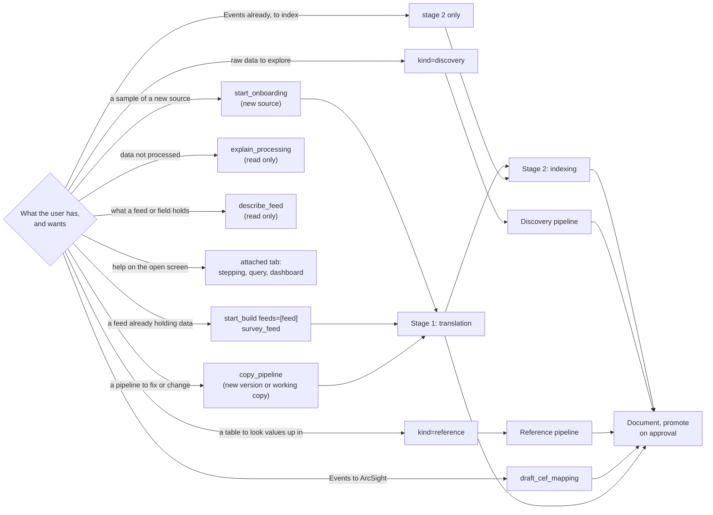
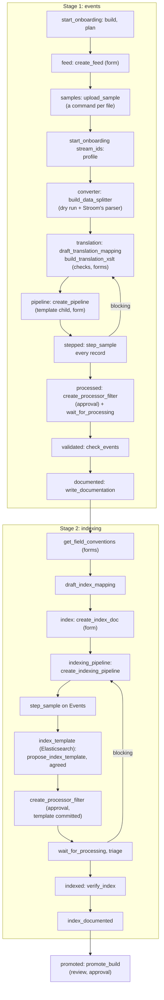
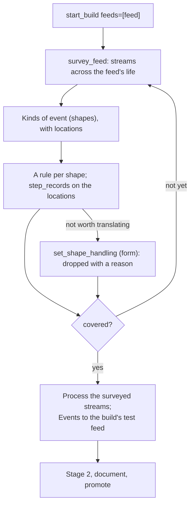
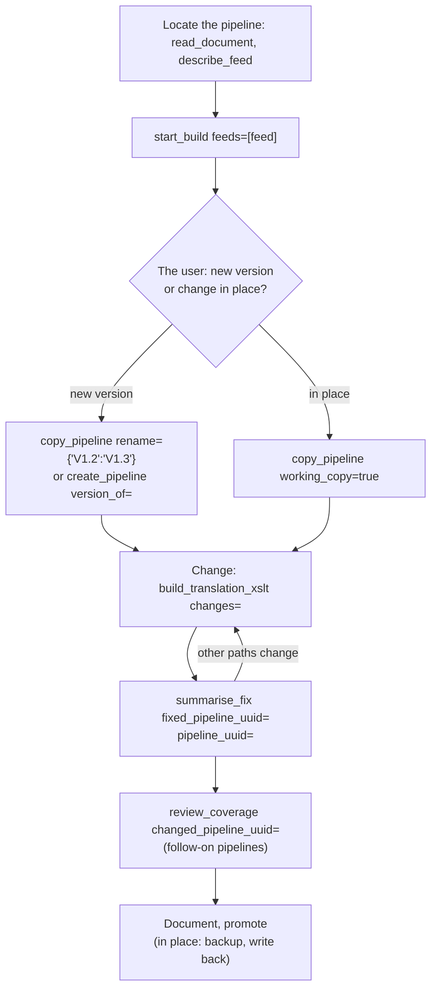
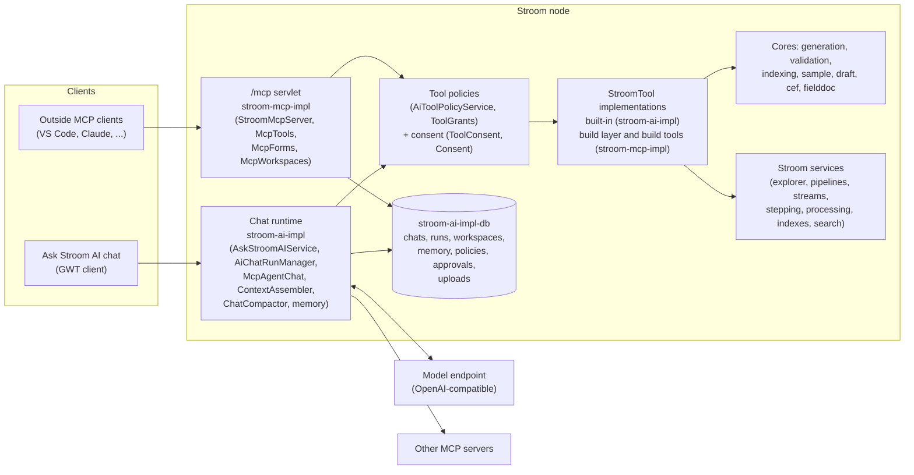
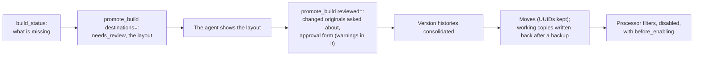
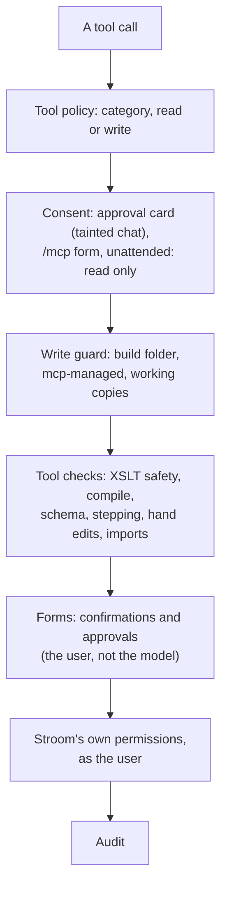

# Stroom AI and its agent tools: design

This is the design record for Stroom AI (the _Ask Stroom AI_ chat) and the agent tools Stroom serves, in the chat
and to outside MCP clients at `/mcp`.
It is written for the people who maintain and extend Stroom AI, Claude included: how it is built, why it behaves as
it does, the decisions that shaped it, the invariants to keep, and where in the code each behaviour lives.
It is self-contained: nothing here is explained by reference to the separate MCP server the onboarding tools were
first written as, which can be retired.
It replaces the port-era design note ("Folding the Stroom MCP server into Stroom", October 2026).

Other documents, and what they hold:

| Document | Audience | Holds |
| --- | --- | --- |
| This document | Maintainers | Design, behaviour, invariants, decisions, status. |
| [README.md](README.md) | Maintainers | The entry point: modules and where things live, building, testing, configuration properties, roadmap. |
| [TOOLS.md](TOOLS.md) | Maintainers | The tool inventory: every tool, its arguments, how overlapping tools differ. |
| stroom-docs, `content/en/docs/user-guide/ai/` (branch `gh-146-ai-user-guide`) | Users and administrators | How to use the chat, the agent tools and `/mcp`. Pages are cited below by their path under that folder. |

This document states user-facing behaviour only where the design depends on it, and points to the stroom-docs page
for the user's view.
It doesn't repeat per-tool arguments; see TOOLS.md.

Keep it current: record each feature's decisions and status here as it is built.
Status words used throughout: **built** (in this branch), **in progress** (being built, uncommitted),
**planned** (agreed, not started), **parked** (deferred by the product owner, notes kept), **open** (awaiting a
decision or a re-test).
Class names are given without packages; the packages are in [Architecture](#architecture).


## Contents

* [Summary](#summary)
* [Workflows](#workflows)
* [End-to-end walkthrough](#end-to-end-walkthrough)
* [Further use cases](#further-use-cases)
* [Architecture](#architecture)
* [Security and consent](#security-and-consent)
* [Sessions, workspace, memory and context](#sessions-workspace-memory-and-context)
* [Builds and onboarding](#builds-and-onboarding)
* [Translation](#translation)
* [Indexing](#indexing)
* [Standing instructions (AGENTS docs)](#standing-instructions-agents-docs)
* [Processing, stepping and documentation](#processing-stepping-and-documentation)
* [Dashboards, charts and analytics](#dashboards-charts-and-analytics)
* [Validation and safety](#validation-and-safety)
* [Clients](#clients)
* [Extending Stroom AI](#extending-stroom-ai)
* [Testing](#testing)
* [Risks, open questions and delivery](#risks-open-questions-and-delivery)
* [Decision log](#decision-log)
* [Parked and open items](#parked-and-open-items)


## Summary

Stroom AI is a chat inside Stroom.
A model answers the user's questions by calling tools that run inside Stroom, as the user, under the user's
permissions.
The same tools are served at `<stroom>/mcp` to any MCP client (VS Code, Claude and others), so an outside model can
use them too.

There are about 100 tools.
They cover reading Stroom's documents, data and processing; searching; dashboards and charts; and building content
end to end: sampling, the text converter, the translation XSLT, pipelines, stepping, processing, indexing into
Elasticsearch or Lucene, CEF output, reference data, documentation, version history and promotion.
The building tools were first written as a separate MCP server.
They were ported into Stroom in October 2026 and have grown since; nothing in Stroom depends on that server.

Goals:

* Answer questions about Stroom's content, data and processing, from what the user can see, with links.
* Take a sample, or a feed that already holds data, to working content: a feed, a translation pipeline writing
  event-logging XML, and an indexing pipeline, built in a workspace and promoted only on the user's approval.
* Maintain content: new versions and working copies of production pipelines, fixes to reported issues, coverage of
  kinds of event a sample missed, and the pipelines that read changed Events.
* Help on Stroom's own screens: stepping, queries and dashboards, with changes applied unsaved for the user to keep.
* Explain processing and retention: why data isn't processed, what keeps or deletes it.

Non-goals:

* Managing users, permissions, nodes or volumes.
* Writing to Elasticsearch: index templates are drafted and checked, and the cluster administrator commits them.
* Deleting production content, or editing it in place. Production documents change through a working copy that
  promotion writes back after a backup, asking the user first if production changed since the copy was taken.
* Reading node logs (2026-10-20). A failed task's reason stays in the operator's log system.
* Model-written JavaScript in visualisations (2026-10-24).

Principles (invariants to keep):

* **The user's own permissions.** Every tool runs as the user and checks the user's application and document
  permissions, and logs what it reads (`AiAuditLog`, with a View or Process event on the object). A tool policy can
  only narrow what a user may do, never widen it.
* **The user decides, in a form the model can't answer.** Confirmations and approvals are forms the user answers
  directly (`Consent`). The model is never given an id to approve a call with: a model holding one could approve its
  own call.
* **Nothing reaches production without the user.** Build tools write only inside a build's folder (`WriteGuard`).
  Promotion moves the build's documents into place after the user approves the layout. Code proposed on Stroom's
  own screens is applied unsaved.
* **The tools hold the rules; the model writes models, not code.** The model writes a mapping or a field plan; the
  generators write the XSLT; the checks are deterministic. A weak model can still build correct content.
* **The plan lives in the tools.** Every write tool's result carries `next`, the plan's next step, so a model that
  treats each request as one call is told it isn't finished.
* **Generic logic.** No special handling for one source system's format, even where a sample would benefit
  (2026-10-29). When a sample drafts poorly, improve what the agent can see, not its vocabulary.
* **Nothing hidden from the user.** A tool that can't do what was asked says so in its reply, with the reason and
  the way forward. The agent acts on the reply's wording, so wording is behaviour and is tested.
* **One bad item doesn't fail a whole answer.** A tool that reads many items reads each separately and names the
  one Stroom can't give, with Stroom's reason.


## Workflows

What the user has, and wants, decides the path before any tool is called.
There are no workflow prompts: the server instructions (`server-instructions.md`, "Which work") map a request to a
path, and the build plan (`BuildPlan`) leads each kind of build from its start (2026-10-27).
Workflow prompts were dropped because a user had to know which one to pick: seen in testing, a discovery index was
never offered, and a table to look values up in was onboarded as events.
When a request fits more than one path, the agent asks which.



| Path | Starts from | Entry | Plan kind |
| --- | --- | --- | --- |
| Onboard a new source | Sample files or a pasted sample | `start_onboarding` | events, then index |
| Onboard an existing feed | A feed with Raw Events | `start_build feeds=[it]`, `survey_feed` | events with `covered`, then index |
| Index existing Events | An Events feed | `start_build`, stage 2 tools | index |
| Discovery index | Raw JSON, delimited text or XML | `start_build kind=discovery` | discovery |
| Reference data | A lookup table | `start_build` or `start_onboarding kind=reference` | reference |
| CEF output | Events | `draft_cef_mapping` | CEF |
| Next version or fix | A production pipeline | `start_build feeds=[...]`, `copy_pipeline` | events or index, on a copy |
| Coverage of a whole feed | A processed feed | `review_coverage` | on a working copy |
| Explain processing | A pipeline, feed, stream or the cluster | `explain_processing` | none (read only) |
| Questions about data | A feed, field or index | `describe_feed`, `describe_data_source`, `run_stroomql` | none |
| Help on a screen | An attached tab | the tab's guidance and `propose_*` tools | none |

The user's view of these paths: `pipeline-admin/onboarding.md` and `pipeline-admin/editing-pipelines.md`.

### Who uses it

| User | Typical work | Where |
| --- | --- | --- |
| Analyst | Questions about data; queries; dashboards; charts; analysing tables | Chat, attached Query or Dashboard tab |
| Pipeline administrator | Onboarding; fixing translations; reprocessing; documentation | Chat or an MCP client (VS Code) |
| Content developer | Stepping a translation; proposed XSLT changes | Chat on the Stepping screen |
| Operator | Why isn't this processed; what is running; volumes; retention | Chat (`explain_processing`, `processor_tasks`, `server_tasks`, `volumes`, `explain_retention`) |

### Chat-only workflows

These run on what the user has open, and apply changes unsaved (see
[Code the agent proposes](#code-the-agent-proposes-built)):

* **Stepping.** The Stepping screen's context (the selected element's input and output as shown, its unsaved code,
  the step errors, and where it is) goes to the agent with the attached tab. `propose_code_change` steps the record
  with the current code and then the proposed code in one stepping session (`CodeChangeStepper`), and refuses a
  proposal that adds errors the current code doesn't have, unless the user accepts them (2026-10-19).
* **Queries.** `propose_query` opens Stroom's New Query dialog with a suggested name; `propose_query_change` gives
  _Apply to query_. `run_stroomql` runs a query as the user and writes the results to a workspace table.
* **Dashboards and charts.** `propose_dashboard`, `propose_dashboard_change`, `propose_visualisation`,
  `propose_extraction_pipeline` (see [Dashboards, charts and analytics](#dashboards-charts-and-analytics)).
* **Tables.** `current_results` snapshots the attached tab's results; `table`, `jq` and `summarise_column` work them
  out in the workspace; a table too large for the context is summarised in batches (`TableSummariserImpl`).
* **Documentation.** `propose_documentation_change` gives a diff card and _Review and apply_, applied as an unsaved
  edit in the document's Documentation tab.


## End-to-end walkthrough

A new source, from sample to promotion, tool by tool, with what each step checks.
The plan's steps (`BuildPlan`'s stage lists `STAGE_1`, `REFERENCE`, `STAGE_2`, `STAGE_3` and `FINISH`) are the headings; a write tool's `next` names the first one not done.

Stage 1 makes the Events stage 2 needs.
Stepping every sample record to completion is stage 1's correctness check.
Stage 2 acts on cooked Events and writes to an index, so its Error streams are triaged and can send the agent back
to fix and reprocess.



1. **Start.** `start_onboarding` creates the build (a folder under the workspace folder) and returns the plan with
   its first step. Given `files=` (paths on the user's disk), it names the next calls: `create_feed`, then
   `upload_sample` with the same paths, then `start_onboarding` again with the stream ids, which profiles them.
   Pasted samples (`samples=`) are profiled at once. The tool also returns the standing instructions that apply.
2. **feed.** `create_feed` proposes the name and encoding in a confirmation form, the name editable. A name that
   differs only in case from an existing feed is refused (`BuildFeeds.refuseCaseTwin`, seen in testing).
3. **samples.** `upload_sample files=` returns one `curl` command per file, for the user to run in their terminal.
   The file goes to `POST /mcp/upload/<id>?file=<name>` (`McpUploadServlet`), signed in as the user, and from there
   to the feed; it never passes through the model. Pending commands are held in the database
   (`ai_sample_upload`), so any node takes the file. Text samples are refused once a feed has been given commands
   (seen in testing: a terminal command failed, and the agent uploaded two records of each file as text). Each file
   becomes its own stream.
4. **Profile.** `start_onboarding` with the stream ids profiles them together (`SampleProfiler`): the format (XML,
   XML fragments, JSON array, object or lines, delimited with or without a header, CEF, RFC 5424 or RFC 3164
   syslog, key=value, CRI, multi-line text), timestamp patterns (`TimePatterns`), and what differs between files.
   The encoding is the feed's, not detected. It names the environment's own templates whose parser reads the format.
5. **converter.** For text formats, `build_data_splitter` writes the Data Splitter from a spec (delimited, regex,
   key=value, syslog with a parsed body), runs it on the sample (a dry run that follows Stroom's own splitting), and
   runs it through Stroom's own parser (`stroom_check`, `StroomSplitterRun`). A converter Stroom loses records with
   isn't saved. It sets `bufferSize` from the longest record, as the reader holds a record only up to half its
   buffer. JSON takes the JSONParser and no converter; XML fragments take the environment's own wrapper converter
   (`FragmentWrappers`).
6. **translation.** `draft_translation_mapping` first settles the event-logging version: the user chooses from the
   versions this Stroom holds, the newest recommended, in a form. It drafts a mapping from the sample (and any
   source notes): a rule per kind of event, its action element, its fields. It pre-fills `shared` entries where the
   stage's existing pipelines call a shared template (`SiblingSharedCalls`). The agent edits the mapping, and
   `build_translation_xslt` checks it against the sample and the schema before generating: fields no record has,
   time formats the values don't fit, required elements the sample leaves empty, XPath Stroom's Saxon can't run.
   It asks the user in forms about values that stand for none (`-`, `N/A`), domain-qualified user ids, and each rule
   whose events are kept as Unknown. It then generates the XSLT (`XsltGenerator`), compiles it as Stroom compiles it,
   and saves it with its mapping. The XSLT is never written by hand.
7. **pipeline.** `create_pipeline` makes the events pipeline as a child of a template (`find_pipeline_templates`,
   `describe_template`), supplying only the converter and the XSLT. It refuses an XSLT or converter from outside the
   build, and a template whose parser can't read the sample (`replace_parser` swaps the parser; overrides
   `reuse_existing_docs` and `accept_parser_mismatch`). The user confirms the template and names in a form.
8. **stepped.** `step_sample` steps every sample record through the whole inherited chain, and returns a verdict per
   record (clean, review or blocking) from the error triage. Draft code is tried with `draft_code` without saving.
   A clean step of the full count records a digest of the pipeline's code in the build record. The agent fixes
   errors its own content causes first; only what it can't resolve (an inherited element, reference data, the
   source data) goes to the user.
9. **processed.** `create_processor_filter` with the sample stream ids asks the user's approval in a form, then
   creates the filter enabled, one task at a time. It refuses a pipeline with no clean step of its current code.
   `wait_for_processing` waits until no output is locked and no task is still open, triages the Error streams
   written beside the output, and fails the gate on blocking errors.
10. **validated.** `check_events` validates the Events against the schema this Stroom holds and the quality rules
    (a full UTC TimeCreated; System Name, Environment, Generator, Device and TypeId present; one action; no empty
    elements), and records the Events as validated.
11. **documented.** `write_documentation` writes a Documentation doc named after the pipeline, with a Field mapping
    section generated by stepping the sample (each Event marked by its rule), and asks the agent for each field's
    description (`needs_descriptions`).
12. **Stage 2 starts.** `get_field_conventions` returns `not_yet` until the build has Events (seen in testing: the
    backend was asked before the translation was written). Then it asks, in forms, the backend (Elasticsearch, or
    Lucene inside Stroom), then the naming: an example index template, an existing index to follow, or a bundled
    convention (ECS, Stroom flat). It never picks one itself.
13. **index.** `draft_index_mapping` drafts the field plan from the Events, named as the example names fields.
    `create_index_doc` confirms the backend, cluster (the one existing Elastic Index docs use, by default), index
    name, index doc name and time field (or the volume group, for Lucene) in one form. It never creates an Elastic
    Cluster doc, which holds credentials.
14. **indexing_pipeline.** `create_indexing_pipeline` makes the pipeline from an indexing template, with the XSLT
    generated from the plan (`IndexingXslt`). It refuses until the build has an events pipeline or is given existing
    Events streams.
15. **index_template (Elasticsearch).** `propose_index_template` steps the indexing pipeline to see the documents it
    writes, and builds the template from the user's example and its component templates. It returns `needs_review`
    with the template as a Dev Tools request, which the agent shows in the chat; called again with
    `reviewed=<review_id>`, it asks the user to agree in a short form. The agreement is kept in the indexing
    pipeline's description, with the index, cluster and a digest of the indexing XSLT. A user's own correction goes
    through `check_index_template`. The cluster administrator commits the template; the user's `user_actions` carry
    the request for them to copy.
16. **Indexing the sample.** `create_processor_filter` refuses an Elasticsearch pipeline without an agreed template
    for its current index and code. The approval form asks the user to confirm the template is committed. In the
    workspace the pipeline indexes in batches of 10, so a document Elasticsearch rejects comes back whole in the Error
    stream (`IndexingRuns.DEV_BATCH_SIZE`). An index the pipeline wrote to before is dropped first (`drop_first`).
17. **indexed.** `wait_for_processing`, then `verify_index`: a `<index>-VERIFY` dashboard, columns the user
    confirms, and test searches through Stroom (counts per stream, an exact match per key field, a time range), each
    check's first hit traced back to its record by stepping. A pass is recorded by the code's digest.
18. **index_documented.** `write_documentation` on the indexing pipeline.
19. **promoted.** `build_status` shows what the build still lacks. `promote_build` returns the layout for review
    (`needs_review`), then asks for approval in a form bound to that layout (first asking about any working copy
    whose production original changed since it was copied); it moves the documents, writes working copies back
    after a backup, and creates each promoted pipeline's processor filter disabled, for the user to review and
    enable.

The Elasticsearch hand-over:

```mermaid
sequenceDiagram
    actor User
    participant Agent
    participant Tools as Stroom's tools
    participant Stroom
    actor Admin as Cluster admin
    participant ES as Elasticsearch
    Agent->>User: An example index template (and its component templates)?
    User-->>Agent: pasted, or like_index names an Elastic Index doc
    Agent->>Tools: draft_index_mapping, create_index_doc, create_indexing_pipeline
    Tools-->>User: form: backend, cluster, index name
    Agent->>Tools: step_sample (Events through the indexing pipeline)
    Agent->>Tools: propose_index_template
    Tools->>Stroom: step the pipeline: the documents it writes
    Tools-->>Agent: needs_review, the Dev Tools request
    Agent->>User: the template, shown in the chat
    Agent->>Tools: propose_index_template reviewed=<review_id>
    Tools-->>User: form: use this template? (short summary)
    Tools->>Stroom: agreement kept in the pipeline's description
    Tools-->>User: button: the request, to copy for the admin
    User->>Admin: commit it
    Admin->>ES: PUT _index_template
    Agent->>Tools: create_processor_filter
    Tools-->>User: form: process the sample? (template committed)
    Tools->>Stroom: filter, enabled; batch size 10
    Stroom->>ES: documents, through the indexing filter
    Agent->>Tools: wait_for_processing, verify_index
```

For Lucene, the template steps are skipped: fields are added to the Lucene index doc from the plan
(`FieldPlans.lucene`), and a build's own Lucene index has its shards deleted (on the user's approval) before it is
indexed again.


## Further use cases

All of these work in a build; production changes only at promotion, after the user approves.
The two that change existing content compare new output with current output record by record, so the only
differences are the intended ones.

### Onboard a feed that already holds data

The user names an existing Raw Events feed instead of giving a sample.
Not every kind of event shows up in every stream, so the agent surveys stream after stream until more streams add
nothing new.
No feed is created and nothing is uploaded: records are stepped and processed where they are.



* `survey_feed` picks streams spread over the feed's life (the last, the first, the middle, then the quarters, so
  any prefix spans the whole range) and reads each part's head (250,000 characters, 1,000 records), plus up to 8
  windows of 250,000 characters further in for one-record-a-line formats. The feed's last streams and sample
  streams are read whole up to 2,000,000 characters (seen in production: a sample read only to its 108th record of
  1,000 hid most of its kinds of event). Records are grouped into shapes: field sets plus the values of fields that
  name the event; masked text for syslog; message fields unwrapped (`Shapes`).
* Each call reads 10 streams by default, up to 100. Fewer than 10 is confirmed in a form, and only when the feed
  holds more (seen in testing: an agent surveyed a live feed 3 streams at a time).
* The survey is kept as a Documentation doc, `<feed> - Survey`, with a `survey-state` block; a later survey carries
  on from it, skipping the streams read (`SurveyDoc`). Its example records are the feed's own data: who can read them
  is down to the folder's permissions.
* The plan steps the survey's locations with `step_records` when there are 60 or fewer, else `step_sample` over the
  surveyed streams. Its `covered` step keeps asking for `survey_feed` until a full batch after the first adds nothing
  new.
* Processing the surveyed streams writes their Events to a test feed in the build (`<FEED>-MCP-TEST`, set on the
  pipeline's StreamAppender by `OutputFeeds`), never into the production feed. Promotion takes the property off.

### Next version, working copy, or a fix

Triggered by new samples the current XSLT doesn't handle, a reported issue, or a requested change.



* The plan offers both: `copy_pipeline source_uuid=<it> rename={'V1.2': 'V1.3'}` (with `working_copy=true` for a
  change in place), or a translation written anew with `create_pipeline version_of=` (a child of the previous
  version's template, with its converter, settings and, if the user keeps them with `keep_references=`, its
  reference data). The agent asks the user which. The names are the agent's proposal, confirmed in the tool's form;
  nothing works out the next version number.
* The translation a new version follows (`StroomBuildFacts.translating`) is the pipeline at the translation stage
  that reads the feed's raw data. Every pipeline reading the raw data is offered only when none of them can be told
  to translate. Another pipeline reading the same raw data, such as an archiver, has no translation to follow (seen
  in testing: TWITTER's raw data was read by an archiving pipeline, Twitter-RollingFileAppender, and by
  Twitter-Events; the archiver came first, so the plan offered it as the one a new version follows, and the drafts
  read its XSLTs, of which it has none).
* Templates are inherited, never copied: `copy_pipeline` refuses a template.
* `summarise_fix` steps the given streams (the reported one plus recent production streams) and exact events with
  the saved code and the draft (or the copy against the original), and diffs each record. It is `ready` when the
  output changes, only the expected paths change, and there are no new blocking errors. It warns when the changed
  code is set by a template pipeline, as the change would reach every pipeline built from it.
* A change to the Events reaches the pipelines that read them: `review_coverage changed_pipeline_uuid=` steps the
  copy over the raw streams and checks each follow-on indexing and CEF pipeline against the Events it gives.
  `build_translation_xslt` returns `follow_on` pointing there after an events pipeline change (asked for by the
  user).
* Promotion: a new version is moved into place beside its predecessor (in a version subfolder named from the version
  in its name, `PromotionLayout.versionFolders`); its filter is created disabled, with buttons to disable the
  predecessor's enabled filters. A working copy is written back over the original after a backup to
  `<workspace>/backups/` (`<name> backup <yyyyMMddHHmmss>`); if the original changed since the copy was taken, the
  user chooses first (see [Promotion](#promotion-built)). Reprocessing production data is the user's.

### Fix a reported issue

A user reports an event that came out wrong, with the Stream ID and Event ID a dashboard shows, or a description.

* `locate_event` takes an Events, Error or Raw Events stream id and an Event ID, and returns the raw part and
  record, the record's input, the stored event, the event stepping gives now, and the XSLTs and converters the
  pipeline runs, marking those inherited from a template. Events are counted across the raw stream's parts, since a
  record can produce none or several.
* `search_events` (which took in the original `find_events`) finds the other events of its kind.
* The fix is drafted in the pipeline's own XSLT or converter, proven with `summarise_fix`, and applied through a copy
  as above, or given as manual steps.

### Coverage of a whole feed

A sample can miss rare kinds of event.
Once a feed is processed, `review_coverage` reads the Error streams where the generated XSLT logged unmatched records
and events kept as Unknown, and says exactly which raw streams hold them (`continue_from`, `max_streams` default 500,
at most 5,000).
Only those streams need processing again.
This depends on every record's number being logged (see [Generation](#generation-built): record numbers).

### Discovery index

A discovery index indexes a source's raw records as they are, to explore them before or instead of translating.

* The source is an existing feed (`start_build feeds=[it] kind=discovery`) or a sample. Nothing is surveyed, as
  Elasticsearch maps the fields itself.
* The agent asks in one message: cluster, index name (e.g. `stroom-discovery-<source>-v1`), discovery template, time
  field and its format, stream meta to add, fields to leave out, and an example index template.
* `draft_index_mapping discovery=` builds a discovery plan; the XSLT (`DiscoveryXslt`, resources
  `discovery-*.xslt`) copies each record into the JSON form the indexing filter reads, adding StreamId
  (`stroom:stream-id()`), EventId (`stroom:record-no()`), `@timestamp` and stream meta. A string holding JSON is
  also parsed into a sibling `<field>_json` (`unpack_json`, on by default). Keys Elasticsearch or Stroom would lose
  (metadata fields, any key starting `_`, repeats of StreamId, EventId or `@timestamp`) become `<key>_original`;
  empty and malformed keys are repaired.
* The template is permissive: strings as `keyword` with `ignore_above` (1,024 by default), no date detection, a
  total-fields limit (2,000), `ignore_malformed`, numeric detection for text sources. It is a data stream only when
  every record has its time.
* The fallback pipeline (`create_indexing_pipeline standalone='discovery'`: parser, record count, one record a split,
  XSLTFilter, JSON SchemaFilter, ElasticIndexingFilter) is a last resort, refused while any discovery template
  exists, and confirmed in a form (2026-10-27).

### Reference data

* A reference build (`kind=reference`, or detected from a Raw Reference feed or a reference-stage pipeline) has its
  own steps: no translation, events or indexing (2026-10-27).
* `build_reference_xslt` generates the reference XSLT from maps (each a name, a key and values); `upload_sample`
  takes `stream_type` Raw Reference with an effective time (by default 2000-01-01).
* Lookups in a translation mapping (`lookup`: map, field, xpath) read a map by key; `find_reference_data` shows what
  exists; small static tables go in Dictionary docs (`save_dictionary`, `dictionary`, `in_dictionary`).
* **Lookups wait for their data.** Stroom remembers a lookup that found nothing for ten minutes (its effective
  stream cache). So stepping is refused while a looked-up map's feed has no Reference stream
  (`PipelineStepping.refuseUnloadedReferences`), and the plan holds the events build's `stepped` step until it has
  one.
* A reference pipeline's processor filter is created disabled, for the user to enable.

### CEF output

* `draft_cef_mapping` drafts a CEF mapping from Events. It first asks whether keys outside ArcSight's CEF dictionary
  may be used (a form, or `needs_guidance`); the answer is taken from the argument, then standing instructions, then
  the plan kept with the XSLT, then an earlier answer in the build, then asked (`CefChoices`).
* The header is taken from the Event: vendor from `EventSource/System/Organisation`, product from `System/Name`,
  version from `System/Version` (however few sample events hold it, asked for by the user), signature from
  `EventDetail/TypeId`, name from `EventDetail/Description`, falling back to the action. A header field the sample
  lacks becomes a `TODO` constant to ask the user about. Custom slots are labelled.
* Fields not sent are grouped by reason and event type (seen in testing: 125 entries over 100 KB).
* The XSLT is compiled before it is saved, with the plan kept with it.
* With no forwarding template, `create_pipeline standalone='kafka'` makes a pipeline of its own (XMLParser, one
  Event a split, XSLTFilter, SchemaFilter `kafka-records:1`, StandardKafkaProducer with a KafkaConfig).
* An existing CEF pipeline, even one written by hand, is reviewed from its lines (`CefLines.review`): what each
  Event sends and leaves out, against the dictionary.
* CEF steps: `cef_mapping`, `cef_pipeline`, `cef_stepped`, `cef_documented`. The filter is created disabled.

### Document an existing index

* `read_document` on an Elastic or Lucene Index doc surveys it through Stroom: its fields, up to 100 documents read
  through dashboard searches on a dashboard that is never saved, and the pipelines that feed it (found by content,
  confirmed from their effective properties). See [Indexing](#indexing) for the limits.
* `write_documentation index_uuid=` confirms the index doc in a form, then writes a Documentation doc named after it,
  with a generated "Data surveyed" summary and Field mapping. An index the build made itself is documented by its
  indexing pipeline's doc, unless `index_itself=true`.

### Evaluate a pipeline

`evaluate_pipeline` (read only) gives the facts for an evaluation of any existing pipeline, the same ground every
time for its stage, so evaluations are consistent and users find the feature: added 2026-10-31, as the agent had
improvised from `read_document`, `summarise_streams`, `step_sample` and `check_events`, covering different ground each
time.
It reads the pipeline's stage as `PipelineShapes` does (the stage `write_documentation` uses) and gives, in order:

* `pipeline` (its stage, templates, parser and code), `processing` (its newest Error streams' errors triaged as
  blocking, review or benign, with the errors the user accepted as benign reported as benign), `stepping`
  (`step_sample`'s verdict on its input streams: by default the inputs of its newest output, else its processor
  filters' feeds' newest streams);
* its stage's checks: an events pipeline's `events` (its newest Events' schema validity, quality and field
  population) and `coverage` (records its Error streams log as matching no rule, pointing to `review_coverage`); an
  indexing or discovery pipeline's `index` (fields its stepped documents write against its index's: missing, unused,
  and values their field's type or keyword analyzer doesn't suit; for Elasticsearch, where it writes and whether an
  index template is agreed, pointing to `check_index_template`); a CEF pipeline's `cef` (its lines reviewed against
  ArcSight's dictionary, header fields still TODO, Event values not sent, the mapping its lines imply; Kafka delivery
  noted as untested); a reference data pipeline's `reference` (its maps, what stepping wrote in each, its feeds and
  the pipelines that look them up); any other stage's `checks`, saying none apply;
* `report`: the outline for its stage, and `next`.

It reuses the tools each part is made of, and runs none of `review_coverage`, `check_index_template` or
`verify_index`, only pointing to them. A missing permission never refuses the call: View Data, Stepping and Manage
Processors each unlock the sections that need them, and a section without them says so.
The agent writes the report from the outline and shows it; a report the user wants kept is saved with
`write_documentation evaluation=true` as `<pipeline> - Evaluation`; nothing in it is generated, and promotion puts it
beside the pipeline.

### Questions about the data

`describe_feed` (read only) answers what a feed holds, what a field means and how to search it, from the generated
documentation and the indexes' fields.
Field names are matched loosely (`UserId`, `userid` and `User.Id` alike); the answer gives each field's
event-logging path and how to search it per backend.
`describe_data_source` gives a data source's documentation (its Documentation tab, the same-named doc beside it, and
its pipelines' docs), to help choose data sources and StroomQL fields.

### Explain processing, retention and volumes

See [explain_processing](#explain_processing-built-2026-10-28).
`explain_retention` gives the retention rules in the order they apply, the rule that keeps a feed's or stream's data
and until when, and what the rules would delete now.
`volumes` gives each data and index volume group, whether it can be written to, and (with _Manage Volumes_) each
volume's state and space.
They were added after the agent, asked what happens when volumes fill, said Stroom deletes the oldest streams:
nothing it could read said otherwise (2026-10-30).
Stroom never deletes data for space; only retention rules or a user do.


## Architecture



| Module | What it holds |
| --- | --- |
| `stroom-ai-api` | Interfaces other modules call (e.g. `CodeChangeStepper`, `ElasticIndexTemplates`). |
| `stroom-ai-impl` | The chat runtime (`stroom.ai.impl`), the built-in tools and their contract (`stroom.ai.impl.tools`), the cores (`tools.generation`, `tools.validation`, `tools.indexing`, `tools.sample`, `tools.draft`, `tools.cef`, `tools.fielddoc`), the workspace (`workspace`), memory (`memory`), extraction pipelines (`extraction`), charts (`vis`), and the MCP client for other servers. |
| `stroom-ai-impl-db` | Persistence (jOOQ, Flyway, `V07_14_00_*`): chats and messages, runs, workspaces, memory, tool policies, approvals, pending sample uploads. |
| `stroom-ai-mock` | A stand-in model and fixtures for tests. |
| `stroom-mcp-impl` | The `/mcp` endpoint (`stroom.mcp.impl`), the upload servlet, the build layer and the building tools (`stroom.mcp.impl.tools`), and the bundled knowledge (resources `stroom/mcp/impl/knowledge`: `server-instructions.md`, `guides/*.md`, `conventions/*`). |

Libraries: LangChain4j (`langchain4j`, `langchain4j-open-ai`) for model calls, and the MCP Java SDK (`mcp-core`,
`mcp-json-jackson3`) for both the client and `/mcp`.
Versions are in `gradle/libs.versions.toml`.

The chat calls tools in-process.
It doesn't go through `/mcp`, so it avoids the problems seen with a separate server: tokens expiring during long
calls, large arguments passed as workspace references, and results re-read from workspace files.

### The tool contract

Every tool, whether built-in or a build tool, implements `StroomTool` and is bound in a Guice multibinder
(`BuiltInToolsModule` in stroom-ai-impl, `BuildToolsModule` in stroom-mcp-impl); `BuiltInTools` picks it up.
`LangChain4jTools` adapts it for the chat's model; `McpToolSchemas` for `/mcp`.
The contract has nothing of the chat or of LangChain4j in it.

| Method | Default | Drives |
| --- | --- | --- |
| `definition()` | | Name, description and schema. `ToolDefinition.general()` drops chat-only hints and parameters for `/mcp`. |
| `category()` | | Which tool-policy category grants it (`AiToolCategory`). |
| `execute(call, context)` | | The work. Bad input returns an explanatory result rather than throwing, so the model can correct itself. |
| `isReadOnly()`, `isReadOnly(call)`, `hasReadOnlyCalls()` | true | Read-only or write, per tool or per call. Unattended runs, Ask and Plan modes, and read-only policies use it. MCP `readOnlyHint`. |
| `readsUntrustedContent()` | true | Whether a result taints the chat. MCP `openWorldHint`. Override with false only for output that is Stroom's fixed text, the model's own input or the user's answers. |
| `usesRunSlot()` | false | Heavy calls over `/mcp` take one of the user's run slots. |
| `isChatOnly()` | false | Never listed or callable over `/mcp`. |
| `confirmsItself()` | false | The tool asks in its own forms, so it isn't approved again as a whole. |
| `changesNeedApprovalAfterUntrustedContent()` | true | Whether a write asks on an approval card once the chat is tainted. |
| `changesOnlyItsBuild()` | false | Changes stay in the build folder, so no approval is asked; promotion asks. |
| `boundsItsOutput()` | false | Its result is never moved to the workspace in place of being returned. |
| `permissions()` | none | Metadata only; tools make their own checks. `TestToolPermissionMetadata` compares a built-in tool's declared permissions, app and document, with those it checks when called. |

`ToolSummaries` holds each built-in tool's one-line summary for the MCP Tool Policies screen; every built-in tool
needs one (a test checks it).

### The chat run loop

```mermaid
sequenceDiagram
    actor User
    participant Svc as AskStroomAIService
    participant Runs as AiChatRunManager
    participant Chat as McpAgentChat
    participant Model
    participant Tool as StroomTool
    User->>Svc: question (attached tab, mode)
    Svc->>Runs: start (or steer an active run)
    Svc-->>User: returns; the browser polls
    Runs->>Chat: answerQuestion (background, as the user)
    loop up to maxToolIterations (100)
        Chat->>Chat: fitToBudget (summaries, shrink)
        Chat->>Model: ChatRequest (streamed)
        Model-->>Chat: reply, tool calls
        Chat->>Chat: offered? policy? consent?
        alt ASK (approval card) or a form
            Chat-->>Runs: WaitingForUserException
            Runs-->>User: card or form ("Needs you")
            User->>Svc: answer
            Svc->>Runs: carryOn: a new run from the stored steps
        else RUN
            Chat->>Tool: execute
            Tool-->>Chat: result (large: saved, stub given)
        end
    end
    Chat-->>User: answer, links, follow-ups
```

* **Runs** (`AiChatRunManager`, table `ai_chat_run`) run in the background as the user. Statuses: QUEUED, RUNNING,
  WAITING_FOR_USER, STOPPING, STOPPED, INTERRUPTED, FAILED, DONE. A heartbeat every 10 s; a run whose heartbeat is
  older than 60 s is marked INTERRUPTED. Limits: `maxRunsPerUser` 3 (cluster-wide), `maxRunsPerNode` 20,
  `maxRunDuration` 2 h. Runs over a limit queue; runs waiting for the user don't count.
* **A run never outlives the session that started it** (`AiChatRunSessionListener`): sign-out or expiry stops it,
  resumably. A run is **unattended** when no browser has polled the user's chats for `unattendedAfter` (10 min);
  unattended runs make only read-only calls, and nothing that needs the user is asked.
* **The loop** (`McpAgentChat.chatWithTools`): per step, fit the context, call the model (streamed through
  `ModelStreamer` when a streaming model is available), then for each tool call check, in order: offered (a call to
  a tool whose group is off turns the group on, and the model is told to call again), shortened arguments (a call
  sent with an earlier call's shortened arguments is refused), tool policy, consent (`ToolConsent.decide`: RUN, DENY
  or ASK). On the last step no tools are offered and the model sums up; the user is told to reply "continue".
* **Replies that only announce more work** (`UnfinishedReplies`) aren't taken as the answer: they are shown as
  interim words and the model is told to make the call, at most twice in a row (seen in testing: the run ended on
  "I'll now fix the field"). A question following one that ended so, or at the step limit, is given that question's
  steps in full (2026-10-28).
* **Pausing for the user.** An approval card or a form throws `WaitingForUserException`: the thread and run slot are
  given up, and the run waits as WAITING_FOR_USER for as long as the user takes. When answered, `carryOn` starts a
  new run from the stored steps, and the same call is made again with the answer. **So a tool that asks must be safe
  to re-run up to its question** (an invariant of `Consent`). Approval cards expire after 24 h.
* **Steering.** A message sent while a run works is queued until the step ends; _Send now_ cuts short a waiting MCP
  tool and skips the step's other calls. A message sent instead of answering a card denies its calls.
* **Large results** (`ToolOutputs`): a result over 4,000 characters is saved to the workspace
  (`/outputs/turn-<t>/call-<m>.txt`) and the model gets a stub: a preview, the top-level fields, and `next` and `hint`
  repeated (seen in testing: a large draft's `next`, its last field, was cut from the preview, and the agent asked the
  user what to do). Results that need the user (`needs_review`, `needs_confirmation`, `needs_approval`) are shown in
  full up to 64,000 characters.
* **After the answer**: links to the documents and streams it names, checked by UUID (`AnswerLinks`); a turn digest
  for compaction; the chat title (`ChatTitler`, from the user's questions only, so no planted instructions reach
  it); follow-up suggestions (`FollowUpSuggester`, not when the turn asked the user for anything).
* **Modes**: Agent, Ask and Plan. Ask and Plan offer only read-only tools; the model is told the mode in every mode,
  so it notices a switch (seen in testing: after switching from Plan to Agent the model kept refusing).
* **The system prompt** says to describe how Stroom behaves only from tool results, Stroom's documents and the
  conversation, never from how other products work (2026-10-30).

User's view: `how-it-works/runs-and-context.md`, `ask-stroom-ai/chat-interface.md`.

### Tool registry, groups and server instructions

* **Groups** (`BuiltInToolGroups`, `ToolGroups`): build, processing, indexing, dashboards and administration tools
  are offered behind `activate_<group>` tools, each saying what the group is for. Core, search and file tools are
  always offered. All definitions together came to about 51k tokens; a question now starts at about 14k
  (2026-10-29). A group stays on while either of the latest two questions uses it, and calling a tool from a group
  that is off turns it on. Activations are rebuilt from the chat's stored calls at each run start, so they survive
  node changes. A Dashboard tab's guidance turns the dashboards group on from the start.
* **MCP servers' tools** are grouped separately when a server offers more than `toolGroupThreshold` (24) tools; a
  server's group named as a built-in group is offered as `mcp_<group>`.
* **Server instructions.** In the chat, `server-instructions.md` is added to the system prompt once `start_onboarding`
  is offered, that is once the build group is on (`BuildInstructions`). Trusted MCP servers' own instructions are
  added for servers whose tools are offered. Over `/mcp` the instructions are sent on every `initialize`
  (`StroomMcpServer.INSTRUCTIONS`, a preamble plus `BundledKnowledge.serverInstructions()`).
* **Lenient arguments** (`ToolCallGuard`, `MojibakeRepair`): unknown arguments are dropped and reported, choices given
  with stray punctuation or case are read as meant, and text mangled by a Windows code page is repaired; the notes go
  in `argument_notes`. After three identical failures a call is answered from the last failure without running
  again, and from the fifth failure in a row the reply says to step back. JSON given to a text argument is passed on
  as JSON (2026-10-31).
* **Workspace arguments** (`WorkspaceArguments`): `{"$workspace": path, "jq": ...}` or `"$workspace:path"` in an
  argument is replaced by the file's content, and taints the run (seen in testing: a 186 KB mapping saved to the
  workspace was refused as an argument, and the build stopped).

### The /mcp endpoint (built)

* A servlet at `<stroom>/mcp` (`McpServlet`), bound like Stroom's other servlets, so it gets the same port, sign-in
  (`SecurityFilter`), request log and HTTP settings. It is Streamable HTTP only: POST for calls, GET for the server's
  stream, DELETE to end a session. It isn't on the admin port. It needs _Use MCP Tools_ and
  `stroom.ai.mcpEndpoint.enabled`.
* The SDK's own server would offer every session the same tools, so Stroom's request handlers (`StroomMcpServer`)
  filter per user. Handlers: ping, `tools/list`, `tools/call`, `resources/list`, `resources/templates/list`,
  `resources/read`, and the `initialized` and `cancelled` notifications. Capabilities: tools (with
  `listChanged`) and resources. There are no prompts.
* Each tool's `ToolDefinition.general()` becomes an MCP tool. Annotations: `readOnlyHint` from `isReadOnly()`,
  `destructiveHint` for a write tool with no read-only calls, `openWorldHint` from `readsUntrustedContent()` (it
  carries "may return content someone else wrote", not "reaches outside"). No `_meta` group is set: groups are the
  chat's.
* Chat-only tools are never listed and are refused if called: the chat's `propose_*` tools (not
  `propose_index_template`), `preview_extraction`, `instruction_evidence`, `task_list`, `memory`, `read_turn`,
  `search_history`, `current_results`.
* **A call** (`McpTools.call`): offered, allowed by policy, then for a write: refused if the client can't show forms
  (`FormsRequired`); else approved in a yes-or-no form (`McpApprovals`) unless the tool confirms itself or changes
  only its build; then a run slot for heavy tools (`McpCallSlot`), then the call under a deadline
  (`ToolDeadline`: the larger of `toolTimeLimit` and `queryTimeLimit`, paused while the user answers a form). Every
  call is audited, refusals included.
* **Resources** (`McpResources`): `stroom://guides` (an index), `stroom://guide/{name}` (agent-instructions, cef,
  data-splitter, documentation, event-logging, indexing, json-input, reference-data, visualisation, xslt), and
  `stroom://conventions/{name}` (ecs, stroom-flat). The same for every user. In the chat the same guides are read
  with `get_instructions guide=`.
* The endpoint isn't in the Swagger spec, which lists JAX-RS resources only. Clients get the tools from `tools/list`,
  which differs by user.
* Long-lived responses outlast nginx's default `proxy_read_timeout`. The SDK's keep-alive pings (every 20 s) keep
  Jetty open; nginx needs a longer timeout, and no buffering, on `/mcp`.
* Sample files are posted to `POST /mcp/upload/<id>?file=<name>` (`McpUploadServlet`), under the user's own sign-in,
  with no ticket. The command reads the key from `STROOM_API_KEY`. Pending uploads are held in the database, so any
  node can take them; a post claims its file with one conditional update, and a claim left by a post cut off part
  way can be taken over after 10 minutes (2026-10-23).

User's view: `agent-tools/connecting-clients.md`, `agent-tools/deployment.md`.

### The build layer

The building tools share a layer in `stroom.mcp.impl.tools`:

| Class | Role |
| --- | --- |
| `WriteGuard` | Creates land in `System/<workspace>/<build>/` (`stroom.ai.builds.workspaceFolder`, default `MCP Workspace`), in role subfolders (Events, Records, Indexing, CEF, Reference). Updates only on documents tagged `mcp-managed`. Refusals are audited. A duplicate type and name in a build is refused (seen in testing: after a summarised conversation an indexing pipeline was made twice). Folder creation takes one of 64 locks, so parallel calls can't make twin folders. |
| `BuildRecords` | The build record: a Documentation doc, `Build record`, in each build folder, holding a `build-record` JSON block: working copies (`copy_of`, and `copy_of_version`, the original's version when copied), versions (`version_of`), digests that stepped clean, verified or validated, sample files, source feeds, the event-logging version, the build's kind. Saves retry up to 5 times on a concurrent change, so two writers lose nothing. Its format and its code digests stay as they are: records already in Stroom read and are written back unchanged, and a clean step recorded earlier still matches the code it was taken on (see [Where state lives](#where-state-lives)). |
| `BuildPlan` | The plan: steps, each one's state derived from what the build holds, and `next`. |
| `BuildChecks`, `BuildStatusTool` | What the build still lacks before promotion. |
| `Consent` | Confirmations and approvals as forms; `needs_review` rounds with a `review_id` digest. |
| `PromoteBuildTool`, `PromotionLayout`, `PromotionProcessing` | Promotion. |
| `KeptMappings`, `SentMappings`, `XsltHistory`, `DocumentationVersions` | State kept with documents and in the session. |
| `ProcessingApprovals`, `ProcessorFilterWrites`, `IndexingRuns`, `OutputFeeds` | Processing in a build. |

Tags: `mcp-generated` marks everything the tools create, for good (backups too); `mcp-managed` marks what the
tools may still change, and comes off at promotion; `mcp-kept-mapping` marks an XSLT holding its mapping.
Nothing else is a tag: earlier per-build and per-digest tags grew Stroom's tag list with every build, so they are
folded into the record the first time it is read, then removed.
A document's build is the folder it is in, so documents in a build folder must not be moved or renamed; the record
says so, but nothing enforces it.

### Where state lives

| State | Where | Why there |
| --- | --- | --- |
| Chats, runs, messages, approvals | Database (`stroom-ai-impl-db`) | Any node; survives restarts. |
| Workspace files | Database, zstd chunks (`WorkspaceStore`), cached locally | Any node. |
| MCP sessions | Memory, one node | The SDK's sessions are in memory; affinity by client IP. |
| A session's draft mapping | Session workspace, `/outputs/mappings/` (`SentMappings`) | A fix sends only its changes. |
| Choices made in forms | Session workspace, `/outputs/choices/` (`UnsavedChoices`) | A call that fails before saving doesn't ask again. |
| Lookup agreements | Session, by document and function (`LookupAgreements`) | Not asked twice for the same XSLT. |
| The build a session works on | Node memory, per session (`BuildPlan.rememberBuild`): set by `start_onboarding`, `start_build` and any call naming a build | Calls that name no build work on it. |
| Build facts | The build record doc | Every node; survives restarts; travels with the build. |
| A mapping or plan | The XSLT's description, hidden JSON (`KeptMapping`) | Any session can regenerate it. |
| Version history | The XSLT's description, and the Documentation doc's Version control | Travels with the content. |
| An agreed index template | The indexing pipeline's description | Checked against the pipeline's current code. |
| Survey results | `<feed> - Survey` Documentation doc | A later session carries on. |
| Accepted errors | The pipeline's Documentation doc | Triage reads them for that pipeline. |
| Turn summaries | Node memory (`TurnSummaries`, 1,000 chats) | Put back after a form; another node summarises again. |
| Pending uploads | Database (`ai_sample_upload`) | Any node takes the file. |
| Default AI settings (model, prompts, dock) | Global config properties (`AskStroomAiConfig`) | Every node; set from the settings dialog's "Set as defaults". |
| A user's own AI settings | User preferences (`askStroomAiConfig`) | Only what they chose: no model means the default. |

**A user's model follows the default unless they chose one.** The client saves a model only when it isn't the
default (`AskStroomAiClient.setConfig`), and sends a question with the user's own model or none. The server answers
one with none using the model its chat has already used, or, for a new chat, the default it has then
(`AskStroomAIService.getModelDoc(config, chatId)`): a changed default reaches the next new chat and never switches a
chat part-way through. A model the user picks in the chat panel is sent for that chat even when it is the default,
so it replaces the chat's (`pickModelForThisChat`). Opening the panel reads the user's settings and the defaults
again (`refreshSettings`), so changes an administrator made since Stroom was loaded apply without a reload; a new
chat reads them too, for its picker. The model pickers show the default to a user who follows it
(`getDisplayConfig`). This was fixed after testing found that moving the chat dock, or pressing OK in the settings
dialog, saved the default model of the time as the user's own, so a new default never reached them
(`TestAskStroomAiClientDefaults`). When the default model changes, "Set as defaults" offers to clear every user's
own choice of model, keeping their other settings (`clearAllUsersModelChoice`); "Reset all users" still clears
everything.

**Stored formats keep reading.** What is kept in documents (the build record's `build-record` block, a kept mapping
or plan, an XSLT's version history, an agreed index template, the survey and source notes blocks) is read back by
later versions of the tools. So its format changes only in ways that still read, and write back alike, what earlier
versions wrote:

* Each keeps its layout: kept blocks are compact JSON in an HTML comment (`KeptMapping.withBlock`), and the older
  layout between `--- stroom-mcp <name> ---` markers is still read; the build record is JSON with sorted keys, and
  the source notes and the survey state are JSON indented by one space (`ToolJson`).
* Entries added to a model later are written only when set: a field's `data_parent` and `join`, a plan's or
  discovery's `stand_ins`, an index field's `items` and `distinct_by`, a Data Splitter spec's `escape`,
  `spaced_values`, `catch_all` and `blank_line_records`, a version history entry's `hand`. A mapping, plan or spec
  without them is written exactly as it was before they existed, so every kept one and every fixture still reads and
  compares unchanged.
* The build record was once written in its Documentation doc's Documentation tab rather than its body:
  `BuildRecords` reads the body, else the tab, and moves it to the body on the next write.
* Digests recorded with what is saved must come out the same (see [Hand edits](#hand-edits-built)).

### The generation and validation cores

| Package | Holds |
| --- | --- |
| `tools.generation` | The translation mapping model (`TranslationMapping`, `EventRule`, `FieldMapping`), `XsltGenerator`, `XsltReader` (an XSLT read back into a mapping), `MappingChanges` (`changes=`), `HandEdits`, the reference generator, a small XML and XPath parser of its own. |
| `tools.validation` | `XsltSafety`, `XsltCompileCheck` (Stroom's own Saxon, function library and import resolver, locked down), `EventSchema` and `HeldSchemas` (the XML schemas this Stroom holds), `EventChecks` (quality rules), `XPathChecks`, `XsltVersionHistory`. |
| `tools.indexing` | `FieldPlan`, `IndexingXslt`, `ElasticDocument`, `PlanTemplates`, `TemplateCheck`, `EcsSchema`, `Discovery`, `FromExample`. |
| `tools.sample` | `SampleProfiler`, `RecordSplitter`, `Shapes`, `SurveyDoc`, `Placeholders`, `SplitterDryRun`, `StroomSplitterRun`. |
| `tools.draft` | `DraftMapping`, `LocalCheck` (a mapping checked on the sample), `SourceNotes`, `SplitterXml`. |
| `tools.cef`, `tools.fielddoc` | The CEF plan and its XSLT; field documentation. |

Some small helpers follow Python's rules rather than Java's, because the cores' results (held by the recorded cases,
see [Testing](#testing)) and the messages agents act on depend on them:

* `ToolText`: lengths and slices in code points, values in messages in Python's notation (`repr`: `'a'`, `None`,
  `True`), and regexes in which only `\n` ends a line (`$` doesn't match before a `\r`).
* `ToolJson` and `JsonValues`: JSON read and written in Python's layout and messages, the truth of an empty value, and
  numbers compared across types.
* `IpAddresses`: an IPv4 octet with a leading zero refused, an IPv4 tail after `::` taken.
* `CloseMatches`: difflib's ratio, autojunk on, for "did you mean".
* `ToolArgs`: a list argument read whether a model sends it as JSON, as a Python literal (`True`, `None`, single
  quotes) or as plain text, as models send all three.

Two helpers follow Stroom's rules instead, as what they check runs in Stroom:

* `XPathRegex`: an extraction's regex compiled by Saxon's own regex engine, in XPath's dialect, as the generated
  XSLT's `analyze-string()` compiles it, for its group count. (It was read in Python's `re` dialect, which refused
  `\p{L}` and let lookahead through.)
* `DelimitedText`: a profile's delimited records split into cells as the generated Data Splitter splits them: a quote
  opens or closes a quoted stretch wherever it is, a doubled quote stays doubled (for `unescape_quotes`), records end
  at a new line (outside quotes with `quoted_newlines`), no field size limit. Only its sniffer, which guesses the
  delimiter and whether there is a header, is a heuristic of Python's.

The cores are pure Java over text and parsed trees; the tools around them read and write Stroom.
Golden files fix their larger outputs (see [Testing](#testing)).

### Bundled knowledge

`server-instructions.md` is the agent's map: which work fits what the user wants, the order of work, the rules for
every run, and how to ask the user questions.
It is written as labelled paragraphs, not headings, as it goes into a system prompt.
The guides (`guides/*.md`) are short working references for the agent (event-logging, XSLT, Data Splitter, JSON input,
indexing, reference data, CEF, documentation, visualisation, AGENTS docs).
Conventions (`conventions/ecs.yaml`, `stroom-flat.yaml`) are field-naming profiles; `ecs_fields.json` (ECS 9.5.0)
and `ecs_component.json` (what Elasticsearch 9.5.3's `ecs@mappings` maps otherwise than ECS: 48 of 2,521 fields) are
read by the tools.
The agent guides and conventions are resources of `stroom-mcp-impl`, not stroom-docs, which is for people
(2026-10-22).

### Reading Stroom's data

* **Undecodable bytes.** A stream is decoded with its feed's encoding. A byte not in it (a Windows-1252 quote in a
  UTF-8 feed) makes Stroom's data viewer refuse the whole stream, while pipelines read on with the replacement
  character. The tools read the raw bytes from the stream store and decode them as a pipeline does
  (`StreamCharsets`, `StreamReader`), and report `undecodable_bytes`: how many, how they read in Windows-1252, and
  what to do.
* **Lengths and slices are in code points** (`ToolText`), so a character outside the Basic Multilingual Plane counts as
  one wherever the tools cut text.
* **A big XML document read only to its head** is cut to its root and the complete records before the cut
  (`SampleProfiler.cutDocument`; seen in production: a 54 MB `<tweets>` stream, read to its head, was profiled as CSV
  with no records).
* **A raw stream Stroom holds as one record** is split by the tools (`StreamReader.splitRaw`; seen in production:
  reads of records 200, 450, 700 and 950 each returned the first four).
* **Streams older than their feed** (from an earlier, deleted feed of the same name) are refused as samples.
* **A Lucene index's analyzers.** The query service's fields for a Lucene index say a field is TEXT, not which
  analyzer it has, and CONTAINS on a keyword field or a range on a text field finds nothing through Stroom. So
  `run_stroomql` and `search_events` read the index's own field list (`IndexResource.findFields`, as the user,
  `LuceneTextFields`) and refuse those searches (`MisleadingSearches`). Found reviewing the tools (2026-10-31): such
  a search ran and found nothing.
* **One bad item.** A tool that reads many items (pipelines, XSLTs, index and cluster docs, AGENTS docs, streams)
  reads each separately. One Stroom can't give is named with Stroom's reason, or passed over where it can't change
  the answer (seen in production: a feed's description failed outright because one pipeline set a property its
  element no longer has). A promotion that fails part way says which step failed and what was already done.

### Indexing backends

Stage 2 is the same flow on Lucene and Elasticsearch; only these differ:

| Aspect | Lucene (Stroom Index) | Elasticsearch |
| --- | --- | --- |
| Index doc | `Index`, in a volume group | `ElasticIndex`, on an Elastic Cluster doc |
| Field definitions | On the index doc, from the plan (`FieldPlans.lucene`) | An index template, committed by the cluster admin |
| XSLT output | `records:2`: `<data name="..." value="..."/>` | `xpath-functions` JSON XML `map` |
| Keyword field | `TEXT` with the `KEYWORD` analyser | `keyword` |
| IDs and time | `ID` for StreamId and EventId, `DATE` | `long`, `date` |
| Objects | Refused: a field of values per item instead | `object`, flattened by Elasticsearch |
| Reindexing | The build's own index: shards deleted on approval | The admin drops the index first |
| Verification | Dashboard on the index doc | Same |


## Security and consent

### Tool policies and permissions (built)

Tool policies decide which tools each user may use, in both `/mcp` and the chat, so the two never differ.

* **Policies** are managed on the MCP Tool Policies screen. Each has a name, the users and groups it covers, and its
  categories, each granted read-only or read and write (2026-10-23). They are a database table, like API keys, not
  documents, so they never travel with content. Changes are logged. A user's or group's page shows their effective
  access and the policies granting it.
* **Union, deny by default.** A user gets the union of the enabled policies naming them, their groups (transitively)
  or everyone. With none, they get no tools.
* **On upgrade**, a migration creates a read-only policy for everyone, so chat users keep the read tools. Write
  tools need an administrator's policy.
* **Applied twice.** `tools/list` and the chat's offered tools show only what the user's policies allow
  (`ToolGrants.offers`), and every call is checked again (`ToolGrants.allowsCall`), since clients cache the list.
  Policies are re-read every 30 s, at once on the node where they change; a change sends
  `notifications/tools/list_changed` to that node's open sessions.
* **Read or write** comes from the tool (`isReadOnly`, or `isReadOnly(call)` where it depends on the call). A tool
  with some read-only calls (`hasReadOnlyCalls`) is offered under a read-only grant, and refuses its writes. A tool
  from another MCP server counts as read-only only if a trusted server says so. Any tool whose status isn't known
  counts as a write.
* **Permissions.** _Use MCP Tools_ gates `/mcp` (the chat doesn't need it). _Manage MCP Tool Policies_ gates the
  screen. Every call still runs the tool's own checks.

Each tool has one category ([`AiToolCategory`](../stroom-core-shared/src/main/java/stroom/ai/shared/AiToolCategory.java));
read or write is decided per tool, so every category holds both.

| Category | Holds | Placement notes |
| --- | --- | --- |
| core | Documents, folders, their instructions, the date and time, and working tools: questions, tasks, memory, workspace files, `jq`, `xpath`, `table`. | |
| search | StroomQL queries, events and data sources. | |
| content | Creating and changing documents: translations, pipelines, feeds, queries, dashboards, documentation, builds; every `propose_*` tool. | |
| indexing | Indexes, their fields, Elasticsearch index templates. | |
| processing | Streams, processor filters and tasks, sampling and stepping. | Stepping is here because it runs pipelines on streams. Reading streams is here so a core-only policy reads no raw data. `upload_sample` is here because it sends data into a feed. |
| administration | Configuration properties, server tasks and volumes. | |

For each tool's category, see [TOOLS.md](TOOLS.md) and stroom-docs `agent-tools/tool-reference.md`.
A tool from another MCP server takes the server's `_meta.group` when a trusted server names a category, else the
category the administrator sets for the server, else core.
An untrusted server can't choose its tools' category (2026-10-23).

### Sign-in (built)

* `/mcp` sits behind `SecurityFilter`, which takes a bearer token or an API key and runs the request as that user. A
  request with no credential gets a 401, not a redirect.
* **OAuth discovery.** A 401 carries `WWW-Authenticate: Bearer resource_metadata=...`, and
  `/.well-known/oauth-protected-resource` (RFC 9728, `McpProtectedResourceServlet`) names the authorisation server.
  With an external identity provider, each client is registered there and the token's audience must be one Stroom
  accepts.
* **Stroom's internal identity provider** accepts only Stroom's own redirect, so outside clients sign in with API keys
  (sent as a bearer), and no metadata is published. Registered OAuth clients in Stroom's provider would be a separate
  feature.
* **Threads.** The SDK may run a handler on a pooled thread. The user's identity is carried in the transport context,
  and each handler runs as that user. Each handler also clears any HTTP request its thread inherited. Tests cover a
  call on a pooled thread.
* **Sessions are their owner's.** Every request for a session must come from the user who started it; another
  user's, or an unknown session, gets a 404.
* **Signing the chat in to other MCP servers.** Under the internal identity provider, Stroom issues the server a
  token for the user. A connection asks for a token that outlasts a call (11 minutes in a chat, which may wait for a
  form): a 5-minute token reused until it had 1 minute left had cut off long calls part way (2026-10-18).

### Consent (built)

| Where | What asks | Why |
| --- | --- | --- |
| Chat, built-in write tools | An approval card, but only once the chat has read untrusted content (2026-10-23). Tools that confirm themselves, or change only their build, aren't asked (2026-10-24). | Untrusted content (data, attachments) could have steered the model. |
| Chat, taint | A chat is tainted only by results of tools that read untrusted content (`readsUntrustedContent`), by attached data and by workspace arguments. Trusted tools' results don't count. | Not every result can carry instructions. |
| Chat, other MCP servers' tools | Per-tool policy (allow, ask always, deny); trusted read-only tools run; a trusted server's modifying tool runs unless the run has read an untrusted server's output (2026-10-16). | Trust is per server. |
| Chat, unattended | Only read-only calls; everything else waits for the user. | Nobody is there to answer. |
| `/mcp`, any write | A yes-or-no form (MCP elicitation), unless the tool confirms itself or changes only its build. A client that can't show forms can't make write calls (`FormsRequired`); its read-only calls still work. No approval ids are ever issued (2026-10-23). | An outside client's model isn't Stroom's, and with an id it could approve its own call. |
| Build tools | Confirmations of key details and approvals of risky actions, in the tool's own forms (`Consent`). | The user, not the model, holds the answer. |
| Agent XSLT | `stroom:host-name` and `stroom:host-address` are allowed once the user agrees in a form (`LookupAgreements`). `http-call`, `fetch-json` and `ask-ai` stay refused. | DNS lookups carry a record's data off the node; the others reach out further. |
| Memory | A change to the user's memory is shown as a card, and waits for approval if the run has read anything that could have asked for it, or the user is away. | Memory follows the user into every chat. |

_Approve everything_ (per chat) exists only when an administrator allows it (`allowApproveEverything`), and never
applies while the user is away, or to tools set to ask always.
User's view: `how-it-works/trust.md`.

### Forms (built)

* **One mechanism, two transports.** In the chat, a form stops the run (`WaitingForUserException`) and the same call
  is made again with the answer. Over `/mcp`, the call waits on the client's elicitation, holding the thread; the run
  slot is given back while it waits, and the deadline is paused.
* **Limits** (`ElicitationSchema`): flat forms, at most 20 fields and 16,000 characters of schema. A form too large to
  show is checked before it is sent, and left to the agent to ask in the chat, rather than treated as declined
  (2026-10-30; seen in testing: "The user made no choice", and the agent called the tool again and again). Forms that
  list values cap themselves at 19 fields plus "the other N values".
* **A form is a question, not a document.** What the user reviews at length (an index template, a promotion layout)
  is shown in the chat first (`needs_review`), and the form then asks a short question bound to a digest of what was
  shown (seen in testing: a 2,000-character confirmation was declined by the client as too long, and the template
  could never be agreed).
* **Names are proposed by calling the tool.** A name the tool confirms (a feed, pipeline, index doc or index) is put
  in an editable field of its form, so the user accepts or corrects it in one place.
* **What the user changed** in a call's forms is kept for the call (`Consent.edited`), for the tool and for the plan.
* A form an MCP client answers with an error tells the agent the user wasn't asked, not that they declined.

### The write guard (built)

The build tools write only inside a build's own folder (`WriteGuard`), plus working copies of production documents
taken into a build.
A document the tools didn't create isn't changed: the change is refused, pointing to a working copy
(`copy_pipeline working_copy=true`), which promotion writes back after a backup.
Promotion moves a build's documents into place, and is reviewed first.
No standing instruction can lift an approval or the write guard.
Every read and write is made through Stroom's services as the user, so Stroom's own checks apply (Create in the
folder, Edit to tag, Delete to remove) and the guard's come on top.

### Code the agent proposes (built)

* XSLT, text converters and StroomQL in an answer are **copy only**: code blocks with a Copy button.
* On the Stepping screen, `propose_code_change` gives a diff card and a side-by-side review dialog. _Apply to editor_
  and _Apply and step_ apply unsaved, with _Undo apply_. The change is refused if the editor changed since the
  proposal. Saving an XSLT changes live processing, so nothing is saved.
* A query gets _Apply to query_ (unsaved, with undo, no review dialog). A dashboard gets _Apply to dashboard_, with
  table operations as unsaved edits; if the dashboard has unsaved changes, the user saves first, for a rollback point.
* New queries and dashboards are created through Stroom's own New dialog, pre-filled with the agent's suggested name.
* These buttons are **user actions** (`UserActions`, `UserActionService`): steps that are the user's, shown as
  buttons. The model can neither make nor click one. Labels are written by Stroom from its own state; each is checked
  again on click, works once, expires after 24 h, and is audited. Kinds include enabling or disabling a processor
  filter, opening a document, an Elasticsearch request for the cluster admin to copy (one of three simple shapes,
  never run by Stroom), and the apply and create actions above. Those that create documents or change editors are
  accepted only from Stroom's own tools. A trusted MCP server's `structuredContent.user_actions` are shown too.

### Workspace files

* Files keep the document or data source they came from.
* Losing access to the source refuses the file; it never deletes it, so the file works again if access returns.
  Only retention removes files.
* Data source types need Use; everything else needs View. Files under `/documents/` and `/tabs/` always need View.

### Audit

`AiAuditLog` writes through Stroom's event logging:

| Event | When |
| --- | --- |
| `AskStroomAi.toolCall` | Every tool call, chat and `/mcp`, refusals and calls not run included: the tool, shortened arguments, the outcome ("Run", "Denied by the user", "Not allowed by tool policy", "Refused: the client can't show forms", ...), the chat or MCP session, unattended or not. |
| `AskStroomAi.answer`, `.userAction` | Every answer; every button click. |
| `AskStroomAi.viewDocument`, `.viewData`, `.search`, `.process`, `.viewProperties` | What tools read: documents, stream data, searches, processing that changes nothing, properties. |

Consent requests, grants and refusals from `Consent` are audited too, as are write-guard refusals.

### Logs

The tools never read node logs, and Stroom doesn't capture failure reasons for them (2026-10-20).
A failed task's reason stays in the operator's own log system: the tools give its node and time.


## Sessions, workspace, memory and context

### Sessions across nodes (built)

* MCP sessions are in memory on one node, and forms need the session. The load balancer keeps each client on one
  node **by client IP**: nginx `ip_hash`; in Kubernetes, a Service's `sessionAffinity: ClientIP`, or ingress-nginx's
  `upstream-hash-by: "$remote_addr"` with proxy buffering off.
* Not by `Mcp-Session-Id`: a client's first request (`initialize`) carries no session id, so hashing on it would send
  its later requests to other nodes.
* A request for a session the node doesn't have gets a 404, and the client starts a new session; VS Code and Claude
  both do.
* Stateless MCP is not supported: it broke VS Code (tools refused as disabled, forms turned into ids).
* At `maxSessionsPerUser` (20 per node) the least recently used session with no running call is ended. A job ("MCP
  Session Maintenance", every minute) ends sessions idle for `sessionRetention` (1 day) and those the transport
  dropped. `TransportSessions` reaches the SDK transport's session map by reflection; a test pins it to the SDK
  version in use.

### Workspace, forms and run slots (built)

* **A workspace per MCP session**, backed by a hidden chat record, so the workspace tools, quotas and retention work
  over `/mcp` as they do in the chat. It is deleted once the session ends and its last call ends.
* **Forms on `/mcp`** wait on the session's elicitation, holding the thread. They have their own per-node limit
  (`maxFormsPerNode` 50, one user at most half), separate from the chat's limit for other servers' forms.
* **Run slots.** A heavy call (survey, StroomQL, stepping) takes one of the user's run slots (`McpCallSlot`), so
  `/mcp` calls and chat runs count together.
* **Long calls** send progress notifications (when the client sent a progress token), and a client's cancellation,
  or the end of the HTTP request, stops the work (`RunningCalls`). The tools say what they are doing as they go
  (`CallProgress`: surveys, index checks, stepping, waits for processing), at most every 5 seconds in a loop; a
  message that can't be sent is dropped, never failing the call. Asked for by the user: a survey of an index ran
  for minutes with nothing to show what it was doing.
* **Forms too large to show** are refused with a `ToolRefusal`, not treated as declined (2026-10-30). See
  [Forms](#forms-built).
* **Choices kept as made.** Domain and stand-in choices are kept in the workspace (`/outputs/choices/`) as soon as
  they are chosen, so a call that fails before saving doesn't ask again (2026-10-30).
* **Workspace limits** (`AiWorkspaceConfig`): 20 MiB a file, 100 MiB a chat, 500 MiB a user; reads of 500 lines or
  20,000 characters; files expire after 7 days, chats after 90 (`AiRetention`, hourly). Paths are confined
  (`WorkspacePath`): areas `/attachments`, `/outputs`, `/documents`, `/tabs`, `/memories`. jq, XPath and regular
  expressions run on locked-down engines with time limits (`SafeJq`, `SafeXPath`, `SafePattern`).

User's view: `how-it-works/workspaces.md`.

### The attached tab (built, 2026-10-19)

Attaching a tab is a deliberate action: the user presses "+".
It stays attached until the user removes it, and only its changes are re-sent.
Switching tabs used to pollute the context silently, so the agent is never given the active tab automatically.
Editing a question, or _Ask again_, sends the attached tab as it is now.

Table snapshots (`current_results`) can be scoped to the first n rows.
If the tab's query has changed since the snapshot, the tool says the snapshot is stale and the agent offers to
re-run; it never refreshes without the user's yes.
Any summary of truncated data says it covers only the first N rows.

### Memory (built)

The user's memory (`/memories/`) is loaded into every chat; a chat's own memory (`/memories/session/`) only into
that chat.
Memory is small and capped: the user's 16 KiB and 200 lines, a chat's 64 KiB, at most 20 names each.
Approval rules are under [Consent](#consent-built).
User's view: `how-it-works/memory.md`.

### Context management (built, 2026-10-29 to 2026-10-30)

* **Between questions** (`ChatCompactor`): when the estimate passes 80% of the budget, turns older than the latest two
  are replaced by digests built in code (`TurnDigests`), and if that isn't enough the model folds the digests into a
  rolling summary. Nothing is deleted; `/compact` compacts on request and compaction can be undone.
* **Within a question** (`McpAgentChat.fitToBudget`): earlier steps (all but the latest four) are summarised in their
  place by the model, then results and arguments are shortened in stages. On an overflow error the run shrinks and
  retries.
* **Tool groups** (`BuiltInToolGroups`); see [Tool registry](#tool-registry-groups-and-server-instructions).
* **Summaries stream** (`ModelStreamer.callUnseen`), with a 60k input cap. Blocking summary calls had hit the 60s read
  timeout. _Stop_ ends summaries in a run and during compaction.
* **Summaries survive forms.** Answering a built-in tool's form restarts the run from stored steps. The latest summary
  is kept per chat, keyed by the last call it covers, and put back when the run restarts (`TurnSummaries`). It used
  to be lost, so every step was summarised again after each form.
* A summary is told that steps kept after it came later and win, so the agent doesn't repeat a step a later kept step
  already did.
* `ReferenceResults` keeps reference results (schema reads, guides, conventions, a template's description) for longer,
  and word for word through step summaries (seen in testing: an agent read an event type's elements, the result was
  shortened, and it mapped fields to another type it remembered better).

### Models

Models are `OpenAIModel` documents (`OpenAIModelDoc`): an OpenAI-compatible base URL, model id, context window, tool
settings and the MCP servers it may call.
Each user chooses their model; a carried-on run keeps the model it started with.
There is no utility model: titles, follow-ups and summaries use the chat's own model (models per task are parked).
Setting up: README "Setting up a model"; user's view `ask-stroom-ai/setting-up.md`.


## Builds and onboarding

### Builds (built)

A build is a working folder for a body of work, recorded in documents (`BuildRecords`).
It records what it is a version of, what it copies, each document's role, and its kind.
A build's kind is given (`kind=reference` or `kind=discovery` on `start_build` or `start_onboarding`), or detected from
its contents, such as a Raw Reference feed or a reference-stage pipeline (2026-10-27).
Build names match `[A-Za-z0-9][A-Za-z0-9_.-]{1,63}`.

`build_status` gives the plan (`BuildPlan`): each step, whether it's done, and the next call.
The steps, in order:

| Stage | Steps |
| --- | --- |
| Events (`1 events`) | feed, samples, converter, translation, pipeline, stepped, covered (existing feeds), processed, validated, documented |
| Reference data (`1 reference`) | reference pipeline, reference stepped, reference processed, reference documented |
| Index (`2 indexing`) | index, indexing pipeline, index template, indexed, index documented |
| CEF output (`3 output`) | CEF mapping, CEF pipeline, CEF stepped, CEF documented |
| All (`finish`) | promoted |

* **State is derived, not stored.** Each step's state is read from what the build holds: a feed, raw streams, a
  converter, an XSLT with its mapping, a pipeline with nothing missing, a clean step of its current code, Events,
  validated Events, documentation not older than the mapping, an index doc, an agreed template, a verification pass.
  So a build left and picked up later, in another session or client, shows where it got to.
* **`next` on every write.** A write tool ends with `BuildPlan.withNext`: `next` (the first unfinished step, the one
  call that does it, and `progress`, e.g. "step 8 of 15, validated; done: feed, ..."), and `done: false` until the
  next step is promotion. Results that are a form round (`status`) pass through without it. Tool descriptions start
  "Onboarding step N of M (step)". The server instructions tell an agent with a task list to keep it to
  `next.progress` (seen in testing: a checklist stayed on "Process samples into Events" while the work went on).
* **A stage's end is no place to stop.** The instructions say to go on to `next`, and end a turn only for the user
  (seen in testing: an onboarding stopped after each stage to ask "Shall I write the documentation now?",
  2026-10-24).
* **Reference-only builds** get their own steps: no translation, events or indexing (2026-10-27).
* **Lookups wait for their data.** An events build whose mapping uses `lookup` waits at the stepping step until each
  looked-up map's feed has a Reference stream. This avoids Stroom's ten-minute effective-stream cache.
* **Discovery indexes** (raw data indexed to explore it) are offered from the start for an existing feed. The
  server instructions map what the user wants to a path; for example, a table to look values up in leads to
  reference data. Workflow prompts are not used.
* **Working copies.** A production pipeline is changed through a working copy in a build (`copy_pipeline
  working_copy=true`), then promoted after review. Promotion records a version in each XSLT's history.
* **Builds on data already in Stroom** (`start_build feeds=`) create no feed and upload nothing: `create_feed` is
  refused unless the user names sample files of their own (`user_samples`) or asks for a test feed. Records are
  stepped and processed where they are, with Events written to the build's test feed.
* **A build on existing data does the Events stage once it has the work for it**: a translation pipeline, a survey,
  or a translation XSLT saved from a mapping. So a next version whose translation is written anew needn't survey
  first (seen in an end-to-end run: its XSLT was saved, the plan still said to choose the work, and it never reached
  its pipeline).

### Promotion (built)



* **Destinations** are the agent's proposal ("the folders sibling sources use, by type"); the tool places what it can
  by rule: a new version in a version subfolder beside its predecessor, Documentation beside its same-named pipeline
  or index, dashboards with the index they search, source notes beside the feed. Anything unplaced is refused, all
  named together (seen in testing). `keep` leaves a document in the workspace.
* **Two rounds.** `needs_review` returns the layout as a tree with a `review_id`; the approval form is bound to that
  layout's digest. `reviewed=true`, or an id from another layout, gets the review again (seen in testing:
  `reviewed=true` on the first call).
* **Warnings** from `build_status` go in the approval, so the user decides with them in view. Promotion waits only for
  documentation the build's own change left behind; a hand edit only warns, so a user's own edits never hold a
  promotion up.
* **Moves** use the explorer's move, so UUIDs don't change and processor filters, references and dashboards keep
  working. Promoted documents lose `mcp-managed` and keep `mcp-generated`. Role subfolders are added when more than one
  role is moved.
* **Working copies** are written back over the original (its data, converter type, documentation and description)
  after a backup to `<workspace>/backups/`; an unchanged copy is discarded.
* **Production changed since the copy** (2026-10-31). `copy_pipeline` records the version each working copy's
  original had when copied (`copy_of_version` in the build record). At promotion, before the layout is built (so the
  reviewed tree shows the choice), each working copy whose original's version has changed (e.g. edited by hand in
  production) is put to the user in a form (`PromoteBuildTool.askAboutChangedOriginals`): who changed production
  and when, then what overwriting would lose from production and what the copy brings (lost lines first: in code
  order, the copy's change filled the lines shown and production's own edit was cut off). "Overwrite production
  with the working copy" writes it back, the production change then only in the backup; "Keep production as it is"
  leaves production alone, and the copy and its working-copy pipeline in the build, for the change to be made again
  on a fresh working copy. The answer is kept in the build record against the original's version until the
  promotion is carried out, so it is asked once per promotion. Asked for by the user: the copy used to be written
  over the production change silently, which survived only in the backup; they chose a question that explains the
  difference over a refusal. A copy taken before the version was recorded is written back without asking.
* **Version histories** are consolidated into one line per XSLT and one row per Documentation doc before any move
  (`consolidateVersions`).
* **Processing is handed over** (`PromotionProcessing`): each promoted pipeline gets a filter on its feed (the source
  feed, never a test feed), disabled, with no minimum creation time, so enabled it processes the feed's existing data
  too, the build's streams included. An indexing pipeline's filter carries `before_enabling` (the admin drops the
  index, or the user deletes a Lucene index's shards, so it starts fresh), and, with its events pipeline promoted too,
  is to be enabled only once that pipeline's filter has processed the build's streams again; its enable button
  depends on the events filter's. A pipeline with an enabled filter already selecting what arrives gets no second
  one. The batch size set for development is removed.
* **A failure part way** says which step failed and what was already done; what wasn't promoted stays in the build.

### Pipelines (built)

A new pipeline is a child of a template (`find_pipeline_templates`, `describe_template`).
Template candidates come, best first, from:

1. configured template folders and names, per stage (`AiPipelineStagesConfig`: translation, indexing, discovery,
   reference, records, forwarding; each with `templateFolders`, `templateNames`, `schemaGroups`, `streamTypes`);
2. pipelines others already inherit from (two or more children);
3. Stroom's standard templates (`System/Template Pipelines`);
4. pipelines with no parent that leave unset what a child supplies.

Templates are found by what they are (their elements, schema groups and stream types), not their names.
A pipeline Stroom can't build (an element type it lacks) is left out and listed as unreadable.
The child overrides only what it must, so later fixes to the template reach every source; a new version keeps its
predecessor's structure and settings instead.
When no template's parser reads the sample, `replace_parser` swaps any template's parser (an XMLParser one first for
XML fragments).

The standalone fallbacks (`standalone='events'`, `standalone='discovery'`) are a **last resort**. They are refused
while any template for the stage exists, and are confirmed in a form (2026-10-27).
`standalone='kafka'` (CEF output) is described the same way but isn't refused while a forwarding template exists
(**open**: a gap in the code).

### Samples and the text converter (built)

* `upload_sample` takes files from the user's machine through the upload servlet; see
  [the walkthrough](#end-to-end-walkthrough). It needs _Import Data_. Pasted text is for samples the user pasted:
  about 10 records and at most 8,000 characters, never trimmed, completed or repaired. A sample holding a reader's cut
  ("truncated at N characters") is refused.
* Text broken by a local tool-call parser (cut at `:` and `,`) is accepted, saying what arrived broken.
* `profile_sample` and `survey_feed` read samples and existing streams. The survey reads large streams in windows (8
  × 250k characters), and reads the coverage of those windows without counting the same records twice.
* `build_data_splitter` infers a Data Splitter from the sample. Things the tools enforce or say:
  * A record is held only up to half the buffer, as the reader refills only below half. With 2× the longest record
    within the default (20,000) no `bufferSize` is written; otherwise it is set to 4× the longest record, capped at
    Stroom's maximum. `buffer_size=` raises it when the feed holds longer records.
  * The converter is run through Stroom's own parser (`stroom_check`); one Stroom loses records with isn't saved.
  * Element ids match Stroom's schema (`[a-z][a-zA-Z0-9]*`; seen in testing: `blank_line` was refused, so no record
    was read).
  * Lines ended by a carriage return alone are refused. `save_text_converter` refuses an added `ignoreErrors`.
  * The CSV field limit is removed.
  * Quoted line breaks are noted by the survey (`quoted_newlines`); the generated splitter splits records on line
    breaks unless told otherwise. The quote-container default is left as it is: a stray quote would merge records
    silently.

### Stand-ins for missing values (built, 2026-10-28)

* Values that stand for nothing (`-`, `N/A` and the like) are detected by rules (`Placeholders`), with no model call.
* The user decides in one form how each is handled. Translation: leave out, or keep as written. An Events index:
  leave out, null, or keep as written (no empty string: ip, number and date fields refuse it). A discovery index:
  leave out, null, empty string, or keep as written. The form is asked by `build_translation_xslt` and
  `draft_index_mapping`.
* Detection errs towards asking. A missed stand-in costs rejected documents and reprocessing; a false one costs a
  remembered click.
* One found only later goes in the mapping's `nil_values`, or an XPath predicate for one field; the agent then reads
  the saved XSLT for that field before reprocessing (seen in testing: a mapping's guard that never reached the XSLT).

### Source documentation (built)

Vendor documentation the user gives (as Markdown or text) is kept by `record_source_notes` in two layers, promoted
beside the feed:

* the documents themselves, verbatim, as `<source> reference - <title>`, read later a passage at a time;
* notes condensed from them, `<source> source notes` (`SourceNotes`): a field dictionary and an event catalogue. A
  catalogue is refused when it names an action element the schema doesn't have, Network without its action, or two
  events with the same field and value.

`draft_translation_mapping` drafts from the notes; `build_translation_xslt` checks the mapping against the catalogue.
Where the sample and the documentation disagree, the sample decides the format and the documentation the meaning.


## Translation

### Mappings (built)

A translation XSLT is generated from a **mapping**: a JSON model of rules (one per kind of event), their fields, and
the common entries.

* The mapping is kept with its XSLT, as hidden JSON in the XSLT's description (`KeptMapping`). So a document written
  by any session can be read and regenerated by any other.
* **The draft for a session** is kept in the session workspace (`SentMappings`), so a save sends only its changes
  (`changes=`; seen in testing: a first save from a 50 KB draft had to be sent whole, which the agent couldn't write
  out in one call). If none is held, the mapping kept with the XSLT is used. **Any save with a mapping**, from
  whichever tool (`rebuild_mapping` included), records that mapping as what the next `changes=` start from
  (2026-10-31). Before this, a hand edit carried into the mapping was lost on the next change.
* `draft_translation_mapping` drafts from the samples. The schema version is settled in a form. The current
  translation's lookups are carried into a next version; a save that keeps none of them warns.
* `rebuild_mapping` reads an XSLT back into a mapping (`XsltReader`). It names what it can't read
  (`... not read`), and refuses a rebuild that would lose XSLT it couldn't read inside an event, unless the user
  accepts losing it (`accept_unread`); differences need `accept_differences`, and the user confirms before saving.
* **Sources**: `field`, `any_of` (the first of several names, for files that name a field differently), `value`,
  `xpath`, `lookup`; modifiers `transform`, `dictionary`, `map`, `default`, `time_format`, `join`; `extract` (a regular
  expression whose groups become fields); `drop_when`. A field no schema element means is carried as Data of the
  action element. A TypeId the same for different kinds of event is refused.
* **Unknown** is agreed per rule, in a form (`allow_unknown`, a `review_id` round). A hand-written XSLT whose records
  come out as Unknown doesn't step clean.
* **Domain-qualified user ids** (`DOMAIN\user`, `user@domain`) are put to the user in one form before saving
  (`DomainSplits`), and the answer is remembered with the XSLT (2026-10-25).

### Generation (built)

* `XsltGenerator` writes the XSLT from the mapping. `XsltReader` reads it back. Golden files fix both.
* **Style** (`XsltStyle`): the layout is mode templates per kind of event (the default), named templates, or inline;
  names are snake_case by default; a conversion used by two or more elements becomes an `xsl:function`; a small
  value map is written inline. An AGENTS doc's XSLT style is read by the agent and passed as `style=`.
* **Rule markers** are processing instructions (`<?stroom-mcp-rule logon?>`) written into each event (2026-10-31),
  only by the XSLT generated for a documentation run (`markRules`), never by a saved XSLT.
  Stroom's stepping drops comments, and a literal comment in a template isn't copied to the output; a processing
  instruction survives both.
* **Record numbers.** `stroom:record-no()` is read once per record, into a variable. In processing it is empty for
  records after the location queue fills, which hid unmatched records from `review_coverage`. Stepping, at split 1,
  hid the fault.
* **Times** finer than a millisecond are cut, not rounded, so no event's time is moved on (2026-10-24).
* **Shared templates** are called in an element's place (`shared` entries); shared XSLTs' functions are imported and
  called (`functions`). The generator refuses a mapping that also maps anything below an element a shared template
  writes, as it would be written twice.
* **The compile check.** A generated XSLT is compiled as Stroom compiles it, before it is saved.

### Saxon limits (built)

Stroom runs Saxon-HE 9.9.
It has no higher-order functions (inline functions, function references, `fold-left`, `for-each`, `filter`, string
constructors), so XPath that needs them is a problem when the XSLT is built, rather than an XSLT that doesn't compile;
Saxon's "needs Saxon-PE" error is said in Stroom's terms (2026-10-31).
It does support `xsl:iterate` and `xsl:for-each-group`.
A mapping can't express `xsl:iterate`, so hand-written XSLT using it is treated as XSLT no mapping can hold (below).

### Hand edits (built)

Users edit generated XSLTs by hand in Stroom, in a build or in production.
The **hand-edit gate** (`HandEditGate`, `HandEdits`) compares three things:

* what the mapping generates;
* the XSLT as it is now;
* the new code.

For each, it compares the element names written and read, the constants and the XPaths.

| Case | What happens |
| --- | --- |
| The new code doesn't touch what the edit changed | Saved; the edit is kept. |
| The change and the edit touch the same field | A form: "Overwrite the XSLT with the change" or "Decide field by field". Field by field, the choices are "Keep my hand edit" or "Use the proposed field". The first question names at most five fields and counts the rest. Answers are remembered per session and XSLT. |
| The edit is kept and the change would undo it | Refused. The agent is told to carry the edit into the mapping (`rebuild_mapping`), then make the change. |
| The edit uses what no mapping can hold (for example `xsl:iterate`, inline or building a variable that is copied into an element) | Refused, saying it can't be carried into a mapping. The choice is the user's: keep the XSLT as it is and make no generated change, or drop the edit (`discard_hand_edit=true`). The agent can still write the change into the code by hand with `save_xslt`. |

* `discard_hand_edit` and `hand_edit_choices` are arguments of `save_xslt`, `build_translation_xslt` and
  `draft_cef_mapping`. The same gate guards indexing XSLTs.
* An unchanged save by this version of the generator isn't taken for a hand edit (the difference may be the kept
  mapping's).
* **Edited, or only written by an earlier generator?** Before promotion and for the Field mapping section, an XSLT
  that differs from what its kept mapping generates is told apart by its version history (`GeneratedDrift`):
  * Saved as written by hand (`save_xslt`) since the mapping was kept: a hand edit, to carry into the mapping and
    never to regenerate (seen in testing: TWITTER's mentions and links, saved with `save_xslt`, were taken for an
    earlier generator's code and offered for regenerating, which would have undone them, and the documentation was
    generated from the mapping without them).
  * Unchanged since the tools saved it: written by an earlier generator, and regenerated rather than reported as
    edited (seen in production after a generator change: reported as edited by hand, and the agent went looking for
    the edit).
  * Otherwise it was edited in Stroom since.

  An XSLT kept with an index or CEF plan and saved by hand counts as edited too.
* **Code digests stay as they are.** Code is compared as `XsltCode` normalises it: the XML declaration, whitespace
  between tags, and the version history comment earlier versions of the tools wrote into the code are not edits.
  Digests are recorded with what is saved: the build record's clean, verified and validated digests (each element's
  code, without that comment, as SHA-256; then the first 16 hex characters of the SHA-256 of those as JSON with
  sorted keys) and the agreed index template's digest of the indexing XSLT (16 hex characters of the SHA-256 of the
  normalised code). Changed, every recorded digest would go stale: every recorded pass would read as unproven and
  every agreed template as agreed for other code.
* **Documented as it runs.** `write_documentation` documents a hand-edited XSLT from its output when stepped, each
  event by the mapping's rule for that record. It no longer refuses an edited XSLT (2026-10-31).
* **Version history.** Each XSLT's description holds a version table: Version, Date, Author, How (agent or by hand),
  Change, By (the Stroom version and the chat's model or client), Digest. A build's changes are pending (an
  Unreleased row) until promotion records them as one version. Hand edits are detected by digest. Each save's
  `change=` is its entry (2026-10-25: the model, not "Stroom AI chat", is named). A save of code written by hand
  (`save_xslt`'s code, not a mapping's or plan's) is marked as such in its pending entry (`"hand": true`), so the
  code isn't taken for what the generator last wrote (seen in testing: without it, an agent's hand edit saved so was
  taken for generated code, and regenerating it from the mapping, undoing the edit, was offered). The mark is
  written only when set, so a generated save's entry is stored as it always has been.

Planned, not started: repeated objects in a translation (an array of users in an Event), decided "not now" on
2026-10-31.


## Indexing

### Conventions (built)

* `get_field_conventions` never picks a convention itself, and there is no configured default. It asks in forms: the
  backend, then the naming (an example index template, an existing index in Stroom to follow, or a bundled profile:
  ECS or Stroom flat). The reply says what is settled, so the backend and naming aren't asked again (2026-10-25).
* It answers `not_yet` until the build has Events (2026-10-27).
* `like_index` reads an Elastic Index doc's index template and component templates through Stroom
  (`ElasticIndexTemplates`, with the cluster doc's own credentials), as getting them from Kibana to paste was
  cumbersome (asked for by the user).
* **ECS.** A plan following ECS is checked field by field (`ecs_check`): a name in an ECS field set that ECS doesn't
  define, or a known field given another type. A Data element whose name is an ECS field's, written in another case
  or with other separators, is drafted under that name (`ecs_data_elements`).
* The template from an ECS plan composes Elasticsearch's built-in `ecs@mappings` with dynamic mapping on, and maps
  only the rest. Fields the component maps as a type Stroom can't list (`match_only_text`, `flattened`, `geo_point`,
  `search_as_you_type`) are mapped as the plan says (`message` as `text`; seen in production: every search on
  `message` found nothing). A `composed_of` name starting `ecs@` other than `ecs@mappings` is refused. An AGENTS
  exclusion of `ecs@mappings` wins over an example, but the user's own nomination wins over an AGENTS exclusion.

### Field plans (built)

An indexing XSLT is generated from a **field plan** (`FieldPlan`): the index, its backend (Elasticsearch or Lucene),
its time field, and each field's name, type and source in the Event.

* `draft_index_mapping` drafts the plan from the Events, following a convention (ECS, or the user's example index or
  template). `get_field_conventions` serves the bundled ECS conventions. `IndexValues` gives example values from the
  live index for fields the sample lacks (asked for by the user).
* Required fields (StreamId, EventId, the time field; `@timestamp` for a data stream) are checked on the plan.
* Dotted names become nested objects, unless the example sets `subobjects: false`.
* `drop_when` (XPath tests on Events) leaves events such as heartbeats out of the index.
* `propose_index_template` and `check_index_template` draft an Elasticsearch index template and check it against the
  plan. Component templates come from AGENTS (`## Component templates`).
* `create_index_doc`, `create_indexing_pipeline`, `verify_index` and `rename_index` handle the rest. Cardinality is
  read from the schema (`withCardinality`). A name edited in `create_index_doc`'s form is applied to the build's
  pipelines (asked for by the user).

### Index templates (built)

* `propose_index_template` needs the user's example (pasted, or read with `like_index`), else `without_example`,
  which the user confirms. From the plan alone it makes a data stream (`data_stream: {}`, `@timestamp` its time
  field), as the user's event indexes are (asked for by the user). The index patterns are `<index>*`; a priority is
  set only if the user asks.
* It is checked against the documents the pipeline writes (stepped as the user) before it is offered.
* A template named after the example's own template or a component is refused (seen in testing).
* Components given once are kept for the session (`IndexingMemory`; seen in testing: re-sent ones came back
  corrupted).
* `check_index_template` checks a user's template: `index_patterns` cover the index; values fit the mapped types
  (dates, IPs, booleans); `dynamic` (strict blocks); a field mapped as a value that the pipeline writes as an object,
  or the reverse; `@timestamp` for a data stream; fields never written (likely renamed); fields not indexed; fields
  mapped twice beside `ecs@mappings`; AGENTS include and exclude rules; a pipeline writing to an alias, and an alias
  whose target isn't mapped.
* The agreement (`IndexTemplateAgreements`) is kept in the pipeline's description with the index, cluster,
  components, a digest of the indexing XSLT and the Dev Tools request. A changed XSLT needs agreeing again; an
  unchanged template already agreed isn't asked again.
* The tools never write to Elasticsearch. Committing the template, and dropping an index, are requests for the cluster
  admin, given as user actions.

### Verification (built)

* `verify_index` makes a `<index>-VERIFY` dashboard in the build (columns confirmed by the user, StreamId and EventId
  hidden, newest first, the query from the sample's start rounded back to a 30-day boundary through `day()+1d`).
* It searches through Stroom: a count per stream against the expected documents (streams over 10,000 events counted by
  their first and last 1,000; asked for by the user), an exact match per key field, a time range, and searches the
  agent adds. Each stream's hits are traced back by stepping the indexing pipeline at their EventIds.
* Searches that would give a misleading answer on Elasticsearch through Stroom are refused (`MisleadingSearches`):
  STARTS_WITH and CONTAINS, a wildcard on an ip field, IN with spaces instead of commas, fields not indexed or not
  listed by the Elastic Index doc. IS_NULL and IS_NOT_NULL are rewritten as NOT_EQUALS `*` and EQUALS `*`.
* Index fields are listed again a few times before a field counts as missing (seen in production: a minute later
  Stroom listed it).
* With `pipeline_uuid`, it checks every field the pipeline writes is in the index. A pass is recorded by the code's
  digest. `checks=false` gives only the dashboard.

### Indexing runs (built)

* In the workspace, an Elasticsearch indexing pipeline indexes in batches of 10 (`IndexingRuns.DEV_BATCH_SIZE`), set by
  `create_processor_filter` and `reprocess_streams`; a rejected document comes back whole. `wait_for_processing`
  restores the template's batch size once indexing completes without errors; promotion makes sure of it.
* Stroom reports a bulk request with failures as one message; triage splits it into one entry per rejected document
  (`ErrorTriage.splitBulk`), with what to do.
* Indexing again doesn't remove documents already in the index. So an index the pipeline wrote to before starts fresh:
  a `drop_first` reply with a button carrying `DELETE _data_stream/<index>` (when the agreed template makes a data
  stream) or `DELETE <index>`; once the user says it is dropped, the call is made again with `index_dropped=true` for
  the approval form. An index whose writes Elasticsearch refused every time isn't dropped; the cause is fixed first
  (seen in testing). A build's own Lucene index has its shards deleted once the user approves; any other, the user
  deletes.

### Arrays of objects (built, 2026-10-31)

A plan field can be an **object**: `items` (its own fields), with an optional `distinct_by`.

* For Elasticsearch this is an array of objects, one per distinct key. For example, every user an event names
  (EventSource/User, the users in Send/Destination and so on), once by login name, each with login, email and
  organisation.
* The generator writes it with `xsl:for-each-group ... group-by` (or `xsl:for-each` with no key). Sources may be a
  union (`|`).
* The template maps it as an object of its items (the product owner's choice), so Elasticsearch flattens the items'
  fields. Item fields are reported as leaves, such as `users.login`.
* A Lucene index holds no objects, so a Lucene plan with one is refused: it plans a field of values per item instead.

### Discovery (built, 2026-10-27)

See [Discovery index](#discovery-index).
The agent asks for the cluster, index name, template, time field, stream meta, fields to drop and an example
template in one message.
An XML discovery pipeline has an indexing pipeline's shape, so `create_indexing_pipeline` tells them apart by the
discovery plan kept with the XSLT.

### Describing an existing index (built)

`read_document` on an index doc (`IndexSurveys`) samples up to 100 documents through an unsaved dashboard:
unsorted (a sorted search reads every document; seen in testing: three minutes), from the last 30 days when that
fills it, waiting 10 s in all, in groups of up to 100 columns, and lists fields past 600 as not surveyed.
Every search is destroyed once read.
Stroom returns a hit only when its StreamId is a stream the user may read, so an index fed from outside Stroom is
documented from its mapping, saying why.
`read_document` doesn't count the whole index; `write_documentation` does, and a count not finished in a minute is
written as "at least".


## Standing instructions (AGENTS docs)

### What they are (built)

A Documentation doc named `AGENTS` (any case; the name is fixed) holds standing instructions: the equivalent of an
AGENTS.md, kept beside the content it is about.

* It applies to its folder and everything below it; one directly under the System root applies everywhere.
* `get_instructions` returns those that apply, from the most general to the most specific (`AgentInstructions`), each
  cut at 20,000 characters. The agent loads them at the start of every run, and again once it knows where the work
  lives. `start_build`, `start_onboarding`, `build_translation_xslt` and `draft_cef_mapping` return them too, so a
  model that skips the step still sees them.
* Docs the user can't view are left out silently; those they can view but Stroom can't read are listed
  (`unreadable_instruction_docs`). The user's own request takes precedence. No instruction can lift an approval or
  the write guard. Anyone who can edit a folder can edit its AGENTS doc, so its permissions matter.

Most of an AGENTS doc is prose for the agent (fields, time, naming, XSLT style, CEF mappings and topic).
A few sections are applied by the tools themselves (`InstructionRules`):

| Section | Enforced how |
| --- | --- |
| `## Ignore` (`- folders: Archive`) | Searches for documents, content and data sources leave those folders out (unless asked to include them). |
| `## Required imports` (`- translation: Stream-Meta-V1`) | Generated XSLTs get the import automatically. A hand-written XSLT without it is refused when saved. The tools say which named templates each import offers, and warn when none is called. Stages: translation (or events), records, indexing, reference, cef (or forwarding). |
| `## Component templates` | New index templates compose them (include and exclude). |
| `## Documentation` (`- field mapping: ...`) | How `write_documentation` lays out a pipeline's field mapping (`compact`, `by event type`, `one table`). The tool's `field_mapping_layout` argument wins. |

CEF lines (mappings, keys outside the dictionary, `topic:`, `template:`) are read from free text (`CefInstructions`).
A `vendor:` line is read but not applied to the CEF header (**open**: a gap in the code).
User's view: `pipeline-admin/configuration.md`.

### Shared imports (built, 2026-10-31)

Existing pipelines often write common elements through shared XSLTs. For example, an Event pipeline puts
`stroom:meta('GUID')` into `Event/Meta/OriginId`, and an indexing pipeline writes `user.id` from
`EventSource/User/Id`. New XSLTs should write them the same way (asked for by the user).

* `describe_template` reports `shared_xslt`: the named templates the template's existing pipelines call, where, and
  from which pipelines.
* A mapping's or plan's `shared` entries call a template in an element's place. The generator refuses a mapping that
  also maps anything below that element.
* **At drafting** (`SiblingSharedCalls`, commit 2cbf795bf8). `describe_template` came only at the pipeline step, after
  the translation was generated, so the stage's existing pipelines are now read before drafting: up to five of the
  stage's templates and their readable children. A call counts only when at least two pipelines make it, one place
  each, the most used first.
  * `draft_translation_mapping` turns a call that writes one element and takes no parameters into a `shared` entry,
    replacing the draft's own entries at or below that element, with a note naming the pipelines and saying to remove
    it only if the user says this source differs. A call writing several places or taking parameters is noted for the
    agent instead.
  * `draft_index_mapping` uses the indexing pipelines' calls when `shared` isn't given (`shared=[]` for none).
* **At saving** (`TranslationDocs.sharedWarnings`, `RequiredImports.uncalled`). `build_translation_xslt` and
  `save_xslt` warn when an XSLT doesn't make a call its stage's pipelines make there, saying whether it writes the
  element itself or leaves it out; and when it imports a required import but calls none of its named templates.
  Warnings, not refusals: the user may say a source differs.

### Suggestions from chat sessions (built 2026-10-31)

AGENTS docs help only with what someone thought to write down, and repeated decisions in chats are lost when a chat
ends. So the agent proposes AGENTS changes from the user's own chats, and the user reviews and applies them.

1. **Evidence** (`instruction_evidence`: `InstructionEvidenceTool`, `InstructionEvidence`; read only, chat only, in
   the build group, no arguments, no model work). The calling user's own chats (`AiService.listChats`, so not
   `/mcp` sessions' hidden chats) last used within the window, newest first, at most 200: the accepted form
   answers, grouped by the tool and field that asked, and what the user wrote. A question answered the same way in
   at least `minChats` chats and never another way is *repeated*; one answered different ways is *mixed*, which is
   no rule. It reads only the user's own messages and form answers, never tool output. (Hand edits made after the
   agent's saves, overridden AGENTS rules and sibling pipelines' shared templates were in the first sketch; they
   are not in the evidence.)
2. **Proposal** (`propose_instructions`: `ProposeInstructionsTool`; content, chat only, build group, checks View).
   The agent gives the folder and the doc's text (or edits to the existing doc), drafted from repeated choices or
   what the user said they always want, with a summary citing the chats. The doc is the AGENTS doc directly in that
   folder. Lines of the sections the tools apply themselves that name nothing the tools know are pointed out in the
   result (`InstructionRules.problems`), not refused: the tools leave such lines out without a word, which is right
   for a note (`- note: ...` is tolerated) but not for a slip like `indexng`, so the agent can propose again.
3. **Review and apply, existing doc**: an `apply_documentation_change` action against the doc's saved content, as
   `propose_documentation_change` offers (which still refuses Documentation docs: AGENTS gets this tool instead).
   The review opens the doc on its own Documentation tab and applies the change to its editor, unsaved; the user
   saves and can undo. For this, `DocTabPresenter.documentationTab()` is a hook that `DocumentationPresenter`
   overrides with its content tab, and `UserActionLookupImpl.savedDocumentation` reads a Documentation doc's
   content (not its description) for the staleness check. Applying needs Edit.
4. **No AGENTS doc where the rule belongs: create on apply** (`create_instructions`, only from Stroom's own tool;
   `UserActions.createInstructions`, `UserActionService.createInstructions`,
   `UserActionLookupImpl.createInstructions`; in the UI `AiDocumentationChanges.reviewNewInstructions` and a
   _Review and create_ button). The review shows the whole doc as added; applying creates the doc in the folder
   with the parts kept and saves it, as the user (`ExplorerService.create` checks Create and logs it; a doc that
   can't be filled is deleted again), then opens it. Refused if the folder has an AGENTS doc by then.
5. **Routing.** Left to the agent, as the evidence tool's hint says: a preference only this user holds goes to their
   memory; a convention for a folder's content goes to its AGENTS doc.
6. **Trigger**: on request, plus a nudge at promotion. In the chat, `promote_build`'s result carries
   `standing_instructions`: call `instruction_evidence`, and offer once to propose its repeated choices, unless it
   finds none or the folder's AGENTS doc says them already. Over `/mcp` there is no nudge.

Decisions (2026-10-31):

* Evidence: the requesting user's own Stroom AI chats only, read directly from their stored messages (accepted
  form answers and the user's own messages) within the window. `/mcp` sessions are out of scope ("too complicated,
  descope /mcp"): their forms are answered in the client and kept nowhere in Stroom, and a session's hidden chat is
  deleted when it ends, so it would have needed a new table (built, then reverted).
* Window and threshold: configurable (`stroom.ai.instructionSuggestions`: `evidenceWindow`, default 90 days;
  `minChats`, default 2).
* Untrusted content: suggestions are **not** refused in a chat that has read untrusted content. The evidence tool
  counts as reading untrusted content (so it taints the chat as any such tool does), and a proposal changes nothing
  until the user applies it in the review. Form questions and options can carry sample-derived text into the
  evidence; the user-applied review is the safeguard.
* Approval: anyone with Edit on the AGENTS doc (Create in the folder for a new one), through an interactive diff
  like the XSLT edit proposals; a new doc is created and saved on apply.

Not tested end to end in a browser yet: the review and apply on an AGENTS doc's tab, and creating one from the
button (the server side and the GWT compile are tested).


## Processing, stepping and documentation

### Processing (built)

* `create_processor_filter`, `set_processor_filter_enabled`, `reprocess_streams`, `wait_for_processing` and
  `processing_status` cover a build's processing.
* **Which filters run.** A filter on an events, records, indexing or discovery pipeline in a build (the sample's
  streams, a feed's, or a reprocessing) is created enabled once the user approves it in a form
  (`ProcessingApprovals.REPROCESS_STAGES`; asked for by the user: sample filters made disabled were left for them to
  enable). Every other filter (CEF output, reference data) is created disabled, as promotion's are: the user enables it
  on the pipeline's Processors tab, and the agent waits for them. `set_processor_filter_enabled` refuses to enable
  ("Enabling a processor filter is the user's").
* **The processor.** Stroom gives a pipeline's new processor its first filter's enabled flag, and a disabled processor
  runs none of its filters, so the tools enable a processor they made even for a disabled filter (seen in testing: the
  filter enabled, nothing processed). An existing disabled processor is enabled only for an approved run.
* **Blast radius.** Sample filters select the stream ids (`Id EQUALS` terms, OR'd), one task at a time. A feed-wide
  filter needs `created_after` (raised to the feed's creation time, and refused if it selects nothing still to
  process), and runs at most 2 tasks. A filter is refused for a stream the pipeline already processed (or an existing
  filter already selects); those go through `reprocess_streams`, at most 10 streams a call, one task at a time, which
  refuses streams not yet processed. A duplicate feed filter is refused.
* **Code proved first.** `create_processor_filter` and `reprocess_streams` both refuse a pipeline with no clean step
  of its current code recorded (`CreateProcessorFilterTool.steppedClean`): a change to its XSLT or converter since
  the last clean step is stepped again before anything is processed. `reprocess_streams` gained the check on
  2026-10-31, asked for by the user, after streams were found reprocessed through code never stepped.
* **Indexing input.** Every indexing filter over Events carries `Pipeline IS_DOC_REF <events pipeline>`, with the
  stream ids, or the stream type and no feed condition for new data: indexing never picks up Events another pipeline
  wrote, even on a shared feed (asked for by the user). Stream ids are checked: each must be an Events stream that
  pipeline produced, not superseded (a superseded one is refused, naming its replacement; seen in production). A
  source pipeline the tools didn't build needs the user's confirmation of that exact pipeline. Feed conditions use
  `Feed IS_DOC_REF`, so a renamed feed is still the one selected.
* **Superseded outputs.** When a pipeline processes a stream again, Stroom marks its earlier outputs deleted, so each
  raw stream keeps one Events stream. The tools delete no streams.
* **Error streams of a translation** go into the input stream's own feed (no pipeline property moves them); production
  filters select Raw Events or Events, so nothing processes them.
* `wait_for_processing` (default 180 s, at most 900, and stopping before the session's call time limit) counts an
  input done only once no output is locked and no task for it is still open (seen in testing: a 100,000-event stream
  still locked, and its Error stream not yet written). It triages the Error streams beside the output into
  `look_into`, and fails the gate on blocking errors. It doesn't wait for output from a pipeline that writes none. It
  says when only a disabled filter would process the streams, and hands off to `explain_processing` when nothing was
  done by the timeout.
* `processor_tasks` and `server_tasks` answer questions across the cluster.
* `summarise_streams` doesn't call an error stream it couldn't read (for example, a locked one) clean; it says it
  couldn't read it.

### explain_processing (built, 2026-10-28)

A read-only tool that explains why work isn't being processed, for a pipeline, a feed, a stream or the whole
cluster.

* It traces the chain: cluster and nodes, then jobs, filter, processor and tracker, profile (node group, periods,
  limits), task creation, queueing and claiming, and processing. Each link is ok, blocking, slowing or not checked.
* It gives the first blocker, with its evidence and the fix.
* Links the user may not see are marked "not checked: needs `<permission>`" (_Manage Processors_, _Manage Jobs_, _View
  System Info_).
* Live node state is asked of every node in parallel, with a short timeout. An unreachable node is itself a finding.
* Priorities follow Stroom's own order (`ProcessorFilter.HIGHEST_PRIORITY_FIRST_COMPARATOR`): the higher priority
  first, then the tracker furthest behind. A filter's existing created backlog uses up its profile's creation budget,
  so a high-priority filter can starve lower ones.
* Both claim modes are handled (`stroom.processor.claimTasksOnWorker`).
* Stroom's skip reasons exist only in logs, so they are inferred from state.
* A default data volume group with no volume to write to blocks processing; other unwritable groups slow it
  (2026-10-30).
* It is the hand-off from `wait_for_processing` timing out with nothing processed, and from `processing_status`
  showing no progress.
* Overnight profile periods (end before start) apply only until midnight. The tool warns about them; the Stroom bug
  is written up separately.

### Stepping (built)

* `step_pipeline`, `step_sample` and `step_records` step a pipeline and return a verdict per record. Draft code is
  given as `draft_code`, by element id; nothing is saved.
* `step_sample` steps up to 50 records a stream and 500 a call (`EventLocations.MAX_RECORDS`); a larger request is
  told plainly (seen in production: 1,000 asked for, 500 stepped, and the call repeated three times). A clean verdict
  is recorded only when the full count asked for was stepped.
* `step_records` steps exact locations (stream, part, record, numbered from 0, as review examples give them), with
  what each should give (`expect='none'` for dropped kinds).
* `compare_outputs` compares two runs (draft code, or another pipeline) field by field per record.
* In the chat, the Stepping screen's context includes the selected element's input and output as shown, its unsaved
  code, the step errors, and where it is.
* Stepping and processing can differ (record numbers, above). Coverage of an existing feed is therefore checked from
  processing too (`review_coverage`).
* Stepping sessions a failed first request made are ended, so none are orphaned (2026-10-23).

### Error triage (built)

`ErrorTriage` classifies each error group, deterministically, so the model explains and acts on results rather than
judging them:

| Class | Typical markers | Agent action |
| --- | --- | --- |
| Blocking | ERROR or FATAL from the converter, parser or the pipeline's own XSLT; schema validation failures; Elasticsearch rejections | Fix and reprocess; the stage can't pass |
| Review | An ERROR from an inherited element; a WARN that hits every record | Check whether the translation causes it; fix, or ask the user |
| Benign | INFO or WARN from inherited elements on some records | Counted and reported; no change |

* Rules match severity, element (a glob), `own` (the pipeline's own element, or one inherited from its template) and a
  message pattern; the first match wins; with none, review. Rules are bundled (`error_rules.yaml`), and an
  administrator's (`stroom.ai.errorTriage.rules`) are checked first.
* Rules explain causes the agent can't see: a record lost to the Data Splitter's buffer; unmatched records with every
  tested value empty, likely pieces of a split record (2026-10-31).
* **Accepted errors.** An error the agent can't resolve that the user says is benign is recorded with
  `write_documentation accept_errors=[{element, example, reason, matches}]` (`*` for what varies), confirmed by the
  user, kept in the pipeline's Documentation doc, and then reported as benign for that pipeline. Events kept as
  Unknown can't be accepted this way: they are agreed per rule.

### Documentation (built)

* `write_documentation` writes a Documentation doc named after the pipeline, in its folder, and sets its title (seen
  in production: the agent's own title named V1.2 on the doc of V1.1). Level-one headings are pushed down.
* Sections: Purpose and data, Processing, Field mapping (generated), Reference maps (generated, reference data
  pipelines), Output, Conformance, Errors (generated from the
  Error streams, with counts and accepted errors), Open items, Version control (added by the tool).
* **Field mapping** is never typed. It is regenerated from the kept mapping or plan by stepping the sample (up to 200
  records), each Event marked by its rule, so the tables show where each value comes from and what the sample's
  events got. By event type (the default): a Common fields table, then a section per rule, rules sharing three
  quarters of their fields together; or compact. A digest marks the section; `build_status` reports documentation
  older than the mapping or XSLT. An index or CEF XSLT written by hand is documented from what it writes, a
  hand-written discovery pipeline from the documents it writes from its raw streams, with no discovery framing (its
  settings aren't known without the plan).
* **Reference maps** (a reference data pipeline, added 2026-10-31): generated by stepping its Raw Reference streams,
  a row per map (key, value, entries in the sample, an example key and value), the feeds that load it and the
  pipelines that look it up: the facts of `evaluate_pipeline`'s `reference` section, shared.
* **What the Field mapping leaves out.** Extractions (a text field's regexes) aren't listed: a long list of regexes
  is more than documentation needs, and the XSLT holds them; the fields they give are still named where they are
  read (asked for by the user). A Data entry every rule writes alike (Folder, say) is one row of the Common fields
  table, not a row per event type, and its description is asked for once. Event types are grouped on what they
  write besides their Data, as Data is what a kind of event carries, not what it is. `allow_unknown` on a rule that
  writes an action element means nothing, so the rule isn't listed as kept Unknown (seen: a rule moved from Unknown
  to Alert kept its `allow_unknown`, and the documentation listed it under Kept as Unknown). TOOLS.md
  (`EventFieldDocs`, `IndexFieldDocs`) has the details.
* **Descriptions** are the agent's, saying what each field means for this source (`needs_descriptions`), kept with the
  doc with where each field came from, so an update asks only for new fields or fields whose source changed (asked
  for by the user: the schema's generic words said nothing a reader couldn't see).
* `stream_ids` default to the streams the current code last stepped clean; Events streams given for an events pipeline
  are mapped to their raw parents.
* **Version control**: one row per promoted build: Version, Date, By (the user, and the agent: Stroom's version and
  the model), Change (one bullet per change, asked for by the user), Code (the XSLT version and mapping digest).
* A data source's documentation (its Documentation tab, the same-named doc beside it, and its pipelines' docs) is
  given by `describe_data_source`, to help choose data sources and StroomQL fields.


## Dashboards, charts and analytics

* **Dashboards (built).** The agent can create a dashboard (a query, a table, a data preview) and change its tables,
  a classic query's expression, formatting and component settings. It can also add tables as tabs, and Text widgets
  below them. Changes are applied unsaved through _Apply to dashboard_, on top of changes made since the proposal
  (2026-10-26).
* **Visualisations (built, 2026-10-24 to 2026-10-26).**
  * No model-written JavaScript runs in the visualisation frame, which is same-origin and unsandboxed.
  * An administrator installs ECharts as a Script doc by hand. Stroom recognises it by content (zrender plus an
    ECharts version, major 6 or later), not by a hash, so administrators can upgrade it without a Stroom release.
  * Stroom serves its own adapter script from the release (`ScriptContentProvider`); nothing moves documents at
    startup. Adapters only ever add settings, never rename, remove or change their meaning, so old charts keep
    drawing; a generated chart's settings are rebuilt only when the user applies a change that touches it.
  * The agent picks the chart kind, the column mappings and the options, and the server builds the Visualisation from
    a per-kind template. With the content pack's D3 visualisations, the agent wires an existing one to a table.
  * Charts have no titles (the pane name is the title).
  * To change an existing generated chart, the agent asks whether to replace it or add a new one.
  * Each chart sends a render report, which is shown in the chat.
* **Chart analytics (built, 2026-10-27).** Trend lines run over the whole range, with one trend for a stack's total.
  Clusters use Leiden (with greedy refinement, for determinism).
* **Extraction pipelines from the dashboard (built, 2026-10-27).**
  * The agent creates or extends a table's extraction pipeline from XPaths, with a preview of 10 events (at most 50).
    The preview must have been tried on the table's own events, in the namespace they're stored in.
  * A new pipeline is a child of the Search Extraction template, or a minimal pipeline if there is none.
  * Clicking "Create extraction pipeline…" and choosing a name and folder is the confirmation. A change in place is
    shown as a diff for review first.
  * Extraction replaces the index values for that table; it doesn't add to them.

User's view: `ask-stroom-ai/dashboards.md`, `ask-stroom-ai/charts.md`, `ask-stroom-ai/search-extraction.md`,
`ask-stroom-ai/analytics.md`.


## Validation and safety

The agent may create freely inside its build; anything that processes data, changes production or reaches outside
Stroom needs the user's yes, in a form.
The checks run in the tools, before Stroom sees the content, so most mistakes never reach Stroom.
The layers, from the outside in:



### Every check

| Check | Where | Blocks? |
| --- | --- | --- |
| Tool policy: the category granted, read or read-write | `ToolGrants`, at listing and per call | Yes |
| A write from an MCP client without forms | `FormsRequired` | Yes |
| A write while the user is away | `ToolConsent` | Waits for the user |
| A write in a tainted chat | `ToolConsent`, approval card | Waits for the user |
| Writes only inside the build, only to `mcp-managed` documents, no duplicate names | `WriteGuard` | Yes |
| XSLT safety: no functions that read the environment, files or URIs (`environment-variable`, `system-property`, `doc`, `document`, `collection`, `unparsed-text`, `json-doc`, `function-lookup`, `transform` and the like), no `xsl:evaluate`, `xsl:result-document`, `xsl:source-document`, `xsl:use-package`, no imports by URL; Stroom's `http-call`, `fetch-json`, `ask-ai` refused unless the XSLT being replaced already calls them | `XsltSafety`, every save and step of agent XSLT | Yes |
| DNS lookups (`host-name`, `host-address`) | `LookupAgreements`, a form, remembered per session and document | Until agreed |
| Unknown `stroom:` functions; elements the schema has no place for; match and select expressions that select nothing for want of a namespace | `check_xslt` (`XsltChecks`) | Yes |
| Compiles as Stroom compiles it (Stroom's Saxon, function library and import resolver, locked down) | `XsltCompileCheck`, before every save | Yes |
| XPath Saxon-HE 9.9 can't run (higher-order functions) | Mapping validation, at build | Yes |
| A mapping against the sample: fields no record has, time formats, required elements left empty, an entry giving several values | `LocalCheck`, `build_translation_xslt` | Problems block; notes warn |
| A mapping against the schema: action elements, element order, choices, a TypeId shared by kinds of event | Mapping validation | Yes |
| Unknown events | A form per rule (`allow_unknown`) | Until agreed |
| Stand-ins and domain-qualified ids | Forms | Until answered |
| Required imports | `RequiredImports`, at save | Missing: refused; imported but uncalled: warned |
| Shared templates siblings call | `SiblingSharedCalls`, at draft and save | Warned |
| Hand edits | `HandEditGate`, at every save of an edited XSLT | Refused or asked |
| A rebuild that would lose unread XSLT | `rebuild_mapping` | Until `accept_unread` |
| Data Splitter run through Stroom's parser; buffer sized; schema-valid ids | `build_data_splitter` | Yes |
| A template whose parser can't read the sample; XSLT from outside the build | `create_pipeline` | Until overridden |
| Every sample record stepped clean, code digest recorded | `step_sample`; `create_processor_filter` and `reprocess_streams` refuse without it | Yes |
| Events against the schema this Stroom holds, plus quality rules | `check_events` | Recorded; the plan waits |
| Error triage of stepping and Error streams | `ErrorTriage` | Blocking groups fail the gate |
| Processing gate: one output per input, none locked, no blocking errors | `wait_for_processing` | Yes |
| Stream ids an indexing filter takes: Events, from the named pipeline, not superseded | `ProcessingSources` | Yes |
| A plain filter on a stream already processed; a duplicate feed filter; a feed filter selecting nothing | `create_processor_filter` | Yes |
| An agreed index template for the pipeline's current code; committed by the admin | `ProcessingApprovals`, `IndexTemplateAgreements` | Yes |
| A template against the documents the pipeline writes | `TemplateCheck` | Problems block |
| An index written to before: dropped first | `drop_first` | Until the user says so |
| Searches that answer wrongly through Stroom (for Lucene, with each text field's analyzer from `LuceneTextFields`) | `MisleadingSearches` | Refused or rewritten |
| Documentation not older than the mapping or XSLT | `BuildChecks` | Blocks promotion only for the build's own change |
| The promotion layout as shown | `review_id` digest | Yes |
| A working copy written over a production document changed since it was copied | `PromoteBuildTool.askAboutChangedOriginals`, a form; refused without forms | Until the user chooses |
| A form too large to show | `ElicitationSchema` | Refused; the agent asks in the chat |
| Regular expressions, jq and XPath the agent gives | Capped in length and time (`SafePattern`, `SafeJq`, `SafeXPath`) | Yes |
| Workspace paths | `WorkspacePath`: confined areas, no `..`, no backslash | Yes |
| A call repeated after the same failure | `ToolCallGuard` | Answered from the last failure |
| Concurrent saves | `version` on the save tools (optional): refused if changed since read; the build record retries | Yes |

### Never weaken validation

The server instructions tell the agent never to change, remove or bypass a schema filter or any check a template
applies: when validation fails, the output is what to fix.
No tool offers a way round its own refusal; a refusal says what would put it right.

### Untrusted content

Data, attachments and documents others wrote can hold instructions planted for the model.
The design doesn't try to spot them; it limits what a steered model can do:

* Tools that read such content taint the chat; once tainted, writes that outlive the chat ask on a card.
* Writes that stay in the build don't ask, as nothing a steered model does there reaches production before promotion,
  which asks itself.
* Over `/mcp` every write asks (or confirms itself, or stays in the build).
* Chat titles are made from the user's questions only.
* Memory changes from a tainted run wait for approval.
* A user action's label is written by Stroom, never by a server or the model.
* Agent XSLT can't reach outside Stroom, read files or the environment.

### Idempotency and concurrency

* A tool that asks a form in the chat is called again with the answer, so it must be safe to re-run up to its
  question. A call stopped by a form doesn't merge its changes twice when made again (2026-10-25).
* The save tools take an optional `version` and refuse a save of a document changed since it was read.
* Stepping holds no session between calls; a call's sessions are ended when it ends.
* Consent answers are bound to the exact call; `/mcp` consent is spent atomically.
* Facts the plan reads are in Stroom (the build record, documents' descriptions), so any node, and any later session,
  sees them.


## Clients

| Client | How it reaches the tools | Forms | Notes |
| --- | --- | --- | --- |
| Ask Stroom AI (the chat) | In-process | The chat's own cards; the run stops and carries on | Approval cards, user actions as buttons, attached tabs, groups, server instructions in the system prompt. |
| MCP clients (VS Code, Claude) | `/mcp`, Streamable HTTP, signed in as the user | MCP elicitation, holding the call | Write calls need elicitation. Resources served; no prompts. |
| Other MCP servers | Called by the chat (`McpToolset`) | Their elicitation forms shown in the chat | Trust is per server; their tools, prompts (as slash commands) and instructions. |

What an MCP client needs:

| Needs | Why | What Stroom provides |
| --- | --- | --- |
| Streamable HTTP, stateful sessions | The transport; forms need the session | `<stroom>/mcp`; affinity by client IP |
| Sign-in as the user | Every call acts as the user | OAuth protected resource metadata (external identity provider), or an API key as a bearer |
| Forms (elicitation) | The user, not the model, answers confirmations and approvals | Every write asks in a form; without forms, writes are refused |
| Patience with long calls | Processing and searches take time | Progress notifications; `wait_for_processing` returns at its timeout with a hint to call again |
| Room for the tools | Some clients cap tools per request | The policy narrows what is listed; VS Code groups tools behind `activate_*` tools itself |

* **Elicitation and protocol versions.** Forms use classic elicitation on a stateful session. The newer pattern, where
  the client repeats the call with the user's answer (input-required results), isn't supported, nor is stateless HTTP.
  Neither is needed by the clients tested.
* **Replies are made to be acted on.** Gates come back as a `status` (`needs_review`, `needs_guidance`, `drop_first`,
  `not_yet`); verdicts are fields (stepping `verdict`, the processing `gate`, survey `saturated` and coverage, the
  plan's `next` and `before_promotion`).
* **Hidden tools.** A tool the server names may be hidden behind a client's group tools; the instructions say to call
  the group tool, never to guess a name or work round it.
* **Large results** a client saves to a file are read with its file-reading tool, never a terminal command, and text
  for Stroom is never round-tripped through a terminal (seen in testing: a document body mangled by PowerShell).
* **Models.** A model weak at XSLT only writes a mapping; schema order, required parts, choices, namespaces and date
  formats come from the generator. The checks and triage are deterministic.

User's view: `agent-tools/connecting-clients.md`.


## Extending Stroom AI

### Adding a tool

1. Implement `StroomTool` (extend `AbstractBuiltInTool`, or the build layer's helpers for a build tool). Write the
   description for the agent: what it does, when to use it, what it refuses. Its wording is behaviour.
2. Set the flags honestly: `isReadOnly` (or per call), `readsUntrustedContent` (true unless the output is fixed text,
   the model's input or the user's answers), `usesRunSlot` for searches and stepping, `isChatOnly` for anything about
   the chat or its tabs, `confirmsItself` only if every change is confirmed in its own form, `changesOnlyItsBuild`
   only if `WriteGuard` confines it.
3. Choose its `category()`; add a line to `ToolSummaries`; put it in a group in `BuiltInToolGroups` unless every
   question needs it.
4. Bind it in `BuiltInToolsModule` (stroom-ai-impl) or `BuildToolsModule` (stroom-mcp-impl).
5. Check permissions in `execute`, as the user; log what it reads with `AiAuditLog` (a View or Process event).
6. Refuse with a reason and the way forward (`ToolRefusal`, or a result saying so); never throw at the model.
7. Ask the user through `Consent` (or `UserQuestions`), never by returning an id. Make it safe to re-run up to its
   question.
8. A write tool in a build ends with `BuildPlan.withNext`.
9. Add it to TOOLS.md, the server instructions or a guide if the agent needs to know when to use it, and the
   stroom-docs tool reference.
10. Tests: unit tests for each refusal and its wording; an end-to-end test if it changes Stroom.

### Adding a build step or stage

1. Add the step to its stage's list in `BuildPlan` (`STAGE_1`, `REFERENCE`, `STAGE_2`, `STAGE_3` or `FINISH`: key,
   what it is, the call that does it), and map the tools that do it in `STEP_OF`.
2. Derive its state in the `done` map from what the build holds; never store a step's state. If it needs a fact, keep
   it in the build record (`BuildRecords`) or with the document.
3. If a kind of build skips it, add that to the kind's steps (as reference builds do).
4. Tests: `TestE2ePlanWalk` walks every state in order and out of it; add the new state and its wrong moves.

### Adding a check

* A check on generated code belongs in the core (`tools.validation`, `tools.generation`), run before saving, with a
  golden or parity test.
* A check that should hold promotion up goes in `BuildChecks`; say whether it blocks or warns. Blocking is for what the
  build's own change left wrong; a user's own edits only warn.
* A triage rule goes in `error_rules.yaml`, with what the agent should do.
* A refusal names the way forward; an override argument exists only where the user may know better, and the user, not
  the agent, decides to use it.

### Adding an AGENTS section, a guide or a convention

* A typed AGENTS section is parsed in `InstructionRules` and applied by the tools; document it in
  `guides/agent-instructions.md` and the stroom-docs configuration page.
* Guides are `knowledge/guides/*.md`, listed in `BundledKnowledge`; they are served as resources and read with
  `get_instructions guide=`.
* Conventions are `knowledge/conventions/*.yaml`.

### Configuration

New properties go in the config classes under `stroom.ai` (`AiConfig` and its children, such as `stroom.ai.mcpEndpoint`,
`stroom.ai.builds`, `stroom.ai.workspace`); regenerate `expected.yaml` (`GenerateExpectedYaml`) and document them in
the README.


## Testing

| Suite | Where | What |
| --- | --- | --- |
| Unit | `stroom-ai-impl`, `stroom-mcp-impl` (`src/test`) | About 3,600 test methods (more cases, with parameterised and dynamic tests), each written around a case seen in testing. Mockito and AssertJ only. |
| Golden | `stroom-ai-impl` and `stroom-mcp-impl` test resources | The generators' larger outputs (XSLT, documentation text), compared to the byte. |
| Recorded cases | `TestXsltReaderCases`, `TestFieldPlanValidation`, `TestIndexingRecordedCalls` and others | Fixtures holding each core's results and error text, call by call. A change to them is a decision, not a fix. |
| Stored formats | `TestBuildRecords`, `TestStoredChatCompatibility`, `TestShapes` | Data in a format already stored, which must still read: never regenerated. |
| Reference mappings, offline | `TestMappingSampleCheck` | Each evaluation case's reference mapping (cases whose samples are under 60 KB) passes the checks `build_translation_xslt` makes before it saves, with no Stroom: a reference that stops passing is a regression in the checks. |
| End to end | `stroom-app`, `stroom.mcp.impl.e2e` | The real tools on a real Stroom, with MySQL and Elasticsearch, through an MCP test client that answers forms (about 35 classes, about 155 tests, about 26 minutes). |
| Reference evaluation | `TestE2eEvalReference` | Each reference mapping checked through the real generator, without a model. |
| Chat evaluation | `stroom-ai-impl` (`-DtestAiEval...`) | Scenarios run through the chat with a real model. See the README's developer notes. |
| Chat end to end | `stroom-app` (`TestAskStroomAi*`) | The chat service with a fake model server: large tables, reports in batches, runs that tidy up, wide sample forms. |

The recorded cases hold each core's results, call by call: `recorded_calls.json` and `model_cases.json` (indexing),
`helper_cases.json` and `model_cases.json` (generation helpers and the mapping model), `reader_cases.json`,
`xpath_cases.json`, `store_cases.json`, `changes_cases.json`, `reference_cases.json`, `draft_cases.json`,
`localcheck_cases.json`, `splitter_cases.json` and `drafts.json`. They and the golden files are regenerated from the
code: run the tests with `-DtestUpdateGoldenFiles=true` (`GoldenFiles`; `McpGoldenFiles` in `stroom-mcp-impl`),
which rewrites each with what the code gives now, then review the `git diff` with the change. Run it twice when the
generator's golden XSLTs change, as the reader's and parser's cases read them. A change to them must be deliberate:
the diff is the review.

Data already stored in an earlier format is never regenerated, as it proves that format still reads:
`stored_survey.json` (samples profiled, split and surveyed, as recorded), `stored-build-record.md` (a build record
already in Stroom's format, which must read and be written back unchanged) and `fixtures/stored-chats/` (how chats
are stored).

What the end-to-end classes prove:

| Capability | Classes |
| --- | --- |
| Onboarding a new source: formats, fragments, records sources and stages, large samples | `TestE2eTranslation`, `TestE2eFormats`, `TestE2eFragments`, `TestE2eRecordsSource`, `TestE2eRecordsStage`, `TestE2eLargeSample` |
| An existing feed; coverage of a whole feed | `TestE2eExistingFeed`, `TestE2eCoverage` |
| Generation, style, shared XSLTs | `TestE2eGenerator`, `TestE2eXsltStyle`, `TestE2eRestyle`, `TestE2eSharedXslt` |
| Hand edits, in a build and in production | `TestE2eHandEditedTranslation`, `TestE2eProductionHandEdits` |
| Stream types, reference data and lookups | `TestE2eStreamTypes` |
| Source documentation; standing instructions | `TestE2eSourceDocs`, `TestE2eInstructions` |
| Errors; evaluating and fixing existing pipelines | `TestE2eErrors`, `TestE2eEvaluateAndFix`, `TestE2eEvaluatePipeline` |
| Indexing: Lucene, Elasticsearch hand-over, field types, users aggregate, discovery | `TestE2eLuceneIndexing`, `TestE2eElasticHandover`, `TestE2eFieldTypes`, `TestE2eUsersAggregate`, `TestE2eDiscovery` |
| CEF output | `TestE2eCef` |
| Questions about a feed and a field | `TestE2eDescribe` |
| The plan as guidance: every state, in order and out of it | `TestE2ePlanWalk` |
| Processing explained; storage tools | `TestE2eExplainProcessing`, `TestE2eStorageTools` |
| The evaluation set's reference solutions | `TestE2eEvalReference`, `TestEvalSamples`, `TestEvalScore` |

The end-to-end tests need:

* a MySQL database, from stroom-resources' `stroom-all-dbs`;
* an Elasticsearch node, 9.5.3.

Set these environment variables:

* `STROOM_JDBC_DRIVER_PORT` for the database's port;
* `STROOM_TEST_ELASTIC_URL` for the node;
* `STROOM_TEST_ELASTIC_REQUIRED=true` to fail rather than skip when the node is missing (CI sets it);
* `STROOM_TEST_ELASTIC_TLS_PASSWORD` to enable the TLS tests, which need a security-enabled node.

Give the test JVM a temp directory on a disk with room (`-Djava.io.tmpdir`): Stroom's volume check fails every
integration test when the disk is nearly full.
Run the suites serially, since they share the database.

```bash
STROOM_JDBC_DRIVER_PORT=3312 STROOM_TEST_ELASTIC_URL=http://localhost:9203 STROOM_TEST_ELASTIC_REQUIRED=true \
  ./gradlew :stroom-app:test --tests 'stroom.mcp.impl.e2e.*'
```

The evaluation set is 53 cases, one YAML file each (`stroom-app` test resources, `stroom/mcp/impl/e2e/eval`): each
case's sample, request, reference solution and what its Events must hold. Sample files too large to keep in a case
are generated from a seed (`EvalSamples`, drawing with `SeededRandom`, the Mersenne Twister Python's `random` uses, and
writing JSON as Python's `json.dumps` does), so that every run makes the same bytes. Each generated file's SHA-256 is
pinned in `generated-sha256.json` (`TestEvalSamples`): the cases' expectations were written for those bytes, so a
generator change that alters them is a change to the cases.

`TestE2eEvalReference` runs each case's reference solution through the real tools without a model. A case passes
when its Events hold what it expects, they are indexed and found, and nothing else was found wrong on the way (its
documentation, stepping). Each case's score is written to `build/eval-reference/<case>.json`; all 53 take about 20
minutes, and `STROOM_EVAL_CASES=12,35` runs only those.

Known local failures in the full build, neither caused by this code:

* `stroom-proxy-app` tests fail when another process holds port 8090.
* `TestSkeletonSweptStepping` is flaky in the full run.


## Risks, open questions and delivery

### Risks

| Risk | Mitigation |
| --- | --- |
| The model writes plausible but wrong XSLT | It writes a mapping; the generator writes the XSLT; schema, sample and stepping checks on every save. |
| Stepping and processing differ | Coverage is checked from processing too (`review_coverage`); record numbers read once per record. |
| Processing far more than the sample | Sample filters by stream id, one task; feed filters need a start time and run 2 tasks; every filter outside an approved build run is created disabled. |
| A prompt-injected model | Taint, approvals, the write guard, forms the model can't answer, XSLT safety. |
| Long chats outgrow the context | Tool groups, streamed summaries, digests, reference results kept. |
| Instructions in the code drift from what the agent is told | Tool wording and server instructions are tested; golden files and recorded cases hold the wording, so a change to it shows in review. |
| `TransportSessions` depends on the SDK's private field | A test pins it to the SDK in use; it fails on an upgrade that changes it. |
| Stroom-side bugs the tools meet (Elasticsearch wildcard fields, extracted KEYWORD and IPV4 values, overnight profile periods, a disabled node still processing) | Worked round or warned about in the tools; written up for core fixes. |

### Open questions

* **Large results over `/mcp`.** The `/mcp` instructions say a large result is saved to the session's workspace
  under `/outputs/`, but `McpTools.call` doesn't move results there as the chat does (`ToolOutputs`); only tools that
  write their own files do. **Open**: unverified which tools do, and whether the wording or the code should change.
* **Stateless HTTP and input-required forms**: not supported; to revisit if a client needs them.
* **`ToolConsentGate`'s javadoc** still mentions an approval id an MCP session might give; none is ever issued. A
  stale comment.

### Delivery status

| Area | Status |
| --- | --- |
| Chat runtime, approvals, memory, workspace, compaction, modes | Built (2026-10-14 to 2026-10-19) |
| Reading tools, stepping help, queries, dashboards | Built (2026-10-15 to 2026-10-21) |
| Tool policies; `/mcp` endpoint; sessions; uploads | Built (2026-10-22 to 2026-10-23) |
| All onboarding tools ported, with the build layer | Built (2026-10-22 to 2026-10-23) |
| End-to-end and evaluation suites ported | Built (2026-10-23 to 2026-10-24) |
| Charts, chart analytics, extraction pipelines | Built (2026-10-24 to 2026-10-27) |
| Discovery and reference builds as kinds of work | Built (2026-10-27) |
| `explain_processing`, `explain_retention`, `volumes` | Built (2026-10-28 to 2026-10-30) |
| Stand-ins, domain splits | Built (2026-10-25 to 2026-10-28) |
| Context management | Built (2026-10-29 to 2026-10-30) |
| Netskope stress fixes; Saxon limits; hand edits no mapping holds; users aggregate | Built (2026-10-31) |
| Shared imports at drafting and saving | Built (2026-10-31, 2cbf795bf8) |
| AGENTS suggestions from chats: the evidence (`instruction_evidence`) | Built (2026-10-31, d6e64473b8) |
| AGENTS suggestions from chats: proposal, review and apply, create on apply, nudge at promotion | Built (2026-10-31); not yet tried in a browser |
| Fixes from reviewing the tools against the docs; promotion asks about a changed production original | Built (2026-10-31, eeca441632, 6e4f231958, 03e056b92f) |
| User documentation (stroom-docs `gh-146-ai-user-guide`) | Drafted; reviewed at the end |


## Decision log

Newest first.
"Asked for by the user" and "seen in testing" in the sections above mark the decisions and findings that shaped the
behaviour; the settled ones are listed here with the section that records them.

| Date | Decision | Section |
| --- | --- | --- |
| 2026-10-31 | Evaluating a pipeline has a tool of its own, `evaluate_pipeline`, the same sections every time for the pipeline's stage (events, indexing, CEF, reference, other) and the report's outline; it gathers facts, runs no follow-on checks, and saves nothing. `write_documentation` generates a Reference maps section for reference data pipelines from the same facts. | Further use cases |
| 2026-10-31 | Promotion asks before writing a working copy over a production document changed since it was copied: who changed it and when, and how production differs from the copy; the user overwrites production (the change then only in the backup) or keeps it (the copy stays in the build). The user chose asking, with the difference explained, over refusing. | Builds |
| 2026-10-31 | `reprocess_streams` needs a clean step of the pipeline's current code, as `create_processor_filter` does (asked for by the user). | Processing |
| 2026-10-31 | Fixes from reviewing the tools against the docs: `xslt_lookups` works over `/mcp` (XSLTs as saved), and `preview_extraction` and `propose_extraction_pipeline` are chat only; `run_stroomql` and `search_events` read a Lucene index's analyzers (`LuceneTextFields`), so CONTAINS on a keyword field and a range on a text field are refused; `document_documentation` leaves out the build tools' hidden blocks; `start_build` remembers its build; `list_visualisations` and `propose_visualisation` declare the permissions they check; tool text says "the agent created", not "this server"; `draft_index_mapping` no longer promises an indexing XSLT; `create_processor_filter` states its feed filters' 2 tasks; `save_xslt`, `save_text_converter` and `save_dictionary` no longer require `build` and `name`; `build_reference_xslt` takes the highest reference-data schema version; the workspace folder setting no longer mentions the retired MCP server. | Architecture, Processing, Builds |
| 2026-10-31 | `propose_instructions`: a typed-section line naming nothing the tools know is pointed out, not refused (a `- note:` bullet is legitimate); a new doc is created with the parts kept and saved on apply, then opened; the nudge at promotion is in the chat only. | Standing instructions |
| 2026-10-31 | AGENTS suggestions descoped from `/mcp`: evidence is the user's own Stroom AI chats only, read from their stored messages; no new table. Window and threshold configurable (`evidenceWindow` 90 days, `minChats` 2). Not refused in a tainted chat: the evidence tool counts as reading untrusted content, and nothing changes until the user applies the review. | Standing instructions |
| 2026-10-31 | AGENTS suggestions: own sessions only; a choice repeated in two or more sessions in 90 days and never contradicted; reviewed like `propose_documentation_change` (needs Edit); create on apply where there is no AGENTS doc (needs Create); one user's preference to memory, an environment convention to AGENTS; on request plus one nudge at promotion. (Evidence and taint superseded the same day, above.) | Standing instructions |
| 2026-10-31 | This design doc lives in the repo and is self-contained, replacing the port-era note, so the original MCP server repo can be retired. User and admin how-to stays in stroom-docs. | Summary |
| 2026-10-31 | Shared imports: pre-fill `shared` entries at drafting from sibling pipelines (two or more, one element, no parameters); warn at saving; warn when a required import is imported but none of its templates is called. | Standing instructions |
| 2026-10-31 | An edit no mapping can hold (`xsl:iterate`, inline or in a variable) is the user's to keep or drop; the gate says so rather than offering to carry it into the mapping. | Translation |
| 2026-10-31 | A hand-edited XSLT is documented as it runs; rule markers become processing instructions. | Translation |
| 2026-10-31 | Users aggregate: object fields with `items` and `distinct_by`, mapped as an object; repeated objects in translations "not now". | Indexing |
| 2026-10-31 | Any save with a mapping is what the next `changes=` start from. | Translation |
| 2026-10-31 | XPath Saxon-HE 9.9 can't run is a problem at build; `rebuild_mapping` refuses to lose unread XSLT inside an event without `accept_unread`. | Translation |
| 2026-10-31 | Netskope stress fixes: record numbers read once per record; Data Splitter half-buffer rule stated; survey windows; no CSV field limit; unread error streams not called clean; JSON given to text arguments passed as JSON. Not changed: the quote-container default (a stray quote would merge records silently). | Builds, Translation, Processing |
| 2026-10-30 | Forms too large to show are left to the agent to ask, not declined; list forms cap at 19 fields plus "the other N"; choices kept as soon as chosen; the turn summary is put back after a form. | Sessions |
| 2026-10-30 | `volumes` and `explain_retention` added, and a volumes check in `explain_processing`, after the agent said Stroom deletes old streams when volumes fill. | Further use cases |
| 2026-10-30 | The system prompt says to describe Stroom only from tool results, Stroom's documents and the conversation, never from other products. | Architecture |
| 2026-10-30 | Equal-priority filters ordered as Stroom orders them (the tracker furthest behind first). | Processing |
| 2026-10-30 | A summary of truncated table data says it covers only the first N rows. | Sessions |
| 2026-10-29 | Fix context management before any compensatory logic: tool groups, streamed summaries, reference results kept. | Sessions |
| 2026-10-29 | No log-type vocabulary in the drafter (it would degrade adapting to unseen data); improve what the agent sees instead. | Summary |
| 2026-10-28 | `explain_processing` built; overnight profile periods warned about, the Stroom bug written up separately; the disabled-node claim left out until tested. | Processing |
| 2026-10-28 | Stand-ins detected by rules and asked in one form; no model call. Agent-added and dismissed candidates parked. | Builds |
| 2026-10-28 | A reply that only announces more work is not the answer; the next question gets an unfinished question's steps in full. | Architecture |
| 2026-10-28 | An MCP form waits until its run is marked waiting, so an answer given at once is taken. | Architecture |
| 2026-10-27 | A reference build is recognised both ways (explicit kind, or detected); discovery offered from the start; standalone fallbacks are a last resort, confirmed in a form; no workflow prompts. | Builds, Indexing |
| 2026-10-27 | Any template's parser may be replaced when none reads the sample; an events pipeline of its own only when Stroom has no translation template. | Builds |
| 2026-10-27 | Data Splitters checked with Stroom's own parser; buffer sized from the longest record. | Builds |
| 2026-10-27 | `get_field_conventions` holds the backend question until the build has Events. | Indexing |
| 2026-10-27 | Extraction pipelines from the dashboard: Search Extraction template child, in place first, preview 10 (max 50); creating it is the confirmation; a change in place is reviewed as a diff. | Dashboards |
| 2026-10-27 | Chart adapters served from the release; no startup work for charts; adapters only add settings. | Dashboards |
| 2026-10-27 | Chart analytics: trends over the whole range; Leiden clusters. | Dashboards |
| 2026-10-26 | Remove and move dashboard components parked. | Parked |
| 2026-10-25 | ECharts recognised by content, not by hash; ECharts 6 or later; no chart titles; replace-or-add for a changed chart. | Dashboards |
| 2026-10-25 | Domain-qualified user ids split only on the user's answer in a form, remembered with the XSLT. | Translation |
| 2026-10-25 | Version rows name the chat's model, not "Stroom AI chat"; several changes in a row are one bullet each. | Documentation |
| 2026-10-25 | `get_field_conventions` says what is settled, so the backend and naming aren't asked again. | Indexing |
| 2026-10-25 | A long question's earlier steps are summarised when its context fills, rather than only shortened. | Sessions |
| 2026-10-24 | No model-written JavaScript; ECharts with Stroom's adapter, or the content pack's D3 visualisations. | Dashboards |
| 2026-10-24 | Build tools that only change their build aren't approved per call (`changesOnlyItsBuild`); promotion asks. | Security |
| 2026-10-24 | The agent goes on through a build's next steps rather than stopping at each stage; it looks into every warning. | Builds |
| 2026-10-24 | `wait_for_processing` waits until outputs are written and unlocked, and triages the Error streams beside them. | Processing |
| 2026-10-24 | Times finer than a millisecond are cut, not rounded. | Translation |
| 2026-10-24 | The agent evaluation over `/mcp` with a real model is shelved, out of CI. | Parked |
| 2026-10-23 | The port keeps established behaviour; fixtures stay; only porting defects are fixed. | Testing |
| 2026-10-23 | Chat write tools ask once the chat is tainted; taint comes only from tools that read untrusted content, and from attachments. | Security |
| 2026-10-23 | `/mcp` writes require forms; no approval ids. | Security |
| 2026-10-23 | Agent XSLT may use `host-name` and `host-address` once the user agrees in a form; `http-call`, `fetch-json`, `ask-ai` refused. | Security |
| 2026-10-23 | Pending sample uploads held in the database, so any node takes them. | Architecture |
| 2026-10-23 | Tool policies grant each category read-only or read and write. | Security |
| 2026-10-23 | Hardening after review: no reaching outside Stroom from agent XSLT, time-limited regexes, View Data for stream text, sessions owned by their user, limits on sessions, uploads and forms. | Security |
| 2026-10-23 | A pipeline's next version may have its translation written anew (`create_pipeline version_of=`), keeping reference data on the user's choice. | Further use cases |
| 2026-10-22 | One release with every tool in Stroom; new `stroom-mcp-impl` module; guides and ECS conventions as its resources. | Architecture |
| 2026-10-22 | Tool policies for `/mcp` and the chat alike; six categories; read-only or read-write; union; deny by default; a read-only policy for everyone on upgrade. | Security |
| 2026-10-22 | _Use MCP Tools_ and _Manage MCP Tool Policies_ permissions; API keys for Stroom's internal identity provider; `/mcp` a servlet, not in Swagger. | Security |
| 2026-10-22 | A workspace per MCP session; a separate form limit; heavy calls take run slots; a merged tool keeps the built-in tool's name. | Sessions |
| 2026-10-22 | Session affinity by client IP, not by session id. | Sessions |
| 2026-10-22 | The draft mapping is kept in the session workspace, falling back to the mapping kept with the XSLT. | Translation |
| 2026-10-21 | Only read-only built-in calls run while the user is away. | Security |
| 2026-10-20 | No log analysis in Stroom: failed tasks give node and time only. | Security |
| 2026-10-20 | Models per task parked. | Parked |
| 2026-10-19 | Attaching a tab is deliberate; _Apply to query_ without a review dialog; editing a question uses the attached tab as it is now. | Sessions, Security |
| 2026-10-19 | AGENTS docs read by the built-in tools, with a new `## Ignore` section. | Standing instructions |
| 2026-10-19 | A proposed code change is stepped before it is offered, and refused if it adds errors unless the user accepts them. | Workflows |
| 2026-10-18 | Code the agent proposes is copy only, except stepping (diff review, apply unsaved) and dashboards (apply unsaved). | Security |
| 2026-10-18 | Every tool enforces the user's permissions and logs access; losing access to a workspace file's source refuses the file, never deletes it. | Security |
| 2026-10-18 | An MCP tool call's token outlasts the call. | Security |
| 2026-10-17 | Up to 100 steps per question (`maxToolIterations`), the model told on its last step. | Architecture |
| 2026-10-16 | Only an untrusted MCP server's output makes a trusted server's modifying tools ask. | Security |
| 2026-10-16 | Ask and Plan modes offer only read-only tools; the model is told the mode in every mode. | Architecture |
| 2026-10-14 | A run never outlives its session; unattended runs read only; run limits and maximum duration. | Architecture |


## Parked and open items

| Item | Status | Notes |
| --- | --- | --- |
| AGENTS suggestions from chats | Built; to try in a browser | The review and apply on an AGENTS doc, and creating one from the button, are tested on the server and compile under GWT, but haven't been used in a browser yet. See [Suggestions from chat sessions](#suggestions-from-chat-sessions-built-2026-10-31). |
| Repeated objects in translations (arrays of users in an Event) | Parked | "Not now" (2026-10-31). Indexing aggregates users already. |
| Models per task | Parked (2026-10-20) | Recommended: a utility model for side calls; choose the model per question at the start; delegation tools. Open: one endpoint or several; whether they override the user's choice. |
| Remove and move dashboard components | Parked (2026-10-26) | `DashboardChanges` operations; undo by layout snapshot. |
| UI map (`describe_ui` from the GWT source) | Parked (2026-10-27) | Pending a cost discussion. Open: how the map is produced, admin screens, chat only or `/mcp` too. |
| Agent-added and dismissed stand-in candidates | Parked (2026-10-28) | Revisit if testing shows too many misses or false positives. |
| Agent evaluation over `/mcp` with a real model | Parked (2026-10-24) | Kept out of CI. Last run: 35 of 53 cases on a small model, about 2.3 hours. |
| Other chart libraries (Chart.js, Highcharts); sandboxing the visualisation frame | Parked | |
| Other dashboard widgets (inputs, table filter, embedded query) | Planned | See the README's roadmap. |
| Document settings in configuration answers | Planned | See the README's roadmap. |
| CEF: an AGENTS `vendor:` line isn't applied to the header | Open | Read and echoed only (`CefInstructions.VENDOR`). |
| `create_pipeline standalone='kafka'` isn't refused while a forwarding template exists | Open | The `events` and `discovery` fallbacks are. |
| Large results over `/mcp` | Open | See [Open questions](#open-questions). |
| Netskope testing: domain split asked twice; a false "saved" claim; Network vs View; schemas by namespace | Open | Held for the product owner's re-test with a synthetic sample (2026-10-29). The domain split asked again was fixed on 2026-10-30. |
| Stepping: Refresh not showing an applied unsaved change | Open | On hold until the product owner confirms it's real. |
| Elasticsearch wildcard fields get `query_string` | Open | A core Stroom bug (`SearchExpressionQueryBuilder`), outside these tools. |
| Data Splitter `blankLine` regex cost with large buffers; quote-container default | Open | Core, or unsafe to change (a stray quote would merge records silently). |
| A disabled node still processes data | Open | Written up for the product owner's choice of fix; `explain_processing` doesn't claim it yet. |
| Extraction: a table given a pipeline between proposal and confirmation is replaced without warning | Open | Known gap. |
| XML fragments drafted from several streams have no record element | Open | Known gap. Several samples are profiled per file (`SampleProfiling.profileAll`), so the record element is kept per file only, and `DraftMapping` reads it from the top level. The draft's mapping has no `record`, its own schema check fails ("xml_fragments input needs record"), and the agent has to add it. Pinned as it is by `TestE2eExistingFeed`. |
| Extracted Elasticsearch KEYWORD and IPV4 values come out blank | Open | Being fixed separately in core (`FieldValueExtractor`). |
| The AI end-to-end suite runs in every `./gradlew build` | Open | Recommended: tag it out of the default build, and split the reference evaluation across forks. |
| An Elasticsearch TLS node in CI | Open | The TLS tests skip without one. |
