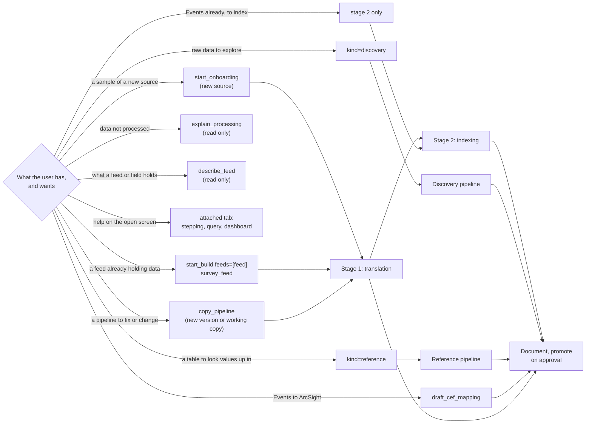
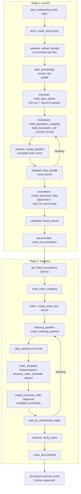
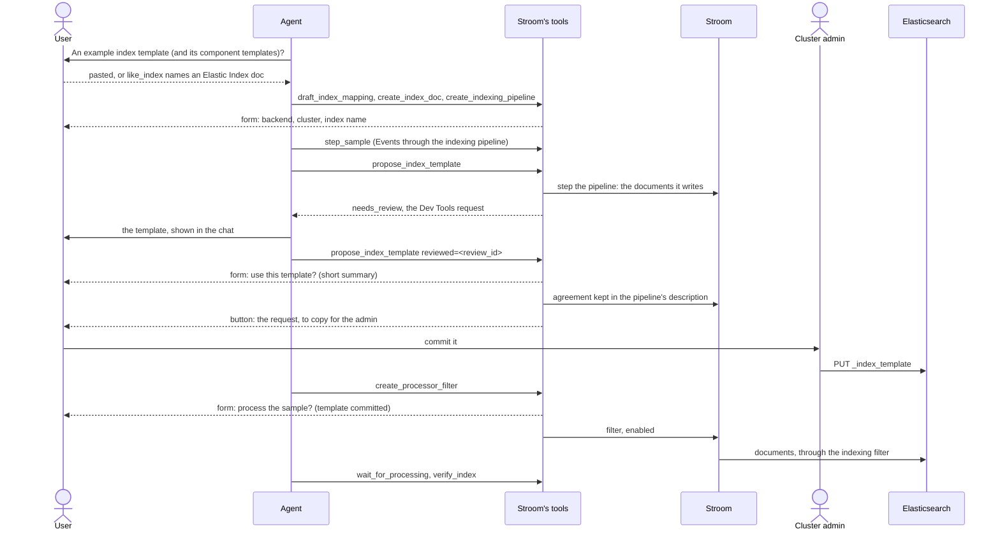
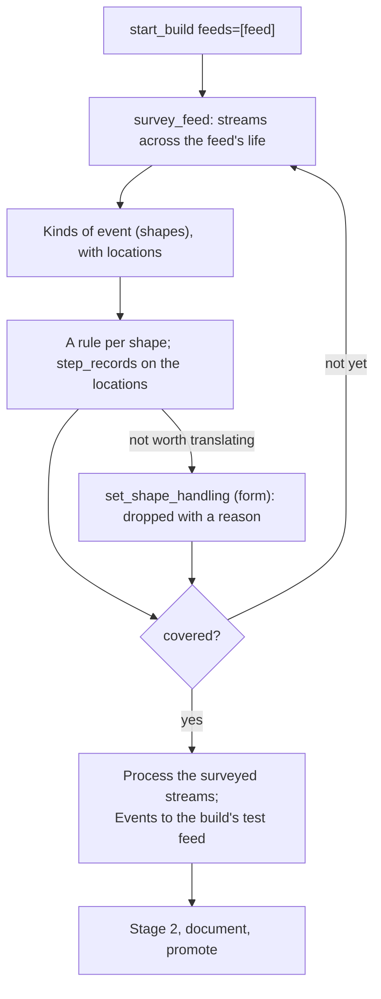
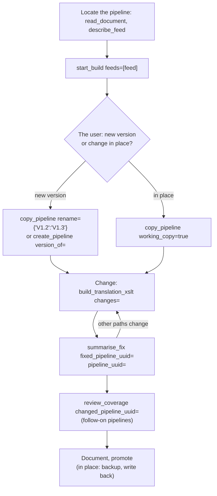
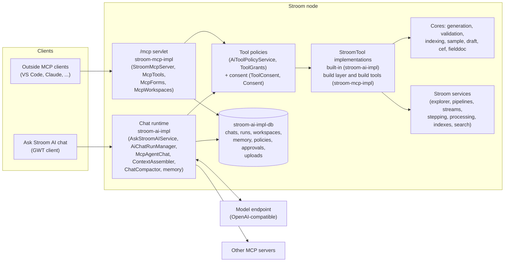
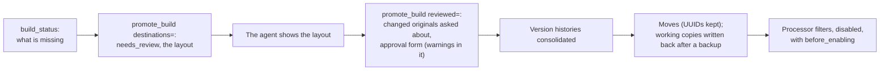
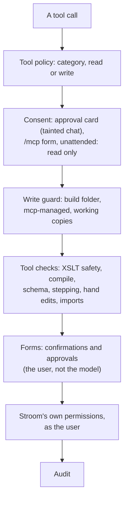

# Stroom AI and its agent tools: design

This is the design record for Stroom AI (the _Ask Stroom AI_ chat) and the agent tools Stroom serves, in the chat
and to outside MCP clients at `/mcp`.
It is written for the people who maintain and extend Stroom AI, Claude included: how it is built, why it behaves as
it does, the decisions that shaped it, the invariants to keep, and where in the code each behaviour lives.
It is self-contained: nothing here is explained by reference to the separate MCP server the onboarding tools were
first written as, which can be retired.
It replaces the port-era design note ("Folding the Stroom MCP server into Stroom", October 2026).

Other documents, and what they hold:

| Document | Audience | Holds |
| --- | --- | --- |
| This document | Maintainers | Design, behaviour, invariants, decisions, status. |
| [README.md](README.md) | Maintainers | The entry point: modules and where things live, building, testing, configuration properties, roadmap. |
| [TOOLS.md](TOOLS.md) | Maintainers | The tool inventory: every tool, its arguments, how overlapping tools differ. |
| stroom-docs, `content/en/docs/user-guide/ai/` (branch `gh-146-ai-user-guide`) | Users and administrators | How to use the chat, the agent tools and `/mcp`. Pages are cited below by their path under that folder. |

This document states user-facing behaviour only where the design depends on it, and points to the stroom-docs page
for the user's view.
It doesn't repeat per-tool arguments; see TOOLS.md.

Keep it current: record each feature's decisions and status here as it is built.
Status words used throughout: **built** (in this branch), **in progress** (being built, uncommitted),
**planned** (agreed, not started), **parked** (deferred by the product owner, notes kept), **open** (awaiting a
decision or a re-test).
Class names are given without packages; the packages are in [Architecture](#architecture).


## Contents

* [Summary](#summary)
* [Workflows](#workflows)
* [End-to-end walkthrough](#end-to-end-walkthrough)
* [Further use cases](#further-use-cases)
* [Architecture](#architecture)
* [Security and consent](#security-and-consent)
* [Sessions, workspace, memory and context](#sessions-workspace-memory-and-context)
* [Builds and onboarding](#builds-and-onboarding)
* [Translation](#translation)
* [Indexing](#indexing)
* [Standing instructions (AGENTS docs)](#standing-instructions-agents-docs)
* [Processing, stepping and documentation](#processing-stepping-and-documentation)
* [Dashboards, charts and analytics](#dashboards-charts-and-analytics)
* [Validation and safety](#validation-and-safety)
* [Clients](#clients)
* [Extending Stroom AI](#extending-stroom-ai)
* [Testing](#testing)
* [Risks, open questions and delivery](#risks-open-questions-and-delivery)
* [Decision log](#decision-log)
* [Parked and open items](#parked-and-open-items)


## Summary

Stroom AI is a chat inside Stroom.
A model answers the user's questions by calling tools that run inside Stroom, as the user, under the user's
permissions.
The same tools are served at `<stroom>/mcp` to any MCP client (VS Code, Claude and others), so an outside model can
use them too.

There are about 100 tools.
They cover reading Stroom's documents, data and processing; searching; dashboards and charts; and building content
end to end: sampling, the text converter, the translation XSLT, pipelines, stepping, processing, indexing into
Elasticsearch or Lucene, CEF output, reference data, documentation, version history and promotion.
The building tools were first written as a separate MCP server.
They were ported into Stroom in October 2026 and have grown since; nothing in Stroom depends on that server.

Goals:

* Answer questions about Stroom's content, data and processing, from what the user can see, with links.
* Take a sample, or a feed that already holds data, to working content: a feed, a translation pipeline writing
  event-logging XML, and an indexing pipeline, built in a workspace and promoted only on the user's approval.
* Maintain content: new versions and working copies of production pipelines, fixes to reported issues, coverage of
  kinds of event a sample missed, and the pipelines that read changed Events.
* Help on Stroom's own screens: stepping, queries and dashboards, with changes applied unsaved for the user to keep.
* Explain processing and retention: why data isn't processed, what keeps or deletes it.

Non-goals:

* Managing users, permissions, nodes or volumes.
* Writing to Elasticsearch: index templates are drafted and checked, and the cluster administrator commits them.
* Deleting production content, or editing it in place. Production documents change through a working copy that
  promotion writes back after a backup, asking the user first if production changed since the copy was taken.
* Reading node logs (2026-10-20). A failed task's reason stays in the operator's log system.
* Model-written JavaScript in visualisations (2026-10-24).

Principles (invariants to keep):

* **The user's own permissions.** Every tool runs as the user and checks the user's application and document
  permissions, and logs what it reads (`AiAuditLog`, with a View or Process event on the object). A tool policy can
  only narrow what a user may do, never widen it.
* **The user decides, in a form the model can't answer.** Confirmations and approvals are forms the user answers
  directly (`Consent`). The model is never given an id to approve a call with: a model holding one could approve its
  own call.
* **Nothing reaches production without the user.** Build tools write only inside a build's folder (`WriteGuard`).
  Promotion moves the build's documents into place after the user approves the layout. Code proposed on Stroom's
  own screens is applied unsaved.
* **The tools hold the rules; the model writes models, not code.** The model writes a mapping or a field plan; the
  generators write the XSLT; the checks are deterministic. A weak model can still build correct content.
* **The plan lives in the tools.** Every write tool's result carries `next`, the plan's next step, so a model that
  treats each request as one call is told it isn't finished.
* **Generic logic.** No special handling for one source system's format, even where a sample would benefit
  (2026-10-29). When a sample drafts poorly, improve what the agent can see, not its vocabulary.
* **Nothing hidden from the user.** A tool that can't do what was asked says so in its reply, with the reason and
  the way forward. The agent acts on the reply's wording, so wording is behaviour and is tested.
* **One bad item doesn't fail a whole answer.** A tool that reads many items reads each separately and names the
  one Stroom can't give, with Stroom's reason.


## Workflows

What the user has, and wants, decides the path before any tool is called.
There are no workflow prompts: the server instructions (`server-instructions.md`, "Which work") map a request to a
path, and the build plan (`BuildPlan`) leads each kind of build from its start (2026-10-27).
Workflow prompts were dropped because a user had to know which one to pick: seen in testing, a discovery index was
never offered, and a table to look values up in was onboarded as events.
When a request fits more than one path, the agent asks which.



| Path | Starts from | Entry | Plan kind |
| --- | --- | --- | --- |
| Onboard a new source | Sample files or a pasted sample | `start_onboarding` | events, then index |
| Onboard an existing feed | A feed with Raw Events | `start_build feeds=[it]`, `survey_feed` | events with `covered`, then index |
| Index existing Events | An Events feed | `start_build`, stage 2 tools | index |
| Discovery index | Raw JSON, delimited text or XML | `start_build kind=discovery` | discovery |
| Reference data | A lookup table | `start_build` or `start_onboarding kind=reference` | reference |
| CEF output | Events | `draft_cef_mapping` | CEF |
| Next version or fix | A production pipeline | `start_build feeds=[...]`, `copy_pipeline` | events or index, on a copy |
| Coverage of a whole feed | A processed feed | `review_coverage` | on a working copy |
| Explain processing | A pipeline, feed, stream or the cluster | `explain_processing` | none (read only) |
| Questions about data | A feed, field or index | `describe_feed`, `describe_data_source`, `run_stroomql` | none |
| Help on a screen | An attached tab | the tab's guidance and `propose_*` tools | none |

The user's view of these paths: `pipeline-admin/onboarding.md` and `pipeline-admin/editing-pipelines.md`.

### Who uses it

| User | Typical work | Where |
| --- | --- | --- |
| Analyst | Questions about data; queries; dashboards; charts; analysing tables | Chat, attached Query or Dashboard tab |
| Pipeline administrator | Onboarding; fixing translations; reprocessing; documentation | Chat or an MCP client (VS Code) |
| Content developer | Stepping a translation; proposed XSLT changes | Chat on the Stepping screen |
| Operator | Why isn't this processed; what is running; volumes; retention | Chat (`explain_processing`, `processor_tasks`, `server_tasks`, `volumes`, `explain_retention`) |

### Chat-only workflows

These run on what the user has open, and apply changes unsaved (see
[Code the agent proposes](#code-the-agent-proposes-built)):

* **Stepping.** The Stepping screen's context (the selected element's input and output as shown, its unsaved code,
  the step errors, and where it is) goes to the agent with the attached tab. `propose_code_change` steps the record
  with the current code and then the proposed code in one stepping session (`CodeChangeStepper`), and refuses a
  proposal that adds errors the current code doesn't have, unless the user accepts them (2026-10-19).
* **Queries.** `propose_query` opens Stroom's New Query dialog with a suggested name; `propose_query_change` gives
  _Apply to query_. `run_stroomql` runs a query as the user and writes the results to a workspace table.
* **Dashboards and charts.** `propose_dashboard`, `propose_dashboard_change`, `propose_visualisation`,
  `propose_extraction_pipeline` (see [Dashboards, charts and analytics](#dashboards-charts-and-analytics)).
* **Tables.** `current_results` snapshots the attached tab's results; `table`, `jq` and `summarise_column` work them
  out in the workspace; a table too large for the context is summarised in batches (`TableSummariserImpl`).
  `table` takes loosely shaped arguments as meant (a list as JSON text, with a stray trailing comma; one object for
  a list; `"-col"` in `orderBy`), and quotes what it was given when it can't. Only failures of a query it could read
  count towards summarising a column instead after two (seen in chat 140: a list given as text in two parallel
  calls brought an unasked-for column summary). `current_results` given a table name that matches nothing uses a
  tab's only table, saying so; with several it still refuses, listing them (2026-11-03).
* **Documentation.** `propose_documentation_change` gives a diff card and _Review and apply_, applied as an unsaved
  edit in the document's Documentation tab.


## End-to-end walkthrough

A new source, from sample to promotion, tool by tool, with what each step checks.
The plan's steps (`BuildPlan`'s stage lists `STAGE_1`, `REFERENCE`, `STAGE_2`, `STAGE_3` and `FINISH`) are the headings; a write tool's `next` names the first one not done.

Stage 1 makes the Events stage 2 needs.
Stepping every sample record to completion is stage 1's correctness check.
Stage 2 acts on cooked Events and writes to an index, so its Error streams are triaged and can send the agent back
to fix and reprocess.



1. **Start.** `start_onboarding` creates the build (a folder under the workspace folder) and returns the plan with
   its first step. Given `files=` (paths on the user's disk), it names the next calls: `create_feed`, then
   `upload_sample` with the same paths, then `start_onboarding` again with the stream ids, which profiles them.
   Pasted samples (`samples=`) are profiled at once. The tool also returns the standing instructions that apply.
2. **feed.** `create_feed` proposes the name and encoding in a confirmation form, the name editable. A name that
   differs only in case from an existing feed is refused (`BuildFeeds.refuseCaseTwin`, seen in testing).
3. **samples.** `upload_sample files=` returns one `curl` command per file, for the user to run in their terminal.
   The file goes to `POST /mcp/upload/<id>?file=<name>` (`McpUploadServlet`), signed in as the user, and from there
   to the feed; it never passes through the model. Pending commands are held in the database
   (`ai_sample_upload`), so any node takes the file. Text samples are refused once a feed has been given commands
   (seen in testing: a terminal command failed, and the agent uploaded two records of each file as text). Each file
   becomes its own stream.
4. **Profile.** `start_onboarding` with the stream ids profiles them together (`SampleProfiler`): the format (XML,
   XML fragments, JSON array, object or lines, delimited with or without a header, CEF, RFC 5424 or RFC 3164
   syslog, key=value, CRI, multi-line text, mixed lines), timestamp patterns (`TimePatterns`), and what differs
   between files. Records come before formats (`LineFormats`): lines that continue an entry (indented, a stack
   trace's frames, causes, elisions and exception line) are grouped with it first, so each format is judged on
   records, and its records' later lines are kept apart as `continuation`. A stream of two or more formats, each a
   tenth of its records or more (none reaching its own share), is `mixed lines`.
   The encoding is the feed's, not detected. It names the environment's own templates whose parser reads the format.
5. **converter.** For text formats, `build_data_splitter` writes the Data Splitter from a spec (delimited, regex,
   key=value, syslog with a parsed body, alternatives: a part per format of record, each record written with its
   `variant`), runs it on the sample (a dry run that follows Stroom's own splitting), and
   runs it through Stroom's own parser (`stroom_check`, `StroomSplitterRun`). A converter Stroom loses records with
   isn't saved. It sets `bufferSize` from the longest record, as the reader holds a record only up to half its
   buffer. JSON takes the JSONParser and no converter; XML fragments take the environment's own wrapper converter
   (`FragmentWrappers`).
6. **translation.** `draft_translation_mapping` first settles the event-logging version: the user chooses from the
   versions this Stroom holds, the newest recommended, in a form. It drafts a mapping from the sample (and any
   source notes): a rule per kind of event, its action element, its fields. It pre-fills `shared` entries where the
   stage's existing pipelines call a shared template (`SiblingSharedCalls`). The agent edits the mapping, and
   `build_translation_xslt` checks it against the sample and the schema before generating: fields no record has,
   time formats the values don't fit, required elements the sample leaves empty, XPath Stroom's Saxon can't run.
   It asks the user in forms about values that stand for none (`-`, `N/A`), domain-qualified user ids, and each rule
   whose events are kept as Unknown. It then generates the XSLT (`XsltGenerator`), compiles it as Stroom compiles it,
   and saves it with its mapping. The XSLT is never written by hand.
7. **pipeline.** `create_pipeline` makes the events pipeline as a child of a template (`find_pipeline_templates`,
   `describe_template`), supplying only the converter and the XSLT. It refuses an XSLT or converter from outside the
   build, and a template whose parser can't read the sample (`replace_parser` swaps the parser; overrides
   `reuse_existing_docs` and `accept_parser_mismatch`). The user confirms the template and names in a form.
8. **stepped.** `step_sample` steps every sample record through the whole inherited chain, and returns a verdict per
   record (clean, review or blocking) from the error triage. Draft code is tried with `draft_code` without saving.
   A clean step of the full count records a digest of the pipeline's code in the build record. The agent fixes
   errors its own content causes first; only what it can't resolve (an inherited element, reference data, the
   source data) goes to the user.
9. **processed.** `create_processor_filter` with the sample stream ids asks the user's approval in a form, then
   creates the filter enabled, up to `stroom.ai.builds.maxProcessingTasks` tasks at once (4 by default, a stream each).
   It refuses a pipeline with no clean step of its current code.
   `wait_for_processing` waits until no output is locked and no task is still open, triages the Error streams
   written beside the output, and fails the gate on blocking errors.
10. **validated.** `check_events` validates the Events against the schema this Stroom holds and the quality rules
    (a full UTC TimeCreated; System Name, Environment, Generator, Device and TypeId present; one action; no empty
    elements), and records the Events as validated.
11. **documented.** `write_documentation` writes a Documentation doc named after the pipeline, with a Field mapping
    section generated by stepping the sample (each Event marked by its rule), and asks the agent for each field's
    description (`needs_descriptions`).
12. **Stage 2 starts.** `get_field_conventions` returns `not_yet` until the build has Events (seen in testing: the
    backend was asked before the translation was written). Then it asks, in forms, the backend (Elasticsearch, or
    Lucene inside Stroom), then the naming: an example index template, an existing index to follow, or a bundled
    convention (ECS, Stroom flat). It never picks one itself.
13. **index.** `draft_index_mapping` drafts the field plan from the Events, named as the example names fields,
    and shows its fields (name, type, source path) as a `needs_showing` table, which Stroom AI's chat shows itself.
    `create_index_doc` confirms the backend, cluster (the one existing Elastic Index docs use, by default), index
    name, index doc name and time field (or the volume group, for Lucene) in one form. It never creates an Elastic
    Cluster doc, which holds credentials.
14. **indexing_pipeline.** `create_indexing_pipeline` makes the pipeline from an indexing template, with the XSLT
    generated from the plan (`IndexingXslt`). It refuses until the build has an events pipeline or is given existing
    Events streams.
15. **index_template (Elasticsearch).** `propose_index_template` steps the indexing pipeline to see the documents it
    writes, and builds the template from the user's example and its component templates. It returns `needs_review`
    with the template as a Dev Tools request, shown in the chat (in Stroom AI by the chat itself, as a JSON code block
    with its notes; the model's copy says it was shown); called again with
    `reviewed=<review_id>`, it asks the user to agree in a short form. The agreement is kept in the indexing
    pipeline's description, with the index, cluster and a digest of the indexing XSLT. A user's own correction goes
    through `check_index_template`. The cluster administrator commits the template; the user's `user_actions` carry
    the request for them to copy.
16. **Indexing the sample.** `create_processor_filter` refuses an Elasticsearch pipeline without an agreed template
    for its current index and code. The approval form asks the user to confirm the template is committed. Stroom
    reports each document Elasticsearch rejects in the Error stream, with its reason, so the pipeline keeps its
    template's batch size. An index the pipeline wrote to before is dropped first (`drop_first`).
17. **indexed.** `wait_for_processing`, then `verify_index`: a `<index>-VERIFY` dashboard, columns the user
    confirms, and test searches through Stroom (counts per stream, an exact match per key field, a time range), each
    check's first hit traced back to its record by stepping. A pass is recorded by the code's digest, with the
    streams searched: the step is done only while they are all the build's current Events, so an Events reprocess
    leads to indexing the new Events (a record without the streams, from before, still counts). Until the step is
    done, `propose_dashboard` is refused and names the plan's next step.
18. **index_documented.** `write_documentation` on the indexing pipeline.
19. **promoted.** `build_status` shows what the build still lacks. `promote_build` returns the layout for review
    (`needs_review`), then asks for approval in a form bound to that layout (first asking about any working copy
    whose production original changed since it was copied); it moves the documents, writes working copies back
    after a backup, and creates each promoted pipeline's processor filter disabled, for the user to review and
    enable.

The Elasticsearch hand-over:



For Lucene, the template steps are skipped: fields are added to the Lucene index doc from the plan
(`FieldPlans.lucene`), and a build's own Lucene index has its shards deleted (on the user's approval) before it is
indexed again.


## Further use cases

All of these work in a build; production changes only at promotion, after the user approves.
The two that change existing content compare new output with current output record by record, so the only
differences are the intended ones.

### Onboard a feed that already holds data

The user names an existing Raw Events feed instead of giving a sample.
Not every kind of event shows up in every stream, so the agent surveys stream after stream until more streams add
nothing new.
No feed is created and nothing is uploaded: records are stepped and processed where they are.



* `survey_feed` picks streams spread over the feed's life (the last, the first, the middle, then the quarters, so
  any prefix spans the whole range) and reads each part's head (250,000 characters, 1,000 records), plus up to 8
  windows of 250,000 characters further in for one-record-a-line formats. The feed's last streams and sample
  streams are read whole up to 2,000,000 characters (seen in production: a sample read only to its 108th record of
  1,000 hid most of its kinds of event). Records are grouped into shapes: field sets plus the values of fields that
  name the event; masked text for syslog; message fields unwrapped (`Shapes`).
* Each call reads 10 streams by default, up to 100. Fewer than 10 is confirmed in a form, and only when the feed
  holds more (seen in testing: an agent surveyed a live feed 3 streams at a time).
* The survey is kept as a Documentation doc, `<feed> - Survey`, with a `survey-state` block; a later survey carries
  on from it, skipping the streams read (`SurveyDoc`). Its example records are the feed's own data: who can read them
  is down to the folder's permissions.
* The plan steps the survey's locations with `step_records` when there are 60 or fewer, else `step_sample` over the
  surveyed streams. Its `covered` step keeps asking for `survey_feed` until a full batch after the first adds nothing
  new.
* Processing the surveyed streams writes their Events to a test feed in the build (`<FEED>-MCP-TEST`, set on the
  pipeline's StreamAppender by `OutputFeeds`), never into the production feed. Promotion takes the property off.

### Next version, working copy, or a fix

Triggered by new samples the current XSLT doesn't handle, a reported issue, or a requested change.



* The plan offers both: `copy_pipeline source_uuid=<it> rename={'V1.2': 'V1.3'}` (with `working_copy=true` for a
  change in place), or a translation written anew with `create_pipeline version_of=` (a child of the previous
  version's template, with its converter, settings and, if the user keeps them with `keep_references=`, its
  reference data). The agent asks the user which. The names are the agent's proposal, confirmed in the tool's form;
  nothing works out the next version number.
* The translation a new version follows (`StroomBuildFacts.translating`) is the pipeline at the translation stage
  that reads the feed's raw data. Every pipeline reading the raw data is offered only when none of them can be told
  to translate. Another pipeline reading the same raw data, such as an archiver, has no translation to follow (seen
  in testing: TWITTER's raw data was read by an archiving pipeline, Twitter-RollingFileAppender, and by
  Twitter-Events; the archiver came first, so the plan offered it as the one a new version follows, and the drafts
  read its XSLTs, of which it has none).
* Templates are inherited, never copied: `copy_pipeline` refuses a template.
* `summarise_fix` steps the given streams (the reported one plus recent production streams) and exact events with
  the saved code and the draft (or the copy against the original), and diffs each record. It is `ready` when the
  output changes, only the expected paths change, and there are no new blocking errors. It warns when the changed
  code is set by a template pipeline, as the change would reach every pipeline built from it.
* A change to the Events reaches the pipelines that read them: `review_coverage changed_pipeline_uuid=` steps the
  copy over the raw streams and checks each follow-on indexing and CEF pipeline against the Events it gives.
  `build_translation_xslt` returns `follow_on` pointing there after an events pipeline change (asked for by the
  user).
* Promotion: a new version is moved into place beside its predecessor (in a version subfolder named from the version
  in its name, `PromotionLayout.versionFolders`); its filter is created disabled, with buttons to disable the
  predecessor's enabled filters. A working copy is written back over the original after a backup to
  `<workspace>/backups/` (`<name> backup <yyyyMMddHHmmss>`); if the original changed since the copy was taken, the
  user chooses first (see [Promotion](#promotion-built)). Reprocessing production data is the user's.

### Fix a reported issue

A user reports an event that came out wrong, with the Stream ID and Event ID a dashboard shows, or a description.

* `locate_event` takes an Events, Error or Raw Events stream id and an Event ID, and returns the raw part and
  record, the record's input, the stored event, the event stepping gives now, and the XSLTs and converters the
  pipeline runs, marking those inherited from a template. Events are counted across the raw stream's parts, since a
  record can produce none or several.
* `search_events` (which took in the original `find_events`) finds the other events of its kind.
* The fix is drafted in the pipeline's own XSLT or converter, proven with `summarise_fix`, and applied through a copy
  as above, or given as manual steps.

### Coverage of a whole feed

A sample can miss rare kinds of event.
Once a feed is processed, `review_coverage` reads the Error streams where the generated XSLT logged unmatched records
and events kept as Unknown, and says exactly which raw streams hold them (`continue_from`, `max_streams` default 500,
at most 5,000).
Only those streams need processing again.
This depends on every record's number being logged (see [Generation](#generation-built): record numbers).

### Discovery index

A discovery index indexes a source's raw records as they are, to explore them before or instead of translating.

* The source is an existing feed (`start_build feeds=[it] kind=discovery`) or a sample. Nothing is surveyed, as
  Elasticsearch maps the fields itself.
* The agent asks in one message: cluster, index name (e.g. `stroom-discovery-<source>-v1`), discovery template, time
  field and its format, stream meta to add, fields to leave out, and an example index template.
* `draft_index_mapping discovery=` builds a discovery plan; the XSLT (`DiscoveryXslt`, resources
  `discovery-*.xslt`) copies each record into the JSON form the indexing filter reads, adding StreamId
  (`stroom:stream-id()`), EventId (`stroom:record-no()`), `@timestamp` and stream meta. A string holding JSON is
  also parsed into a sibling `<field>_json` (`unpack_json`, on by default). Keys Elasticsearch or Stroom would lose
  (metadata fields, any key starting `_`, repeats of StreamId, EventId or `@timestamp`) become `<key>_original`;
  empty and malformed keys are repaired.
* The template is permissive: strings as `keyword` with `ignore_above` (1,024 by default), no date detection, a
  total-fields limit (2,000), `ignore_malformed`, numeric detection for text sources. It is a data stream only when
  every record has its time.
* The fallback pipeline (`create_indexing_pipeline standalone='discovery'`: parser, record count, one record a split,
  XSLTFilter, JSON SchemaFilter, ElasticIndexingFilter) is a last resort, refused while any discovery template
  exists, and confirmed in a form (2026-10-27).

### Reference data

* A reference build (`kind=reference`, or detected from a Raw Reference feed or a reference-stage pipeline) has its
  own steps: no translation, events or indexing (2026-10-27).
* `build_reference_xslt` generates the reference XSLT from maps (each a name, a key and values); `upload_sample`
  takes `stream_type` Raw Reference with an effective time (by default 2000-01-01).
* Lookups in a translation mapping (`lookup`: map, field, xpath) read a map by key; `find_reference_data` shows what
  exists; small static tables go in Dictionary docs (`save_dictionary`, `dictionary`, `in_dictionary`).
* **Lookups wait for their data.** Stroom remembers a lookup that found nothing for ten minutes (its effective
  stream cache). So stepping is refused while a looked-up map's feed has no Reference stream
  (`PipelineStepping.refuseUnloadedReferences`), and the plan holds the events build's `stepped` step until it has
  one.
* A reference pipeline's processor filter is created disabled, for the user to enable.

### CEF output

* `draft_cef_mapping` drafts a CEF mapping from Events. It first asks whether keys outside ArcSight's CEF dictionary
  may be used (a form, or `needs_guidance`); the answer is taken from the argument, then standing instructions, then
  the plan kept with the XSLT, then an earlier answer in the build, then asked (`CefChoices`).
* The header is taken from the Event: vendor from `EventSource/System/Organisation`, product from `System/Name`,
  version from `System/Version` (however few sample events hold it, asked for by the user), signature from
  `EventDetail/TypeId`, name from `EventDetail/Description`, falling back to the action. A header field the sample
  lacks becomes a `TODO` constant to ask the user about. Custom slots are labelled.
* Fields not sent are grouped by reason and event type (seen in testing: 125 entries over 100 KB).
* The XSLT is compiled before it is saved, with the plan kept with it.
* With no forwarding template, `create_pipeline standalone='kafka'` makes a pipeline of its own (XMLParser, one
  Event a split, XSLTFilter, SchemaFilter `kafka-records:1`, StandardKafkaProducer with a KafkaConfig).
* An existing CEF pipeline, even one written by hand, is reviewed from its lines (`CefLines.review`): what each
  Event sends and leaves out, against the dictionary.
* A CEF pipeline is stage `forwarding` (`PipelineShapes`): backend `kafka` when it has a StandardKafkaProducer, and
  backend `file` when it writes CEF lines as text (a TextWriter to a file, rolling file or stream appender). A text
  writer alone can't tell (Batch Search writes text too), so the text one is told by its XSLTs, read as the user
  only for a pipeline that would otherwise be `other` and doesn't parse raw input: its own or inherited XSLTs, and
  those they `xsl:import` or `xsl:include` (found by name as Stroom finds them, up to 4 imports deep and 25 XSLTs
  read), one of which keeps a CEF plan or holds `CEF:0|` or `CEF:1|` (added 2026-10-31: in existing environments a
  thin pipeline XSLT often imports a shared CEF one). An import that can't be found or read is skipped; with no
  XSLT read, the pipeline stays `other`. Its lines are read from the stepped output of its XSLT: a text XSLT's lines
  (Stroom's XML declaration dropped), or the text of XML that its TextWriter writes without the tags.
* CEF steps: `cef_mapping`, `cef_pipeline`, `cef_stepped`, `cef_documented`. The filter is created disabled.

### Document an existing index

* `read_document` on an Elastic or Lucene Index doc surveys it through Stroom: its fields, up to 100 documents read
  through dashboard searches on a dashboard that is never saved, and the pipelines that feed it (found by content,
  confirmed from their effective properties). See [Indexing](#indexing) for the limits.
* `write_documentation index_uuid=` confirms the index doc in a form, then writes a Documentation doc named after it,
  with a generated "Data surveyed" summary and Field mapping. An index the build made itself is documented by its
  indexing pipeline's doc, unless `index_itself=true`.

### Evaluate a pipeline

`evaluate_pipeline` (read only) gives the facts for an evaluation of any existing pipeline, the same ground every
time for its stage, so evaluations are consistent and users find the feature: added 2026-10-31, as the agent had
improvised from `read_document`, `summarise_streams`, `step_sample` and `check_events`, covering different ground each
time.
It reads the pipeline's stage as `PipelineShapes` does (the stage `write_documentation` uses) and gives, in order:

* `pipeline` (its stage, templates, parser and code), `processing` (its newest Error streams' errors triaged as
  blocking, review or benign, with the errors the user accepted as benign reported as benign), `stepping`
  (`step_sample`'s verdict on its input streams: by default the inputs of its newest output, else its processor
  filters' feeds' newest streams);
* its stage's checks: an events pipeline's `events` (its newest Events' schema validity, quality and field
  population) and `coverage` (records its Error streams log as matching no rule, pointing to `review_coverage`); an
  indexing or discovery pipeline's `index` (fields its stepped documents write against its index's: missing, unused,
  and values their field's type or keyword analyzer doesn't suit; for Elasticsearch, where it writes and whether an
  index template is agreed, pointing to `check_index_template`); a CEF pipeline's `cef` (its lines reviewed against
  ArcSight's dictionary, header fields still TODO, Event values not sent, the mapping its lines imply; Kafka delivery,
  or for one writing text what its appender does, noted as untested; to Kafka or to a file alike); a reference data pipeline's `reference` (its maps, what stepping wrote in each, its feeds and
  the pipelines that look them up); any other stage's `checks`, saying none apply;
* `report`: the outline for its stage, and `next`.

It reuses the tools each part is made of, and runs none of `review_coverage`, `check_index_template` or
`verify_index`, only pointing to them. A missing permission never refuses the call: View Data, Stepping and Manage
Processors each unlock the sections that need them, and a section without them says so.
The agent writes the report from the outline and shows it; a report the user wants kept is saved with
`write_documentation evaluation=true` as `<pipeline> - Evaluation`; nothing in it is generated, and promotion puts it
beside the pipeline.

### Questions about the data

`describe_feed` (read only) answers what a feed holds, what a field means and how to search it, from the generated
documentation and the indexes' fields.
Field names are matched loosely (`UserId`, `userid` and `User.Id` alike); the answer gives each field's
event-logging path and how to search it per backend.
`describe_data_source` gives a data source's documentation (its Documentation tab, the same-named doc beside it, and
its pipelines' docs), to help choose data sources and StroomQL fields.

### Explain processing, retention and volumes

See [explain_processing](#explain_processing-built-2026-10-28).
`explain_retention` gives the retention rules in the order they apply, the rule that keeps a feed's or stream's data
and until when, and what the rules would delete now.
`volumes` gives each data and index volume group, whether it can be written to, and (with _Manage Volumes_) each
volume's state and space.
They were added after the agent, asked what happens when volumes fill, said Stroom deletes the oldest streams:
nothing it could read said otherwise (2026-10-30).
Stroom never deletes data for space; only retention rules or a user do.


## Architecture



| Module | What it holds |
| --- | --- |
| `stroom-ai-api` | Interfaces other modules call (e.g. `CodeChangeStepper`, `ElasticIndexTemplates`). |
| `stroom-ai-impl` | The chat runtime (`stroom.ai.impl`), the built-in tools and their contract (`stroom.ai.impl.tools`), the cores (`tools.generation`, `tools.validation`, `tools.indexing`, `tools.sample`, `tools.draft`, `tools.cef`, `tools.fielddoc`), the workspace (`workspace`), memory (`memory`), extraction pipelines (`extraction`), charts (`vis`), and the MCP client for other servers. |
| `stroom-ai-impl-db` | Persistence (jOOQ, Flyway, `V07_14_00_*`): chats and messages, runs, workspaces, memory, tool policies, approvals, pending sample uploads. |
| `stroom-ai-mock` | A stand-in model and fixtures for tests. |
| `stroom-mcp-impl` | The `/mcp` endpoint (`stroom.mcp.impl`), the upload servlet, the build layer and the building tools (`stroom.mcp.impl.tools`), and the bundled knowledge (resources `stroom/mcp/impl/knowledge`: `server-instructions.md`, `guides/*.md`, `conventions/*`). |

Libraries: LangChain4j (`langchain4j`, `langchain4j-open-ai`) for model calls, and the MCP Java SDK (`mcp-core`,
`mcp-json-jackson3`) for both the client and `/mcp`.
Versions are in `gradle/libs.versions.toml`.

The chat calls tools in-process.
It doesn't go through `/mcp`, so it avoids the problems seen with a separate server: tokens expiring during long
calls, large arguments passed as workspace references, and results re-read from workspace files.

### The tool contract

Every tool, whether built-in or a build tool, implements `StroomTool` and is bound in a Guice multibinder
(`BuiltInToolsModule` in stroom-ai-impl, `BuildToolsModule` in stroom-mcp-impl); `BuiltInTools` picks it up.
`LangChain4jTools` adapts it for the chat's model; `McpToolSchemas` for `/mcp`.
The contract has nothing of the chat or of LangChain4j in it.

| Method | Default | Drives |
| --- | --- | --- |
| `definition()` | | Name, description and schema. `ToolDefinition.general()` drops chat-only hints and parameters for `/mcp`. |
| `category()` | | Which tool-policy category grants it (`AiToolCategory`). |
| `execute(call, context)` | | The work. Bad input returns an explanatory result rather than throwing, so the model can correct itself. |
| `isReadOnly()`, `isReadOnly(call)`, `hasReadOnlyCalls()` | true | Read-only or write, per tool or per call. Unattended runs, Ask and Plan modes, and read-only policies use it. MCP `readOnlyHint`. |
| `isDestructive()` | true for a tool that writes | Whether its writes may overwrite or delete, not only add. MCP `destructiveHint`; false only for a tool whose every change adds something new. |
| `readsUntrustedContent()` | true | Whether a result taints the chat. MCP `openWorldHint`. Override with false only for output that is Stroom's fixed text, the model's own input or the user's answers. |
| `usesRunSlot()` | false | Heavy calls over `/mcp` take one of the user's run slots. |
| `isChatOnly()` | false | Never listed or callable over `/mcp`. |
| `confirmsItself()` | false | The tool asks in its own forms, so it isn't approved again as a whole. |
| `changesNeedApprovalAfterUntrustedContent()` | true | Whether a write asks on an approval card once the chat is tainted. |
| `changesOnlyItsBuild()` | false | Changes stay in the build folder, so no approval is asked; promotion asks. |
| `boundsItsOutput()` | false | Its result is never moved to the workspace in place of being returned. |
| `permissions()` | none | Metadata only; tools make their own checks. `TestToolPermissionMetadata` compares a built-in tool's declared permissions, app and document, with those it checks when called. |

`ToolSummaries` holds each built-in tool's one-line summary for the MCP Tool Policies screen; every built-in tool
needs one (a test checks it).

### The chat run loop

```mermaid
sequenceDiagram
    actor User
    participant Svc as AskStroomAIService
    participant Runs as AiChatRunManager
    participant Chat as McpAgentChat
    participant Model
    participant Tool as StroomTool
    User->>Svc: question (attached tab, mode)
    Svc->>Runs: start (or steer an active run)
    Svc-->>User: returns; the browser polls
    Runs->>Chat: answerQuestion (background, as the user)
    loop up to maxToolIterations (100)
        Chat->>Chat: fitToBudget (summaries, shrink)
        Chat->>Model: ChatRequest (streamed)
        Model-->>Chat: reply, tool calls
        Chat->>Chat: offered? policy? consent?
        alt ASK (approval card) or a form
            Chat-->>Runs: WaitingForUserException
            Runs-->>User: card or form ("Needs you")
            User->>Svc: answer
            Svc->>Runs: carryOn: a new run from the stored steps
        else RUN
            Chat->>Tool: execute
            Tool-->>Chat: result (large: saved, stub given)
        end
    end
    Chat-->>User: answer, links, follow-ups
```

* **Runs** (`AiChatRunManager`, table `ai_chat_run`) run in the background as the user. Statuses: QUEUED, RUNNING,
  WAITING_FOR_USER, STOPPING, STOPPED, INTERRUPTED, FAILED, DONE. A heartbeat every 10 s; a run whose heartbeat is
  older than 60 s is marked INTERRUPTED. Limits: `maxRunsPerUser` 3 (cluster-wide), `maxRunsPerNode` 20,
  `maxRunDuration` 2 h. Runs over a limit queue; runs waiting for the user don't count.
* **A failure part way through a turn** (e.g. the model timing out) shows the error and marks the run FAILED, with the
  reason (`MODEL_TIMED_OUT`, `ANSWER_FAILED`; `AiChatRunManager.ModelFailedException`), not DONE, so it can be
  resumed: the error offers **Continue** (resume: the turn's tool steps are kept and given to the model again) and
  **Retry from scratch** (asks the question again, discarding the turn's steps; confirmed first when there are any).
  Before, the run ended DONE, Resume wasn't offered, and Retry lost the turn's work.
* **A run never outlives the session that started it** (`AiChatRunSessionListener`): sign-out or expiry stops it,
  resumably. A run is **unattended** when no browser has polled the user's chats for `unattendedAfter` (10 min);
  unattended runs make only read-only calls, and nothing that needs the user is asked.
* **The loop** (`McpAgentChat.chatWithTools`): per step, fit the context, call the model (streamed through
  `ModelStreamer` when a streaming model is available), then for each tool call check, in order: offered (a call to
  a tool whose group is off turns the group on, and the model is told to call again), shortened arguments (a call
  sent with an earlier call's shortened arguments is refused), tool policy, consent (`ToolConsent.decide`: RUN, DENY
  or ASK). On the last step no tools are offered and the model sums up; the user is told to reply "continue".
* **Replies that only announce more work** (`UnfinishedReplies`) aren't taken as the answer: they are shown as
  interim words and the model is told to make the call, at most twice in a row (seen in testing: the run ended on
  "I'll now fix the field"). A question following one that ended so, or at the step limit, is given that question's
  steps in full (2026-10-28). "In a row" means with no tool call between: a step that calls a tool starts the count
  again, as it does for replies cut off at the length limit. The count had run over the whole question, so a long
  build ended on its third such reply; and an announcement with no "I" ("Now validating the Events", "Moving on to
  the index", "Next: indexing") wasn't recognised (both seen in testing, 2026-11-02).
* **Pausing for the user.** An approval card or a form throws `WaitingForUserException`: the thread and run slot are
  given up, and the run waits as WAITING_FOR_USER for as long as the user takes. When answered, `carryOn` starts a
  new run from the stored steps, and the same call is made again with the answer. **So a tool that asks must be safe
  to re-run up to its question** (an invariant of `Consent`). Approval cards expire after 24 h.
* **Steering.** A message sent while a run works is queued until the step ends; _Send now_ cuts short a waiting MCP
  tool and skips the step's other calls. A message sent instead of answering a card denies its calls.
* **Large results** (`ToolOutputs`): a result over 4,000 characters is saved to the workspace
  (`/outputs/turn-<t>/call-<m>.txt`) and the model gets a stub: a preview, the top-level fields, and `next` and `hint`
  repeated (seen in testing: a large draft's `next`, its last field, was cut from the preview, and the agent asked the
  user what to do). Results that need the user (`needs_review`, `needs_confirmation`, `needs_approval`) are shown in
  full up to 64,000 characters.
* **After the answer**: links to the documents and streams it names, checked by UUID (`AnswerLinks`); a turn digest
  for compaction; the chat title (`ChatTitler`, from the user's questions only, so no planted instructions reach
  it); follow-up suggestions (`FollowUpSuggester`, not when the turn asked the user for anything).
* **Modes**: Agent, Ask and Plan. Ask and Plan offer only read-only tools; the model is told the mode in every mode,
  so it notices a switch (seen in testing: after switching from Plan to Agent the model kept refusing).
* **The system prompt** says to describe how Stroom behaves only from tool results, Stroom's documents and the
  conversation, never from how other products work (2026-10-30).

User's view: `how-it-works/runs-and-context.md`, `ask-stroom-ai/chat-interface.md`.

### Tool registry, groups and server instructions

* **Groups** (`BuiltInToolGroups`, `ToolGroups`): build, processing, indexing, dashboards and administration tools
  are offered behind `activate_<group>` tools, each saying what the group is for. Core, search and file tools are
  always offered. All definitions together came to about 51k tokens; a question now starts at about 14k
  (2026-10-29). A group stays on while either of the latest two questions uses it, and calling a tool from a group
  that is off turns it on. Activations are rebuilt from the chat's stored calls at each run start, so they survive
  node changes. A Dashboard tab's guidance turns the dashboards group on from the start.
* **MCP servers' tools** are grouped separately when a server offers more than `toolGroupThreshold` (24) tools; a
  server's group named as a built-in group is offered as `mcp_<group>`.
* **Server instructions.** In the chat, `server-instructions.md` is added to the system prompt once `start_onboarding`
  is offered, that is once the build group is on (`BuildInstructions`). Trusted MCP servers' own instructions are
  added for servers whose tools are offered. Over `/mcp` the instructions are sent on every `initialize`
  (`StroomMcpServer.INSTRUCTIONS`, a preamble plus `BundledKnowledge.serverInstructions()`). The chat gives one
  server's instructions at most `McpToolset.MAX_SERVER_INSTRUCTIONS_CHARS` (20,000) characters, so a third-party
  server can't fill the context; Stroom's own are held under it by a test (see [Bundled knowledge](#bundled-knowledge)).
* **Lenient arguments** (`ToolCallGuard`, `MojibakeRepair`): unknown arguments are dropped and reported, choices given
  with stray punctuation or case are read as meant, and text mangled by a Windows code page is repaired; the notes go
  in `argument_notes`. After three identical failures a call is answered from the last failure without running
  again, and from the fifth failure in a row the reply says to step back; when each failure was a new problem, only
  from the tenth (seen: five different problems fixed in turn, told to start again from a clean mapping, 2026-11-02). JSON given to a text argument is passed on
  as JSON (2026-10-31).
* **Workspace arguments** (`WorkspaceArguments`): `{"$workspace": path, "jq": ...}` or `"$workspace:path"` in an
  argument is replaced by the file's content, and taints the run (seen in testing: a 186 KB mapping saved to the
  workspace was refused as an argument, and the build stopped).

### The /mcp endpoint (built)

* A servlet at `<stroom>/mcp` (`McpServlet`), bound like Stroom's other servlets, so it gets the same port, sign-in
  (`SecurityFilter`), request log and HTTP settings. It is Streamable HTTP only: POST for calls, GET for the server's
  stream, DELETE to end a session. It isn't on the admin port. It needs _Use MCP Tools_ and
  `stroom.ai.mcpEndpoint.enabled`.
* The SDK's own server would offer every session the same tools, so Stroom's request handlers (`StroomMcpServer`)
  filter per user. Handlers: ping, `tools/list`, `tools/call`, `resources/list`, `resources/templates/list`,
  `resources/read`, and the `initialized` and `cancelled` notifications. Capabilities: tools (with
  `listChanged`) and resources. There are no prompts.
* Each tool's `ToolDefinition.general()` becomes an MCP tool. Annotations: `readOnlyHint` from `isReadOnly()`,
  `destructiveHint` from `isDestructive()` for a tool that writes (true by default, including one with some
  read-only calls), `openWorldHint` from `readsUntrustedContent()` (it carries "may return content someone else
  wrote", not "reaches outside"). `title` and `idempotentHint` are not set. No `_meta` group is set: groups are
  the chat's.
* Chat-only tools are never listed and are refused if called: the chat's `propose_*` tools (not
  `propose_index_template`), `preview_extraction`, `instruction_evidence`, `task_list`, `memory`, `read_turn`,
  `search_history`, `current_results`.
* **A call** (`McpTools.call`): offered, allowed by policy, then for a write: refused if the client can't show forms
  (`FormsRequired`); else approved in a yes-or-no form (`McpApprovals`) unless the tool confirms itself or changes
  only its build; then a run slot for heavy tools (`McpCallSlot`), then the call under a deadline
  (`ToolDeadline`: the larger of `toolTimeLimit` and `queryTimeLimit`, paused while the user answers a form). Every
  call is audited, refusals included.
* **Resources** (`McpResources`): `stroom://guides` (an index), `stroom://guide/{name}` (agent-instructions, cef,
  data-splitter, documentation, event-logging, indexing, json-input, mapping, reference-data, visualisation, xslt),
  and
  `stroom://conventions/{name}` (ecs, stroom-flat). The same for every user. In the chat the same guides are read
  with `get_instructions guide=`.
* The endpoint isn't in the Swagger spec, which lists JAX-RS resources only. Clients get the tools from `tools/list`,
  which differs by user.
* Long-lived responses outlast nginx's default `proxy_read_timeout`. The SDK's keep-alive pings (every 20 s) keep
  Jetty open; nginx needs a longer timeout, and no buffering, on `/mcp`.
* Sample files are posted to `POST /mcp/upload/<id>?file=<name>` (`McpUploadServlet`), under the user's own sign-in,
  with no ticket. The command reads the key from `STROOM_API_KEY`. Pending uploads are held in the database, so any
  node can take them; a post claims its file with one conditional update, and a claim left by a post cut off part
  way can be taken over after 10 minutes (2026-10-23).

User's view: `agent-tools/connecting-clients.md`, `agent-tools/deployment.md`.

### The build layer

The building tools share a layer in `stroom.mcp.impl.tools`:

| Class | Role |
| --- | --- |
| `WriteGuard` | Creates land in `System/<workspace>/<build>/` (`stroom.ai.builds.workspaceFolder`, default `MCP Workspace`), in role subfolders (Events, Records, Indexing, CEF, Reference). Updates only on documents tagged `mcp-managed`. Refusals are audited. A duplicate type and name in a build is refused (seen in testing: after a summarised conversation an indexing pipeline was made twice). Folder creation takes one of 64 locks, so parallel calls can't make twin folders. |
| `BuildRecords` | The build record: a Documentation doc, `Build record`, in each build folder, holding a `build-record` JSON block: working copies (`copy_of`, and `copy_of_version`, the original's version when copied), versions (`version_of`), digests that stepped clean, verified or validated, the streams a verification searched (`indexed_streams`), sample files, source feeds, the event-logging version, the build's kind. Saves retry up to 5 times on a concurrent change, so two writers lose nothing. Its format and its code digests stay as they are: records already in Stroom read and are written back unchanged, and a clean step recorded earlier still matches the code it was taken on (see [Where state lives](#where-state-lives)). |
| `BuildPlan` | The plan: steps, each one's state derived from what the build holds, and `next`. |
| `BuildChecks`, `BuildStatusTool` | What the build still lacks before promotion. |
| `Consent` | Confirmations and approvals as forms; `needs_review` rounds with a `review_id` digest. |
| `PromoteBuildTool`, `PromotionLayout`, `PromotionProcessing` | Promotion. |
| `KeptMappings`, `SentMappings`, `XsltHistory`, `DocumentationVersions` | State kept with documents and in the session. |
| `ProcessingApprovals`, `ProcessorFilterWrites`, `IndexingRuns`, `OutputFeeds` | Processing in a build. |

Tags: `mcp-generated` marks everything the tools create, for good (backups too); `mcp-managed` marks what the
tools may still change, and comes off at promotion; `mcp-kept-mapping` marks an XSLT holding its mapping.
Nothing else is a tag: earlier per-build and per-digest tags grew Stroom's tag list with every build, so they are
folded into the record the first time it is read, then removed.
A document's build is the folder it is in, so documents in a build folder must not be moved or renamed; the record
says so, but nothing enforces it.

### Where state lives

| State | Where | Why there |
| --- | --- | --- |
| Chats, runs, messages, approvals | Database (`stroom-ai-impl-db`) | Any node; survives restarts. |
| Workspace files | Database, zstd chunks (`WorkspaceStore`), cached locally | Any node. |
| MCP sessions | Memory, one node | The SDK's sessions are in memory; affinity by client IP. |
| A session's draft mapping | Session workspace, `/outputs/mappings/` (`SentMappings`) | A fix sends only its changes. |
| Choices made in forms | Session workspace, `/outputs/choices/` (`UnsavedChoices`) | A call that fails before saving doesn't ask again. |
| Lookup agreements | Session, by document and function (`LookupAgreements`) | Not asked twice for the same XSLT. |
| The build a session works on | Node memory, per session (`BuildPlan.rememberBuild`): set by `start_onboarding`, `start_build` and any call naming a build | Calls that name no build work on it. |
| Build facts | The build record doc | Every node; survives restarts; travels with the build. |
| A mapping or plan | The XSLT's description, hidden JSON (`KeptMapping`) | Any session can regenerate it. |
| Version history | The XSLT's description, and the Documentation doc's Version control | Travels with the content. |
| An agreed index template | The indexing pipeline's description | Checked against the pipeline's current code. |
| Survey results | `<feed> - Survey` Documentation doc | A later session carries on. |
| Accepted errors | The pipeline's Documentation doc | Triage reads them for that pipeline. |
| Turn summaries | Node memory (`TurnSummaries`, 1,000 chats) | Put back after a form; another node summarises again. |
| Pending uploads | Database (`ai_sample_upload`) | Any node takes the file. |
| Default AI settings (model, prompts, dock) | Global config properties (`AskStroomAiConfig`) | Every node; set from the settings dialog's "Set as defaults". |
| A user's own AI settings | User preferences (`askStroomAiConfig`) | Only what they chose: no model means the default. |

**A user's model follows the default unless they chose one.** The client saves a model only when it isn't the
default (`AskStroomAiClient.setConfig`), and sends a question with the user's own model or none. The server answers
one with none using the model its chat has already used, or, for a new chat, the default it has then
(`AskStroomAIService.getModelDoc(config, chatId)`): a changed default reaches the next new chat and never switches a
chat part-way through. A model the user picks in the chat panel is sent for that chat even when it is the default,
so it replaces the chat's (`pickModelForThisChat`). Opening the panel reads the user's settings and the defaults
again (`refreshSettings`), so changes an administrator made since Stroom was loaded apply without a reload; a new
chat reads them too, for its picker. The model pickers show the default to a user who follows it
(`getDisplayConfig`). This was fixed after testing found that moving the chat dock, or pressing OK in the settings
dialog, saved the default model of the time as the user's own, so a new default never reached them
(`TestAskStroomAiClientDefaults`). When the default model changes, "Set as defaults" offers to clear every user's
own choice of model, keeping their other settings (`clearAllUsersModelChoice`); "Reset all users" still clears
everything.

**Stored formats keep reading.** What is kept in documents (the build record's `build-record` block, a kept mapping
or plan, an XSLT's version history, an agreed index template, the survey and source notes blocks) is read back by
later versions of the tools. So its format changes only in ways that still read, and write back alike, what earlier
versions wrote:

* Each keeps its layout: kept blocks are compact JSON in an HTML comment (`KeptMapping.withBlock`), and the older
  layout between `--- stroom-mcp <name> ---` markers is still read; the build record is JSON with sorted keys, and
  the source notes and the survey state are JSON indented by one space (`ToolJson`).
* Entries added to a model later are written only when set: a field's `data_parent` and `join`, a plan's or
  discovery's `stand_ins`, an index field's `items` and `distinct_by`, a Data Splitter spec's `escape`,
  `spaced_values`, `catch_all` and `blank_line_records`, a version history entry's `hand`. A mapping, plan or spec
  without them is written exactly as it was before they existed, so every kept one and every fixture still reads and
  compares unchanged.
* The build record was once written in its Documentation doc's Documentation tab rather than its body:
  `BuildRecords` reads the body, else the tab, and moves it to the body on the next write.
* Digests recorded with what is saved must come out the same (see [Hand edits](#hand-edits-built)).

### The generation and validation cores

| Package | Holds |
| --- | --- |
| `tools.generation` | The translation mapping model (`TranslationMapping`, `EventRule`, `FieldMapping`), `XsltGenerator`, `XsltReader` (an XSLT read back into a mapping), `MappingChanges` (`changes=`), `HandEdits`, the reference generator, a small XML and XPath parser of its own. |
| `tools.validation` | `XsltSafety`, `XsltCompileCheck` (Stroom's own Saxon, function library and import resolver, locked down), `EventSchema` and `HeldSchemas` (the XML schemas this Stroom holds), `EventChecks` (quality rules), `XPathChecks`, `XsltVersionHistory`. |
| `tools.indexing` | `FieldPlan`, `IndexingXslt`, `ElasticDocument`, `PlanTemplates`, `TemplateCheck`, `EcsSchema`, `Discovery`, `FromExample`. |
| `tools.sample` | `SampleProfiler`, `RecordSplitter`, `Shapes`, `SurveyDoc`, `Placeholders`, `SplitterDryRun`, `StroomSplitterRun`. |
| `tools.draft` | `DraftMapping`, `LocalCheck` (a mapping checked on the sample), `SourceNotes`, `SplitterXml`. |
| `tools.cef`, `tools.fielddoc` | The CEF plan and its XSLT; field documentation. |

Some small helpers follow Python's rules rather than Java's, because the cores' results (held by the recorded cases,
see [Testing](#testing)) and the messages agents act on depend on them:

* `ToolText`: lengths and slices in code points, values in messages in Python's notation (`repr`: `'a'`, `None`,
  `True`), and regexes in which only `\n` ends a line (`$` doesn't match before a `\r`).
* `ToolJson` and `JsonValues`: JSON read and written in Python's layout and messages, the truth of an empty value, and
  numbers compared across types.
* `IpAddresses`: an IPv4 octet with a leading zero refused, an IPv4 tail after `::` taken.
* `CloseMatches`: difflib's ratio, autojunk on, for "did you mean".
* `ToolArgs`: a list argument read whether a model sends it as JSON, as a Python literal (`True`, `None`, single
  quotes) or as plain text, as models send all three.

Two helpers follow Stroom's rules instead, as what they check runs in Stroom:

* `XPathRegex`: an extraction's regex compiled by Saxon's own regex engine, in XPath's dialect, as the generated
  XSLT's `analyze-string()` compiles it, for its group count. (It was read in Python's `re` dialect, which refused
  `\p{L}` and let lookahead through.)
* `DelimitedText`: a profile's delimited records split into cells as the generated Data Splitter splits them: a quote
  opens or closes a quoted stretch wherever it is, a doubled quote stays doubled (for `unescape_quotes`), records end
  at a new line (outside quotes with `quoted_newlines`), no field size limit. Only its sniffer, which guesses the
  delimiter and whether there is a header, is a heuristic of Python's.

One part of the generated XSLT departs from the Python server's deliberately, as a defect found after the port (the
Python server still has it):

* `XsltGenerator`: a repeated entry's guard is `exists((source)[normalize-space(.)])`, not the bare sequence. The bare
  sequence was safe for the field it was written for (a key given again, so attribute nodes), but an xpath may give
  strings (`tokenize()`), and two or more strings have no effective boolean value, so Saxon failed every record
  holding two values.
* `XsltGenerator`, from 2026-11-04: an entry without `repeat` writes its first value everywhere (`$v[1]`, or
  `(field)[1]` inlined, the brackets making it the first of all rather than of each step), where Python's plain
  values joined every value with spaces and only transformed and time values took the first; a test of whether an
  input has a value keeps the predicate (`field[normalize-space(.)]`), not `normalize-space(field)`, which refused a
  key given twice; and an entry with an `xpath` of its own logs a warning ("Several values (n) for <path>, only the
  first written") when it reads several. `XsltReader` takes the generator's `[1]` off an expression it keeps as an
  xpath, so a mapping reads back as it was.

The cores are pure Java over text and parsed trees; the tools around them read and write Stroom.
Golden files fix their larger outputs (see [Testing](#testing)).

### Bundled knowledge

`server-instructions.md` is the agent's map: which work fits what the user wants, the order of work, the rules for
every run, and how to ask the user questions.
It is written as labelled paragraphs, not headings, as it goes into a system prompt.
It holds only what the agent needs throughout a build, and what no tool enforces (2026-11-03):

* **A rule a tool enforces stays with the tool.** A form, an approval, a refusal or a reply saying what comes next
  (`drop_first`, `before_enabling`, a filter created disabled) is where the agent meets the rule, at the moment it
  applies. The instructions keep only what the agent must bring itself: to follow the reply, not to look for a way
  round a refusal, never to weaken validation.
* **Stage detail lives in the guides.** How to parse, write a Data Splitter, draft a mapping or set up a discovery
  index is in the data-splitter, xslt, mapping and indexing guides; the instructions give a line or two naming the
  guide, and the plan's step for that work (converter, translation, a discovery index) names it too, so the agent
  is pointed to it when it applies.
* **It fits whole.** Seen: the file grew to 20,675 characters, past what the chat gives a server, and the agent lost
  its last rules (Elasticsearch indexing only through the pipeline) without a word. It was cut to 12,934 characters,
  and `TestBundledKnowledge.theInstructionsFitWhatStroomAiGivesAServer` fails once it no longer fits, against the
  same constant the chat cuts at: growth means trimming or moving detail to a guide, not raising the cap. Pinned
  phrases (keep going until `next` says promote, ask only what no form asks) are tested in `TestBundledKnowledge`
  and `TestStroomMcpServer`.
* **One agent, not sub-agents.** Splitting the work across sub-agents with an instruction set each was weighed and
  decided against (2026-11-03): the instructions are already about building only, and onboarding is a conversation
  with forms and questions mid-task, which sub-agents would need routing back to the user.
The guides (`guides/*.md`) are short working references for the agent (event-logging, XSLT, Data Splitter, JSON input,
indexing, reference data, CEF, documentation, visualisation, AGENTS docs).
Conventions (`conventions/ecs.yaml`, `stroom-flat.yaml`) are field-naming profiles, each path an exact event-logging
path (a `*` one element): ECS's covers a Network action's Payload Resource, Outcome and Device ports, network alerts
(Alert/Network, Alert/IDS) and Send/Receive devices as well, each checked against the 4.1.0 and 3.5.2 schemas (seen:
a web proxy's index drafted with 21 fields, the rest named by hand, 2026-11-01). `ecs_fields.json` (ECS 9.5.0)
and `ecs_component.json` (what Elasticsearch 9.5.3's `ecs@mappings` maps otherwise than ECS: 48 of 2,521 fields) are
read by the tools.
The agent guides and conventions are resources of `stroom-mcp-impl`, not stroom-docs, which is for people
(2026-10-22).

### Reading Stroom's data

* **Undecodable bytes.** A stream is decoded with its feed's encoding. A byte not in it (a Windows-1252 quote in a
  UTF-8 feed) makes Stroom's data viewer refuse the whole stream, while pipelines read on with the replacement
  character. The tools read the raw bytes from the stream store and decode them as a pipeline does
  (`StreamCharsets`, `StreamReader`), and report `undecodable_bytes`: how many, how they read in Windows-1252, and
  what to do.
* **Lengths and slices are in code points** (`ToolText`), so a character outside the Basic Multilingual Plane counts as
  one wherever the tools cut text.
* **A big XML document read only to its head** is cut to its root and the complete records before the cut
  (`SampleProfiler.cutDocument`; seen in production: a 54 MB `<tweets>` stream, read to its head, was profiled as CSV
  with no records).
* **A raw stream Stroom holds as one record** is split by the tools (`StreamReader.splitRaw`; seen in production:
  reads of records 200, 450, 700 and 950 each returned the first four).
* **Streams older than their feed** (from an earlier, deleted feed of the same name) are refused as samples.
* **A Lucene index's analyzers.** The query service's fields for a Lucene index say a field is TEXT, not which
  analyzer it has, and CONTAINS on a keyword field or a range on a text field finds nothing through Stroom. So
  `run_stroomql` and `search_events` read the index's own field list (`IndexResource.findFields`, as the user,
  `LuceneTextFields`) and refuse those searches (`MisleadingSearches`). Found reviewing the tools (2026-10-31): such
  a search ran and found nothing.
* **One bad item.** A tool that reads many items (pipelines, XSLTs, index and cluster docs, AGENTS docs, streams)
  reads each separately. One Stroom can't give is named with Stroom's reason, or passed over where it can't change
  the answer (seen in production: a feed's description failed outright because one pipeline set a property its
  element no longer has). A promotion that fails part way says which step failed and what was already done.

### Indexing backends

Stage 2 is the same flow on Lucene and Elasticsearch; only these differ:

| Aspect | Lucene (Stroom Index) | Elasticsearch |
| --- | --- | --- |
| Index doc | `Index`, in a volume group | `ElasticIndex`, on an Elastic Cluster doc |
| Field definitions | On the index doc, from the plan (`FieldPlans.lucene`) | An index template, committed by the cluster admin |
| XSLT output | `records:2`: `<data name="..." value="..."/>` | `xpath-functions` JSON XML `map` |
| Keyword field | `TEXT` with the `KEYWORD` analyser | `keyword` |
| IDs and time | `ID` for StreamId and EventId, `DATE` | `long`, `date` |
| Objects | Refused: a field of values per item instead | `object`, flattened by Elasticsearch |
| Reindexing | The build's own index: shards deleted on approval | The admin drops the index first |
| Verification | Dashboard on the index doc | Same |


## Security and consent

### Tool policies and permissions (built)

Tool policies decide which tools each user may use, in both `/mcp` and the chat, so the two never differ.

* **Policies** are managed on the MCP Tool Policies screen. Each has a name, the users and groups it covers, and its
  categories, each granted read-only or read and write (2026-10-23). They are a database table, like API keys, not
  documents, so they never travel with content. Changes are logged. A user's or group's page shows their effective
  access and the policies granting it.
* **Union, deny by default.** A user gets the union of the enabled policies naming them, their groups (transitively)
  or everyone. With none, they get no tools.
* **On upgrade**, a migration creates a read-only policy for everyone, so chat users keep the read tools. Write
  tools need an administrator's policy.
* **Applied twice.** `tools/list` and the chat's offered tools show only what the user's policies allow
  (`ToolGrants.offers`), and every call is checked again (`ToolGrants.allowsCall`), since clients cache the list.
  Policies are re-read every 30 s, at once on the node where they change; a change sends
  `notifications/tools/list_changed` to that node's open sessions.
* **Read or write** comes from the tool (`isReadOnly`, or `isReadOnly(call)` where it depends on the call). A tool
  with some read-only calls (`hasReadOnlyCalls`) is offered under a read-only grant, and refuses its writes. A tool
  from another MCP server counts as read-only only if a trusted server says so. Any tool whose status isn't known
  counts as a write.
* **Permissions.** _Use MCP Tools_ gates `/mcp` (the chat doesn't need it). _Manage MCP Tool Policies_ gates the
  screen. Every call still runs the tool's own checks.

Each tool has one category ([`AiToolCategory`](../stroom-core-shared/src/main/java/stroom/ai/shared/AiToolCategory.java));
read or write is decided per tool, so every category holds both.

| Category | Holds | Placement notes |
| --- | --- | --- |
| core | Documents, folders, their instructions, the date and time, and working tools: questions, tasks, memory, workspace files, `jq`, `xpath`, `table`. | |
| search | StroomQL queries, events and data sources. | |
| content | Creating and changing documents: translations, pipelines, feeds, queries, dashboards, documentation, builds; every `propose_*` tool. | |
| indexing | Indexes, their fields, Elasticsearch index templates. | |
| processing | Streams, processor filters and tasks, sampling and stepping. | Stepping is here because it runs pipelines on streams. Reading streams is here so a core-only policy reads no raw data. `upload_sample` is here because it sends data into a feed. |
| administration | Configuration properties, server tasks and volumes. | |

For each tool's category, see [TOOLS.md](TOOLS.md) and stroom-docs `agent-tools/tool-reference.md`.
A tool from another MCP server takes the server's `_meta.group` when a trusted server names a category, else the
category the administrator sets for the server, else core.
An untrusted server can't choose its tools' category (2026-10-23).

### Sign-in (built)

* `/mcp` sits behind `SecurityFilter`, which takes a bearer token or an API key and runs the request as that user. A
  request with no credential gets a 401, not a redirect.
* **OAuth discovery.** A 401 carries `WWW-Authenticate: Bearer resource_metadata=...`, and
  `/.well-known/oauth-protected-resource` (RFC 9728, `McpProtectedResourceServlet`) names the authorisation server.
  With an external identity provider, each client is registered there and the token's audience must be one Stroom
  accepts.
* **Stroom's internal identity provider** accepts only Stroom's own redirect, so outside clients sign in with API keys
  (sent as a bearer), and no metadata is published. Registered OAuth clients in Stroom's provider would be a separate
  feature.
* **Threads.** The SDK may run a handler on a pooled thread. The user's identity is carried in the transport context,
  and each handler runs as that user. Each handler also clears any HTTP request its thread inherited. Tests cover a
  call on a pooled thread.
* **Sessions are their owner's.** Every request for a session must come from the user who started it; another
  user's, or an unknown session, gets a 404.
* **Signing the chat in to other MCP servers.** Under the internal identity provider, Stroom issues the server a
  token for the user. A connection asks for a token that outlasts a call (11 minutes in a chat, which may wait for a
  form): a 5-minute token reused until it had 1 minute left had cut off long calls part way (2026-10-18).

### Consent (built)

| Where | What asks | Why |
| --- | --- | --- |
| Chat, built-in write tools | An approval card, but only once the chat has read untrusted content (2026-10-23). Tools that confirm themselves, or change only their build, aren't asked (2026-10-24). | Untrusted content (data, attachments) could have steered the model. |
| Chat, taint | A chat is tainted only by results of tools that read untrusted content (`readsUntrustedContent`), by attached data, by an attached tab whose note previews its content (its small parts' first lines; 2026-11-02) and by workspace arguments. Trusted tools' results don't count. | Not every result can carry instructions. |
| Chat, other MCP servers' tools | Per-tool policy (allow, ask always, deny); trusted read-only tools run; a trusted server's modifying tool runs unless the run has read an untrusted server's output (2026-10-16). | Trust is per server. |
| Chat, unattended | Only read-only calls; everything else waits for the user. | Nobody is there to answer. |
| `/mcp`, any write | A yes-or-no form (MCP elicitation), unless the tool confirms itself or changes only its build. A client that can't show forms can't make write calls (`FormsRequired`); its read-only calls still work. No approval ids are ever issued (2026-10-23). | An outside client's model isn't Stroom's, and with an id it could approve its own call. |
| Build tools | Confirmations of key details and approvals of risky actions, in the tool's own forms (`Consent`). | The user, not the model, holds the answer. |
| Agent XSLT | `stroom:host-name` and `stroom:host-address` are allowed once the user agrees in a form (`LookupAgreements`). `http-call`, `fetch-json` and `ask-ai` stay refused. | DNS lookups carry a record's data off the node; the others reach out further. |
| Memory | A change to the user's memory is shown as a card, and waits for approval if the run has read anything that could have asked for it, or the user is away. | Memory follows the user into every chat. |

_Approve everything_ (per chat) exists only when an administrator allows it (`allowApproveEverything`), and never
applies while the user is away, or to tools set to ask always.
User's view: `how-it-works/trust.md`.

### Forms (built)

* **One mechanism, two transports.** In the chat, a form stops the run (`WaitingForUserException`) and the same call
  is made again with the answer. Over `/mcp`, the call waits on the client's elicitation, holding the thread; the run
  slot is given back while it waits, and the deadline is paused.
* **Limits** (`ElicitationSchema`): flat forms, at most 20 fields and 16,000 characters of schema. A form too large to
  show is checked before it is sent, and left to the agent to ask in the chat, rather than treated as declined
  (2026-10-30; seen in testing: "The user made no choice", and the agent called the tool again and again). Forms that
  list values cap themselves at 19 fields plus "the other N values".
* **A form is a question, not a document.** What the user reviews at length (an index template, a promotion layout)
  is shown in the chat first (`needs_review`), and the form then asks a short question bound to a digest of what was
  shown (seen in testing: a 2,000-character confirmation was declined by the client as too long, and the template
  could never be agreed).
* **Names are proposed by calling the tool.** A name the tool confirms (a feed, pipeline, index doc or index) is put
  in an editable field of its form, so the user accepts or corrects it in one place.
* **What the user changed** in a call's forms is kept for the call (`Consent.edited`), for the tool and for the plan.
* A form an MCP client answers with an error tells the agent the user wasn't asked, not that they declined.

### The write guard (built)

The build tools write only inside a build's own folder (`WriteGuard`), plus working copies of production documents
taken into a build.
A document the tools didn't create isn't changed: the change is refused, pointing to a working copy
(`copy_pipeline working_copy=true`), which promotion writes back after a backup.
Promotion moves a build's documents into place, and is reviewed first.
No standing instruction can lift an approval or the write guard.
Every read and write is made through Stroom's services as the user, so Stroom's own checks apply (Create in the
folder, Edit to tag, Delete to remove) and the guard's come on top.

### Code the agent proposes (built)

* XSLT, text converters and StroomQL in an answer are **copy only**: code blocks with a Copy button.
* On the Stepping screen, `propose_code_change` gives a diff card and a side-by-side review dialog. _Apply to editor_
  and _Apply and step_ apply unsaved, with _Undo apply_. The change is refused if the editor changed since the
  proposal. Saving an XSLT changes live processing, so nothing is saved.
* A query gets _Apply to query_ (unsaved, with undo, no review dialog). A dashboard gets _Apply to dashboard_, with
  table operations as unsaved edits; if the dashboard has unsaved changes, the user saves first, for a rollback point.
* New queries and dashboards are created through Stroom's own New dialog, pre-filled with the agent's suggested name.
* These buttons are **user actions** (`UserActions`, `UserActionService`): steps that are the user's, shown as
  buttons. The model can neither make nor click one. Labels are written by Stroom from its own state; each is checked
  again on click, works once, expires after 24 h, and is audited. Kinds include enabling or disabling a processor
  filter, opening a document, an Elasticsearch request for the cluster admin to copy (one of three simple shapes,
  never run by Stroom), and the apply and create actions above. Those that create documents or change editors are
  accepted only from Stroom's own tools. A trusted MCP server's `structuredContent.user_actions` are shown too.

### Workspace files

* Files keep the document or data source they came from.
* Losing access to the source refuses the file; it never deletes it, so the file works again if access returns.
  Only retention removes files.
* Data source types need Use; everything else needs View. Files under `/documents/` and `/tabs/` always need View.

### Audit

`AiAuditLog` writes through Stroom's event logging:

| Event | When |
| --- | --- |
| `AskStroomAi.toolCall` | Every tool call, chat and `/mcp`, refusals and calls not run included: the tool, shortened arguments, the outcome ("Run", "Denied by the user", "Not allowed by tool policy", "Refused: the client can't show forms", ...), the chat or MCP session, unattended or not. |
| `AskStroomAi.answer`, `.userAction` | Every answer; every button click. |
| `AskStroomAi.viewDocument`, `.viewData`, `.search`, `.process`, `.viewProperties` | What tools read: documents, stream data, searches, processing that changes nothing, properties. |

Consent requests, grants and refusals from `Consent` are audited too, as are write-guard refusals.

### Logs

The tools never read node logs, and Stroom doesn't capture failure reasons for them (2026-10-20).
A failed task's reason stays in the operator's own log system: the tools give its node and time.


## Sessions, workspace, memory and context

### Sessions across nodes (built)

* MCP sessions are in memory on one node, and forms need the session. The load balancer keeps each client on one
  node **by client IP**: nginx `ip_hash`; in Kubernetes, a Service's `sessionAffinity: ClientIP`, or ingress-nginx's
  `upstream-hash-by: "$remote_addr"` with proxy buffering off.
* Not by `Mcp-Session-Id`: a client's first request (`initialize`) carries no session id, so hashing on it would send
  its later requests to other nodes.
* A request for a session the node doesn't have gets a 404, and the client starts a new session; VS Code and Claude
  both do.
* Stateless MCP is not supported: it broke VS Code (tools refused as disabled, forms turned into ids).
* At `maxSessionsPerUser` (20 per node) the least recently used session with no running call is ended. A job ("MCP
  Session Maintenance", every minute) ends sessions idle for `sessionRetention` (1 day) and those the transport
  dropped. `TransportSessions` reaches the SDK transport's session map by reflection; a test pins it to the SDK
  version in use.

### Workspace, forms and run slots (built)

* **A workspace per MCP session**, backed by a hidden chat record, so the workspace tools, quotas and retention work
  over `/mcp` as they do in the chat. It is deleted once the session ends and its last call ends.
* **Forms on `/mcp`** wait on the session's elicitation, holding the thread. They have their own per-node limit
  (`maxFormsPerNode` 50, one user at most half), separate from the chat's limit for other servers' forms.
* **Run slots.** A heavy call (survey, StroomQL, stepping) takes one of the user's run slots (`McpCallSlot`), so
  `/mcp` calls and chat runs count together.
* **Long calls** send progress notifications (when the client sent a progress token), and a client's cancellation,
  or the end of the HTTP request, stops the work (`RunningCalls`). The tools say what they are doing as they go
  (`CallProgress`: surveys, index checks, stepping, waits for processing), at most every 5 seconds in a loop; a
  message that can't be sent is dropped, never failing the call. Asked for by the user: a survey of an index ran
  for minutes with nothing to show what it was doing.
* **Forms too large to show** are refused with a `ToolRefusal`, not treated as declined (2026-10-30). See
  [Forms](#forms-built).
* **Choices kept as made.** Domain and stand-in choices are kept in the workspace (`/outputs/choices/`) as soon as
  they are chosen, so a call that fails before saving doesn't ask again (2026-10-30).
* **Workspace limits** (`AiWorkspaceConfig`): 20 MiB a file, 100 MiB a chat, 500 MiB a user; reads of 500 lines or
  20,000 characters; files expire after 7 days, chats after 90 (`AiRetention`, hourly). Paths are confined
  (`WorkspacePath`): areas `/attachments`, `/outputs`, `/documents`, `/tabs`, `/memories`. jq, XPath and regular
  expressions run on locked-down engines with time limits (`SafeJq`, `SafeXPath`, `SafePattern`).

User's view: `how-it-works/workspaces.md`.

### The attached tab (built, 2026-10-19)

Attaching a tab is a deliberate action: the user presses "+".
It stays attached until the user removes it, and only its changes are re-sent.
Switching tabs used to pollute the context silently, so the agent is never given the active tab automatically.
Editing a question, or _Ask again_, sends the attached tab as it is now.

The snapshot holds the tab's search requests (`searches.json`), not its rows: no search is run when the question is
asked. The note on the tab lists each table of results with its row count and columns, and tells the model the rows
aren't in the snapshot and to call `current_results` (with `table` naming the table when the tab shows several) to
take them as a workspace table under `/tabs/results/`. Seen in testing: the note used to point at `searches.json`
for the rows (2026-11-03).

Table snapshots (`current_results`) can be scoped to the first n rows.
If the tab's query has changed since the snapshot, the tool says the snapshot is stale and the agent offers to
re-run; it never refreshes without the user's yes.
Any summary of truncated data says it covers only the first N rows.

### Memory (built)

The user's memory (`/memories/`) is loaded into every chat; a chat's own memory (`/memories/session/`) only into
that chat.
Memory is small and capped: the user's 16 KiB and 200 lines, a chat's 64 KiB, at most 20 names each.
Approval rules are under [Consent](#consent-built).
User's view: `how-it-works/memory.md`.

### Attached tables (built)

A table the user attaches ("Ask about this table") is stored in the chat's workspace as `/attachments/<id>.md`, with
a profile made in code beside it (`TableProfiler`, `/attachments/<id>.profile.md`). A model without tools is given
the table itself, up to `maxRowsWithoutTools` rows. A model with tools (`ContextAssembler.profileMessage`) is given:

* a **small table** (at most 200 data rows and 20,000 characters: `MAX_FULL_TABLE_ROWS`, `MAX_FULL_TABLE_CHARS`) in
  full, with its workspace path and the note to work figures out from that file with the `table` tool, so it can
  answer without spending a model round trip on a tool call first (seen in testing: about 85 PowerShell events took
  some 45 seconds, each model call 3 to 8 seconds, as the model had only the profile and had to read the rows with
  tools; 2026-11-03);
* a **larger table** as its path and profile only, to be queried with `table` and `summarise_column`.

The context estimate (`ContextAssembler.estimateUsage`) counts a table that is likely given in full (by its file size
and stored row count) at its size, and a larger one at its profile's. Compaction and a run's own shortening work on
the assembled messages, so they see what is sent.

### Context management (built, 2026-10-29 to 2026-10-30)

* **Between questions** (`ChatCompactor`): when the estimate passes 80% of the budget, turns older than the latest two
  are replaced by digests built in code (`TurnDigests`), and if that isn't enough the model folds the digests into a
  rolling summary. Nothing is deleted; `/compact` compacts on request and compaction can be undone.
* **Within a question** (`McpAgentChat.fitToBudget`): earlier steps (all but the latest four) are summarised in their
  place by the model, then results and arguments are shortened in stages. On an overflow error the run shrinks and
  retries.
* **Tool groups** (`BuiltInToolGroups`); see [Tool registry](#tool-registry-groups-and-server-instructions).
* **Summaries stream** (`ModelStreamer.callUnseen`), with a 60k input cap. Blocking summary calls had hit the 60s read
  timeout. _Stop_ ends summaries in a run and during compaction.
* **Summaries survive forms.** Answering a built-in tool's form restarts the run from stored steps. The latest summary
  is kept per chat, keyed by the last call it covers, and put back when the run restarts (`TurnSummaries`). It used
  to be lost, so every step was summarised again after each form.
* A summary is told that steps kept after it came later and win, so the agent doesn't repeat a step a later kept step
  already did.
* `ReferenceResults` keeps reference results (schema reads, guides, conventions, a template's description) for longer,
  and word for word through step summaries (seen in testing: an agent read an event type's elements, the result was
  shortened, and it mapped fields to another type it remembered better).

### Models

Models are `OpenAIModel` documents (`OpenAIModelDoc`): an OpenAI-compatible base URL, model id, context window, tool
settings and the MCP servers it may call.
Each user chooses their model; a carried-on run keeps the model it started with.
There is no utility model: titles, follow-ups and summaries use the chat's own model (models per task are parked).
Setting up: README "Setting up a model"; user's view `ask-stroom-ai/setting-up.md`.


## Builds and onboarding

### Builds (built)

A build is a working folder for a body of work, recorded in documents (`BuildRecords`).
It records what it is a version of, what it copies, each document's role, and its kind.
A build's kind is given (`kind=reference` or `kind=discovery` on `start_build` or `start_onboarding`), or detected from
its contents, such as a Raw Reference feed or a reference-stage pipeline (2026-10-27).
Build names match `[A-Za-z0-9][A-Za-z0-9_.-]{1,63}`.

`build_status` gives the plan (`BuildPlan`): each step, whether it's done, and the next call.
The steps, in order:

| Stage | Steps |
| --- | --- |
| Events (`1 events`) | feed, samples, converter, translation, pipeline, stepped, covered (existing feeds), processed, validated, documented |
| Reference data (`1 reference`) | reference pipeline, reference stepped, reference processed, reference documented |
| Index (`2 indexing`) | index, indexing pipeline, index template, indexed, index documented |
| CEF output (`3 output`) | CEF mapping, CEF pipeline, CEF stepped, CEF documented |
| All (`finish`) | promoted |

* **State is derived, not stored.** Each step's state is read from what the build holds: a feed, raw streams, a
  converter, an XSLT with its mapping, a pipeline with nothing missing, a clean step of its current code, Events,
  validated Events, documentation not older than the mapping, an index doc, an agreed template, a verification pass.
  So a build left and picked up later, in another session or client, shows where it got to.
* **`next` on every write.** A write tool ends with `BuildPlan.withNext`: `next` (the first unfinished step, the one
  call that does it, and `progress`, e.g. "step 8 of 15, validated; done: feed, ..."), and `done: false` until the
  next step is promotion. Results that are a form round (`status`) pass through without it. Tool descriptions start
  "Onboarding step N of M (step)". The server instructions tell an agent with a task list to keep it to
  `next.progress` (seen in testing: a checklist stayed on "Process samples into Events" while the work went on).
* **A stage's end is no place to stop.** The instructions say to go on to `next`, and end a turn only for the user
  (seen in testing: an onboarding stopped after each stage to ask "Shall I write the documentation now?",
  2026-10-24).
* **Reference-only builds** get their own steps: no translation, events or indexing (2026-10-27).
* **Lookups wait for their data.** An events build whose mapping uses `lookup` waits at the stepping step until each
  looked-up map's feed has a Reference stream. This avoids Stroom's ten-minute effective-stream cache.
* **Discovery indexes** (raw data indexed to explore it) are offered from the start for an existing feed. The
  server instructions map what the user wants to a path; for example, a table to look values up in leads to
  reference data. Workflow prompts are not used.
* **Working copies.** A production pipeline is changed through a working copy in a build (`copy_pipeline
  working_copy=true`), then promoted after review. Promotion records a version in each XSLT's history.
* **Builds on data already in Stroom** (`start_build feeds=`) create no feed and upload nothing: `create_feed` is
  refused unless the user names sample files of their own (`user_samples`) or asks for a test feed. Records are
  stepped and processed where they are, with Events written to the build's test feed.
* **A build on existing data does the Events stage once it has the work for it**: a translation pipeline, a survey,
  or a translation XSLT saved from a mapping. So a next version whose translation is written anew needn't survey
  first (seen in an end-to-end run: its XSLT was saved, the plan still said to choose the work, and it never reached
  its pipeline).

### Promotion (built)



* **Destinations** are the agent's proposal ("the folders sibling sources use, by type"); the tool places what it can
  by rule: a new version in a version subfolder beside its predecessor, Documentation beside its same-named pipeline
  or index, dashboards with the index they search, source notes beside the feed. Anything unplaced is refused, all
  named together (seen in testing). `keep` leaves a document in the workspace.
* **Two rounds.** `needs_review` returns the layout as a tree with a `review_id`; the approval form is bound to that
  layout's digest, which the form doesn't show (`Consent.Request.boundTo`: the id meant nothing to the user). The
  Unknown-records and index-template forms are bound the same way. `reviewed=true`, or an id from another layout, gets the review again (seen in testing:
  `reviewed=true` on the first call).
* **Warnings** from `build_status` go in the approval, so the user decides with them in view. Promotion waits only for
  documentation the build's own change left behind; a hand edit only warns, so a user's own edits never hold a
  promotion up.
* **Moves** use the explorer's move, so UUIDs don't change and processor filters, references and dashboards keep
  working. Promoted documents lose `mcp-managed` and keep `mcp-generated`. Role subfolders are added when more than one
  role is moved.
* **Working copies** are written back over the original (its data, converter type, documentation and description)
  after a backup to `<workspace>/backups/`; an unchanged copy is discarded.
* **Production changed since the copy** (2026-10-31). `copy_pipeline` records the version each working copy's
  original had when copied (`copy_of_version` in the build record). At promotion, before the layout is built (so the
  reviewed tree shows the choice), each working copy whose original's version has changed (e.g. edited by hand in
  production) is put to the user in a form (`PromoteBuildTool.askAboutChangedOriginals`): who changed production
  and when, then what overwriting would lose from production and what the copy brings (lost lines first: in code
  order, the copy's change filled the lines shown and production's own edit was cut off). "Overwrite production
  with the working copy" writes it back, the production change then only in the backup; "Keep production as it is"
  leaves production alone, and the copy and its working-copy pipeline in the build, for the change to be made again
  on a fresh working copy. The answer is kept in the build record against the original's version until the
  promotion is carried out, so it is asked once per promotion. Asked for by the user: the copy used to be written
  over the production change silently, which survived only in the backup; they chose a question that explains the
  difference over a refusal. A copy taken before the version was recorded is written back without asking.
* **Version histories** are consolidated into one line per XSLT and one row per Documentation doc before any move
  (`consolidateVersions`).
* **Processing is handed over** (`PromotionProcessing`): each promoted pipeline gets a filter on its feed (the source
  feed, never a test feed), disabled, with no minimum creation time, so enabled it processes the feed's existing data
  too, the build's streams included. An indexing pipeline's filter carries `before_enabling` (the admin drops the
  index, or the user deletes a Lucene index's shards, so it starts fresh), and, with its events pipeline promoted too,
  is to be enabled only once that pipeline's filter has processed the build's streams again; its enable button
  depends on the events filter's. A pipeline with an enabled filter already selecting what arrives gets no second
  one.
* **A failure part way** says which step failed and what was already done; what wasn't promoted stays in the build.

### Pipelines (built)

A new pipeline is a child of a template (`find_pipeline_templates`, `describe_template`).
Template candidates come, best first, from:

1. configured template folders and names, per stage (`AiPipelineStagesConfig`: translation, indexing, discovery,
   reference, records, forwarding; each with `templateFolders`, `templateNames`, `schemaGroups`, `streamTypes`);
2. pipelines others already inherit from (two or more children);
3. Stroom's standard templates (`System/Template Pipelines`);
4. pipelines with no parent that leave unset what a child supplies.

Templates are found by what they are (their elements, schema groups and stream types), not their names.
A pipeline Stroom can't build (an element type it lacks) is left out and listed as unreadable.
The child overrides only what it must, so later fixes to the template reach every source; a new version keeps its
predecessor's structure and settings instead.
When no template's parser reads the sample, `replace_parser` swaps any template's parser (an XMLParser one first for
XML fragments).

The standalone fallbacks (`standalone='events'`, `standalone='discovery'`) are a **last resort**. They are refused
while any template for the stage exists, and are confirmed in a form (2026-10-27).
`standalone='kafka'` (CEF output) is described the same way but isn't refused while a forwarding template exists
(**open**: a gap in the code).

### Samples and the text converter (built)

* `upload_sample` takes files from the user's machine through the upload servlet; see
  [the walkthrough](#end-to-end-walkthrough). It needs _Import Data_. Pasted text is for samples the user pasted:
  about 10 records and at most 8,000 characters, never trimmed, completed or repaired. A sample holding a reader's cut
  ("truncated at N characters") is refused.
* Text broken by a local tool-call parser (cut at `:` and `,`) is accepted, saying what arrived broken.
* `profile_sample` and `survey_feed` read samples and existing streams. The survey reads large streams in windows (8
  × 250k characters), and reads the coverage of those windows without counting the same records twice.
* `build_data_splitter` infers a Data Splitter from the sample. Things the tools enforce or say:
  * A record is held only up to half the buffer, as the reader refills only below half. With 2× the longest record
    within the default (20,000) no `bufferSize` is written; otherwise it is set to 4× the longest record, capped at
    Stroom's maximum. `buffer_size=` raises it when the feed holds longer records. Given `stream_ids`, the sample
    streams are read through whole for the longest record (`StreamReader.recordLengths`), not only the first
    1,000,000 characters it profiles (seen: records of over 105,000 characters lost further into a 159 MB stream).
  * `measure_records` gives the longest record of whole raw streams and the `bufferSize` that holds it, read through
    on the server a chunk at a time (`RecordLengths`). A record is a line, or with `quote` the lines a quoted value
    spans joined; one of a marked start line or a blank-line block needs the converter's pattern and isn't measured.
  * The converter is run through Stroom's own parser (`stroom_check`); one Stroom loses records with isn't saved.
  * Element ids match Stroom's schema (`[a-z][a-zA-Z0-9]*`; seen in testing: `blank_line` was refused, so no record
    was read).
  * Lines ended by a carriage return alone are refused. `save_text_converter` refuses an added `ignoreErrors`.
  * A Data Splitter is checked as Stroom's DSParser checks it (`DataSplitterSchema`): the `data-splitter:3`
    namespace and schema location, valid against the schema Stroom holds for the namespace (found as the pipeline
    finds it, not among those the user may view). Stroom's parser fails every stream without that schema, so with
    none held no Data Splitter is saved. `save_text_converter` also refuses one with no `<data>` element or one
    Stroom's parser can't read, and runs it through Stroom's parser on the build's newest raw sample streams before
    saving (seen in testing: a converter written by hand for a space-delimited feed named its fields with `<entry>`
    elements Stroom ignores, saved, and its records had no fields). `build_data_splitter`'s `stroom_check` makes
    the same schema check, and its `not_saved` replies say what to try next.
  * The output of an XSLT in records:2, reference-data:2 or kafka-records:1 is checked against the schema Stroom
    holds for its namespace by `step_sample` and `step_records` where no schema filter after it does
    (`OutputSchemas`, `UnvalidatedOutput`); a record that fails blocks a clean step. The element after the XSLT
    drops output in the wrong shape without an error, and Stroom's own Indexing template has no schema filter.
  * Syslog inside a wrapper, told by its format alone (RFC 3164 and RFC 5424, never one product's fields)
    (`SyslogHeaders`): a relay's header before the source's line (syslog within syslog) is a syslog spec with
    `name_prefix: relay_` and the source's header as its `body`; a collector's words before each line are a regex
    whose `relay_line` a syslog body reads. A stream of relayed lines and lines sent directly (fewer than four in
    five relayed) is one regex whose relay header is optional (`SyslogHeaders.optionalRelay`), its `relay_*` fields
    empty on a direct line, so a kind of event is one rule however its line came; a mixed-lines stream's syslog part
    is read the same way. Only when the relayed sources are in another header format than the direct ones is it two
    `alternatives` parts (`syslog_relayed`, matched by `SyslogHeaders.relayedStart`, and `syslog`). The relay's fields are read after the source's own (`relayFields`: its
    time last, even when finer), and its whole-line text isn't mapped (`wrappedTexts`). One level of relay is
    inferred. RFC 5424 structured data is read element by element, a `]` escaped or quoted inside a value not ending
    it (it was read to the first `]`).
  * A JSON field holding a syslog line, or what follows the host in an RFC 5424 header (a shipper that read the
    header up to the host into keys of its own), is drafted as an `extract` of the header's parts
    (`<field>.time`, `<field>.app`, `<field>.structured`, `<field>.message`...), read before the record's other fields,
    and the pairs in its structured data and message are read by the usual pairs extracts.
  * JSON encoded twice (a JSON string holding JSON) is held JSON: a field of it is in `json_fields`, lines of it are
    read a line a record by a Data Splitter (as JSON lines with bad lines are), and the generated `mcp:json-to-xml`
    parses a string of JSON again.
  * The CSV field limit is removed.
  * Quoted line breaks are noted by the survey (`quoted_newlines`); the generated splitter splits records on line
    breaks unless told otherwise. The quote-container default is left as it is: a stray quote would merge records
    silently.

### Stand-ins for missing values (built, 2026-10-28)

* Values that stand for nothing (`-`, `N/A` and the like) are detected by rules (`Placeholders`), with no model call.
* The user decides in one form how each is handled. Translation: leave out, or keep as written. An Events index:
  leave out, null, or keep as written (no empty string: ip, number and date fields refuse it). A discovery index:
  leave out, null, empty string, or keep as written. The form is asked by `build_translation_xslt` and
  `draft_index_mapping`.
* Detection errs towards asking. A missed stand-in costs rejected documents and reprocessing; a false one costs a
  remembered click.
* The destination decides (2026-11-10). A value that only misfits its field's other values (not one of the usual
  stand-ins) is asked only where the destination would refuse it: an Events element with a non-string base type, a
  pattern or a list of values (resolved in the schema), or an index field that isn't keyword or text. A string
  element, a Data Value or a keyword field takes it as written. Among numbers a misfit holding a digit is data (a
  version, a post code). The usual stand-ins are asked anywhere.
* One found only later goes in the mapping's `nil_values`, or an XPath predicate for one field; the agent then reads
  the saved XSLT for that field before reprocessing (seen in testing: a mapping's guard that never reached the XSLT).

### Source documentation (built)

Vendor documentation the user gives (as Markdown or text) is kept by `record_source_notes` in two layers, promoted
beside the feed:

* the documents themselves, verbatim, as `<source> reference - <title>`, read later a passage at a time;
* notes condensed from them, `<source> source notes` (`SourceNotes`): a field dictionary and an event catalogue. A
  catalogue is refused when it names an action element the schema doesn't have, Network without its action, or two
  events with the same field and value.

`draft_translation_mapping` drafts from the notes; `build_translation_xslt` checks the mapping against the catalogue.
Where the sample and the documentation disagree, the sample decides the format and the documentation the meaning.

### Aggregated feeds: source types and source type groups (proposed, 2026-11-12)

Not built. A design for feeds that aggregate several discrete sources: a JSON wrapper with fixed metadata (host,
source type, time...) around a `message` whose format depends on the source type (seen: PEGA logs, whose messages are
plain text for most source types and SOAP envelopes, namespaces and all, for others). Today such a feed is one build
and one translation: the draft unpacks a held format only where 80% of a field's values are in it, the survey never
looks inside `message`, and the agent's context holds every source type at once. The user may also want only some of
the source types translated now, and the rest later.

The same holds without a wrapper, where a field of the record itself says which source it came from and so which
fields it has (seen: Azure's unified audit log, whose `Workload`, ExchangeOnline, SharePoint, AzureActiveDirectory...,
decides the fields under `event.*`). The user may want one workload, or a few, handled by a pipeline, the rest left
for later or for another pipeline: their choice limits what the build surveys and translates.

Terms:

* **Source type**: the records a value of one field marks as from one source, matched exactly (Azure's `Workload` =
  `ExchangeOnline`, PEGA's source type) or by a pattern on the value (`LogFilePath` under `/var/log/mail/`: every log
  file of one directory one source). The field is the wrapper's or the record's own, at any depth (`event.Workload`),
  and is the **source type field**: one field, never a combination (a second discriminator, Azure's `RecordType`, tells
  kinds apart within a source type, as Azure's `Operation` does within a workload).
* **Scope**: the source types a build covers. A build's survey, samples, classification and translation see only the
  records in its scope; the rest are counted, by source type, for the registry, and nothing more.
* **Source type group**: the source types one translation handles, e.g. a mail group for several mail source types. A
  source type group is one mapping and one XSLT doc; its rules tell its source types (and the kinds within them) apart.
* **Registry**: the feed's list of its source types and what became of each.

#### The source type registry

A Documentation doc, `<feed> source types`, made in the build and promoted beside the feed with the pipeline, so a
later build finds it (decided, 2026-11-12). It has a human-readable part: a short account of the feed (what the
source type field is, how many source types, which are translated, which parked and why) and a table, a row a source
type; and, as the survey record does, a machine block (`<!-- stroom-mcp source types {...} -->`) the tools read and
write, never shown as the text. One row per source type:

| Column | |
| --- | --- |
| Source type | its name, and how its records are matched: a value exactly, or a pattern on the source type field (an anchored regular expression, e.g. `^/var/log/mail/`) |
| Records | its share of the surveyed records, and how many |
| Message | the formats its messages were seen in (XML with its root element, JSON, syslog, key=value, text), and how many of them failed to parse |
| Source type group | the source type group that translates it, with its XSLT doc, or none |
| Status | `translated`, `parked` (for a later build), `dropped` (the user chose never to translate it), or `new` (seen after the registry was made) |
| Examples | survey locations (stream, part, record) to step |
| System | the EventSource/System/Name its group writes: the feed's default unless set for this source type |
| Decided | who chose the status, and when; a reason for parked and dropped |

How it is filled and kept:

* The "source types" step ([How it starts](#how-it-starts)) surveys the feed by source type, and the user confirms
  the source type field as they confirm a kind field (`KindFields`, [Samples and the text
  converter](#samples-and-the-text-converter-built)): chosen by values, put to them when unsure.
* The user chooses, in a form, the source type groups to build now; every other source type is `parked`, with their
  reason. `dropped` only on their word.
* `review_coverage` and the processing checks add any source type the dispatcher meets that the registry lacks as
  `new`, so new sources in an aggregated feed surface rather than vanishing into a catch-all.
* A build started on a feed that has a registry (`start_onboarding` on an existing feed) shows its parked and new
  source types, and the plan offers a scoped build for those the user picks.

#### Matching records to source types

* **Exact values** where the field holds a few, as most discriminators do; **patterns** where its values are many and
  their structure says the source (file paths, logger names, URLs): the agent proposes them from the values (a common
  directory, a prefix, a dotted package), each with the values it covers and how many records, and the user confirms
  them in the source type step, as they confirm the field.
* **Order**: the registry's rows are tried in order and the first match wins, so a narrower pattern goes before a
  wider one (`^/var/log/mail/audit/` before `^/var/log/mail/`); the registry shows the order, and the tools refuse a row
  no record could reach (one an earlier row always matches first).
* **Patterns stay small and anchored**: matched once on one field's value per record (`matches()` in the dispatcher,
  the same in the tools), never on the message, so a long value costs one scan, not backtracking (seen on 2026-11-06: a
  key=value regex over long lines overflowed the stack). A value no row matches is a `new` source type: counted, logged
  once a stream, and added to the registry for the user to place.
* **Survey and profiles** count by the registry's rows, so a pattern's source type is profiled as one, whatever the
  number of values it covers.

#### Profiling the source types

To choose a scope, the user needs to know what each source type is: which hold the application's security audit,
which are noisy database or health traffic. The "source types" step profiles every source type the survey counts,
and the agent puts the profiles to the user before the scope form. A profile, kept in the registry row:

* **Size**: records and bytes (a share of the feed each: a source type of few, huge records differs from one of
  many small ones), per day over the streams read, and the streams it is in (all, or a few: a source that comes and
  goes).
* **Shape**: its message formats; its fields with fill rates (the wrapper's aside, as every record has them); how many
  shapes it has, and how much of it its commonest shapes cover (one template for 99% of records is repetitive, a few
  dozen varied ones isn't).
* **Composition**: its kinds of event, by the kind-field rule within it (`KindFields`), the top ones with their
  counts; its levels or severities, where a field holds them.
* **Signals**, each said with what it rests on, never as a verdict:
  * of an audit trail: an actor (a field with a user home, `FieldHomes`), a client address, an outcome (success,
    failure, denied), an object acted on, kinds whose values name access, change or authentication (logon, delete,
    grant, permission, password, policy...);
  * of operational traffic: no actor; a few templates covering nearly all records; levels mostly debug or trace;
    SQL, queries, timings, heartbeats or health checks in the messages; a large share of the feed's bytes.

  Generic signals only, from field roles and words any product uses, as the draft's logic is; what the agent knows of
  the product (Azure's workloads, PEGA's log categories) is added as its knowledge, marked so (`agent_knowledge`, as
  source notes mark it), with a confidence.
* **Examples**: two or three records each, from the survey's locations, steppable.

How it is shown: a table in the chat, a row a source type (size, top kinds, signals in a few words, the agent's
suggested category: security audit, operational, network, diagnostic noise, with its confidence), sorted by the agent's
suggested category then size; a source type's detail on request. The scope form then lists the source types by name and
share alone, referring to the table, as forms do (plain text, no Markdown). The agent suggests; the user chooses.

A source type the survey's records rarely show is profiled from those few, saying so ("from only N records"); a
row the survey didn't meet (one the user named, or carried over from an earlier registry) says "not seen in the N
records read". The survey's budget may never meet a rare source type at all: an assessment's registry can be
incomplete, and the dispatcher's warnings of new source types are how it fills in later.

What it costs: the source type field is read in every record the survey reads (cheap: a field of the parsed JSON),
the profile's counts and samples kept per source type within the survey's own budget. Shares are estimates from the
records read, said as such ("about"), scaled to the streams' sizes as the survey's depth estimates are now. A source
type seen only in the survey's windows is still profiled, from fewer records, and says so.

Where a discovery index exists for the feed (Stroom AI's discovery pipelines index raw JSON as it is), the profile
can also come from it: counts by source type over time and by kind, as a dashboard the agent builds with the existing
dashboard tools, for a feed too big to survey well. Optional; the survey's profile is the default.

#### Scope

The user chooses a build's scope in a form once the source type field is confirmed, from the source types the survey
counted (each with its share of records and its message formats): all of them, a source type group's, or any subset.
What it changes:

* **Survey** (`survey_feed`): records outside the scope are counted by source type and not otherwise read, so they
  never shape the survey: its shapes, kinds, saturation, depth and the gate are over the scope's records alone. A
  scope of rare source types in a big feed is read deeper than a whole-feed survey would read it (seen: the user
  asked to survey ten streams of a growing feed and was held to more; a scope makes "enough" mean enough of what they
  asked for). The scope is kept in the survey state, as the kind fields are, and every part read is signed by it; a
  changed scope starts the survey's coverage again for the source types it adds.
* **Samples, classification and the draft**: read through the scope (records outside it left out as they are read,
  located as the survey locates them), so the kinds listed and the rules drafted are the scope's.
* **The translation**: a scope's source type group handles its source types; records outside it are passed over by
  the dispatcher and counted, never sent to a catch-all rule of the group's.
* **Coverage and processing checks** (`review_coverage`): judged against the scope, saying what share of the feed the
  scope is.

#### The pipeline

Options considered:

1. **Dynamic XSLT naming** (`xsltNamePattern`). Stroom resolves the pattern once per stream, from `${feed}` and
   `${pipeline}` only (`PipelineDocFinder`), so it can't choose an XSLT for each record of a stream that mixes source
   types. Useful only where source types already arrive in feeds of their own. Rejected for mixed streams.
2. **A pipeline per source type group**, each a child of a base pipeline (Stroom's pipeline inheritance) overriding its
   translation XSLT, each translating its own source types and dropping the rest. Every pipeline reads every stream: N
   source type groups read the feed N times, write N Events streams for each raw stream, and each logs or hides the 90%
   of records it skips. Kept for source type groups that need what a pipeline gives on its own: another destination,
   another owner, reprocessing on their own.
3. **Chained filters**, one XSLT filter per source type group, each translating its records and passing the others
   through. One pass over every stream per source type group, a document half Events and half records until the last
   filter, the schema checked only at the end, and a source type group added by changing the pipeline's structure.
4. **Unwrap, then dispatch**: an unwrap XSLT filter normalising each record (the wrapper's fields as attributes, the
   message parsed into elements), then the dispatcher. Groups read one clean format, a wrapper change touches
   unwrap alone, and stepping shows the normalised records; but every record is passed over twice, unwrap must know
   the scope to parse only in-scope messages (so changes as the scope grows), and the generator, draft, checks and
   docs would all need a new intermediate input. Rejected (2026-11-12).
5. **Dispatch, one filter (decided, 2026-11-12)**: one XSLT filter, the dispatcher, importing each source type
   group's XSLT; each group parses its own messages.

```text
Parser (JSON) -> dispatch XSLT -> Schema filter -> Writer
                 (generated; xsl:import of each source type group's XSLT doc)
```

* **The dispatcher** (generated from the registry, small) only routes: it reads the source type field and hands the
  record to its source type group's mode, or passes it over and counts it. It owns every stylesheet-level declaration
  (`xsl:output`, `xsl:strip-space`, global parameters, keys).
* **The feed's common module** (`<feed> common`, generated, one per feed) holds named templates for the parts of an
  Event every group writes one way: the wrapper's or the record's common fields (EventTime, EventSource's device and
  system) and the site's shared calls (below). Every group imports it. An Event can't be split between two writers:
  a group writes inside EventSource (its user, client) and may know a better time than the wrapper's (a collector's
  receive time against an access log's own), so each group writes its whole Event, calling the common module's
  templates for the shared parts and overriding the time where its records have their own. A change to the wrapper's
  fields touches the common module alone.

  ```xml
  <xsl:import href="uuid='...', name='PEGA-Mail'"/>
  <xsl:import href="uuid='...', name='PEGA-Integration'"/>
  ...
  <xsl:template match="record">
    <xsl:choose>
      <xsl:when test="sourcetype = ('MailIn', 'MailOut', 'MailQueue')">
        <xsl:apply-templates select="." mode="pega-mail"/>
      </xsl:when>
      <xsl:when test="sourcetype = 'IntegrationServices'">...</xsl:when>
      <xsl:otherwise><!-- out of scope: not written, counted --></xsl:otherwise>
    </xsl:choose>
  </xsl:template>
  ```

* **A source type group** is an XSLT doc of templates in a mode of its own, generated from its own mapping (kept
  with the XSLT, as now), reading the records as translations read them now, writing its whole Event (the common
  module's templates called for the shared parts, in schema order: `Meta`, `Classification` and `SharingData` come
  before EventTime and EventSource). It holds only templates in its mode and its imports: no stylesheet-level
  declarations, no template matching the document or the record outside its mode, its own named templates prefixed
  with its mode's name. It parses its own messages with the
  held-format reading the draft already makes (`xml_fields`, `json_fields`, `extract`; XML parsed in a `try`), which
  needs no 80% threshold as its messages are all its own format; text before the XML (`Request: `) is its to read.
  A message that fails to parse is counted per group in the processing checks (a truncated SOAP body would otherwise
  read as empty values, unsaid). Imported by UUID: Stroom refuses an import whose name matches two XSLTs
  (`CustomURIResolver`), and a rename doesn't break a UUID. Saving a group's XSLT recompiles every pooled XSLT that
  imports (gh-5968), so processing and stepping follow it.
* **Records outside the scope** (parked, dropped or new source types): not written, counted (decided, 2026-11-12):
  the dispatcher reads the source type field and nothing else of them, and the processing checks say how many of each
  source type were passed over in each stream. A source type the registry lacks is also logged once a stream (WARN,
  naming it). Processing can't write the registry (only a build can): `review_coverage`, or the next build on the
  feed, reads those warnings and adds the rows as `new`; until then they are warnings in the processing checks.

**Imports, shared and generated.** At run time the dispatcher, the groups, the common module and the site's libraries
are one compiled stylesheet:

```text
dispatcher ── xsl:import ──> group A ── xsl:import ──> <feed> common ── xsl:import ──> site library (e.g. Event/Meta)
           │                         └─ xsl:import ──> <feed> helpers
           └─ xsl:import ──> group B ── xsl:import ──> <feed> common, <feed> helpers
```

* **The site's shared calls** (`SiblingSharedCalls`: the named templates of shared XSLTs the environment's event
  pipelines call, and where; seen: the stream's GUID written into `Event/Meta` by a standard import) are found once
  per feed by the first scoped build, recorded beside the registry with the feed's other shared decisions, and made
  in one place, the common module, so every group writes the site's parts one way and groups built months apart
  agree. A shared call only one group needs is imported and called by that group.
* **Generated helpers** (`mcp:parse-xml`, `mcp:time-ms`, `mcp:json-to-xml` and the generator's global variables) live
  in one module per feed, `<feed> helpers`, generated with the dispatcher and imported by each group; never inline in
  a group, where several groups' copies would meet in one stylesheet and the highest import precedence would win
  silently (groups generated by different generator versions running another group's helper).
* **The same module imported more than once** (every group importing the common module and the helpers) is allowed in
  XSLT: the copies take different import precedence, and identical copies change nothing.
* **Checks** (`check_xslt`, the generator's own): a group module holds nothing stylesheet-level and nothing outside its
  mode; imports don't cycle (a hand-edited group importing the dispatcher is refused, saying why), and their depth is
  capped.
* **Patterns in Saxon and in the tools**: the dispatcher matches a pattern with XPath's `matches()` (Saxon), the tools
  with Java's regular expressions, whose dialects differ (no lookarounds in Saxon, for one); a pattern is checked
  against what both accept when the user confirms it, so the survey's counts and processing agree.
* **A changed site library** changes every group at once, outside any build: documentation lists the libraries each
  group imports, with the versions checked against, and `review_coverage` steps the groups again when an imported
  library has changed since.

**Reference data**: a group whose mapping looks values up (`stroom:lookup`) needs a reference loader on the XSLT
filter element, which is pipeline configuration, not a document. The registry records each group's reference
pipelines, and the dispatcher filter's list is their union, set at promotion: the one part of adding a group that
changes the pipeline, and said so to the user.

**Checking a group before it is saved**: `build_translation_xslt` and the stepping tools step an unsaved draft in
place of an element's own code, but the dispatcher imports each group by UUID, and an import resolves to the saved
document. So the tools step a temporary dispatcher with the draft group inlined in place of its import (the draft's
own imports hoisted to the top, as XSLT requires imports first).

**Working copies**: a later build changing a promoted group, the common module or the helpers works on copies with
UUIDs of their own. Stepping in the build resolves imports to the working copies; promotion writes them back over
the originals and regenerates the dispatcher against the originals' UUIDs.

The same shape with or without a wrapper: without one (Azure's audit log), the dispatcher chooses by the record's own
field (`Workload`) and each group reads the fields its source types have (`event.*` for one workload, others for
another).

Which pipeline handles a group is always the user's choice, asked in a form whenever a scoped build makes a group
(decided, 2026-11-12): the feed's existing pipeline, a pipeline of its own (optionally writing to an output feed of its
own: "a pipeline for ExchangeOnline and SharePoint"), or a new version of the existing pipeline (`copy_pipeline`,
below). The form says each one's cost; the existing pipeline is the default where there is one, and the first build
of a feed, with no pipeline yet, asks only whether the group shares the feed's pipeline or has its own. A group in a
pipeline of its own:

* **Its pipeline** has the same one-filter shape, its dispatcher handling only its group. Its Events go to its own
  feed through the stream appender's `feed` property (Stroom writes to the input stream's feed when it isn't set);
  the build makes that feed as it makes feeds now, in a form.
* **The cost**, said when the user asks: Stroom's processor filters choose streams, not records, so the pipeline reads
  every stream of the raw feed and passes over the records outside its group.
* **The feed's main pipeline** passes over that group's source types like any record outside its scope, counted as
  handled by that pipeline, not as parked or new.
* **The registry** records, for each source type, the pipeline and the output feed that handle it; every dispatcher
  is generated from it, so no two pipelines claim a source type.
* Records outside a pipeline's scope are passed over without a warning a record (counted once a stream), so other
  pipelines' records aren't reported as errors.

Why this shape: one pass over each record whatever the number of groups, out-of-scope records costing a field read;
a group added or changed is a document change (its XSLT, the dispatcher regenerated, the registry row), not a change
to the pipeline unless it brings a reference loader the pipeline lacks; nothing new for the generator to read, its
groups' input being records as translations read them now.

What it needs that isn't built:

* the generator writing a source type group (templates in a mode writing its whole Event, no stylesheet-level
  declarations), the feed's common module (the shared Event parts, the site's shared calls), the helpers module, and
  the dispatcher (its imports, its choose, the count of records passed over);
* the tools' checks of a group module, the temporary dispatcher for stepping an unsaved group, imports resolved to
  working copies in a build, and the reference loaders' union at promotion;
* kept mappings, drift checks and documentation per group XSLT, and the pipeline's documentation listing its groups
  with a link to the registry;
* index plans merged from the groups' plans into one index per output feed (decided, 2026-11-12): the groups writing
  to the same Events feed share its index, its conventions and backend chosen once; a group with an output feed of
  its own has its own index.
* the stream appender's `feed` property set by the pipeline tools, for a group's own output feed.

#### Scoped builds

A feed with a registry is onboarded by **scoped builds**, each covering one or more of its source types: a source type
group, or several. There is no build above them: the registry holds the feed's state, and what used to need a
coordinating build is either recorded beside it or derived from it.

* **One build at a time per feed.** A build is refused for a feed that has another open (made and not promoted or
  abandoned), naming it: finish or abandon it first. So the registry, the dispatcher and the feed's documents are
  only ever changed by one build, and promotion needs no merging.
* **The feed's shared decisions**: the Environment, a default System Name (each source type's own in its registry
  row: Azure's ExchangeOnline, SharePoint and AzureActiveDirectory are different systems), field conventions, the
  site's shared calls, the indexing backend and each output feed's index, recorded beside the registry (in its
  machine block). The first scoped build makes them with the user;
  later builds inherit them, and the tools refuse a change the user hasn't asked for, saying where they are kept.
* **Bootstrap**: the first scoped build makes what the feed needs whatever its scope: the pipeline, the dispatcher
  and the index (and a group's own pipeline, output feed and index, when the user asks for them). Nothing is assumed
  made until promoted: a build abandoned before promotion leaves the next to make them.
* **Its own work**: its sample is the scope's records, read from the feed's streams where the survey located them
  (the tools read through the scope, so the agent never re-uploads text); then the usual steps (classify, draft, build
  the group's XSLT, document). One format a source type, so held formats need no 80% threshold, and its kinds are
  those of its source types alone.
* **Promotion**: its group's XSLT; the dispatcher, generated from the registry as it will be (an import for every
  `translated` group, the rest passed over and counted); the registry rows it changed; the index's new fields; the
  feed's documentation, assembled from the registry and the source type groups' docs. On a promoted feed, through
  working copies, as promotion changes promoted documents now.
* **The index across builds**: each build adds its group's fields to its output feed's index. A field another
  source type group already has with another type can't be changed in an Elasticsearch index: the build says so before
  promotion and the user chooses (a field of another name, or a new index version). A field of the same name and
  type meaning something else in another group isn't caught by its type: the build compares the two fields'
  descriptions and asks the user where they differ.
* **Agents**: a scoped build is a build like any other, its context its own (the main gain over one long
  onboarding of every source type), its record and the registry what it starts from. Builds are one after another,
  in Ask Stroom AI and in other clients alike.

#### How it starts

One mechanism, entered three ways:

1. **Within onboarding, on evidence.** When the survey's first batch finds a candidate source type field (several
   values whose records differ in their fields or message formats, as Azure's `Workload` or PEGA's source type do),
   or the user says the feed aggregates sources, the plan adds a "source types" step: the source type field
   confirmed, the source types profiled, the registry written, the scope chosen. The rest of the survey runs within
   the scope, so profiling costs no second survey. For JSON it comes after the survey's first batch; where the field
   is only readable through the text converter (syslog, key=value), after the converter, as classification does. A
   feed of one source never sees it.
2. **On its own, as an assessment**: a build whose plan ends at the registry (`start_onboarding` with an assessment
   goal), offering to onboard a scope once written. For a user who wants to know
   what a feed holds before committing to it, or what an onboarded feed carries now. The same survey, profiling and
   registry; only the plan's end differs. A user asking to survey a feed with no build open is offered this: a
   survey without a build only reads (as `survey_feed` does now), so nothing, its registry included, would be kept;
   declined, the survey is shown in the chat as now.
3. **From the registry**: onboarding a feed that has one starts at the scope choice, its parked and new source types
   offered, each with its profile.

#### Keeping what a survey found

Surveying a feed prompts the user to promote the survey doc (`<feed> - Survey`) beside the feed, with the registry
where there is one (decided 2026-11-12): a form once the survey is covered or the user stops it, and again at the
build's promotion if they deferred it. So what was learnt of a feed outlives the build that learnt it, whether or not
anything is onboarded: an assessment's survey and registry are promoted on their own; a later build on the feed
carries on from them (as a survey carries on from its doc now, its streams read skipped) rather than surveying
afresh. Beside the feed, the survey's example records (the feed's own data) are as readable as the feed's folder
lets them be, which the form says; the user may keep them in the build instead. A promoted survey is updated by later
surveys of the feed through a working copy, like any promoted document.

#### Decided (2026-11-12)

* Records outside a pipeline's scope (parked, dropped, new): not written, counted.
* The registry: a doc beside the feed, with a human-readable part and the tools' machine block.
* One XSLT filter, the dispatcher importing each source type group's XSLT; each group parses its own messages, so only
  in-scope messages are parsed. No unwrap step.
* One index per output feed: groups writing to the same Events feed share its index.
* Which pipeline handles a group is always asked in a form: the existing pipeline (the default), a pipeline of its own
  (optionally with its own output feed), or a new version of the existing pipeline.
* The source type field is one field, at any depth; a source type matches a value exactly or by a pattern on it,
  rows tried in order.
* Profiles show the agent's suggested category for each source type by default, beside the signals it rests on.
* A "component" is called a source type group.
* No concurrent builds: one open build per feed.
* Surveying a feed prompts the user to promote the survey doc beside it.

Built in phase 1 (where the design was silent):

* The source types step is its own tool, `record_source_types`, in two rounds as `promote_build` is: the table shown
  (`needs_review`), then the scope form (a yes per source type, and why the others wait). The plan step
  `source_types` sits between the converter and classification, needed only once a source type field is confirmed or
  a registry exists; an assessment (`start_onboarding kind=assessment feed=`) plans only it, coverage and promotion.
* No status of its own for the scope: rows the build takes on stay `parked`, their reason saying which build takes
  them on; the scope is kept in the survey state and the registry's `scope`. `translated` waits for a group.
* The field is found on structured records only (separation of the records' shapes by its values, and kinds within
  each value); text read through the converter waits for a later phase. With a source type field confirmed, kind
  fields are chosen without it.
* The promotion prompt is for a survey of a feed outside the build; a new source's sample survey stays with its
  build. With no choice made, a registry goes beside the feed.

Built in phase 2 (where the design was silent):

* A record is in a scope when its source type field's value first matches one of the scope's rows; a record with no
  value, or one no row matches (a new source type), is outside every scope. The rows are snapshotted into the survey
  state's scope, so the survey alone matches records as the registry does.
* A scope applies to the build that chose it: a later build carrying on from a promoted survey reads unscoped until
  it chooses its own.
* The survey signs each stream it reads with the scope's source types; a wider scope reads streams again only for the
  types it adds (`coverage_restarted`), a narrower one never restarts coverage. Out-of-scope records are counted and
  profiled but make no shapes; budgets count the scope's records; locations stay the stream's real records.
* Samples are filtered record by record on the parsed field (JSON, key=value, delimited with a header); XML and text
  read only through the converter are kept whole, said in a note. `classify_kinds`, the draft and the sample check say
  how many records were in scope and which source types were left out.
* `review_coverage` judges within the scope (out-of-scope kinds `passed_over`, not `missed`) and adds unmatched values
  to the build's registry as `new`; it is no longer read-only (it changes only its build, so asks no approval).

Built in phase 3 (where the design was silent):

* A group is a translation mapping with an optional `module` block (kind, name, mode, source types, imports), and
  every generated module carries an `<mcp:module>` marker, so kept mappings, hand-edit checks, drift and docs work for
  groups unchanged. Every name a group declares (templates, functions, variables, once-per-stream log keys) is
  prefixed with its mode.
* The first group of a feed makes `<feed> common` from the mapping's EventTime, System, Generator and Device entries
  that read only the record's own fields or constants, plus its shared calls; the registry's Environment and default
  System Name replace the mapping's. A later group drops entries matching the common module and keeps the ones that
  differ as its own override (said in `group.notes`); a rule mapping anything under a common part writes the whole
  part itself. A group's System Name is its rows' if they all agree, else its mapping's.
* `<feed> helpers` holds `mcp:json-to-xml`, `mcp:parse-xml` and `mcp:zone`; group-specific functions stay in the group.
  A group logs (WARN) each record whose held XML or JSON field doesn't parse, and still writes the event.
* The dispatcher reads the source type field once a record through `mcp:<mode>_source_type` (the registry's rows in
  order: `=` a value, `matches()` an anchored pattern), routes by group, and logs passed-over counts (INFO) per source
  type at the end of each **document** (Stroom hands an XSLT a stream in several documents, so a stream's counts are
  the sum of its lines) and each unmatched value once a stream (WARN). Its spec is kept in a `dispatcher` block of its
  description, so it is regenerated, never edited.
* Saving a group saves, in order: the helpers (made or rewritten if out of date), the common module (if new), the
  group importing their real UUIDs, the dispatcher regenerated with every group, and the registry rows set
  `translated` with `group` and `group_xslt`.
* An unsaved group is stepped through a temporary dispatcher built from the saved one's spec, the draft inlined in place
  of its import; `write_documentation` routes only that group, so its sections hold only its events.
* Imports resolve by the UUID in a `uuid='…'` href as well as by name, are capped at 8 deep, and cycles or a module
  importing the dispatcher are refused.
* Stroom core: `CustomURIResolver` now gives each imported XSLT the system id `urn:stroom:xslt:<uuid>`. Without one,
  Saxon refuses a stylesheet importing one module twice (XTSE0210), which every aggregated feed does (each group imports
  the common and helpers modules). Errors inside an imported XSLT now name that id as their location.

Built in phase 4 (where the design was silent):

* Registry rows carry `pipeline` (`own`, its dispatcher, its name, `new_version`), `output_feed` (absent for the feed's
  own Events, empty while a group's own feed is still to be made) and `references` (the reference data a group looks
  up, given on `build_translation_xslt group=`); the registry's top level names the feed's `modules` (helpers,
  common). `record_source_types` carries all of these over when a later build records the registry again.
* The feed's pipeline runs `<feed> dispatcher`; a group in a pipeline of its own gets `<feed> <group> dispatcher`.
  Each translated row is routed by exactly one dispatcher; the others log its records (INFO, never a warning) as
  handled by that pipeline, named once `create_pipeline` names it.
* Placement is asked only for a new group (no row placed or translated). Without forms the call is refused until
  `pipeline=shared|own|new_version` (and `own_output_feed`) is given.
* `create_pipeline` fills the XSLT slot with the build's dispatcher, refuses rather than guesses when the build holds
  two (naming both), refuses a group, common or helpers module as the pipeline's XSLT, sets each stream appender's
  `feed` to the group's output feed (refusing until `create_feed group=` has made it), and loads the groups' reference
  data when no `references` are given.
* One open build per aggregated feed is enforced at `start_build`, `start_onboarding kind=assessment` and
  `record_source_types`. A build is open on the feed when its folder holds the feed's registry, or it works from or
  holds the feed and holds an XSLT or pipeline.
* Working copies of modules go in the Events role folder; every promoted module importing a copied one is copied too,
  so stepping in the build runs the copies. Module imports are rewritten by text and dispatchers regenerated from their
  spec, without `check_xslt` (the code was checked; checking against the originals' old content could fail).
* Promotion moves modules (found by their `mcp:module` marker) and group output feeds beside the feed; after approval
  and before write-back it points every module at the originals and rewrites the registry to name them. Reference data
  is only ever added, never removed, shown in the approval as `pipeline_changes`.
* Not covered: a pipeline newly made in a later build running a dispatcher's working copy is not re-pointed at
  promotion (use `copy_pipeline`); a production pipeline not copied into the build gains no reference data.

#### Open decisions

None at present.

#### Backfill: forward only (decided, 2026-11-12)

A source type moved out of parked has no Events for the streams already processed: its records were passed over.
Translating its history means reprocessing those raw streams, which reruns every group on them.

What Stroom does, checked in the code:

* **Events streams are superseded.** After a task processes a raw stream, `AbstractProcessorTaskExecutor`
  (`deleteDuplicateOutput`) logically deletes every other output stream of the same parent from the same pipeline whose
  task has finished. So reprocessing writes one new Events stream per raw stream, every translated group in it, and no
  duplicate Events. Per pipeline: a group in a pipeline of its own is reprocessed through that pipeline.
* **The index is not cleaned up for this case.** The new Events stream has a new id, and the indexing pipeline indexes
  it as new data; the superseded stream's documents stay, so every group already translated is in the index twice for
  the period.
  * Elasticsearch purges a stream's documents by `StreamId` only when the indexing pipeline itself runs under a
    reprocess filter, for that same stream (`ElasticIndexingFilter.purgeDocumentsForStream`), which a translation
    reprocess never triggers.
  * Lucene has no per-document delete. A document lands in the shard of its own event time's partition (the index's
    time field; else its Events stream's creation time), by month unless the index says otherwise; a shard holds every
    document of its partition, per node and volume group, and is deleted whole (`IndexResource.deleteIndexShards`).

The policy (decided, 2026-11-12): **forward only.** A source type moved out of parked is translated from the next
processing on, and the user is told its history isn't, and why: backfilling it means reprocessing the period's raw
streams, which translates and indexes every group's records in it again, and leaves the superseded streams' documents
in the index (above). Reprocessing and any index clean-up are the user's to do, outside the tools; the agent says what
Stroom does, as above, if they ask.

Two ways to have the history without disturbing what is there, both among the choices the pipeline form offers when
a source type moves out of parked (with the history's cost said beside each):

* **A pipeline of its own for the new source types** (the separate-pipeline route above), optionally with its own
  output feed and index: its processor filter can take the feed's earlier streams as well as new ones, and nothing it
  writes meets the existing pipeline's output or index.
* **A new version of the existing pipeline** (`copy_pipeline`, promoted in a version subfolder beside its
  predecessor, with its own index, documentation and dashboard): its dispatcher and groups cover the new source types
  too, and it processes the feed's history into its fresh index. Stroom supersedes output per pipeline, so the old
  version's Events streams are untouched; the user retires the old version (its processor filter, index and Events)
  when the new one has caught up.


## Translation

### Mappings (built)

A translation XSLT is generated from a **mapping**: a JSON model of rules (one per kind of event), their fields, and
the common entries.

* The mapping is kept with its XSLT, as hidden JSON in the XSLT's description (`KeptMapping`). So a document written
  by any session can be read and regenerated by any other.
* **The draft for a session** is kept in the session workspace (`SentMappings`), so a save sends only its changes
  (`changes=`; seen in testing: a first save from a 50 KB draft had to be sent whole, which the agent couldn't write
  out in one call). If none is held, the mapping kept with the XSLT is used. **Any save with a mapping**, from
  whichever tool (`rebuild_mapping` included), records that mapping as what the next `changes=` start from
  (2026-10-31). Before this, a hand edit carried into the mapping was lost on the next change.
* `draft_translation_mapping` drafts from the samples. The schema version is settled in a form. The current
  translation's lookups are carried into a next version; a save that keeps none of them warns.
* `rebuild_mapping` reads an XSLT back into a mapping (`XsltReader`). It names what it can't read
  (`... not read`), and refuses a rebuild that would lose XSLT it couldn't read inside an event, unless the user
  accepts losing it (`accept_unread`); differences need `accept_differences`, and the user confirms before saving.
* **Sources**: `field`, `any_of` (the first of several names, for files that name a field differently), `value`,
  `xpath`, `lookup`; modifiers `transform`, `dictionary`, `map`, `default`, `time_format`, `join`; `extract` (a regular
  expression whose groups become fields); `drop_when`. A field no schema element means is carried as Data of the
  action element. A TypeId the same for different kinds of event is refused.
* **Unknown** is agreed per rule, in a form (`allow_unknown`, a `review_id` round). A hand-written XSLT whose records
  come out as Unknown doesn't step clean.
* **Domain-qualified user ids** (`DOMAIN\user`, `user@domain`) are put to the user in one form before saving
  (`DomainSplits`), and the answer is remembered with the XSLT (2026-10-25).

### Generation (built)

* `XsltGenerator` writes the XSLT from the mapping. `XsltReader` reads it back. Golden files fix both.
* **Style** (`XsltStyle`): the layout is mode templates per kind of event (the default), named templates, or inline;
  names are snake_case by default; a conversion used by two or more elements becomes an `xsl:function`; a small
  value map is written inline. An AGENTS doc's XSLT style is read by the agent and passed as `style=`.
* **Rule markers** are processing instructions (`<?stroom-mcp-rule logon?>`) written into each event (2026-10-31),
  only by the XSLT generated for a documentation run (`markRules`), never by a saved XSLT.
  Stroom's stepping drops comments, and a literal comment in a template isn't copied to the output; a processing
  instruction survives both.
* **Record numbers.** `stroom:record-no()` is read once per record, into a variable. In processing it is empty for
  records after the location queue fills, which hid unmatched records from `review_coverage`. Stepping, at split 1,
  hid the fault.
* **Times** finer than a millisecond are cut, not rounded, so no event's time is moved on (2026-10-24).
* **Shared templates** are called in an element's place (`shared` entries); shared XSLTs' functions are imported and
  called (`functions`). The generator refuses a mapping that also maps anything below an element a shared template
  writes, as it would be written twice.
* **The compile check.** A generated XSLT is compiled as Stroom compiles it, before it is saved.

### Repeated groups (built)

An element written once per item, each holding its own fields, is a **group** (2026-11-12; asked for by the user
from a SEG mail gateway's `recipients="a@x,b@y"`, each recipient wanted as one `Send/Destination/User` with its own
`Id` and `Domain`, which `repeat` could not express). `repeat: true` stays as the shorthand for a list of strings.

```json
{"path": "EventDetail/Send/Destination/User", "for_each": {"split": "recipients", "on": ","}, "as": "recipient",
 "fields": [{"path": "Id", "item": true, "transform": "strip_domain"},
            {"path": "Domain", "item": true, "transform": "domain"}]}
```

* **Model:** a field entry with `for_each` (`FieldGroup`, `ItemSource`). Items come from `split` (a field's text on a
  literal separator, pieces trimmed, empty ones dropped), `array` (a JSON array, one object read as one item; an XML
  or Data Splitter element repeated) or `zip` (lists paired by position). A group field reads a key of its item
  (`field`, dotted for objects inside it; a zip's names), the item itself (`item: true`), an outer group's item
  (`item: "<as>"`) or the record (`scope: record`); anything else an entry does, but not `repeat`. Paths are relative
  to the group (a path given from Event is taken back to relative). The new keys are written only when set, so kept
  mappings, dumps and goldens are unchanged.
* **Checks:** the group's element is one the schema lets repeat; nothing else in the rule maps below it; a field
  given from Event outside it, a key of a split's piece, an item name no enclosing group has, and a zip read whole
  are refused when the mapping is read. Groups nest **16 deep at most** (`FieldGroup.MAX_DEPTH`), which bounds every
  walk of the mapping (parse, validation, leaves, docs).
* **XSLT:** each group is an `xsl:for-each` over its items, the item held in a variable named after `as`; nested
  groups are nested loops, as deep as the mapping nests them, never a template recursing over the input. A split is
  `tokenize(..., 'q')` (literal, no regex over the whole value), each piece trimmed by a short regex. Item reads are
  written in place; record reads inside a loop stay variables declared outside it (`justInTime` never moves a
  variable into a loop it isn't in). A zip whose lists differ in length is logged (`stroom:log('ERROR', ...)`, the
  lists' lengths and the record's number) and the rule's Event is not written. A Data group writes `<Data
  Name="recipient">` per item, its Data inside, as `data_parent`'s container.
* **Docs:** a row per field of a group (`FieldGroup.leaves`), its source naming the items (`the recipient (strip_domain);
  for each recipient (each of `recipients` split on ',')`), nested groups the chain.
* **Draft** (`ListFields`, first level only, format-level): a plain Data entry whose values are mostly lists (`,` or
  `;`, found with `indexOf`; at most 50 pieces a value and 200 values looked at; each piece tested alone with short
  anchored patterns: mail, IPv4, integer, name/id/host token, all one kind) becomes a Data group splitting it, an
  inner Data per piece; a JSON key holding arrays of objects becomes an array Data group, a Data per scalar key (a key
  holding an array is left out, as read whole its values would run together). Deeper levels stay as they were.
* **Index plans** (`GroupedFields`, applied by `draft_index_mapping` from the mapping kept with the translation that
  wrote the Events): two or more planned fields read from one group's element become, in Elasticsearch, one `object`
  field (not `nested`) whose description says a query on two of an item's fields can match values from different
  items; in Lucene (or Elasticsearch with flat names) fields of several values, saying the pairing is lost. Only the
  outermost group is an object. Not applied on the `changes=` amend path.
* **Not built:** `rebuild_mapping` (`XsltReader`) doesn't read a group's loop back into a group entry; it reports
  that XSLT as not read, as it does other XSLT it can't read.

### Saxon limits (built)

Stroom runs Saxon-HE 9.9.
It has no higher-order functions (inline functions, function references, `fold-left`, `for-each`, `filter`, string
constructors), so XPath that needs them is a problem when the XSLT is built, rather than an XSLT that doesn't compile;
Saxon's "needs Saxon-PE" error is said in Stroom's terms (2026-10-31).
It does support `xsl:iterate` and `xsl:for-each-group`.
A mapping can't express `xsl:iterate`, so hand-written XSLT using it is treated as XSLT no mapping can hold (below).

### Hand edits (built)

Users edit generated XSLTs by hand in Stroom, in a build or in production.
The **hand-edit gate** (`HandEditGate`, `HandEdits`) compares three things:

* what the mapping generates;
* the XSLT as it is now;
* the new code.

For each, it compares the element names written and read, the constants and the XPaths.

| Case | What happens |
| --- | --- |
| The new code doesn't touch what the edit changed | Saved; the edit is kept. |
| The change and the edit touch the same field | A form: "Overwrite the XSLT with the change" or "Decide field by field". Field by field, the choices are "Keep my hand edit" or "Use the proposed field". The first question names at most five fields and counts the rest. Answers are remembered per session and XSLT. |
| The edit is kept and the change would undo it | Refused. The agent is told to carry the edit into the mapping (`rebuild_mapping`), then make the change. |
| The edit uses what no mapping can hold (for example `xsl:iterate`, inline or building a variable that is copied into an element) | Refused, saying it can't be carried into a mapping. The choice is the user's: keep the XSLT as it is and make no generated change, or drop the edit (`discard_hand_edit=true`). The agent can still write the change into the code by hand with `save_xslt`. |

* `discard_hand_edit` and `hand_edit_choices` are arguments of `save_xslt`, `build_translation_xslt` and
  `draft_cef_mapping`. The same gate guards indexing XSLTs.
* An unchanged save by this version of the generator isn't taken for a hand edit (the difference may be the kept
  mapping's).
* **Edited, or only written by an earlier generator?** Before promotion and for the Field mapping section, an XSLT
  that differs from what its kept mapping generates is told apart by its version history (`GeneratedDrift`):
  * Saved as written by hand (`save_xslt`) since the mapping was kept: a hand edit, to carry into the mapping and
    never to regenerate (seen in testing: TWITTER's mentions and links, saved with `save_xslt`, were taken for an
    earlier generator's code and offered for regenerating, which would have undone them, and the documentation was
    generated from the mapping without them).
  * Unchanged since the tools saved it: written by an earlier generator, and regenerated rather than reported as
    edited (seen in production after a generator change: reported as edited by hand, and the agent went looking for
    the edit).
  * Otherwise it was edited in Stroom since.

  An XSLT kept with an index or CEF plan and saved by hand counts as edited too.
* **Code digests stay as they are.** Code is compared as `XsltCode` normalises it: the XML declaration, whitespace
  between tags, and the version history comment earlier versions of the tools wrote into the code are not edits.
  Digests are recorded with what is saved: the build record's clean, verified and validated digests (each element's
  code, without that comment, as SHA-256; then the first 16 hex characters of the SHA-256 of those as JSON with
  sorted keys) and the agreed index template's digest of the indexing XSLT (16 hex characters of the SHA-256 of the
  normalised code). Changed, every recorded digest would go stale: every recorded pass would read as unproven and
  every agreed template as agreed for other code.
* **Documented as it runs.** `write_documentation` documents a hand-edited XSLT from its output when stepped, each
  event by the mapping's rule for that record. It no longer refuses an edited XSLT (2026-10-31).
* **Version history.** Each XSLT's description holds a version table: Version, Date, Author, How (agent or by hand),
  Change, By (the Stroom version and the chat's model or client), Digest. A build's changes are pending (an
  Unreleased row) until promotion records them as one version. Hand edits are detected by digest. Each save's
  `change=` is its entry (2026-10-25: the model, not "Stroom AI chat", is named). A save of code written by hand
  (`save_xslt`'s code, not a mapping's or plan's) is marked as such in its pending entry (`"hand": true`), so the
  code isn't taken for what the generator last wrote (seen in testing: without it, an agent's hand edit saved so was
  taken for generated code, and regenerating it from the mapping, undoing the edit, was offered). The mark is
  written only when set, so a generated save's entry is stored as it always has been.

Planned, not started: repeated objects in a translation (an array of users in an Event), decided "not now" on
2026-10-31.


### Events in a forked namespace (built, 2026-11-03)

Some environments hold a fork of the event-logging schema in a namespace of their own (seen:
`file://xml/schema/accounting/events`), with the same elements. An Events document is told by its shape
(`<Events>` holding `<Event>`s in one namespace, `EventsNamespaces`), not by `event-logging:3`. Seen in testing:
Events in a fork were profiled as no events, so the index draft found no populated paths and the agent wrote every
field by hand; `check_events` refused them as "not an Events document"; and the agent believed moving to
`event-logging:3` needed the schema filter's schema group changed.

* `summarise_streams` (`StreamSummaries.summariseEvents`) profiles Events in any namespace and says which one
  (`events_namespace`, with a note), where it isn't `event-logging:3`.
* `check_events` validates forked Events against the schema they declare, else the one schema Stroom holds for the
  namespace (refused, saying what to write, with none or several); the quality rules apply as to standard Events.
* An index plan keeps the namespace (`events_namespace`, only when not standard) and its indexing XSLT reads it
  (`xpath-default-namespace`). `save_xslt` restores it from the session's drafted plan when the agent's copy leaves
  it out. The plan's reply names fields whose source the event-logging schema has no element for
  (`fields_not_in_schema`).
* A schema filter's schema group only narrows its candidate schemas (`FindXMLSchemaCriteria.matches`); the output's
  namespace and `xsi:schemaLocation` pick the schema, so a group holding both validates either. The tools and the
  event-logging guide say so, and the guide says to keep the namespace the feed's translation and imports write
  rather than asking.

Full support (built 2026-11-03), decided with the product owner rather than writing `event-logging:3` and converting
(a forked environment's shared imports, cooked Events and templates are all forked, so converting would need a step in
every pipeline type):

* **What a fork is.** An XML schema document in a schema group that holds an event-logging schema (e.g. EVENTS), in
  a namespace other than `event-logging:3` (`HeldSchemas.forks`). Not "any schema with an Events root", nor a list
  in config.
* **Which a translation writes.** Inferred from what the environment's translations already write
  (`EventsTargetInference`): the imports its AGENTS docs require of translations, then the XSLTs set on the best
  translation template and those it inherits from. A fork inferred is settled without asking (how `inferred`);
  nothing inferred, the user is asked in two steps: the variant first, by namespace (`event-logging:3` or each
  fork's), then its version within that variant, since a fork's versions are its own and may match event-logging's
  numbers (seen: a reference environment's fork at 4.1.0, its namespace as its system id). A version given before the
  variant is settled asks the variant first; the variant chosen is kept for the session, so a version given next is
  read within it. The fork's document is kept as the build's chosen document (its UUID, as for a version held
  twice), so every later call reads it. A namespace given again once a version is chosen for the build in that
  variant is given that version, not asked again (seen in testing: the agent passed the namespace on every turn, as
  the variant question's hint said, and the user was asked the version each time); only another namespace asks.
  The agent is told to give the version (or the fork's document UUID) from then on. The build record keeps the
  variant (`namespace`) with the version; a choice made before the build had a folder is copied to its record once
  it has one, and one made before the session named a build is taken as that build's.
* **The schema model.** `EventSchema` knows its namespace (the XSD's targetNamespace) and system id, so mapping
  checks, element checks and `read_document` see the fork's own elements (its extra activities). `HeldSchemas`
  resolves a fork by its document's UUID.
* **Generation.** `XsltGenerator` writes the schema's namespace and system id; standard output is unchanged (the
  goldens). `XsltReader` and `MappingRebuild` read a fork's XSLT (and its imports) as `event-logging:3`
  (`ForkedEvents`): a mapping doesn't depend on the namespace.
* **Readers.** check_xslt checks a fork's XSLT against the fork's schema; index plans read the fork's schema for
  their checks; CEF plans keep `events_namespace` like index plans; Event fragments in a fork's namespace are
  event-logging fragments; shared templates' call sites are found in a fork's Events.
* **Imports.** check_xslt (and so every save) refuses an XSLT whose import writes Events in another namespace than
  it does, saying not to drop the import (seen: the agent dropped the environment's common import to write
  `event-logging:3`).
* **Tests.** A test fork of our own: event-logging 4.1.0 in `file://xml/schema/test-fork/events` with one extra
  activity, Charge. Unit tests throughout; `TestE2eForkedSchema` covers a forked environment end to end.

## Indexing

### Conventions (built)

* `get_field_conventions` never picks a convention itself, and there is no configured default. It asks in forms: the
  backend, then the naming (an example index template, an existing index in Stroom to follow, or a bundled profile:
  ECS or Stroom flat). The reply says what is settled, so the backend and naming aren't asked again (2026-10-25).
* It answers `not_yet` until the build has Events (2026-10-27).
* `like_index` reads an Elastic Index doc's index template and component templates through Stroom
  (`ElasticIndexTemplates`, with the cluster doc's own credentials), as getting them from Kibana to paste was
  cumbersome (asked for by the user).
* **ECS.** A plan following ECS is checked field by field (`ecs_check`): a name in an ECS field set that ECS doesn't
  define, or a known field given another type. A Data element whose name is an ECS field's, written in another case
  or with other separators, is drafted under that name (`ecs_data_elements`).
* The template from an ECS plan composes Elasticsearch's built-in `ecs@mappings` with dynamic mapping on, and maps
  only the rest. Fields the component maps as a type Stroom can't list (`flattened`, `geo_point`,
  `search_as_you_type`) are mapped as the plan says. `message` (`match_only_text`) is left to the component: Stroom
  lists it as text since #5878 (before then, every search on it found nothing). A `composed_of` name starting `ecs@` other than `ecs@mappings` is refused. An AGENTS
  exclusion of `ecs@mappings` wins over an example, but the user's own nomination wins over an AGENTS exclusion.

### Field plans (built)

An indexing XSLT is generated from a **field plan** (`FieldPlan`): the index, its backend (Elasticsearch or Lucene),
its time field, and each field's name, type and source in the Event.

* `draft_index_mapping` drafts the plan from the Events, following a convention (ECS, or the user's example index or
  template). `get_field_conventions` serves the bundled ECS conventions. `IndexValues` gives example values from the
  live index for fields the documents stepped for the documentation lack, whatever their share of the events (asked
  for by the user); the shares are counted from the Events behind those same documents.
* Required fields (StreamId, EventId, the time field; `@timestamp` for a data stream) are checked on the plan.
* Dotted names become nested objects, unless the example sets `subobjects: false`.
* `drop_when` (XPath tests on Events) leaves events such as heartbeats out of the index.
* `propose_index_template` and `check_index_template` draft an Elasticsearch index template and check it against the
  plan. Component templates come from AGENTS (`## Component templates`).
* `create_index_doc`, `create_indexing_pipeline`, `verify_index` and `rename_index` handle the rest. Cardinality is
  read from the schema (`withCardinality`). A name edited in `create_index_doc`'s form is applied to the build's
  pipelines (asked for by the user).

### Index templates (built)

* `propose_index_template` needs the user's example (pasted, or read with `like_index`), else `without_example`,
  which the user confirms. From the plan alone it makes a data stream (`data_stream: {}`, `@timestamp` its time
  field), as the user's event indexes are (asked for by the user). The index patterns are `<index>*`; a priority is
  set only if the user asks.
* It is checked against the documents the pipeline writes (stepped as the user) before it is offered.
* A template named after the example's own template or a component is refused (seen in testing).
* Components given once are kept for the session (`IndexingMemory`; seen in testing: re-sent ones came back
  corrupted).
* `check_index_template` checks a user's template: `index_patterns` cover the index; values fit the mapped types
  (dates, IPs, booleans); `dynamic` (strict blocks); a field mapped as a value that the pipeline writes as an object,
  or the reverse; `@timestamp` for a data stream; fields never written (likely renamed); fields not indexed; fields
  mapped twice beside `ecs@mappings`; AGENTS include and exclude rules; a pipeline writing to an alias, and an alias
  whose target isn't mapped.
* The agreement (`IndexTemplateAgreements`) is kept in the pipeline's description with the index, cluster,
  components, a digest of the indexing XSLT and the Dev Tools request. A changed XSLT needs agreeing again; an
  unchanged template already agreed isn't asked again.
* The tools never write to Elasticsearch. Committing the template, and dropping an index, are requests for the cluster
  admin, given as user actions.

### Verification (built)

* `verify_index` makes a `<index>-VERIFY` dashboard in the build (columns confirmed by the user, StreamId and EventId
  hidden, newest first, the query from the sample's start rounded back to a 30-day boundary through `day()+1d`).
* It searches through Stroom: a count per stream against the expected documents (streams over 10,000 events counted by
  their first and last 1,000; asked for by the user), an exact match per key field, a time range, and searches the
  agent adds. Each stream's hits are traced back by stepping the indexing pipeline at their EventIds.
* Searches that would give a misleading answer on Elasticsearch through Stroom are refused (`MisleadingSearches`):
  STARTS_WITH and CONTAINS, a wildcard on an ip field, IN with spaces instead of commas, fields not indexed or not
  listed by the Elastic Index doc. IS_NULL is rewritten as NOT_EQUALS `*`. IS_NOT_NULL is rewritten as
  MATCHES_REGEX `.+` on a string field and EQUALS `*` on another: Stroom searches EQUALS `*` as Elasticsearch's
  `exists`, which an empty string meets (seen in testing: told EQUALS `*` was any value, the agent saw it would pass
  on empty strings and dropped checks of fields that were populated). `search_events` does the same.
* Index fields are listed again a few times before a field counts as missing (seen in production: a minute later
  Stroom listed it).
* With `pipeline_uuid`, it checks every field the pipeline writes is in the index. A pass is recorded by the code's
  digest. `checks=false` gives only the dashboard.

### Indexing runs (built)

* Since #5958 Stroom logs each document Elasticsearch rejects itself, naming it by its EventId, then a fatal summary
  of the batch: triage gives such an entry its event's record, and the summary its own reason (the causes are in the
  entries above it). So an indexing pipeline keeps its template's batch size while it is developed (the tools used to
  set 10, so that a rejected document came back whole). Stroom lists only the first 100 documents a batch rejects,
  then says how many there were: the group of listed documents says, in `listed_only`, how many more were rejected
  without being listed, so its count isn't taken for all of them (`evaluate_pipeline` keeps it).
* Older Stroom reported a bulk request with failures as one message, cut to 4,096 characters; triage splits it into
  one entry per rejected document (`ErrorTriage.splitBulk`), with what to do, as Error streams from it remain.
* Indexing again doesn't remove documents already in the index. So an index the pipeline wrote to before starts fresh:
  a `drop_first` reply with a button carrying `DELETE _data_stream/<index>` (when the agreed template makes a data
  stream) or `DELETE <index>`; once the user says it is dropped, the call is made again with `index_dropped=true` for
  the approval form. An index whose writes Elasticsearch refused every time isn't dropped; the cause is fixed first
  (seen in testing). A build's own Lucene index has its shards deleted once the user approves; any other, the user
  deletes.
* An index name that already stands for something on the cluster is found before indexing, not by `verify_index`'s
  counts after it (seen in testing, 2026-11-04: the sample's first run went into another's data stream of the same
  name, and the agent, taking the counts for a translation fault, hand-wrote the XSLT). `ExistingIndexes` looks the
  pipeline's index name up on its Elastic Cluster doc (`ElasticIndexPresence`, implemented by the Elasticsearch
  module: `_resolve/index` then `_count`, as the user, with Read on the cluster doc; an index name's `{variables}`
  looked up as wildcards). The sample's first run into a name holding documents gets an `index_exists` reply before
  anything is asked or processed: what exists, every data stream and index to delete first (`delete_first`, each request shown for the cluster admin to run by hand; an alias's targets, not the alias; a name's variables taken as any value),
  `rename_index` as the other way, and a hint not to change the translation over it. `index_dropped=true` is checked
  again, in `reprocess_streams` too, not taken on trust. Existing but empty, or not known (a refused or unreachable
  lookup is never taken for absent): processing goes on, with a line in the approval. `propose_index_template`
  warns (`existing_index`) so another name can be chosen early.

### Arrays of objects (built, 2026-10-31)

A plan field can be an **object**: `items` (its own fields), with an optional `distinct_by`.

* For Elasticsearch this is an array of objects, one per distinct key. For example, every user an event names
  (EventSource/User, the users in Send/Destination and so on), once by login name, each with login, email and
  organisation.
* The generator writes it with `xsl:for-each-group ... group-by` (or `xsl:for-each` with no key). Sources may be a
  union (`|`).
* The template maps it as an object of its items (the product owner's choice), so Elasticsearch flattens the items'
  fields. Item fields are reported as leaves, such as `users.login`.
* A Lucene index holds no objects, so a Lucene plan with one is refused: it plans a field of values per item instead.

### Discovery (built, 2026-10-27)

See [Discovery index](#discovery-index).
The agent asks for the cluster, index name, template, time field, stream meta, fields to drop and an example
template in one message.
An XML discovery pipeline has an indexing pipeline's shape, so `create_indexing_pipeline` tells them apart by the
discovery plan kept with the XSLT.

### Describing an existing index (built)

`read_document` on an index doc (`IndexSurveys`) samples up to 100 documents through an unsaved dashboard:
unsorted (a sorted search reads every document; seen in testing: three minutes), from the last 30 days when that
fills it, waiting 10 s in all, in groups of up to 100 columns, and lists fields past 600 as not surveyed.
Every search is destroyed once read.
Stroom returns a hit only when its StreamId is a stream the user may read, so an index fed from outside Stroom is
documented from its mapping, saying why.
`read_document` doesn't count the whole index; `write_documentation` does, and a count not finished in a minute is
written as "at least".


## Standing instructions (AGENTS docs)

### What they are (built)

A Documentation doc named `AGENTS` (any case; the name is fixed) holds standing instructions: the equivalent of an
AGENTS.md, kept beside the content it is about.

* It applies to its folder and everything below it; one directly under the System root applies everywhere.
* `get_instructions` returns those that apply, from the most general to the most specific (`AgentInstructions`), each
  cut at 20,000 characters. The agent loads them at the start of every run, and again once it knows where the work
  lives. `start_build`, `start_onboarding`, `build_translation_xslt` and `draft_cef_mapping` return them too, so a
  model that skips the step still sees them.
* Docs the user can't view are left out silently; those they can view but Stroom can't read are listed
  (`unreadable_instruction_docs`). The user's own request takes precedence. No instruction can lift an approval or
  the write guard. Anyone who can edit a folder can edit its AGENTS doc, so its permissions matter.

Most of an AGENTS doc is prose for the agent (fields, time, naming, XSLT style, CEF mappings and topic).
A few sections are applied by the tools themselves (`InstructionRules`):

| Section | Enforced how |
| --- | --- |
| `## Ignore` (`- folders: Archive`) | Searches for documents, content and data sources leave those folders out (unless asked to include them). |
| `## Required imports` (`- translation: Stream-Meta-V1`) | Generated XSLTs get the import automatically. A hand-written XSLT without it is refused when saved. The tools say which named templates each import offers, and warn when none is called. Stages: translation (or events), records, indexing, reference, cef (or forwarding). |
| `## Component templates` | New index templates compose them (include and exclude). |
| `## Documentation` (`- field mapping: ...`) | How `write_documentation` lays out a pipeline's field mapping (`compact`, `by event type`, `one table`). The tool's `field_mapping_layout` argument wins. |

CEF lines (mappings, keys outside the dictionary, `topic:`, `template:`) are read from free text (`CefInstructions`).
A `vendor:` line is read but not applied to the CEF header (**open**: a gap in the code).
User's view: `pipeline-admin/configuration.md`.

### Shared imports (built, 2026-10-31)

Existing pipelines often write common elements through shared XSLTs. For example, an Event pipeline puts
`stroom:meta('GUID')` into `Event/Meta/OriginId`, and an indexing pipeline writes `user.id` from
`EventSource/User/Id`. New XSLTs should write them the same way (asked for by the user).

* `describe_template` reports `shared_xslt`: the named templates the template's existing pipelines call, where, and
  from which pipelines.
* A mapping's or plan's `shared` entries call a template in an element's place. The generator refuses a mapping that
  also maps anything below that element.
* **At drafting** (`SiblingSharedCalls`, commit 2cbf795bf8). `describe_template` came only at the pipeline step, after
  the translation was generated, so the stage's existing pipelines are now read before drafting: up to five of the
  stage's templates and their readable children. A call counts only when at least two pipelines make it, one place
  each, the most used first.
  * `draft_translation_mapping` turns a call that writes one element and takes no parameters into a `shared` entry,
    replacing the draft's own entries at or below that element, with a note naming the pipelines and saying to remove
    it only if the user says this source differs. A call writing several places or taking parameters is noted for the
    agent instead.
  * `draft_index_mapping` uses the indexing pipelines' calls when `shared` isn't given (`shared=[]` for none).
* **At saving** (`TranslationDocs.sharedWarnings`, `RequiredImports.uncalled`). `build_translation_xslt` and
  `save_xslt` warn when an XSLT doesn't make a call its stage's pipelines make there, saying whether it writes the
  element itself or leaves it out; and when it imports a required import but calls none of its named templates.
  Warnings, not refusals: the user may say a source differs.

### Suggestions from chat sessions (built 2026-10-31)

AGENTS docs help only with what someone thought to write down, and repeated decisions in chats are lost when a chat
ends. So the agent proposes AGENTS changes from the user's own chats, and the user reviews and applies them.

1. **Evidence** (`instruction_evidence`: `InstructionEvidenceTool`, `InstructionEvidence`; read only, chat only, in
   the build group, no arguments, no model work). The calling user's own chats (`AiService.listChats`, so not
   `/mcp` sessions' hidden chats) last used within the window, newest first, at most 200: the accepted form
   answers, grouped by the tool and field that asked, and what the user wrote. A question answered the same way in
   at least `minChats` chats and never another way is *repeated*; one answered different ways is *mixed*, which is
   no rule. It reads only the user's own messages and form answers, never tool output. (Hand edits made after the
   agent's saves, overridden AGENTS rules and sibling pipelines' shared templates were in the first sketch; they
   are not in the evidence.)
2. **Proposal** (`propose_instructions`: `ProposeInstructionsTool`; content, chat only, build group, checks View).
   The agent gives the folder and the doc's text (or edits to the existing doc), drafted from repeated choices or
   what the user said they always want, with a summary citing the chats. The doc is the AGENTS doc directly in that
   folder. Lines of the sections the tools apply themselves that name nothing the tools know are pointed out in the
   result (`InstructionRules.problems`), not refused: the tools leave such lines out without a word, which is right
   for a note (`- note: ...` is tolerated) but not for a slip like `indexng`, so the agent can propose again.
3. **Review and apply, existing doc**: an `apply_documentation_change` action against the doc's saved content, as
   `propose_documentation_change` offers (which still refuses Documentation docs: AGENTS gets this tool instead).
   The review opens the doc on its own Documentation tab and applies the change to its editor, unsaved; the user
   saves and can undo. For this, `DocTabPresenter.documentationTab()` is a hook that `DocumentationPresenter`
   overrides with its content tab, and `UserActionLookupImpl.savedDocumentation` reads a Documentation doc's
   content (not its description) for the staleness check. Applying needs Edit.
4. **No AGENTS doc where the rule belongs: create on apply** (`create_instructions`, only from Stroom's own tool;
   `UserActions.createInstructions`, `UserActionService.createInstructions`,
   `UserActionLookupImpl.createInstructions`; in the UI `AiDocumentationChanges.reviewNewInstructions` and a
   _Review and create_ button). The review shows the whole doc as added; applying creates the doc in the folder
   with the parts kept and saves it, as the user (`ExplorerService.create` checks Create and logs it; a doc that
   can't be filled is deleted again), then opens it. Refused if the folder has an AGENTS doc by then.
5. **Routing.** Left to the agent, as the evidence tool's hint says: a preference only this user holds goes to their
   memory; a convention for a folder's content goes to its AGENTS doc.
6. **Trigger**: on request, plus a nudge at promotion. In the chat, `promote_build`'s result carries
   `standing_instructions`: call `instruction_evidence`, and offer once to propose its repeated choices, unless it
   finds none or the folder's AGENTS doc says them already. Over `/mcp` there is no nudge.

Decisions (2026-10-31):

* Evidence: the requesting user's own Stroom AI chats only, read directly from their stored messages (accepted
  form answers and the user's own messages) within the window. `/mcp` sessions are out of scope ("too complicated,
  descope /mcp"): their forms are answered in the client and kept nowhere in Stroom, and a session's hidden chat is
  deleted when it ends, so it would have needed a new table (built, then reverted).
* Window and threshold: configurable (`stroom.ai.instructionSuggestions`: `evidenceWindow`, default 90 days;
  `minChats`, default 2).
* Untrusted content: suggestions are **not** refused in a chat that has read untrusted content. The evidence tool
  counts as reading untrusted content (so it taints the chat as any such tool does), and a proposal changes nothing
  until the user applies it in the review. Form questions and options can carry sample-derived text into the
  evidence; the user-applied review is the safeguard.
* Approval: anyone with Edit on the AGENTS doc (Create in the folder for a new one), through an interactive diff
  like the XSLT edit proposals; a new doc is created and saved on apply.

Not tested end to end in a browser yet: the review and apply on an AGENTS doc's tab, and creating one from the
button (the server side and the GWT compile are tested).


## Processing, stepping and documentation

### Processing (built)

* `create_processor_filter`, `set_processor_filter_enabled`, `reprocess_streams`, `wait_for_processing` and
  `processing_status` cover a build's processing.
* **Which filters run.** A filter on an events, records, indexing or discovery pipeline in a build (the sample's
  streams, a feed's, or a reprocessing) is created enabled once the user approves it in a form
  (`ProcessingApprovals.REPROCESS_STAGES`; asked for by the user: sample filters made disabled were left for them to
  enable). Every other filter (CEF output, reference data) is created disabled, as promotion's are: the user enables it
  on the pipeline's Processors tab, and the agent waits for them. `set_processor_filter_enabled` refuses to enable
  ("Enabling a processor filter is the user's").
* **The processor.** Stroom gives a pipeline's new processor its first filter's enabled flag, and a disabled processor
  runs none of its filters, so the tools enable a processor they made even for a disabled filter (seen in testing: the
  filter enabled, nothing processed). An existing disabled processor is enabled only for an approved run.
* **Blast radius.** Sample filters select the stream ids (`Id EQUALS` terms, OR'd), up to
  `stroom.ai.builds.maxProcessingTasks` tasks at once (4 by default; seen: two sample streams of 160 and 211 MB
  processed one after the other with a limit of 1). A feed-wide filter needs `created_after` (raised to the feed's
  creation time, and refused if it selects nothing still to process), and runs at most 2 tasks. A filter is refused
  for a stream the pipeline already processed (or an existing filter already selects); those go through
  `reprocess_streams`, at most 10 streams a call, with the same task limit, which refuses streams not yet processed. A
  duplicate feed filter is refused.
* **Code proved first.** `create_processor_filter` and `reprocess_streams` both refuse a pipeline with no clean step
  of its current code recorded (`CreateProcessorFilterTool.steppedClean`): a change to its XSLT or converter since
  the last clean step is stepped again before anything is processed. `reprocess_streams` gained the check on
  2026-10-31, asked for by the user, after streams were found reprocessed through code never stepped.
* **Indexing input.** Every indexing filter over Events carries `Pipeline IS_DOC_REF <events pipeline>`, with the
  stream ids, or the stream type and no feed condition for new data: indexing never picks up Events another pipeline
  wrote, even on a shared feed (asked for by the user). Stream ids are checked: each must be an Events stream that
  pipeline produced, not superseded (a superseded one is refused, naming its replacement; seen in production). A
  source pipeline the tools didn't build needs the user's confirmation of that exact pipeline. Feed conditions use
  `Feed IS_DOC_REF`, so a renamed feed is still the one selected.
* **Superseded outputs.** When a pipeline processes a stream again, Stroom marks its earlier outputs deleted, so each
  raw stream keeps one Events stream. The tools delete no streams.
* **Error streams of a translation** go into the input stream's own feed (no pipeline property moves them); production
  filters select Raw Events or Events, so nothing processes them.
* `wait_for_processing` (default 180 s, at most 900, and stopping before the session's call time limit) counts an
  input done only once no output is locked and no task for it is still open (seen in testing: a 100,000-event stream
  still locked, and its Error stream not yet written). It triages the Error streams beside the output into
  `look_into`, and fails the gate on blocking errors. It doesn't wait for output from a pipeline that writes none. It
  says when only a disabled filter would process the streams, and hands off to `explain_processing` when nothing was
  done by the timeout.
* `processor_tasks` and `server_tasks` answer questions across the cluster.
* `summarise_streams` doesn't call an error stream it couldn't read (for example, a locked one) clean; it says it
  couldn't read it.

### explain_processing (built, 2026-10-28)

A read-only tool that explains why work isn't being processed, for a pipeline, a feed, a stream or the whole
cluster.

* It traces the chain: cluster and nodes, then jobs, filter, processor and tracker, profile (node group, periods,
  limits), task creation, queueing and claiming, and processing. Each link is ok, blocking, slowing or not checked.
* It gives the first blocker, with its evidence and the fix.
* Links the user may not see are marked "not checked: needs `<permission>`" (_Manage Processors_, _Manage Jobs_, _View
  System Info_).
* Live node state is asked of every node in parallel, with a short timeout. An unreachable node is itself a finding.
* Priorities follow Stroom's own order (`ProcessorFilter.HIGHEST_PRIORITY_FIRST_COMPARATOR`): the higher priority
  first, then the tracker furthest behind. A filter's existing created backlog uses up its profile's creation budget,
  so a high-priority filter can starve lower ones.
* Both claim modes are handled (`stroom.processor.claimTasksOnWorker`).
* Stroom's skip reasons exist only in logs, so they are inferred from state.
* A default data volume group with no volume to write to blocks processing; other unwritable groups slow it
  (2026-10-30).
* It is the hand-off from `wait_for_processing` timing out with nothing processed, and from `processing_status`
  showing no progress.
* Overnight profile periods (end before start) apply only until midnight. The tool warns about them; the Stroom bug
  is written up separately.

### Stepping (built)

* `step_pipeline`, `step_sample` and `step_records` step a pipeline and return a verdict per record. Draft code is
  given as `draft_code`, by element id; nothing is saved.
* `step_sample` steps up to 50 records a stream and 500 a call (`EventLocations.MAX_RECORDS`); a larger request is
  told plainly (seen in production: 1,000 asked for, 500 stepped, and the call repeated three times). A clean verdict
  is recorded only when the full count asked for was stepped.
* `step_records` steps exact locations (stream, part, record, numbered from 0, as review examples give them), with
  what each should give (`expect='none'` for dropped kinds).
* `compare_outputs` compares two runs (draft code, or another pipeline) field by field per record.
* In the chat, the Stepping screen's context includes the selected element's input and output as shown, its unsaved
  code, the step errors, and where it is.
* Stepping and processing can differ (record numbers, above). Coverage of an existing feed is therefore checked from
  processing too (`review_coverage`).
* Stepping sessions a failed first request made are ended, so none are orphaned (2026-10-23).

### Error triage (built)

`ErrorTriage` classifies each error group, deterministically, so the model explains and acts on results rather than
judging them:

| Class | Typical markers | Agent action |
| --- | --- | --- |
| Blocking | ERROR or FATAL from the converter, parser or the pipeline's own XSLT; schema validation failures; Elasticsearch rejections | Fix and reprocess; the stage can't pass |
| Review | An ERROR from an inherited element; a WARN that hits every record | Check whether the translation causes it; fix, or ask the user |
| Benign | INFO or WARN from inherited elements on some records | Counted and reported; no change |

* Rules match severity, element (a glob), `own` (the pipeline's own element, or one inherited from its template) and a
  message pattern; the first match wins; with none, review. Rules are bundled (`error_rules.yaml`), and an
  administrator's (`stroom.ai.errorTriage.rules`, a YAML list of mappings in `config.yml`) are checked first.
* Rules explain causes the agent can't see: a record lost to the Data Splitter's buffer; unmatched records with every
  tested value empty, likely pieces of a split record (2026-10-31).
* A rule marked `cause: true` (the Data Splitter losing text: a record over half its buffer, content its
  expressions don't match) puts its group first in its class, saying `cause`, and every other blocking and review
  group says `may_follow_from`: what is read after lost text is misread. Seen: 58 schema errors from a lost record
  came first, with advice about the mapping, and the agent chased a quoting fault for 10 minutes before reaching the
  buffer group of 4 below them.
* **Accepted errors.** An error the agent can't resolve that the user says is benign is recorded with
  `write_documentation accept_errors=[{element, example, reason, matches}]` (`*` for what varies), confirmed by the
  user, kept in the pipeline's Documentation doc, and then reported as benign for that pipeline. Events kept as
  Unknown can't be accepted this way: they are agreed per rule.

### Documentation (built)

* `write_documentation` writes a Documentation doc named after the pipeline, in its folder, and sets its title (seen
  in production: the agent's own title named V1.2 on the doc of V1.1). Level-one headings are pushed down.
* Sections: Purpose and data, Processing, Field mapping (generated), Reference maps (generated, reference data
  pipelines), Output, Conformance, Errors (generated from the
  Error streams, with counts and accepted errors), Open items, Version control (added by the tool).
* **Field mapping** is never typed. It is regenerated from the kept mapping or plan by stepping the sample (up to 200
  records), each Event marked by its rule, so the tables show where each value comes from and what the sample's
  events got. By event type (the default): a Common fields table, then a section per rule, rules sharing three
  quarters of their fields together; or compact. A digest marks the section; `build_status` reports documentation
  older than the mapping or XSLT. A translation XSLT written by hand (no mapping), or rewritten so most of its
  events are no longer the mapping's, is documented from the Events it writes, by event type (TypeId, else the
  action element; `WrittenEventDocs`), with no From column. An index or CEF XSLT written by hand is documented from
  what it writes, a
  hand-written discovery pipeline from the documents it writes from its raw streams, with no discovery framing (its
  settings aren't known without the plan).
* **Reference maps** (a reference data pipeline, added 2026-10-31): generated by stepping its Raw Reference streams,
  a row per map (key, value, entries in the sample, an example key and value), the feeds that load it and the
  pipelines that look it up: the facts of `evaluate_pipeline`'s `reference` section, shared.
* **What the Field mapping leaves out.** Extractions (a text field's regexes) aren't listed: a long list of regexes
  is more than documentation needs, and the XSLT holds them; the fields they give are still named where they are
  read (asked for by the user). A Data entry every rule writes alike (Folder, say) is one row of the Common fields
  table, not a row per event type, and its description is asked for once. Event types are grouped on what they
  write besides their Data, as Data is what a kind of event carries, not what it is. `allow_unknown` on a rule that
  writes an action element means nothing, so the rule isn't listed as kept Unknown (seen: a rule moved from Unknown
  to Alert kept its `allow_unknown`, and the documentation listed it under Kept as Unknown). TOOLS.md
  (`EventFieldDocs`, `IndexFieldDocs`) has the details.
* **Descriptions** are the agent's, saying what each field means for this source (`needs_descriptions`), kept with the
  doc with where each field came from, so an update asks only for new fields or fields whose source changed (asked
  for by the user: the schema's generic words said nothing a reader couldn't see). A field read from the same source
  in several places is asked once: a Data value by its name (`Data[@Name='x']`), an element under several action
  elements by its path with the action element as `*` (`EventDetail/*/Payload/Resource/URL` for Network/Permit,
  Network/Deny and Alert/Network), each with `under`; a full-path description still wins for its row, and a `*`
  description never covers a row read from elsewhere (seen: 334 fields asked for a web proxy's allow, block and
  alert rules, the same 130 columns under each, 2026-11-01).
* `stream_ids` default to the streams the current code last stepped clean; Events streams given for an events pipeline
  are mapped to their raw parents.
* **Version control**: one row per promoted build: Version, Date, By (the user, and the agent: Stroom's version and
  the model), Change (one bullet per change, asked for by the user), Code (the XSLT version and mapping digest).
* A data source's documentation (its Documentation tab, the same-named doc beside it, and its pipelines' docs) is
  given by `describe_data_source`, to help choose data sources and StroomQL fields.


## Dashboards, charts and analytics

* **Dashboards (built).** The agent can create a dashboard (a query, a table, a data preview) and change its tables,
  a classic query's expression, formatting and component settings. It can also add tables as tabs, and Text widgets
  below them. Changes are applied unsaved through _Apply to dashboard_, on top of changes made since the proposal
  (2026-10-26).
* **Visualisations (built, 2026-10-24 to 2026-10-26).**
  * No model-written JavaScript runs in the visualisation frame, which is same-origin and unsandboxed.
  * An administrator installs ECharts as a Script doc by hand. Stroom recognises it by content (zrender plus an
    ECharts version, major 6 or later), not by a hash, so administrators can upgrade it without a Stroom release.
  * Stroom serves its own adapter script from the release (`ScriptContentProvider`); nothing moves documents at
    startup. Adapters only ever add settings, never rename, remove or change their meaning, so old charts keep
    drawing; a generated chart's settings are rebuilt only when the user applies a change that touches it.
  * The agent picks the chart kind, the column mappings and the options, and the server builds the Visualisation from
    a per-kind template. With the content pack's D3 visualisations, the agent wires an existing one to a table.
  * Charts have no titles (the pane name is the title).
  * To change an existing generated chart, the agent asks whether to replace it or add a new one.
  * Each chart sends a render report, which is shown in the chat.
* **Chart analytics (built, 2026-10-27).** Trend lines run over the whole range, with one trend for a stack's total.
  Clusters use Leiden (with greedy refinement, for determinism).
* **Extraction pipelines from the dashboard (built, 2026-10-27).**
  * The agent creates or extends a table's extraction pipeline from XPaths, with a preview of 10 events (at most 50).
    The preview must have been tried on the table's own events, in the namespace they're stored in.
  * A new pipeline is a child of the Search Extraction template, or a minimal pipeline if there is none.
  * Clicking "Create extraction pipeline…" and choosing a name and folder is the confirmation. A change in place is
    shown as a diff for review first.
  * Extraction replaces the index values for that table; it doesn't add to them.

User's view: `ask-stroom-ai/dashboards.md`, `ask-stroom-ai/charts.md`, `ask-stroom-ai/search-extraction.md`,
`ask-stroom-ai/analytics.md`.


## Validation and safety

The agent may create freely inside its build; anything that processes data, changes production or reaches outside
Stroom needs the user's yes, in a form.
The checks run in the tools, before Stroom sees the content, so most mistakes never reach Stroom.
The layers, from the outside in:



### Every check

| Check | Where | Blocks? |
| --- | --- | --- |
| Tool policy: the category granted, read or read-write | `ToolGrants`, at listing and per call | Yes |
| A write from an MCP client without forms | `FormsRequired` | Yes |
| A write while the user is away | `ToolConsent` | Waits for the user |
| A write in a tainted chat | `ToolConsent`, approval card | Waits for the user |
| Writes only inside the build, only to `mcp-managed` documents, no duplicate names | `WriteGuard` | Yes |
| XSLT safety: no functions that read the environment, files or URIs (`environment-variable`, `system-property`, `doc`, `document`, `collection`, `unparsed-text`, `json-doc`, `function-lookup`, `transform` and the like), no `xsl:evaluate`, `xsl:result-document`, `xsl:source-document`, `xsl:use-package`, no imports by URL; Stroom's `http-call`, `fetch-json`, `ask-ai` refused unless the XSLT being replaced already calls them | `XsltSafety`, every save and step of agent XSLT | Yes |
| DNS lookups (`host-name`, `host-address`) | `LookupAgreements`, a form, remembered per session and document | Until agreed |
| Unknown `stroom:` functions; elements the schema has no place for; match and select expressions that select nothing for want of a namespace | `check_xslt` (`XsltChecks`) | Yes |
| Compiles as Stroom compiles it (Stroom's Saxon, function library and import resolver, locked down) | `XsltCompileCheck`, before every save | Yes |
| XPath Saxon-HE 9.9 can't run (higher-order functions) | Mapping validation, at build | Yes |
| A mapping against the sample: fields no record has, time formats, required elements left empty, an entry giving several values | `LocalCheck`, `build_translation_xslt` | Problems block; notes warn |
| A mapping against the schema: action elements, element order, choices, a TypeId shared by kinds of event | Mapping validation | Yes |
| Unknown events | A form per rule (`allow_unknown`) | Until agreed |
| Stand-ins and domain-qualified ids | Forms | Until answered |
| Required imports | `RequiredImports`, at save | Missing: refused; imported but uncalled: warned |
| Shared templates siblings call | `SiblingSharedCalls`, at draft and save | Warned |
| Hand edits | `HandEditGate`, at every save of an edited XSLT | Refused or asked |
| A rebuild that would lose unread XSLT | `rebuild_mapping` | Until `accept_unread` |
| Data Splitter run through Stroom's parser; buffer sized; schema-valid ids | `build_data_splitter` | Yes |
| A template whose parser can't read the sample; XSLT from outside the build | `create_pipeline` | Until overridden |
| Every sample record stepped clean, code digest recorded | `step_sample`; `create_processor_filter` and `reprocess_streams` refuse without it | Yes |
| Events against the schema this Stroom holds, plus quality rules | `check_events` | Recorded; the plan waits |
| Error triage of stepping and Error streams | `ErrorTriage` | Blocking groups fail the gate |
| Processing gate: one output per input, none locked, no blocking errors | `wait_for_processing` | Yes |
| Stream ids an indexing filter takes: Events, from the named pipeline, not superseded | `ProcessingSources` | Yes |
| A plain filter on a stream already processed; a duplicate feed filter; a feed filter selecting nothing | `create_processor_filter` | Yes |
| An agreed index template for the pipeline's current code; committed by the admin | `ProcessingApprovals`, `IndexTemplateAgreements` | Yes |
| A template against the documents the pipeline writes | `TemplateCheck` | Problems block |
| An index written to before: dropped first | `drop_first` | Until the user says so |
| An Elasticsearch index name already holding documents, before the first run (and once said dropped) | `ExistingIndexes`, `index_exists` | Until it is dropped or renamed |
| Searches that answer wrongly through Stroom (for Lucene, with each text field's analyzer from `LuceneTextFields`) | `MisleadingSearches` | Refused or rewritten |
| Documentation not older than the mapping or XSLT | `BuildChecks` | Blocks promotion only for the build's own change |
| The promotion layout as shown | `review_id` digest | Yes |
| A working copy written over a production document changed since it was copied | `PromoteBuildTool.askAboutChangedOriginals`, a form; refused without forms | Until the user chooses |
| A form too large to show | `ElicitationSchema` | Refused; the agent asks in the chat |
| Regular expressions, jq and XPath the agent gives | Capped in length and time (`SafePattern`, `SafeJq`, `SafeXPath`) | Yes |
| Workspace paths | `WorkspacePath`: confined areas, no `..`, no backslash | Yes |
| A call repeated after the same failure | `ToolCallGuard` | Answered from the last failure |
| Concurrent saves | `version` on the save tools (optional): refused if changed since read; the build record retries | Yes |

### Never weaken validation

The server instructions tell the agent never to change, remove or bypass a schema filter or any check a template
applies: when validation fails, the output is what to fix.
No tool offers a way round its own refusal; a refusal says what would put it right.

### Untrusted content

Data, attachments and documents others wrote can hold instructions planted for the model.
The design doesn't try to spot them; it limits what a steered model can do:

* Tools that read such content taint the chat; once tainted, writes that outlive the chat ask on a card.
* Writes that stay in the build don't ask, as nothing a steered model does there reaches production before promotion,
  which asks itself.
* Over `/mcp` every write asks (or confirms itself, or stays in the build).
* Chat titles are made from the user's questions only.
* Memory changes from a tainted run wait for approval.
* A user action's label is written by Stroom, never by a server or the model.
* Agent XSLT can't reach outside Stroom, read files or the environment.

### Idempotency and concurrency

* A tool that asks a form in the chat is called again with the answer, so it must be safe to re-run up to its
  question. A call stopped by a form doesn't merge its changes twice when made again (2026-10-25).
* The save tools take an optional `version` and refuse a save of a document changed since it was read.
* Stepping holds no session between calls; a call's sessions are ended when it ends.
* Consent answers are bound to the exact call; `/mcp` consent is spent atomically.
* Facts the plan reads are in Stroom (the build record, documents' descriptions), so any node, and any later session,
  sees them.


## Clients

| Client | How it reaches the tools | Forms | Notes |
| --- | --- | --- | --- |
| Ask Stroom AI (the chat) | In-process | The chat's own cards; the run stops and carries on | Approval cards, user actions as buttons, attached tabs, groups, server instructions in the system prompt. |
| MCP clients (VS Code, Claude) | `/mcp`, Streamable HTTP, signed in as the user | MCP elicitation, holding the call | Write calls need elicitation. Resources served; no prompts. |
| Other MCP servers | Called by the chat (`McpToolset`) | Their elicitation forms shown in the chat | Trust is per server; their tools, prompts (as slash commands) and instructions. |

What an MCP client needs:

| Needs | Why | What Stroom provides |
| --- | --- | --- |
| Streamable HTTP, stateful sessions | The transport; forms need the session | `<stroom>/mcp`; affinity by client IP |
| Sign-in as the user | Every call acts as the user | OAuth protected resource metadata (external identity provider), or an API key as a bearer |
| Forms (elicitation) | The user, not the model, answers confirmations and approvals | Every write asks in a form; without forms, writes are refused |
| Patience with long calls | Processing and searches take time | Progress notifications; `wait_for_processing` returns at its timeout with a hint to call again |
| Room for the tools | Some clients cap tools per request | The policy narrows what is listed; VS Code groups tools behind `activate_*` tools itself |

* **Elicitation and protocol versions.** Forms use classic elicitation on a stateful session. The newer pattern, where
  the client repeats the call with the user's answer (input-required results), isn't supported, nor is stateless HTTP.
  Neither is needed by the clients tested.
* **Replies are made to be acted on.** Gates come back as a `status` (`needs_review`, `needs_guidance`, `drop_first`,
  `not_yet`); verdicts are fields (stepping `verdict`, the processing `gate`, survey `saturated` and coverage, the
  plan's `next` and `before_promotion`).
* **Hidden tools.** A tool the server names may be hidden behind a client's group tools; the instructions say to call
  the group tool, never to guess a name or work round it.
* **Large results** a client saves to a file are read with its file-reading tool, never a terminal command, and text
  for Stroom is never round-tripped through a terminal (seen in testing: a document body mangled by PowerShell).
* **Models.** A model weak at XSLT only writes a mapping; schema order, required parts, choices, namespaces and date
  formats come from the generator. The checks and triage are deterministic.

User's view: `agent-tools/connecting-clients.md`.


## Extending Stroom AI

### Adding a tool

1. Implement `StroomTool` (extend `AbstractBuiltInTool`, or the build layer's helpers for a build tool). Write the
   description for the agent: what it does, when to use it, what it refuses. Its wording is behaviour.
2. Set the flags honestly: `isReadOnly` (or per call), `readsUntrustedContent` (true unless the output is fixed text,
   the model's input or the user's answers), `usesRunSlot` for searches and stepping, `isChatOnly` for anything about
   the chat or its tabs, `confirmsItself` only if every change is confirmed in its own form, `changesOnlyItsBuild`
   only if `WriteGuard` confines it.
3. Choose its `category()`; add a line to `ToolSummaries`; put it in a group in `BuiltInToolGroups` unless every
   question needs it.
4. Bind it in `BuiltInToolsModule` (stroom-ai-impl) or `BuildToolsModule` (stroom-mcp-impl).
5. Check permissions in `execute`, as the user; log what it reads with `AiAuditLog` (a View or Process event).
6. Refuse with a reason and the way forward (`ToolRefusal`, or a result saying so); never throw at the model.
7. Ask the user through `Consent` (or `UserQuestions`), never by returning an id. Make it safe to re-run up to its
   question.
8. A write tool in a build ends with `BuildPlan.withNext`.
9. Add it to TOOLS.md and the stroom-docs tool reference. Say when to use it in its own description and replies
   first; a guide for detail about one kind of work; the server instructions only for what the agent needs
   throughout a build, which must fit their limit (see [Bundled knowledge](#bundled-knowledge)).
10. Tests: unit tests for each refusal and its wording; an end-to-end test if it changes Stroom.

### Adding a build step or stage

1. Add the step to its stage's list in `BuildPlan` (`STAGE_1`, `REFERENCE`, `STAGE_2`, `STAGE_3` or `FINISH`: key,
   what it is, the call that does it), and map the tools that do it in `STEP_OF`.
2. Derive its state in the `done` map from what the build holds; never store a step's state. If it needs a fact, keep
   it in the build record (`BuildRecords`) or with the document.
3. If a kind of build skips it, add that to the kind's steps (as reference builds do).
4. Tests: `TestE2ePlanWalk` walks every state in order and out of it; add the new state and its wrong moves.

### Adding a check

* A check on generated code belongs in the core (`tools.validation`, `tools.generation`), run before saving, with a
  golden or parity test.
* A check that should hold promotion up goes in `BuildChecks`; say whether it blocks or warns. Blocking is for what the
  build's own change left wrong; a user's own edits only warn.
* A triage rule goes in `error_rules.yaml`, with what the agent should do.
* A refusal names the way forward; an override argument exists only where the user may know better, and the user, not
  the agent, decides to use it.

### Adding an AGENTS section, a guide or a convention

* A typed AGENTS section is parsed in `InstructionRules` and applied by the tools; document it in
  `guides/agent-instructions.md` and the stroom-docs configuration page.
* Guides are `knowledge/guides/*.md`, listed in `BundledKnowledge`; they are served as resources and read with
  `get_instructions guide=`.
* Conventions are `knowledge/conventions/*.yaml`.

### Configuration

New properties go in the config classes under `stroom.ai` (`AiConfig` and its children, such as `stroom.ai.mcpEndpoint`,
`stroom.ai.builds`, `stroom.ai.workspace`); regenerate `expected.yaml` (`GenerateExpectedYaml`) and document them in
the README.


## Testing

| Suite | Where | What |
| --- | --- | --- |
| Unit | `stroom-ai-impl`, `stroom-mcp-impl` (`src/test`) | About 3,600 test methods (more cases, with parameterised and dynamic tests), each written around a case seen in testing. Mockito and AssertJ only. |
| Golden | `stroom-ai-impl` and `stroom-mcp-impl` test resources | The generators' larger outputs (XSLT, documentation text), compared to the byte. |
| Recorded cases | `TestXsltReaderCases`, `TestFieldPlanValidation`, `TestIndexingRecordedCalls` and others | Fixtures holding each core's results and error text, call by call. A change to them is a decision, not a fix. |
| Stored formats | `TestBuildRecords`, `TestStoredChatCompatibility`, `TestShapes` | Data in a format already stored, which must still read: never regenerated. |
| Reference mappings, offline | `TestMappingSampleCheck` | Each evaluation case's reference mapping (cases whose samples are under 60 KB) passes the checks `build_translation_xslt` makes before it saves, with no Stroom: a reference that stops passing is a regression in the checks. |
| End to end | `stroom-app`, `stroom.mcp.impl.e2e` | The real tools on a real Stroom, with MySQL and Elasticsearch, through an MCP test client that answers forms (about 35 classes, about 155 tests, about 26 minutes). |
| Reference evaluation | `TestE2eEvalReference` | Each reference mapping checked through the real generator, without a model. |
| Chat evaluation | `stroom-ai-impl` (`-DtestAiEval...`) | Scenarios run through the chat with a real model. See the README's developer notes. |
| Chat end to end | `stroom-app` (`TestAskStroomAi*`) | The chat service with a fake model server: large tables, reports in batches, runs that tidy up, wide sample forms. |

The recorded cases hold each core's results, call by call: `recorded_calls.json` and `model_cases.json` (indexing),
`helper_cases.json` and `model_cases.json` (generation helpers and the mapping model), `reader_cases.json`,
`xpath_cases.json`, `store_cases.json`, `changes_cases.json`, `reference_cases.json`, `draft_cases.json`,
`localcheck_cases.json`, `splitter_cases.json` and `drafts.json`. They and the golden files are regenerated from the
code: run the tests with `-DtestUpdateGoldenFiles=true` (`GoldenFiles`; `McpGoldenFiles` in `stroom-mcp-impl`),
which rewrites each with what the code gives now, then review the `git diff` with the change. Run it twice when the
generator's golden XSLTs change, as the reader's and parser's cases read them. A change to them must be deliberate:
the diff is the review.

Data already stored in an earlier format is never regenerated, as it proves that format still reads:
`stored_survey.json` (samples profiled, split and surveyed, as recorded), `stored-build-record.md` (a build record
already in Stroom's format, which must read and be written back unchanged) and `fixtures/stored-chats/` (how chats
are stored).

What the end-to-end classes prove:

| Capability | Classes |
| --- | --- |
| Onboarding a new source: formats, fragments, records sources and stages, large samples | `TestE2eTranslation`, `TestE2eFormats`, `TestE2eFragments`, `TestE2eRecordsSource`, `TestE2eRecordsStage`, `TestE2eLargeSample` |
| An existing feed; coverage of a whole feed | `TestE2eExistingFeed`, `TestE2eCoverage` |
| Generation, style, shared XSLTs | `TestE2eGenerator`, `TestE2eXsltStyle`, `TestE2eRestyle`, `TestE2eSharedXslt` |
| Hand edits, in a build and in production | `TestE2eHandEditedTranslation`, `TestE2eProductionHandEdits` |
| Stream types, reference data and lookups | `TestE2eStreamTypes` |
| Source documentation; standing instructions | `TestE2eSourceDocs`, `TestE2eInstructions` |
| Errors; evaluating and fixing existing pipelines | `TestE2eErrors`, `TestE2eEvaluateAndFix`, `TestE2eEvaluatePipeline` |
| Indexing: Lucene, Elasticsearch hand-over, field types, users aggregate, discovery | `TestE2eLuceneIndexing`, `TestE2eElasticHandover`, `TestE2eFieldTypes`, `TestE2eUsersAggregate`, `TestE2eDiscovery` |
| CEF output | `TestE2eCef` |
| Questions about a feed and a field | `TestE2eDescribe` |
| The plan as guidance: every state, in order and out of it | `TestE2ePlanWalk` |
| Processing explained; storage tools | `TestE2eExplainProcessing`, `TestE2eStorageTools` |
| The evaluation set's reference solutions | `TestE2eEvalReference`, `TestEvalSamples`, `TestEvalScore` |

The end-to-end tests need:

* a MySQL database, from stroom-resources' `stroom-all-dbs`;
* an Elasticsearch node, 9.5.3.

Set these environment variables:

* `STROOM_JDBC_DRIVER_PORT` for the database's port;
* `STROOM_TEST_ELASTIC_URL` for the node;
* `STROOM_TEST_ELASTIC_REQUIRED=true` to fail rather than skip when the node is missing (CI sets it);
* `STROOM_TEST_ELASTIC_TLS_PASSWORD` to enable the TLS tests, which need a security-enabled node.

Give the test JVM a temp directory on a disk with room (`-Djava.io.tmpdir`): Stroom's volume check fails every
integration test when the disk is nearly full.
Run the suites serially, since they share the database.

```bash
STROOM_JDBC_DRIVER_PORT=3312 STROOM_TEST_ELASTIC_URL=http://localhost:9203 STROOM_TEST_ELASTIC_REQUIRED=true \
  ./gradlew :stroom-app:test --tests 'stroom.mcp.impl.e2e.*'
```

The evaluation set is 53 cases, one YAML file each (`stroom-app` test resources, `stroom/mcp/impl/e2e/eval`): each
case's sample, request, reference solution and what its Events must hold. Sample files too large to keep in a case
are generated from a seed (`EvalSamples`, drawing with `SeededRandom`, the Mersenne Twister Python's `random` uses, and
writing JSON as Python's `json.dumps` does), so that every run makes the same bytes. Each generated file's SHA-256 is
pinned in `generated-sha256.json` (`TestEvalSamples`): the cases' expectations were written for those bytes, so a
generator change that alters them is a change to the cases.

`TestE2eEvalReference` runs each case's reference solution through the real tools without a model. A case passes
when its Events hold what it expects, they are indexed and found, and nothing else was found wrong on the way (its
documentation, stepping). Each case's score is written to `build/eval-reference/<case>.json`; all 53 take about 20
minutes, and `STROOM_EVAL_CASES=12,35` runs only those.

Known local failures in the full build, neither caused by this code:

* `stroom-proxy-app` tests fail when another process holds port 8090.
* `TestSkeletonSweptStepping` is flaky in the full run.


## Risks, open questions and delivery

### Risks

| Risk | Mitigation |
| --- | --- |
| The model writes plausible but wrong XSLT | It writes a mapping; the generator writes the XSLT; schema, sample and stepping checks on every save. |
| Stepping and processing differ | Coverage is checked from processing too (`review_coverage`); record numbers read once per record. |
| Processing far more than the sample | Sample filters by stream id, one task; feed filters need a start time and run 2 tasks; every filter outside an approved build run is created disabled. |
| A prompt-injected model | Taint, approvals, the write guard, forms the model can't answer, XSLT safety. |
| Long chats outgrow the context | Tool groups, streamed summaries, digests, reference results kept. |
| Instructions in the code drift from what the agent is told | Tool wording and server instructions are tested; golden files and recorded cases hold the wording, so a change to it shows in review. |
| `TransportSessions` depends on the SDK's private field | A test pins it to the SDK in use; it fails on an upgrade that changes it. |
| Stroom-side bugs the tools meet (Elasticsearch wildcard fields, extracted KEYWORD and IPV4 values, overnight profile periods, a disabled node still processing) | Worked round or warned about in the tools; written up for core fixes. |

### Open questions

* **Large results over `/mcp`.** The `/mcp` instructions say a large result is saved to the session's workspace
  under `/outputs/`, but `McpTools.call` doesn't move results there as the chat does (`ToolOutputs`); only tools that
  write their own files do. **Open**: unverified which tools do, and whether the wording or the code should change.
* **Stateless HTTP and input-required forms**: not supported; to revisit if a client needs them.
* **`ToolConsentGate`'s javadoc** still mentions an approval id an MCP session might give; none is ever issued. A
  stale comment.

### Delivery status

| Area | Status |
| --- | --- |
| Chat runtime, approvals, memory, workspace, compaction, modes | Built (2026-10-14 to 2026-10-19) |
| Reading tools, stepping help, queries, dashboards | Built (2026-10-15 to 2026-10-21) |
| Tool policies; `/mcp` endpoint; sessions; uploads | Built (2026-10-22 to 2026-10-23) |
| All onboarding tools ported, with the build layer | Built (2026-10-22 to 2026-10-23) |
| End-to-end and evaluation suites ported | Built (2026-10-23 to 2026-10-24) |
| Charts, chart analytics, extraction pipelines | Built (2026-10-24 to 2026-10-27) |
| Discovery and reference builds as kinds of work | Built (2026-10-27) |
| `explain_processing`, `explain_retention`, `volumes` | Built (2026-10-28 to 2026-10-30) |
| Stand-ins, domain splits | Built (2026-10-25 to 2026-10-28) |
| Context management | Built (2026-10-29 to 2026-10-30) |
| Netskope stress fixes; Saxon limits; hand edits no mapping holds; users aggregate | Built (2026-10-31) |
| Shared imports at drafting and saving | Built (2026-10-31, 2cbf795bf8) |
| AGENTS suggestions from chats: the evidence (`instruction_evidence`) | Built (2026-10-31, d6e64473b8) |
| AGENTS suggestions from chats: proposal, review and apply, create on apply, nudge at promotion | Built (2026-10-31); not yet tried in a browser |
| Fixes from reviewing the tools against the docs; promotion asks about a changed production original | Built (2026-10-31, eeca441632, 6e4f231958, 03e056b92f) |
| User documentation (stroom-docs `gh-146-ai-user-guide`) | Drafted; reviewed at the end |


## Decision log

Newest first.
"Asked for by the user" and "seen in testing" in the sections above mark the decisions and findings that shaped the
behaviour; the settled ones are listed here with the section that records them.

| Date | Decision | Section |
| --- | --- | --- |
| 2026-11-12 | From external test notes (a mail gateway's syslog: `msw <date> <time> [pid] [level] [SEGTrap] id="..."; ...`). Kinds and kind fields: bracketed words before a body's pairs are fields of their own (up to eight prefix words; a date and time of day one `time`, named `message_time` beside a syslog header's); survey shapes differing in a bracketed label (`[SEGTrap]`, `[SEGDeliver]`) aren't merged; a bare bracketed label isn't RFC 5424 structured data (structured data has a parameter or an enterprise's id), so such a message isn't read as a held syslog header. Kind fields are checked by their values wherever they come from: a field of whole messages, or of values holding addresses or times, is no kind field (codes are, whatever they look like); a `kind_field` given that fails is refused with why and the fields that could, never replaced silently; one the agent gives is confirmed by the user in a short form where forms can be shown, not again once they chose it in one; kept or surveyed kind fields the records (as the build's splitter reads them) lack or that fail are passed over. Where the draft's kinds leave most records in none, the fields that could tell them apart are put to the user, and their choice listed at once; with none to offer, the listing isn't recorded as classified, so the plan doesn't go on to the draft. | Sample analysis, Builds |
| 2026-11-12 | From the same notes. Syslog is read deeper in the survey, as other line formats are (its 30,000-line streams could only be stopped at); a stream that still can't be read further is put to the user with how many of its records were read and why, not a name from the agent's result. Field descriptions given in batches are kept, their earlier batches no longer asked for again against old sources; an existing index's doc keeps them between calls too; a field documented from a hand-edited XSLT as it runs keeps the description given with its known source, both ways (a translation edited by hand and rebuilt by turns asked for all ~150 again each turn). | Sample analysis, Documentation |
| 2026-11-12 | From chat 173 (an events doc with 94 "(not in the sample)"). A translation's documentation is stepped over the build survey's examples beyond the sample's first 200 records, so each kind the survey found has its own values; the stepped records are kept for the session, keyed by the versions of everything stepping runs, so the rounds of field descriptions step once (some 20 rounds re-stepped the same 200 records before). An empty Sample values cell says whether no sampled record reached the rule or its sampled events held no value. | Documentation |
| 2026-11-11 | From chat 172. A catalogue (classified) rule carries as Data only the leftover fields its own records hold, as the draft's own rules do (seen: every NetScaler rule given every key any NetScaler message held, and the events doc listing some 200 of them "(not in the sample)"); all of them where the sample has none of its records. get_field_conventions asks the user the backend in a form wherever both can be used and none is chosen, whatever backend the agent passes (seen: backend=lucene passed unasked, and the reply said the user had chosen it); without forms, the agent's backend is what the user said. | Translation, Indexing |
| 2026-11-11 | From chat 171 (NetScaler classifications without the fields their records hold). classify_kinds applies the draft's extractions on their own, not by parsing the whole draft, which a time still to choose (or any other unfinished part) made it refuse, losing every field read from a message. A kind told by a value is shown with `Told by` and `Reads`, as a split's kind is. The draft reads `key = value` with spaces (`spaced_equals`), only in a text of pairs by its other styles; the quoted-value dashed body and joined `k1:k2 v1:v2` stay the agent's (the user's choice). | Translation |
| 2026-11-11 | Fields carried as Data go to the schema element that means them by default, in EventSource as well as the action element (asked for by the user: Netskope Network/Connect's city, coordinates, rule, URL, method and status code stayed Data until the user asked, then the agent mapped them well). By guidance and a nudge, not code: the mapping guide's rule, and the draft's `data_placement` listing each rule's Data entries beside the schema's elements; no field names matched in code (generic draft logic). | Translation |
| 2026-11-11 | The survey gate, from external test notes (a survey that couldn't be covered: big streams no call could read whole, the user's "stop and accept" with nowhere to go, the agent told to raise max_chars_per_stream, the user's "go ahead with a limited sample" ignored, and the survey record deleted to get past the gate). The user can accept the survey as it is (`accept_as_is`, confirmed); every stream read only in part can be settled (stop and accept, or step records further in), and a stop is kept; no read-more hint after either; a filter over stream_ids the survey read whole goes ahead uncovered; a build on an existing feed without a survey record is still to survey. Streams that arrive after a covered survey are left to review_coverage (the user's choice). | Builds |
| 2026-11-11 | One kind of event is classified like any other (asked for by the user: classify_kinds said "nothing to classify" for one kind, so the user was never asked what the events were and the draft left them Unknown). None told apart, the records are listed as one kind told by a field every record shares; the draft makes that kind's rule the rule for every record, without a condition, so a production value the sample lacked isn't left to the catch-all. | Builds |
| 2026-11-11 | From external test notes (a CSV mail log whose kind column was `msg_act`, a name nothing knew: the survey chose its columns afresh in each part and was never covered; the draft made one 'other' rule, so nothing was classified and records went to the catch-all as Unknown). One rule for the fields that tell structured records' kinds apart, `KindFields`, shared by survey_feed and classify_kinds: chosen by values (a few short values that repeat, not one a record, not addresses or times; a field with a home such as a host or user is never one), a kind field's name only a preference and only when its values pass (a message id named `msg_id` doesn't). Sure (a named field passes, or none could be one): chosen unasked. Unsure: the candidates are put to the user, who decides (or names another field, or "all one kind"). Chosen once per survey and kept in its state, every part signed by it; kept in the source notes for the draft, which follows the user's choice and never takes a field by its values alone. | Sample analysis, Builds |
| 2026-11-10 | From external test notes (indexing). propose_dashboard is refused while the session's build has an indexing pipeline whose indexing isn't verified (`BuildProgress`, bound by stroom-mcp-impl), naming the plan's next step: verify_index makes the build's dashboard over the data's real time window (seen: the steps skipped, and a dashboard over the last 24 hours showed none of the sample). Telling the user a data source's time range when a dashboard's window matches nothing was not done: the tool runs no search, and there is no cheap way. draft_index_mapping shows the plan's fields as a `needs_showing` table, and create_index_doc's form refers to it (seen: an index approved whose fields were never shown). A passed verification keeps the streams it searched (`indexed_streams`); `indexed` is done only while none of them has been deleted since or left out of the build's current Events (not "all among the newest Events listed": on a busy feed the streams verified fall out of that list), so after an Events reprocess the plan leads to a new indexing filter on the new Events; records without them still count; reprocess_streams' hint offers reindexing when the build has a verified index. An index template under review (`needs_review`, `dev_tools`) is shown by Stroom AI's chat itself, as a JSON code block with its notes, and replaced in the model's copy (seen: the agent called again before printing it, and the form asked the user to confirm a template never shown). | Builds and onboarding |
| 2026-11-10 | From an external test. Stand-ins: the destination decides whether a misfit is asked (see "Stand-ins for missing values"); browser versions, post codes and an id among numbers are no longer asked. Dashed pairs: a quote opens a quoted value only where it closes inside its own pair (its closing quote followed by a spaced dash or the end); otherwise the value runs to the next spaced dash, and a quoted reading that comes out empty or runs past another key falls back to that. XML held in text: the profile types it `embedded xml` (or `embedded xml after prefix`) with a note to keep it one field and read it in the translation; the draft looks for it again once a syslog line is read into its parts (a message holding XML), and reads XML after words of its own through an extract (`<field>.xml`) and xml_fields; create_pipeline refuses a second parser, as a pipeline has one, reading the raw stream. Key=value lists (repro tests first): a whitespace-delimited value ending in `,` or `;` runs past the space while what follows isn't a key (`rcpt=a@x; b@x`, which went into words); a pairs value that is a list is the `listed` style (`a@x,b@x`, which was read as its first); a text the splitter already read its pairs from (a syslog message) isn't read for them again (every key had been drafted twice); a key a line gives more than once gets `repeat: true` on its Data entry. | Translation |
| 2026-11-10 | A failure part way through a turn (a model timeout, or any error answering) fails the run, with its reason, so it can be resumed with the turn's tool steps kept; the error offers Continue first and Retry from scratch second (confirmed when the turn took tool steps). Before, the run ended DONE and Retry was the only way on, losing the turn's work. | Runs |
| 2026-11-10 | ask_user refuses an option label over 120 characters (the model is asked for under 80, with detail in the option's description) or a description over 500, rather than cutting them: a cut label read wrongly and no longer matched `recommended`. The chat wraps long options. | Tools |
| 2026-11-10 | A schema_version naming the variant (namespace) of the version already chosen for the build is given that version, not asked again; the agent is told to give the version or document UUID from then on, and the build record keeps the variant. | Event-logging versions |
| 2026-11-10 | A field named `subject` is the event's user (EventSource/User/Id) only when its values read as identifiers, four in five one token each (`FieldHomes.USER_BY_VALUE`, `readsAsIdentifiers`): in an access log it is who acted, but a mail's or a certificate's subject is text (seen in testing: a mail log's subject line drafted as the user). It is no longer in the user home's name pattern, so a Data entry so named isn't said to have a home. | Translation |
| 2026-11-10 | The draft's kinds field: a naming field whose values repeat is taken before one with a different value in every record (seen in testing: a mail log's msgid, each message's own id, drafted as EventDetail/TypeId over its action). Only a preference: a short excerpt may show each kind once (an event id each once), so such a field is still taken when no other names kinds. | Translation |
| 2026-11-10 | An Events reprocess in a build with a verified index tells the user, in its approval, and the agent, in its hint, that searches of the index won't show the replaced streams' events until the new Events are indexed: a search looks up each hit's stream, and the reprocess deletes the Events it replaces (seen in testing: the agent didn't know why the index's events had gone from search). The indexing guide says so too. | Builds and onboarding |
| 2026-11-09 | Encapsulated syslog (asked for by the user, after a test run whose records were syslog read into JSON keys by a shipper): syslog within syslog, a collector's words before syslog, a syslog line (or the end of an RFC 5424 header after the host) in a JSON field, and JSON encoded twice. Each is told by its format alone; no product's fields are special-cased (the user's rule). Inferred as format-level inference for published formats (RFC 3164, RFC 5424), as CEF and LEEF are. The relay's names take the prefix (`relay_time`, `relay_host`), so the source's keep the names homes and time ranking know. Pairs in a syslog message are still read again by the draft's pairs extracts (needed where a pair is named as a header field, `time`), except in a relay's whole-line text. Relayed and direct lines in one stream (asked for by the user) are one regex with an optional relay header, not a part each: found end to end, two parts made a login relayed and a login sent directly two rules sharing a TypeId, which the mapping's check refused, and would have put each kind to the user twice. Not inferred: a collector's words in mixed lines, a relay of a relay. | Builds and onboarding |
| 2026-11-09 | classify_kinds keeps a form's answer however long the user takes (seen in testing: an answer given five minutes after the table was shown was dropped, the table shown again and the user asked twice). In the chat a form stops the run and the same call is made again with the answer; the shown set's mark is stamped with the call that asks its form (`<when>@<call id>`), and that call's re-run takes it as fresh. Another, later call still shows a table older than 90 seconds again before its form. | Sessions |
| 2026-11-09 | From an external test (six notes, the user's decisions). A number of eight or fourteen digits is a date only where it is one (year 1990-2099, a real month, day and time of day), and digits alone among numbers are a number, so a file size isn't put to the user as a stand-in for none. A stand-in in the only fields a required element is written from (`RequiredSources`) isn't offered "Leave out": for EventSource/Device the options are "Keep as written" (first) and "Leave out, Device from the sender's address", which adds `meta_fallback` (`RemoteHost`, `RemoteAddress`; a new entry key, the stream's meta attributes tried in order for a record whose input gives none) to the Device entries; another required element's stand-in is kept as written and the reply says why. The draft lists in `ignored_fields` the time fields that only repeat the event's time in every record (the same instant or a whole zone offset away; a date and a time of day joined), not one named as a start or a creation; the `unmapped` step says Error streams already written keep their lines until reprocessed. classify_kinds: an amended or declined set is kept as `amended` until it comes back as the user's (`from_user`), meanwhile not listed (status `awaiting_amendments`, so no plan step) nor taken as fresh proposals; those of it not sent back are recorded `rejected`, and the next `confirm` takes any left as rejected; a form closed unanswered is not a refusal (`Consent.answer` says so, and declining is `Consent.Declined`); listing keeps proposals still to confirm; confirmed events in the notes are merged by what tells their records (field and value, or pattern and kind), not their name. draft_index_mapping: `extra_fields` go in before the tool's own fields (a path one reads alone gets no field of the tool's; one named as a planned field replaces it, said in `draft_notes`), a union of paths in an extra field takes none of them (a field of every user beside one of each is wanted), a union source is several values each written once (`distinct-values`), the tool's own field that clashes as a value and an object is renamed (`name.value`, or joined at the clash, `user_id`) and the draft kept, a clash between fields given or the convention's is refused naming where each came from, a field of objects is an object in the clash check, and a tool field whose path ends like one a planned field reads is put to the user (merge, keep, or both), never merged. get_field_conventions records the backend and naming chosen in its forms with the build (`indexing_choices` in the build record), and gives them back as settled rather than asking again; write_documentation asks for field descriptions 25 at a time. | Builds and onboarding |
| 2026-11-09 | A survey is complete only once every stream it read in part is settled (read to its end, or the user chose to stop): the streams read in part are kept in the survey doc, and lines of mixed formats are read further in like any one-record-a-line format, so their depth is put to the user. A mapping refused as not a mapping is not kept as the base for `changes`; a value map none of whose keys the sample holds is warned of. The XSLT build's sample check also checks the records the survey found past where the sample is read to (records a line each). | Builds and onboarding |
| 2026-11-03 | The server instructions hold only what the agent needs throughout a build and no tool enforces: rules the tools enforce (processor filters, reprocessing, accept_errors, placeholders, Elasticsearch only through the pipeline) are left to their forms and replies, and stage detail (parsing, Data Splitters, mappings, discovery) moved to the guides, which the plan's steps name. 20,675 characters (past the chat's 20,000, so the last rules were cut silently) down to 12,934, held under the limit by a test rather than a higher cap. | Bundled knowledge |
| 2026-11-03 | No sub-agents for building: the server instructions are already about building only, and onboarding is a conversation with forms and questions mid-task (decided by the user). | Bundled knowledge |
| 2026-11-03 | A table a tool writes (`table`, `search_events`, `stream_meta`, `processor_tasks`, `server_tasks`) is in the format its file's name gives (`.md` Markdown, `.tsv` TSV, otherwise CSV), as `table` and `fetch_events` read it back: CSV written to a `.md` file was read as one column, and `fetch_events` said it had no `StreamId` and `EventId` (chat 141). `table`'s `where` takes `in` and `not_in` (values as a list or separated by commas), after a refused `in` was rewritten as a regular expression too long to be allowed. | Chat-only workflows |
| 2026-11-03 | Whether to look into the events behind an attached table stays the model's judgement: no nudge to answer from the table first. Tried on chat 141 (events fetched unasked, most of a turn), it saved the calls (chat 142) but the model then said where a value came from without looking, wrongly (quoted secret names put down to the translation, though the source log has them). | Sessions, workspace, memory and context |
| 2026-11-03 | `table` reads loosely shaped arguments as meant (a list as JSON text, whitespace and one trailing comma ignored; a single object as a list of one; `orderBy` items as column names, `-` for descending unless a result column has that exact name) and otherwise refuses quoting what was given; argument-shape errors are refused before the query runs, so only failures of a readable query count towards the column-summary fallback (seen in chat 140). `current_results` uses a tab's only table when the name given matches nothing, with a note; with several tables it refuses, listing them. | Chat-only workflows |
| 2026-11-03 | A model with tools is given a small attached table (at most 200 rows and 20,000 characters) in full with its path, not only its profile, so a question about it needs no tool call first; larger tables are unchanged. An attached tab's note no longer points at `searches.json` for rows (it holds only the search requests, and no search is run at question time): it says to call `current_results`. The `table` tool's description names the tables `current_results` writes (`/tabs/results/`). | Sessions, workspace, memory and context |
| 2026-11-02 | The environment's error triage rules stay in config (`stroom.ai.errorTriage.rules`), not AGENTS: only administrators change them, and a rule marking errors benign could otherwise hide them from the build gates. Each rule is a structured value (`ErrorTriageRuleConfig`): a YAML list of mappings in `config.yml`, a JSON array in the Properties screen, with the bundled rules' fields including `cause` (asked for by the user). | Error triage |
| 2026-11-02 | The replies a run carries on from (cut off, or only saying what comes next) are counted in a row, starting again at each step that calls a tool; announcements with no "I" are recognised. `chatWithTools` split into a method per part of a step, over a per-run `Run`. | Agent loop |
| 2026-11-02 | The pipeline stage defaults are the standard template-pipelines content pack's only (indexing: `System/Template Pipelines`, `Indexing`; discovery: none); an environment's own templates (e.g. Elasticsearch) are configured. | Pipeline stages |
| 2026-11-02 | On Elasticsearch, IS_NOT_NULL on a string field is searched as MATCHES_REGEX `.+`, not EQUALS `*`: Stroom searches EQUALS `*` as `exists`, which an empty string meets, so it couldn't show a field is populated. | Indexing |
| 2026-11-02 | An event-logging version held in more than one XML schema document (seen: imported twice, with different UUIDs) is a question: the user picks the document (form, or `schema_version=` its UUID), kept with the build's version and with a translation's kept mapping (`schema_uuid`, so regenerating, rebuilding and documenting it read that document); the checks read it, `evaluate_pipeline` validates with the document its pipeline's schema group names, and the translation pipeline's schema filter is given its schema group, since Stroom otherwise validates with whichever it lists first. Copies of identical content need no group; differing ones Stroom can't tell apart by group are refused until the user removes or regroups one. | Event-logging versions |
| 2026-11-02 | A Data Splitter is checked against the `data-splitter:3` schema Stroom holds, as the DSParser checks it, in `save_text_converter` and `build_data_splitter`'s `stroom_check`; with none held none is saved (no Data Splitter can run). `save_text_converter` runs it through Stroom's parser on the build's sample streams before saving. | Builds |
| 2026-11-02 | Stepping checks an XSLT's records:2, reference-data:2 and kafka-records:1 output against the schema Stroom holds where no schema filter in the pipeline does, a failure blocking a clean step: the elements reading that output drop what doesn't fit silently, and Stroom's Indexing template has no schema filter (asked for by the user, after the Data Splitter schema gap). | Builds |
| 2026-11-03 | MCP `destructiveHint` comes from `StroomTool.isDestructive()`, true for any tool that writes: a tool with some read-only calls was advertised as not destructive, though its writes may overwrite (e.g. `build_translation_xslt` by uuid). `title` and `idempotentHint` stay unset: `title` is cosmetic, and whether a write repeats safely depends on the call. | MCP endpoint |
| 2026-11-03 | Where a fork is held and nothing settles which schema a translation writes, the user is asked the variant first (by namespace: `event-logging:3` or each fork's, with the versions each holds), then the version within it. A fork's versions are its own, and may match event-logging's numbers (seen: a reference environment's fork at 4.1.0, its namespace as its system id), so a bare version can't say which schema; given before the variant is settled, the variant is asked first. `schema_version` takes a namespace too; the variant chosen is kept for the session. The test fork now mirrors such an environment: event-logging 4.1.0 with `event-logging:3` replaced by its namespace (version and id kept), plus Charge; a self-versioned fork stays covered in unit tests. Template inference walks the translation-template candidates in rank order, passing over any whose XSLTs write no Events: the configured standard template (no XSLT) had outranked the environment's own, so nothing was inferred, hidden in the e2e test until now by the form's default answer picking the fork. | Event-logging versions |
| 2026-11-03 | From widening the forked schema's e2e coverage (a client without forms; every reader of processed forked Events; a CEF pipeline stepped; a fork held in two versions; live Elasticsearch): `build_translation_xslt` reports `schema_version_settled` even for a version the agent gave when the user chose the variant in a form the agent never saw; and `create_pipeline` doesn't check the build's raw sample against the parser of a pipeline fed the build's Events (an XSLT it sets reads an Events namespace: `event-logging:3` or a fork's), as a CEF pipeline in the same build as a JSON feed was refused, with only `accept_parser_mismatch` (meant for a user insisting on a template) to get past it. | Event-logging versions |
| 2026-11-03 | A repeated entry's guard is wrapped in `exists()`: seen in testing (a Netskope group list split with `tokenize()` and repeated under `EventSource/User`), the bare string sequence the Python server writes failed every record with two groups (no effective boolean value). The user chose to fix it in the port only and record the departure, rather than fix the Python server too or wait for it. | Translation |
| 2026-11-03 | A saved XSLT changed or regenerated by `uuid` with no `schema_version` is generated against the XML schema document kept with it (`schema_uuid`), the session's remembered choice only where none is kept. Seen in testing: a new session remembered no choice, so a change to a fork's translation fell back to event-logging's document of the version and moved it into `event-logging:3`. The guides now say a delimited text list is one value, split with an `xpath` using `tokenize()` and `repeat`. | Event-logging versions |
| 2026-11-04 | An entry without `repeat` writes its first value with text, in every kind of entry (plain, `default`, `data`, `data_parent`, maps and their keys, times), and a condition holds when any value passes. Seen: plain values joined several values with spaces while transformed ones took the first. A test of presence keeps the predicate form, as `normalize-space()` over a key given twice failed every such record. Held by `TestXsltGeneratorMultiValues`: each kind of entry and condition fed none, one and two values from a field given twice, an xpath selecting both, and an xpath splitting a delimited text, run with Saxon (a `stroom:format-date` stand-in added to the test harness) and validated. The user chose the first value over joining. | Translation |
| 2026-11-04 | An entry with an `xpath` of its own and no `repeat` logs a warning when it reads several values (`stroom:log` WARN, triaged as review with the fix: `repeat: true`). A field gives one value per name and lookups, joins and `any_of` read one, so they don't. The user chose the warning in the generated XSLT over a check of the sample in Java, which can't run xpaths or see a key given twice. | Translation |
| 2026-11-04 | `verify_index` starts the dashboard's time range at the sample's earliest event, found by a search sorted oldest first. Seen in testing: it read the dashboard's own table, newest first, and the window (2026-10-04) hid a third of a sample reaching back to 2026-08-08. | Indexing |
| 2026-11-04 | Records before formats, and streams of several formats. Seen in testing: a stream of syslog, key=value and plain log lines read as text line by line, its splitter splitting lines and passing the rest through, and the agent hand-wrote the XSLT over many turns; stack traces outnumbering their entries kept any format from its share. Lines that continue an entry are grouped with it first (one regex, `LineFormats.RECORD_LINE_START`, used by the profile, the dry run and the converter); a stream of two or more formats each with a tenth of the records (the user's threshold; one format reaching its own share stays that format) is `mixed lines`, read by an `alternatives` spec (a part for every format it holds, timestamped text a part per shape of its time), each record's `variant` written for the mapping's rules; the draft drafts each variant's records on their own (`VariantDrafts`: its own time and format) and joins them, rules `when` the variant equals theirs. Found with a long fixture of many formats and quoting (`mixed-lines-generator.py`): CEF's escaped `\=` was taken for a key, the dry run kept spaces Stroom trims from a regex's values, and the generator left EventDetail/Unknown out when all its Data were empty (the Event then invalid: the schema requires an action element, and Unknown's content is all optional), so Unknown is no longer guarded; all fixed, the last departing from the Python server. The exception a trace starts with and its message are fields, not a kind of event; how much of each trace the Events keep is the user's choice, all of it by default. Departs from the Python server, which has neither. | Builds |
| 2026-11-04 | Incomplete timestamps, the user deciding where the rest comes from. Stroom's own completion of a dateless time is from the stream's create time and moves a later time back a month (`FormatDate`), so it is never relied on. A header line's date is carried by the splitter onto the lines after it (a part's `carry`: a Data Splitter var read as `$carryN$1[0]`), not by `stroom:put`, as stepping scopes put and get to one record and stepping is how a translation is checked; it is joined with each dateless time; `rollover` adds a day each time a time goes back past the previous one on the same date, its state one value read before and written after (Saxon's lazy evaluation can't reorder it); a new header's date starts again; in stepping (one record at a time) a time past midnight shows the day before, and processing rolls it over. With no header, the draft asks: the received or created date, or one in `RemoteFile`. Records with no time: received or created time, asked, labelled approximations; never the processing time. Times in other layouts are named before saving; `time_fallback` (only as the user agreed) writes a stream meta time for a record whose time won't parse, with a warning naming it, instead of an empty time. The Meta check now skips what `stroom:meta()` computes and says why a re-uploaded sample lacks its headers. Interleaved lines of one event are not supported (the user's decision): the profile warns. | Translation |
| 2026-11-04 | A time with no zone or offset is never assumed to be UTC (asked for by the user: sources write local time). The draft sets no `timezone` and asks which zone the source writes in, offering UTC, any zone a field names, and an offset guessed from the sample's latest time against its `ReceivedTime` (labelled a guess: a sample sent long after its events says nothing); `timezone=` answers it. `build_translation_xslt` warns of a zone-less time still without one. Departs from the Python server, which drafts UTC with a note. | Translation |
| 2026-11-04 | Lines tied into records by a key each holds (asked for by the user: auditd, whose events are several lines sharing a `msg=audit(...)` envelope), kept provider-agnostic (the user's requirement). The profile suggests a key=value field on nearly every line whose value holds over runs of consecutive lines of different kinds, and isn't a time (same-second lines aren't events); the line name is the name-like field that differs within a record, wherever it sits (an audispd `node=` prefix is kept). The spec's `record_key` groups consecutive lines by a backreference in the record regex, `line_name` nests each line's fields under its name (`SYSCALL/exe`), `skip_lines` passes over separators (ausearch's `----`, `time->`), `single_quotes` reads single-quoted values and pairs inside them (`msg='op=login res=success'`). The draft times a record by an epoch in its key, else a line's time field, and leaves the key's copies out. Works for any line kind: a regex spec keyed by a bracketed request id agrees with Stroom; only the suggestion is limited to key=value lines. Interleaved lines are not put back together (the user's decision: Stroom's translation reads records in chunks): the profile warns, from a count its detection needs anyway. Characters XML 1.0 doesn't allow are taken out by Stroom's parser before the Data Splitter (`CombinedParser`); the dry run and profile now do the same and name them, advising a FindReplaceFilter where they separate fields (auditd ENRICHED's `\x1d`). `ausearch -i` (interpreted) output is not key=value and not supported. Departs from the Python server, which has none of it. | Builds |
| 2026-11-04 | Keys on marker lines only (asked for by the user, in the general case: ModSecurity's serial audit log, `--id-A--` ... `--id-Z--`). `join_unkeyed` lets a line holding no key join the record before it, and with `line_name` each marker and the lines after it are a section read whole under the marker's name; the profile finds markers by shape (no white space, word tokens between punctuation at both ends), the key and name columns as for key=value lines. Tested with a generated ModSecurity log and a made-up `[[job-ID:STEP]]` style, both agreed by Stroom's parser, ModSecurity end to end. A formats shortlist (formats-shortlist-generator.py: Check Point, iptables, LEEF 1.0/2.0, Postfix, OpenLDAP, Cisco ISE, PostgreSQL, ModSecurity) was profiled against Stroom: the gaps it found are in TOOLS.md's open items. | Builds |
| 2026-11-05 | The plan's Events streams are those showing what the build's translation writes now: not made from a raw stream since deleted, and, where the build's translation pipelines made any, theirs made since the pipeline's XSLT was last saved; the rest are listed in `build_status` (`events_streams_left_out`) and not used. Seen in testing (chat 149): the documentation step named the Events of an earlier run, whose raw stream had been deleted. | Builds |
| 2026-11-06 | An index plan's field whose source no event read has, but which the translation that wrote the Events writes (read from its XSLT: the element, or the Data entry's Name), is `fields_rare` and kept, not `fields_not_in_sample`; that list's hint now has the user choose to leave the field out, have the translation write it, or keep it. A sample can say how often a path is populated, never that it isn't. Seen in testing (a web proxy): a byte count the Events held early in their stream was said to be one the index would never get, to leave out. The documentation's section is "Not seen in the sample", saying only part of each stream is read. | Indexing |
| 2026-11-06 | An e2e test of features planted where sampling passes them by (TestE2ePlantedFeatures, PlantedFeed: a mail gateway's 20,000-record stream with a field only near its head, a kind of record only near its end, a field mid-stream in 2 records, 168-recipient quoted lists, stand-ins, and a field only in a stream sent later): each is found, mapped and never called absent, or reported by processing by name. It found three more: the survey's windows were read in order until the record budget ran out, so the last (the stream's end) never was (now each an equal share); a head holding more records than the budget was read from its start (now RecordPicks); and an Error stream's first 1,000 markers were all INFO (kept-Unknown lines), hiding the warning further in (now warnings and errors are kept first). | Sampling |
| 2026-11-06 | Sampling reads a block at a stream's head and spreads the rest over what follows (RecordPicks: a quarter at the head), for the Events checks and summaries; the survey's head takes at most half a part's record budget when the part is bigger than its head, the windows spread to its end the rest. Seen in testing: head alone missed kinds of event further in (the change of 2026-11-05), spread alone missed a field only events early in the stream had, and the survey's head filled its whole budget so no window was read and a kind of record near the end was never seen. The survey's coverage says "only part of" a stream was read, not "only the start". | Sampling |
| 2026-11-07 | The draft holds no one source's event codes (asked for by the user: no source-specific handling in the tools): the table of seven Windows logon event ids drafted as Authenticate is gone. A Windows event id is drafted as any kind of event is, a rule each with EventDetail/Unknown; what it means comes from the agent, the user's documentation (source notes, which the draft already follows) and the user. | Translation |
| 2026-11-07 | A CEF line after rsyslog's RFC 3339 header (an ISO time, the host, any tag: its high-precision file format) is read with its time, host and tag as fields, not the whole header as one `prefix`. Seen in testing (chat 152, a relay's NetScaler App Firewall lines): the draft found no time in the CEF records, asked the user what time to give events that had one, and mapped EventTime/TimeCreated to when Stroom received the stream. | Translation |
| 2026-11-07 | A build's plan has an `unmapped` step after processing (asked for by the user): the fields its processing reported as read by no rule (the Error streams its translation pipelines wrote for the raw streams its current Events were made from) that its translation XSLT doesn't name now are `unmapped_fields` in build_status, and the step stays to do until each is mapped (then the streams holding it reprocessed) or left out (ignored_fields), as the user decides. Not a gate failure: a decision for the user, made once a field, and it ends, as a decided field isn't reported again. The raw streams are the build's current Events streams' parents, so a build working from an existing feed (its Events in a test feed) is covered as one with its own samples. | Builds |
| 2026-11-07 | A CEF or LEEF draft's kinds are its header's event name (`cef_name`, else `cef_signature_id`, `leef_event_id`: the field of the three with the most values, more than one), taken before a field whose name only looks like a kind's (seen in testing, chat 152: NetScaler's CEF split by `act`, blocked or not, rather than APPFW_SQL...). Format-level knowledge: the CEF and LEEF headers' own fields. A name the same in every record leaves the kind to another field. | Translation |
| 2026-11-07 | Which time is the event's (asked for by the user, work package B): timestamp fields are ranked by name (an event's; one that may be, `created_at`, `start`, `end`, `date`; one whose name says nothing; an object's, `expires`, `valid_*`, `last*`, `*modified*`, CEF's `file*Time`, never, kept as Data), the record's own before its container's (a syslog header's, by the spec's structure), the container's as the fallback record by record (`any_of` with one `[A][B]` format checked on both; an epoch number beside a pattern can't combine, so the container's for all, with a note). A kind lacking the common time gets its own; two times alike (same rank and side, 90% of the records, different values) are put to the agent as `time_candidates`, with each one's share, format, rank and median distance from the others (never from the clock: a source may send old events). A note lists every timestamp field. A combined format is zoneless where any section is, so the user is still asked the zone. Tested by the matrix T1-T16 (`TestDraftEventTime`, `TestE2eEventTime`). | Translation |
| 2026-11-07 | Numeric times by range, not a leading 1 (asked for by the user): epoch seconds to nanoseconds are times from 1990 to 2100 (until now only Sep 2001 to May 2033); a digit narrower (before Sep 2001) only in a field named as a time, as such widths are often counts and ids. Windows FILETIME (100 ns ticks since 1601, also Active Directory's lastLogon) is `windows_filetime`, known only in a field named as a time (no epoch unit in range overlaps it), written as `floor(value div 10000 - 11644473600000)` epoch ms. | Translation |
| 2026-11-07 | What onboarding a domain controller's Security log needs, in general terms (asked for by the user, work package E; no Windows knowledge in the tools, the log is only test data, `DomainControllerLog`): a kinds field may have up to 64 values, each with a rule (until now 12: 40 event ids were drafted as no kinds); kind names are matched with their parent's too (Winlogbeat's `event.code`); several user fields in one record are listed with their role by generic prefixes (subject, source, actor, by_... acting; target, member, object... acted on), the actor's drafted as EventSource/User and the agent asked to decide kind by kind; a correlation id shared by records (one change written as several) is noted, each record mapped alone; FILETIME's seven digits of a second are read. | Translation |
| 2026-11-07 | Source notes may hold the agent's own knowledge of a source (asked for by the user, work package E7), each such note `basis: agent_knowledge` with a `confidence` (high, medium, low; required), beside the user's documentation (the default, no basis kept). The notes doc shows each note's basis; the result's `to_review` lists the low-confidence ones for the user first; field documentation says a meaning is the agent's knowledge, never passing it off as the vendor's. Still never notes guessed from the sample's values. | Translation |
| 2026-11-07 | `survey_feed` shows up to two more of a shape's records where their text differs (`more_examples`, 300 characters each, for the first 20 shapes), so the agent classifies a kind from several of its records, not one (work package E9). | Translation |
| 2026-11-07 | A time the draft puts to the agent (`time_candidates`) can't be left unchosen (asked for by the user; seen in the agent eval: Haiku kept a session's start, the draft's first, without a word, in two of six runs): the drafted time entry carries `choose_from` (the fields), which a mapping may not carry, so `build_translation_xslt` refuses it, saying how to choose, until the agent sends the entry without it; the draft's own schema check reads it without. | Translation |
| 2026-11-07 | `classify_kinds` (work package E8, every decision the user's): before the draft, the agent classifies each kind of event the documentation doesn't cover and the user confirms them in one form. A new tool (not part of record_source_notes or the draft); the kinds found as the draft finds them; the form shows every proposal as a table (in the block checkbox's description, the message being limited to 2,000 characters), accepts high and medium together, asks each low one (up to 10) on its own, and takes free-text corrections; confirmed ones recorded `basis: user_confirmed`; rejected ones left for the agent to ask about (the draft keeps them Unknown); corrections sent back by the agent as `from_user`, recorded without another form; without forms, the table for the chat. A required plan step `classify` before the translation, done when nothing is pending, not recorded once a translation is written. | Builds |
| 2026-11-07 | Who acted and what was acted on, kind by kind (asked for by the user, the gaps left by `classify_kinds`): a catalogue event's `actor` is its rule's EventSource/User/Id (the rule's entry wins over the common one); its `affected` field goes in its action element's object, named by `affected_as` (User, File, Document, Group...), checked against the schema when recorded and written out to its leaf (`User` as `User/Id`, else Name, Path or Title), so a Delete or Create isn't drafted empty. What a rule's action element still needs is said at the draft (`schema_check.unfilled`, beside the problems naming it), not invented. | Translation |
| 2026-11-07 | From the agent eval of classify_kinds (Haiku 37/55, Sonnet 3/6 on the many-kinds cases): a catalogue rule now starts from the sample's own rule for its records (its fields kept, Data under another element moved to the catalogue's) and lays the catalogue over it, the catalogue's description only where the records carry no message of their own (seen: one fixed description written over each record's message, and severities, names and addresses lost); `actor` and `affected` are optional, must be fields of the records (classify_kinds refuses others, listing `record_fields` and `user_fields`), and an actor holding addresses is never the event's user (seen: a firewall's source address given for records naming no user); the draft notes what it couldn't use; an `affected_as` without a simple leaf is refused naming the leaves below it. | Translation |
| 2026-11-08 | No Markdown in a form (asked for by the user; seen in chat 153: classify_kinds' proposal table, in a checkbox's description, shown as raw pipes): the chat renders Markdown, a form's titles and descriptions are plain text. classify_kinds gives the table back for the agent to show in the chat, keeps the proposals in the notes, and asks with `confirm: true` in a short plain form. The shared confirmation forms keep their details in the message, which the chat renders as Markdown. | Sessions |
| 2026-11-08 | classify_kinds' proposals are shown one after another (asked for by the user: one wide table of long descriptions was hard to read): a numbered heading `[product] title` from two short proposal fields, the kind's sample record preformatted (a code block, so above the table: a cell can't hold one), then a two-column table, a row only where the proposal has a value. | Builds |
| 2026-11-08 | classify_kinds for many kinds (asked for by the user, for a source of a hundred event types): rounds of 18 kinds (a form's 20 fields); each round first shows the high-confidence proposals as one table (`# | Rule | Kind | Mapping`), accepted together or amended in a short form, then the others in detail grouped under Medium- and Low-confidence headings (no Kind or Confidence row), each confirmed on its own; rejected kinds stay out of later rounds; a kinds field may have up to 200 values (was 64). | Builds |
| 2026-11-08 | One source notes doc a build (seen in chat 156: a notes doc named for the build and a second named for the source, classify_kinds writing its proposals to one and reading the other, so `confirm` found nothing and no form came): the notes doc named for the source, else the one the build has, else a new one. `confirm: true` sent with proposals is not taken (the user hasn't seen the table yet); a correction from the user between the rounds keeps the others to confirm; `from_user` is only for what the user said. | Builds |
| 2026-11-08 | Catch-all kinds at most medium (asked for by the user; seen: catch-alls rated high, so never shown on their own): a kind told apart by its format alone is marked `catch_all`, and a high proposal for it is rated medium. A format's `other` rule is listed with only the records its format's own rules leave, and not at all when they leave none (as a single format's fallback rule never was). A catch-all prompts the agent to refine the splitter when its records name their event, so the user confirms each kind. | Builds |
| 2026-11-08 | classify_kinds puts its proposals to the user a set at a time (asked for by the user: a yes/no box beside a free-text box let them both accept and amend; then one question a kind was too many): up to ten of one confidence, high first, then medium, then low, each set numbered from 1 under a heading naming its range (`## Medium-confidence classifications (1-10 of 21)`), and one question a set (`Consent.answer`: a string field with `examples`, which the chat shows as a button with a box for the user's own words, a server's form asked as questions when every field suggests its answers): `Accept all N`, or amendments in words (nothing recorded; the agent sends the set again as `from_user`). The agent shows only the table it is given. The high-confidence table's Mapping shows the outcome (seen: failed and successful logons both `Authenticate: Logon`). | Sessions |
| 2026-11-08 | From chat 160 (asked for by the user): a medium- or low-confidence proposal shows its record as the sample has it, whole (the sample's line holding most of the record's values; else its fields, but its format and time), not its fields cut short, and what it says under subheadings, not a table. A catch-all kind proposed as Unknown is refused (seen: two catch-all formats proposed as Unknown, the logons and sudo commands in them never put to the user): refine the splitter, or classify it as the one kind it is. An amended set leaves the proposals at once (found in review: a kind the user rejected, left out by the agent, was put to them again in the next set). | Builds |
| 2026-11-08 | From chat 161: the agent retyped classify_kinds' tables, shortened and restyled (a set over the chat's 4,000-character result limit fetched back from the workspace; a short one retyped anyway), and once never showed a set the user then accepted. A result whose content is for the user as it is now has status `needs_showing` (given to the agent in full, as a review is, up to 64,000 characters); Stroom AI's chat shows its `table` itself, as Markdown after the call, and the hint tells the agent not to repeat it; another MCP client's agent is told to show it as it is. A kind told by its format alone is a catch-all only when it is a format's leftovers, or its records say what happened in free text (a field of varied text of four or more words, not a time); a variant the splitter reads into one event's fields (sshd_failed_password) is a kind. A refusal names the proposals with unknown actor or affected fields once, and lists the fields once. Code blocks in the chat have a Wrap button beside Copy (asked for by the user). | Builds |
| 2026-11-08 | From chat 162: a splitter reading only timestamp, host and message told no kinds apart, so classify_kinds said "nothing to classify", the plan marked the step done, and the agent wrote some 25 rules by hand, none put to the user. Records not told apart whose text says what happened (a field of varied free text) are now put back to the agent to refine the splitter, nothing recorded (the step stays to do); with `one_kind: true` the user confirms in a form that they are one kind of event, or says what kinds they hold. | Builds |
| 2026-11-08 | A medium- or low-confidence proposal's classification is a two-column table again, Element and Value, a row only where it has a value (asked for by the user, in place of the subheadings); the action element's row is named Schema action, not to repeat "element". | Builds |
| 2026-11-08 | set_shape_handling shows the kinds as a table before its form (asked for by the user; seen: the kinds run together in the form's message, cut short): its first call gives back `# | Kind of event | Records | Share` as `needs_showing` (shown by Stroom AI's chat itself), and `confirm: true` asks in a short form that refers to it. | Builds |
| 2026-11-08 | From a finished build (asked for by the user): the check of fields no rule reads (`mcp_unread_fields`) is called once before the rules' `xsl:choose`, guarded so records a drop rule takes aren't checked, not in every rule's branch (unsightly, and a branch added by hand would miss it); a record no rule matches is checked too (its fields are read by no rule). A kept-Unknown rule's records are logged by a named template (`mcp_kept_unknown`) once a stream for each kind, the rule and the values the rules test, not a line a record that filled the Error stream; the line logged is the first record's, as before, never records run together, so no line is longer than a record's. review_coverage counts such a kind's streams, not its records, and tells the user its kinds apart from the unmatched ones. The XSLT reader skips both generator calls. | Translation |
| 2026-11-08 | survey_feed reads deeper only as the user says (asked for by the user, from the chat 163 review: a 25,000-record stream surveyed to its 10,000th record, its two rarest kinds near its end never seen nor classified). Each part of a stream has its own budget of records, not one shared by the parts (different data can go to different parts), read breadth first; a part of a stream to be read whole is read in order from its start, its windows a first look further in; one left in part is put to the user in a short form (stop here, read N more, to the end while affordable, or their own words), read on from where it stopped skipping what its windows read, and its depth and the user's choice kept in the survey doc, so a stopped part isn't asked about again and one a call's time cut short is read on by the next call. Covered once every such part is read whole or the user chose to stop it. | Builds |
| 2026-11-08 | An existing feed's build isn't processed until its survey is covered (asked for by the user: seen in chat 163, a feed processed and called complete while its survey said NOT COVERED): create_processor_filter refuses while the plan's coverage step is to do (BuildPlan.uncovered), saying to survey on, the user asked whether to read deeper or choosing to stop. Found on the way: the survey's windows read as many bytes as their characters could take, past the next windows' starts, so the part's tail (the last window) was never read; a window now stops at the next one's start, and the tail window's last records are the ones read. | Builds |
| 2026-11-08 | A catch-all rule logs the kinds it takes (asked for by the user: seen in chat 163, two kinds of event no one had seen went through a catch-all rule into Alerts, and nothing said so). A rule is a catch-all when it takes what earlier rules leave: the rule with no conditions after rules with them, or one whose conditions are fewer than an earlier rule's and all of them that rule's. Its records are logged as a kept-Unknown rule's are, once a stream for each kind (`Caught by rule 'r': record N (...)`), by the one named template both now share (`mcp_log_kind`; the reader also skips the earlier name, `mcp_kept_unknown`). review_coverage reports caught kinds apart, for the agent to check against the kinds classified and put a new one to the user. | Translation |
| 2026-11-08 | classify_kinds, from the chat 163 review: without `splitter` it reads the records with the build's saved Data Splitter (seen: called without one six times, two giant catch-alls each, then again with the spec); a kind the user says to leave untranslated is sent as theirs with `drop: true`, kept as settled (`dropped` in the notes) and left out of later rounds (seen: the USB lines put to the user four times); a proposal's Action and outcome are checked against its action element (record_source_notes too), so the user never confirms what the schema won't take (seen: Alert with an outcome and an Action, confirmed, then failing the draft); and a catch-all kind's table says what it covers, every record of its format no other kind takes, with their count (seen: 200 records confirmed from one line as one kind). | Builds |
| 2026-11-08 | classify_kinds reads records as the draft does (seen in testing: kinds told apart inside a JSON record's message field listed with no records or sample, and no user field to name): the keys of JSON text (`json_fields`), the elements of XML text (`xml_fields`, not their `//` aliases) and the values the draft's extractions take from text are record fields, so a kind inside an inner message has its records, sample and actor. Covered for JSON lines, nested JSON, a JSON array, a wrapped JSON object, XML fragments and documents, and key/value, JSON and XML inner messages (unit), and four of them through Stroom to the draft (e2e). | Builds |
| 2026-11-08 | draft_translation_mapping, from the chat 163 review: a kind the user confirmed by field=value goes only into the rules of the variants whose records hold the value (one no variant holds, to the first whose records have the field), ending cross-product rules such as `linux_icastart`; bodies of `Key value` parts separated by ` - ` (NetScaler-style; a format-level rule, approved by the user) are read as pairs, keys with brackets (`Group(s)`) escaped; System Name and Environment, given with a build, are kept in its record as the user's answers, used when left out, and another refused unless `user_changed` (seen: Test answered, Prod sent). | Translation |
| 2026-11-08 | A confirmed classification can't be lost quietly (the user's decision: ask in a form; seen in the chat 163 review, confirmed logoffs went to Unknown and a confirmed Action Other became Logon): build_translation_xslt checks each `user_confirmed` kind's sample records against the rule they now go to (none, dropped, another action element or Action), warns on every build, and on saving shows a table and asks to keep the change (kept with the XSLT, asked once) or follow the confirmation (nothing saved). The Unknown review lists the confirmed kinds among a rule's records, so a rule isn't agreed to by its reason alone. After a failed build the result says what the next `changes=` start from. | Translation |
| 2026-11-08 | review_coverage, from the chat 163 review: examples read with the pipeline's own Data Splitter (an inferred spec split them otherwise); kinds kept as Unknown, as the user agreed, need no rule (it had told the agent to add rules for them); Error streams holding as many log lines of a severity as Stroom writes (1,000, `RecordErrorReceiver`) are named in `counts_capped`, their counts short (seen: 1,000 lines for 2,003 records). check_events flags identifiers with punctuation at an end (`frank.`) and values that run on into the next field (`"IdleTimeout" - Group(s) "Staff"`); save_text_converter given JSON says so; the processor filter's form is plain words (it had told the user to "have the agent create_feed test_feed=true"). The server instructions say to reuse recorded answers, to change the draft rather than write a mapping by hand, and never to claim more coverage than the survey's. Error triage knows the catch-all's own "Caught by rule" lines (benign, theirs to check against the kinds classified; they had been triaged as an inherited element's info). | Translation |
| 2026-11-09 | From chat 165 (only three kinds put to the user): classify_kinds read the build's saved Data Splitter, whose formats' field was the agent's own (`srcfmt`), and the draft took all ~4,000 records as one format, its kinds the three CEF names, the rest one catch-all no one was asked about; "every kind is classified" followed. A saved converter's formats are now read from its XML (the field written with a value of its own in each part, `SplitterSpec.converterVariants`), and the draft drafts each format on its own as from a spec; classify_kinds takes the formats' field from the draft's rules; records in no kind listed are counted and said (`unlisted_records`, in the hint), never taken as covered. | Builds |
| 2026-11-09 | Events said in free text are told apart by patterns (asked for by the user after chat 166, where the agent made a Data Splitter part for each wording of sshd's, logind's and the kernel's messages, some 15 parts, because classify_kinds' hint said to refine the splitter until a field named the event; an inferred event-phrase field was built first and dropped as too fragile: it merged 'Login failed' with 'Login succeeded'). A splitter part is a line format. classify_kinds takes a proposal with `matches` (an XPath regex its field matches), `within` (the listed kind it splits; `*` when none is told apart) and `names` (its capture groups' fields), checked against that kind's records (compiles in XPath's dialect, matches some, overlaps no other, names its own), what the patterns leave said; confirmed, they are catalogue events with `matches`, and the kind is listed again with what they leave, settled when none. The draft makes each a rule testing the field with `matches`, before the value kinds' rules, its groups an extract entry; variants route it by their records; the confirmed-kinds check and the catalogue check know patterns. | Builds |
| 2026-11-09 | From chat 169: a later set of a confidence goes on numbering from the one before (asked for by the user: '11-14 of 14' had been numbered 1 to 4), so the rows match the heading's range; amendments name those numbers. The table Stroom AI's chat shows the user (`needs_showing`) is replaced in the model's copy of the result by a note that it was shown (`ToolOutputs.forModel`), as the agent retyped it despite the hint (chats 168, 169); other MCP clients' agents, which show it themselves, get it whole. | Builds |
| 2026-11-06 | Fields no rule reads are reported by processing: a Data Splitter or JSON translation logs (WARN, once a stream, by name, with stroom:put/get; error triage reports it, benign, saying to map it and reprocess, or list it in ignored_fields) each non-blank field a record has that no rule reads, unless the mapping's new `ignored_fields` lists it. Sampling can't promise every field; processing sees all records, so a field the sample lacked, or one a source adds later, is found and mapped. The user decided against reading every record (streams of 100,000+ lines). WARN, classed benign by error triage (and not raised as "occurs for every record", which stepping makes it, keeping no value from record to record), so stepping stays clean: tried at INFO, a stream's kept-Unknown lines (INFO, one a record) used up the 1,000 lines of each severity Stroom writes to an Error stream, and a field first seen later went unreported. Turned off by the XSLT's own variable log_unmapped_fields (the mapping's key of that name; set false() in Stroom's editor, a save from the tools keeps it), asked for by the user. Written by a named template the rules that translate call, not for records left untranslated on purpose. | Translation |
| 2026-11-06 | From testing (an external build): EventSource/System/Name is no longer drafted from the source's name, and a save is refused while System/Name or Environment is still a TODO placeholder (the user's to give, or a standing instruction's); a stand-in or domain-split answer given before is applied on every save, including one refused for other problems (the user was asked again on each round of fixes); an index plan's ecs_check now tells the agent to ask the user about each name outside ECS (decided: warn and ask, not refuse). | Translation |
| 2026-11-06 | The regexes the tools write for reading records take a quoted value (key=value), a CEF header field, a CEF extension value and a LEEF header field as runs taken whole, joined by escapes (`[^"\\]*+(?:\\.[^"\\]*+)*+`, ToolText.escapedRun), not `(?:\\.|[^"\\])*`, which Java's regex recursed over once a character. Seen in testing (a Secure Email Gateway): a quoted list of 168 recipients, about 5,000 characters, overflowed the stack once the build's splitter was saved; the same regex is in the Data Splitter written, so Stroom's processing would have failed too. A stack overflow inside a tool call (ToolCallGuard) is now the call's error, saying where to look, not the chat run's failure. | Translation |
| 2026-11-06 | A Sankey diagram's selected link is outlined as a network's is (asked for by the user), in the ECharts adapter too: its edge drawn solid LINK_OUTLINE beyond the band's, and the band tinted a quarter with the selection colour (BAND_TINT), in both adapters: filled solid under the see-through band, a node's label over it couldn't be read (seen in testing). Checked in headless Chromium. | Visualisations |
| 2026-11-06 | A network's legend item hovered fades every node and link but its group's or cluster's (a link both of whose ends are in it), as ECharts' focus does; leaving the legend shows them all again. Seen in testing: ECharts' own legend hover highlighted the node whose index was the category's, with its neighbours, whichever item was hovered, so it is turned off (legendHoverLink) and the ECharts adapter fades the items itself (by opacity, as ECharts gives them no blur state to put them in). Checked in headless Chromium. | Visualisations |
| 2026-11-05 | A selected network link's outline (the solid line drawn either side of it) is a quarter as thick a side as a selected node's border, 0.75px a side against 3px, so together half as thick as it, in both adapters; the selected link stays see-through, as others are (asked for by the user). | Visualisations |
| 2026-11-05 | A chart's legend filters the dashboard as a click does (asked for by the user), in both adapters (ECharts and D3) and every chart with a legend: while it shows only some items and nothing is clicked, the chart's selection is one per item shown (a series by series, a pie's slice by name, a network's group by sourceGroup and targetGroup, a cluster by its nodes, up to 200; a combined Other by none), so add_selection_filter terms on those keys narrow the query or linked tables. A narrowed legend stays so across a refresh (it may filter the chart's own query, which would otherwise undo it); Show All, or other settings, widen it and clear the filter. The D3 adapter's legend gained Legend Click show only too, and its network graph Max Categories and the Node Size and Link Width scales, so the two adapters draw alike. Checked in headless Chromium for both. | Visualisations |
| 2026-11-05 | From chat 149 (the NetScaler sample on the new code): the build's own Data Splitter is found from the XSLT's folder when a call names only its uuid (the sample was read with a guessed spec again); and a rule or extract entry removed that the mapping from before had (the saved XSLT's, else the draft) but the last sent one lacks is said in `changes_applied` as removed by an earlier call, not refused, as changes build on the mapping last sent, even by a refused call (four calls were refused for removals an earlier call had made); a name the mapping never had is still refused, so a wrong name isn't passed over. A Data entry removed without its data_name is still refused, now naming the entries its path has. | Translation |
| 2026-11-05 | Charts' legends and network graph sizes, asked for by the user: Legend Click (default show only: a click in a fully shown legend shows only that item, later clicks add items, hiding the last shows all again; or hide, as before) for every chart with a legend; a network's Max Categories (default 12) caps the groups or clusters given their own colour, the rest combined grey as Other groups / Other clusters; Node Size Scale and Link Width Scale (sqrt as before, log, linear). | Visualisations |
| 2026-11-05 | The ECharts adapter draws and resizes nothing while its element has no size, catching up on the next resize (or a check every 100ms for up to 10s). Seen in testing: a network graph moved between a widget's full screen and normal size failed inside ECharts ("Cannot read properties of null (reading '0')"): at 0 by 0 its view's transform can't be inverted. The chart follows its element's own size (a ResizeObserver): Stroom calls resize before a widget's new size is laid out, so the chart stayed a size behind, drawn in a corner of full screen and at full screen's size back in the widget (reproduced in headless Chromium). A redraw (Stroom sends the data again as the widget changes mode) is drawn at the element's size now, ECharts told of it, and a network's nodes are moved with the chart's middle as a resize moves them; before, they were placed where they were at the old size, out of view after leaving full screen. Every generated chart is served the bundled adapter, so none needs generating again. | Visualisations |
| 2026-11-05 | Chat message times ("just now", "5 minutes ago") are brought up to date on every status poll (15 s while the page shows, 60 s hidden): they were worked out once, as each message was drawn. | Chat |
| 2026-11-05 | Extraction pipelines the tools make are tagged `extraction`, as the dashboard, view and index pipeline pickers list only those. Seen in testing: a column's new extraction pipeline didn't show in the table's settings. | Dashboards |
| 2026-11-05 | `changes.extract` merges entry by entry, by the fields each extracts (`names`), with `remove: true` to drop one; it replaced the whole list before. Seen in testing: an agent's few new entries wiped the rest twice (26 cut to 2), and every record fell to the rule for the rest. | Translation |
| 2026-11-05 | Checks say what they didn't cover: `check_events` and `summarise_streams` read events spread over a stream that holds more than they read, not its start, and the sample check names the rules none of its records reached. Seen in testing: 500 and 2,000 of 6,000 events, mostly one kind, taken to cover the rest. | Builds |
| 2026-11-05 | Without a `splitter`, `build_translation_xslt` reads the sample with the build's own Data Splitter (when it has one), through Stroom's own parser (`SplitterSpec.ofConverter`), as processing reads it; it guessed a spec from the sample's first format before. Covers converters made from a spec and by hand alike. Seen in testing: a two-format stream read as one, so the Unknown gate had no records to show and the agent concluded specs read one pattern only. | Translation |
| 2026-11-05 | Time formats are checked with a parser built as `stroom:format-date` builds its own (lenient, case-insensitive), not a regex copy of it: optional sections (`[.SSSSSS]`), alternatives (`[A][B]`) and quoted literals read as Stroom reads them. Where values fit one pattern with an optional part, the check suggests it. No more formats are recognised automatically: past common shapes the model writes the pattern, and the check now judges it as Stroom does. Seen in testing: the agent's correct `[.SSSSSS]` was refused, and it stripped the fraction with an xpath. | Translation |
| 2026-11-05 | A build's survey drops streams gone since it read them (deleted, or no longer there): not counted as read, their examples no longer locations, and shapes seen only in them surveyed again. Seen in testing: a feed's streams deleted mid-build and uploaded again; known shapes kept locations only in deleted streams and couldn't be stepped. | Builds |
| 2026-11-05 | Every part of a stream is read: sample reads (each part its own text, the stream's characters shared between them) and `survey_feed` (every part, up to 20, for `stream_ids` and a feed's last streams). Seen in testing: a feed's five latest streams uploaded again as one stream of five parts; the checks read the first part only, and the survey three. | Builds |
| 2026-11-05 | Streams created before their feed are no longer refused or left out: a feed deleted and made again owns them, as Stroom files streams by feed name and shows them in its Data tab (we had recorded that it didn't). Sampling, stepping, `create_processor_filter` and `reprocess_streams` take them, the build's stream lists include them, and a feed-wide filter's start is no longer raised to the feed's creation. `create_feed` still notes them, in case the user meant to start afresh. Seen in testing: an accidental delete and re-create left the feed unusable for onboarding. | Builds |
| 2026-11-05 | Something the user attaches while a run works reaches the model at its next step, not only with the next question: a document as the reference note a question's attachment gets (name, uuid, path, the tools to read it), anything else named, as it is given in full with the next question. Seen in testing (chat 146): a vendor doc attached just after "onboard this feed" never reached the run, so the model said nothing was attached and found the doc nine calls later by searching Stroom. | Chat |
| 2026-11-04 | write_documentation keeps, for the session, the field descriptions and markdown of calls that wrote nothing (`PendingDocumentation`), so each round asks only for fields still undescribed and a call may give only descriptions; given keys are normalised (a Data value's `/@Value` added, double quotes) and those matching no field returned (`unmatched`); the needs_descriptions round says `written: false`, leads with a short hint starting NOT WRITTEN, and cuts each schema's words. Seen in testing (chat 144): nine calls over ten minutes, the markdown sent whole each time, batches of descriptions lost, keys without `/@Value` dropped unsaid, and a 28,000-character reply moved to a file. | Builds |
| 2026-11-04 | A doc write_documentation asked descriptions for and didn't write holds the next stage: get_field_conventions and promote_build refuse with the pipeline's name, and build_status says `documentation_pending`. Seen in testing (chat 144): its reply moved to a file, the agent told the user "Documentation is done" and was asking for the indexing backend with nothing written. | Builds |
| 2026-11-04 | For a stream of several formats (variants), with no single system_name given, each rule gets its own EventSource/System/Name (a placeholder naming its variant) and the draft says to ask the user whether it's one system or one per product; system_name may be a JSON object of each variant's. Seen in testing (chat 144): five products, the user asked for each product's name "from the log documentation", and one name was given to every event. | Translation |
| 2026-11-04 | A stage the user says the build is not to do now is recorded (`build_status skip_stage=indexing` or `cef_output`, kept in the node's memory by build) and its steps skipped, so next goes on past it; the index step's next says so. Seen in testing (chat 144): told "no indexing at this stage", next still said to go straight on to indexing. | Builds |
| 2026-11-04 | record_source_notes records what is valid and returns the events whose action element the schema lacks (`event_problems`) to send again corrected, instead of refusing everything; events a record can't tell apart still refuse the catalogue. Seen in testing (chat 144): 10,500 characters refused for three events, then sent whole again. | Builds |
| 2026-11-04 | A time's zone may be read record by record from a field or a stream meta attribute (asked for by the user), `timezone` given as `{field|meta, map, default}`. Its values come in many forms and Stroom reads a zone with `ZoneId.of` (`DateFormatterCache.getZoneId`), warning and reading UTC for one it can't, a wrong time unseen: so the sample's zones are checked with Stroom's own reader before saving and those it can't read named; offsets whose meaning is plain (`+5:30`, `+10.5`) are written as it reads them by the generated `mcp:zone`; abbreviations are mapped only as the user says (`IST`, `CST` name several zones); `default` (the user's) covers a record with none. A zone unreadable in processing can't be told in XSLT, so it stays Stroom's warning. | Translation |
| 2026-11-04 | The shortlist's gaps fixed as general rules (2eb4884116 text around pairs, 5c0444370e ", "/"; " delimiters and keys holding spaces, 345287b89b key:"value" pairs and syslog structured data, e34340ac98 LEEF), every format then read by Stroom without errors. The fifth, tying text lines by a key (a PostgreSQL session id, an ISE message id), is not inferred (the user's decision): guessing which token of free text ties lines would be guesswork, so the data-splitter guide shows the agent giving `record_key` and `line_name` itself, a tested example. Inference covers common shapes; past them the model writes the spec (or the converter, `save_text_converter`), checked against the sample and Stroom's parser. The user asked that new edge cases go that way rather than into more inference. | Builds |
| 2026-11-04 | A translation XSLT written by hand gets its Field mapping generated from the Events it writes, by event type (`WrittenEventDocs`), replacing any the agent wrote; so does one edited by hand, by the mapping's rules, or by event type where most of its events are no longer the mapping's. Seen in testing: the agent's own section for a hand-written XSLT had the common fields and no event type's own. The user chose always generated; the instructions for writing one by hand went. | Builds |
| 2026-11-04 | `write_documentation` refuses a link to a document (`?action=open-doc&docType=&docUuid=`) that names no document of that type the user can open. Seen in testing: a feed's UUID typed by hand with a digit doubled, its link broken in documentation bound for production. | Builds |
| 2026-10-31 | A CEF pipeline writing its lines as text (to a file or stream) is stage `forwarding`, backend `file`, told by its XSLTs and those they import (a CEF plan kept, or a CEF header literal, `CEF:0` or `CEF:1` and a bar), not by its writer; `write_documentation` and `evaluate_pipeline` treat it as they treat one to Kafka. | CEF output |
| 2026-10-31 | Evaluating a pipeline has a tool of its own, `evaluate_pipeline`, the same sections every time for the pipeline's stage (events, indexing, CEF, reference, other) and the report's outline; it gathers facts, runs no follow-on checks, and saves nothing. `write_documentation` generates a Reference maps section for reference data pipelines from the same facts. | Further use cases |
| 2026-10-31 | Promotion asks before writing a working copy over a production document changed since it was copied: who changed it and when, and how production differs from the copy; the user overwrites production (the change then only in the backup) or keeps it (the copy stays in the build). The user chose asking, with the difference explained, over refusing. | Builds |
| 2026-10-31 | `reprocess_streams` needs a clean step of the pipeline's current code, as `create_processor_filter` does (asked for by the user). | Processing |
| 2026-10-31 | Fixes from reviewing the tools against the docs: `xslt_lookups` works over `/mcp` (XSLTs as saved), and `preview_extraction` and `propose_extraction_pipeline` are chat only; `run_stroomql` and `search_events` read a Lucene index's analyzers (`LuceneTextFields`), so CONTAINS on a keyword field and a range on a text field are refused; `document_documentation` leaves out the build tools' hidden blocks; `start_build` remembers its build; `list_visualisations` and `propose_visualisation` declare the permissions they check; tool text says "the agent created", not "this server"; `draft_index_mapping` no longer promises an indexing XSLT; `create_processor_filter` states its feed filters' 2 tasks; `save_xslt`, `save_text_converter` and `save_dictionary` no longer require `build` and `name`; `build_reference_xslt` takes the highest reference-data schema version; the workspace folder setting no longer mentions the retired MCP server. | Architecture, Processing, Builds |
| 2026-10-31 | `propose_instructions`: a typed-section line naming nothing the tools know is pointed out, not refused (a `- note:` bullet is legitimate); a new doc is created with the parts kept and saved on apply, then opened; the nudge at promotion is in the chat only. | Standing instructions |
| 2026-10-31 | AGENTS suggestions descoped from `/mcp`: evidence is the user's own Stroom AI chats only, read from their stored messages; no new table. Window and threshold configurable (`evidenceWindow` 90 days, `minChats` 2). Not refused in a tainted chat: the evidence tool counts as reading untrusted content, and nothing changes until the user applies the review. | Standing instructions |
| 2026-10-31 | AGENTS suggestions: own sessions only; a choice repeated in two or more sessions in 90 days and never contradicted; reviewed like `propose_documentation_change` (needs Edit); create on apply where there is no AGENTS doc (needs Create); one user's preference to memory, an environment convention to AGENTS; on request plus one nudge at promotion. (Evidence and taint superseded the same day, above.) | Standing instructions |
| 2026-10-31 | This design doc lives in the repo and is self-contained, replacing the port-era note, so the original MCP server repo can be retired. User and admin how-to stays in stroom-docs. | Summary |
| 2026-10-31 | Shared imports: pre-fill `shared` entries at drafting from sibling pipelines (two or more, one element, no parameters); warn at saving; warn when a required import is imported but none of its templates is called. | Standing instructions |
| 2026-10-31 | An edit no mapping can hold (`xsl:iterate`, inline or in a variable) is the user's to keep or drop; the gate says so rather than offering to carry it into the mapping. | Translation |
| 2026-10-31 | A hand-edited XSLT is documented as it runs; rule markers become processing instructions. | Translation |
| 2026-10-31 | Users aggregate: object fields with `items` and `distinct_by`, mapped as an object; repeated objects in translations "not now". | Indexing |
| 2026-10-31 | Any save with a mapping is what the next `changes=` start from. | Translation |
| 2026-10-31 | XPath Saxon-HE 9.9 can't run is a problem at build; `rebuild_mapping` refuses to lose unread XSLT inside an event without `accept_unread`. | Translation |
| 2026-10-31 | Netskope stress fixes: record numbers read once per record; Data Splitter half-buffer rule stated; survey windows; no CSV field limit; unread error streams not called clean; JSON given to text arguments passed as JSON. Not changed: the quote-container default (a stray quote would merge records silently). | Builds, Translation, Processing |
| 2026-10-30 | Forms too large to show are left to the agent to ask, not declined; list forms cap at 19 fields plus "the other N"; choices kept as soon as chosen; the turn summary is put back after a form. | Sessions |
| 2026-10-30 | `volumes` and `explain_retention` added, and a volumes check in `explain_processing`, after the agent said Stroom deletes old streams when volumes fill. | Further use cases |
| 2026-10-30 | The system prompt says to describe Stroom only from tool results, Stroom's documents and the conversation, never from other products. | Architecture |
| 2026-10-30 | Equal-priority filters ordered as Stroom orders them (the tracker furthest behind first). | Processing |
| 2026-10-30 | A summary of truncated table data says it covers only the first N rows. | Sessions |
| 2026-10-29 | Fix context management before any compensatory logic: tool groups, streamed summaries, reference results kept. | Sessions |
| 2026-10-29 | No log-type vocabulary in the drafter (it would degrade adapting to unseen data); improve what the agent sees instead. | Summary |
| 2026-10-28 | `explain_processing` built; overnight profile periods warned about, the Stroom bug written up separately; the disabled-node claim left out until tested. | Processing |
| 2026-10-28 | Stand-ins detected by rules and asked in one form; no model call. Agent-added and dismissed candidates parked. | Builds |
| 2026-10-28 | A reply that only announces more work is not the answer; the next question gets an unfinished question's steps in full. | Architecture |
| 2026-10-28 | An MCP form waits until its run is marked waiting, so an answer given at once is taken. | Architecture |
| 2026-10-27 | A reference build is recognised both ways (explicit kind, or detected); discovery offered from the start; standalone fallbacks are a last resort, confirmed in a form; no workflow prompts. | Builds, Indexing |
| 2026-10-27 | Any template's parser may be replaced when none reads the sample; an events pipeline of its own only when Stroom has no translation template. | Builds |
| 2026-10-27 | Data Splitters checked with Stroom's own parser; buffer sized from the longest record. | Builds |
| 2026-10-27 | `get_field_conventions` holds the backend question until the build has Events. | Indexing |
| 2026-10-27 | Extraction pipelines from the dashboard: Search Extraction template child, in place first, preview 10 (max 50); creating it is the confirmation; a change in place is reviewed as a diff. | Dashboards |
| 2026-10-27 | Chart adapters served from the release; no startup work for charts; adapters only add settings. | Dashboards |
| 2026-10-27 | Chart analytics: trends over the whole range; Leiden clusters. | Dashboards |
| 2026-10-26 | Remove and move dashboard components parked. | Parked |
| 2026-10-25 | ECharts recognised by content, not by hash; ECharts 6 or later; no chart titles; replace-or-add for a changed chart. | Dashboards |
| 2026-10-25 | Domain-qualified user ids split only on the user's answer in a form, remembered with the XSLT. | Translation |
| 2026-10-25 | Version rows name the chat's model, not "Stroom AI chat"; several changes in a row are one bullet each. | Documentation |
| 2026-10-25 | `get_field_conventions` says what is settled, so the backend and naming aren't asked again. | Indexing |
| 2026-10-25 | A long question's earlier steps are summarised when its context fills, rather than only shortened. | Sessions |
| 2026-10-24 | No model-written JavaScript; ECharts with Stroom's adapter, or the content pack's D3 visualisations. | Dashboards |
| 2026-10-24 | Build tools that only change their build aren't approved per call (`changesOnlyItsBuild`); promotion asks. | Security |
| 2026-10-24 | The agent goes on through a build's next steps rather than stopping at each stage; it looks into every warning. | Builds |
| 2026-10-24 | `wait_for_processing` waits until outputs are written and unlocked, and triages the Error streams beside them. | Processing |
| 2026-10-24 | Times finer than a millisecond are cut, not rounded. | Translation |
| 2026-10-24 | The agent evaluation over `/mcp` with a real model is shelved, out of CI. | Parked |
| 2026-10-23 | The port keeps established behaviour; fixtures stay; only porting defects are fixed. | Testing |
| 2026-10-23 | Chat write tools ask once the chat is tainted; taint comes only from tools that read untrusted content, and from attachments. | Security |
| 2026-10-23 | `/mcp` writes require forms; no approval ids. | Security |
| 2026-10-23 | Agent XSLT may use `host-name` and `host-address` once the user agrees in a form; `http-call`, `fetch-json`, `ask-ai` refused. | Security |
| 2026-10-23 | Pending sample uploads held in the database, so any node takes them. | Architecture |
| 2026-10-23 | Tool policies grant each category read-only or read and write. | Security |
| 2026-10-23 | Hardening after review: no reaching outside Stroom from agent XSLT, time-limited regexes, View Data for stream text, sessions owned by their user, limits on sessions, uploads and forms. | Security |
| 2026-10-23 | A pipeline's next version may have its translation written anew (`create_pipeline version_of=`), keeping reference data on the user's choice. | Further use cases |
| 2026-10-22 | One release with every tool in Stroom; new `stroom-mcp-impl` module; guides and ECS conventions as its resources. | Architecture |
| 2026-10-22 | Tool policies for `/mcp` and the chat alike; six categories; read-only or read-write; union; deny by default; a read-only policy for everyone on upgrade. | Security |
| 2026-10-22 | _Use MCP Tools_ and _Manage MCP Tool Policies_ permissions; API keys for Stroom's internal identity provider; `/mcp` a servlet, not in Swagger. | Security |
| 2026-10-22 | A workspace per MCP session; a separate form limit; heavy calls take run slots; a merged tool keeps the built-in tool's name. | Sessions |
| 2026-10-22 | Session affinity by client IP, not by session id. | Sessions |
| 2026-10-22 | The draft mapping is kept in the session workspace, falling back to the mapping kept with the XSLT. | Translation |
| 2026-10-21 | Only read-only built-in calls run while the user is away. | Security |
| 2026-10-20 | No log analysis in Stroom: failed tasks give node and time only. | Security |
| 2026-10-20 | Models per task parked. | Parked |
| 2026-10-19 | Attaching a tab is deliberate; _Apply to query_ without a review dialog; editing a question uses the attached tab as it is now. | Sessions, Security |
| 2026-10-19 | AGENTS docs read by the built-in tools, with a new `## Ignore` section. | Standing instructions |
| 2026-10-19 | A proposed code change is stepped before it is offered, and refused if it adds errors unless the user accepts them. | Workflows |
| 2026-10-18 | Code the agent proposes is copy only, except stepping (diff review, apply unsaved) and dashboards (apply unsaved). | Security |
| 2026-10-18 | Every tool enforces the user's permissions and logs access; losing access to a workspace file's source refuses the file, never deletes it. | Security |
| 2026-10-18 | An MCP tool call's token outlasts the call. | Security |
| 2026-10-17 | Up to 100 steps per question (`maxToolIterations`), the model told on its last step. | Architecture |
| 2026-10-16 | Only an untrusted MCP server's output makes a trusted server's modifying tools ask. | Security |
| 2026-10-16 | Ask and Plan modes offer only read-only tools; the model is told the mode in every mode. | Architecture |
| 2026-10-14 | A run never outlives its session; unattended runs read only; run limits and maximum duration. | Architecture |


## Parked and open items

| Item | Status | Notes |
| --- | --- | --- |
| AGENTS suggestions from chats | Built; to try in a browser | The review and apply on an AGENTS doc, and creating one from the button, are tested on the server and compile under GWT, but haven't been used in a browser yet. See [Suggestions from chat sessions](#suggestions-from-chat-sessions-built-2026-10-31). |
| Repeated objects in translations (arrays of users in an Event) | Parked | "Not now" (2026-10-31). Indexing aggregates users already. |
| Models per task | Parked (2026-10-20) | Recommended: a utility model for side calls; choose the model per question at the start; delegation tools. Open: one endpoint or several; whether they override the user's choice. |
| Remove and move dashboard components | Parked (2026-10-26) | `DashboardChanges` operations; undo by layout snapshot. |
| UI map (`describe_ui` from the GWT source) | Parked (2026-10-27) | Pending a cost discussion. Open: how the map is produced, admin screens, chat only or `/mcp` too. |
| Agent-added and dismissed stand-in candidates | Parked (2026-10-28) | Revisit if testing shows too many misses or false positives. |
| Agent evaluation over `/mcp` with a real model | Parked (2026-10-24) | Kept out of CI. Last run: 35 of 53 cases on a small model, about 2.3 hours. |
| Other chart libraries (Chart.js, Highcharts); sandboxing the visualisation frame | Parked | |
| Network drilldown: double-click a node for its further links | Parked (2026-11-05) | The chart asks the dashboard to expand a node (a new message: today it can only send a selection); the dashboard runs the graph's own query again for links touching it, capped (e.g. 200), and sends them as an addition; the chart merges them beside the node, marked by distance, a second double-click collapsing them; a Drilldown setting, on by default. The dashboard side is the risk. See the README's roadmap. |
| Second- and third-order connections | Proposed (2026-11-05) | In the chart: the 1 to 3 hop neighbourhood of a node, from the links loaded (bounded by Max Rows). By the agent: hop-by-hop queries from a starting node, each hop capped, into one table of links with a `hop` column, coloured by hop. Drilldown above is the interactive form. |
| Fit a network to its view once its layout settles | Proposed (2026-11-05) | A network's force layout spreads wider than a small widget (half of a 60-node sample outside 600×400). |
| Other dashboard widgets (inputs, table filter, embedded query) | Planned | See the README's roadmap. |
| Document settings in configuration answers | Planned | See the README's roadmap. |
| CEF: an AGENTS `vendor:` line isn't applied to the header | Open | Read and echoed only (`CefInstructions.VENDOR`). |
| `create_pipeline standalone='kafka'` isn't refused while a forwarding template exists | Open | The `events` and `discovery` fallbacks are. |
| Large results over `/mcp` | Open | See [Open questions](#open-questions). |
| Netskope testing: domain split asked twice; a false "saved" claim; Network vs View; schemas by namespace | Open | Held for the product owner's re-test with a synthetic sample (2026-10-29). The domain split asked again was fixed on 2026-10-30. |
| Stepping: Refresh not showing an applied unsaved change | Open | On hold until the product owner confirms it's real. |
| Elasticsearch wildcard fields get `query_string` | Open | A core Stroom bug (`SearchExpressionQueryBuilder`), outside these tools. |
| Data Splitter `blankLine` regex cost with large buffers; quote-container default | Open | Core, or unsafe to change (a stray quote would merge records silently). |
| A disabled node still processes data | Open | Written up for the product owner's choice of fix; `explain_processing` doesn't claim it yet. |
| Extraction: a table given a pipeline between proposal and confirmation is replaced without warning | Open | Known gap. |
| XML fragments drafted from several streams have no record element | Open | Known gap. Several samples are profiled per file (`SampleProfiling.profileAll`), so the record element is kept per file only, and `DraftMapping` reads it from the top level. The draft's mapping has no `record`, its own schema check fails ("xml_fragments input needs record"), and the agent has to add it. Pinned as it is by `TestE2eExistingFeed`. |
| Extracted Elasticsearch KEYWORD and IPV4 values come out blank | Open | Being fixed separately in core (`FieldValueExtractor`). |
| The AI end-to-end suite runs in every `./gradlew build` | Open | Recommended: tag it out of the default build, and split the reference evaluation across forks. |
| An Elasticsearch TLS node in CI | Open | The TLS tests skip without one. |
