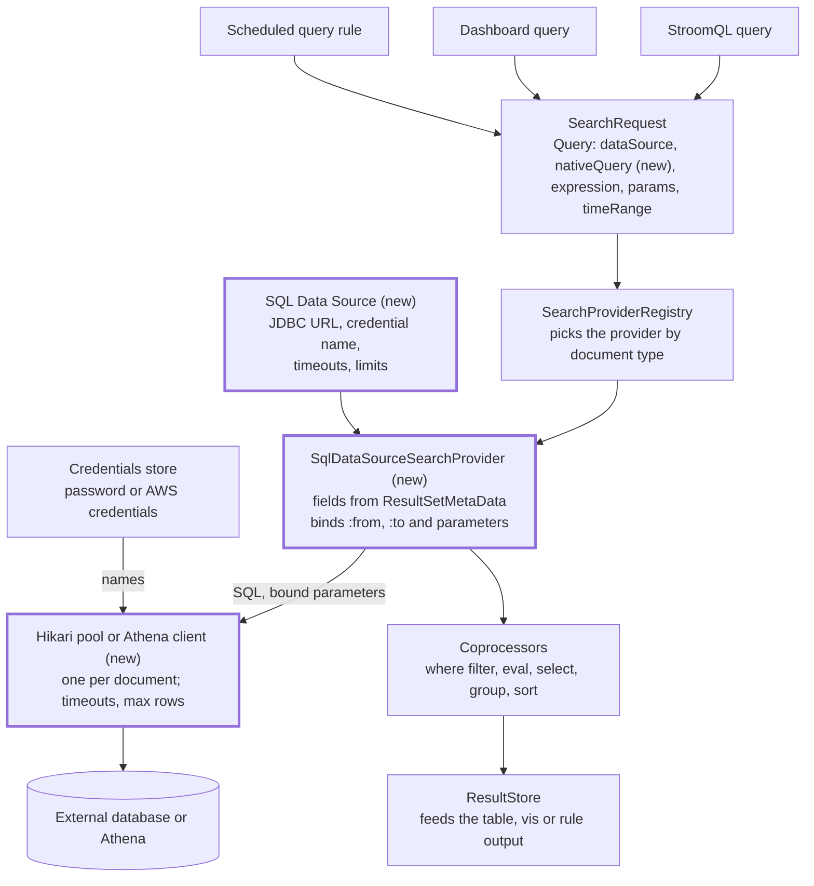

# SQL Data Source Design

Snapshot of the design document, last updated 2026-11-10

## Summary

A new **SQL Data Source** document holds a database connection. StroomQL and dashboard queries name it as their data source and carry a SQL `SELECT` as an embedded string. Stroom runs the SQL, turns each result set column into a query field, and feeds the rows into the normal result store. From there the `where`, `eval`, `select`, `group`, `sort`, `window` and `having` stages work unchanged.

The data source plugs in as one more `SearchProvider`, like SQL Statistics, Plan B and Floor Map. Credentials come from Stroom's existing Credentials store, as the Elastic cluster connection does.

Amazon Athena is the main target. It gets its own connection type on the same document, run through the AWS SDK rather than JDBC (see Amazon Athena).

Stage 8 widens the document into an **External Data Source**, decided 11 November 2026: a Type choice of JDBC, Amazon Athena, CSV or Excel, with that type's settings below it (see External Data Source).

- Issue: [#6010 Add query and analytic support for multiple SQL datasources](https://github.com/gchq/stroom/issues/6010) (no description or comments yet).
- Branch: based on `7.14`. Milestone not yet set.
- In scope: StroomQL, dashboard query panes and rule/analytic queries, read-only.
- Out of scope: writing to the external database and joins across data sources.

## How it fits Stroom's query machinery

Every query source already builds a `SearchRequest`, and Stroom picks a provider by the data source's document type. So a SQL Data Source needs one new provider, a document and a connection pool; nothing after the rows changes.



StroomQL's `from "name"` finds the document through `DataSourceResolver` and `DataSourceProviderRegistry.findDataSourceByName`. The provider implements `SearchProvider.createResultStore` and the `DataSourceProvider` methods: `getFieldInfo`, `getFieldCount`, `fetchDocumentation` and `getTimeField`. It hands each row to the coprocessors as a `Val[]`, as `StatisticsSearchServiceImpl` does for SQL Statistics.

## The new document type

The document is named `SqlDataSource` (shown as **SQL Data Source**), matching the issue's wording. It holds a connection and query limits, but no SQL; the SQL travels with each query. It lives in a new module, `stroom-sql-datasource`, kept apart from `stroom-sqlstore`, which already means the temporal store.

| Setting | Type | Default | Notes |
| --- | --- | --- | --- |
| JDBC URL | text | none | Must match an allowed pattern in config (see Security). |
| Credential | credential name | none | A Username/Password credential, resolved on the server like `ElasticConnectionConfig`'s API key. |
| Connection properties | key/value list | empty | Passed to the driver; a deny list blocks dangerous ones. |
| Time column | text | none | Optional. Becomes the data source's time field for time range filtering. |
| Query timeout | seconds | 60 | `Statement.setQueryTimeout`. |
| Max rows | number | 100,000 | `Statement.setMaxRows`; the query reports when it is hit. |
| Fetch size | number | 1,000 | Rows per round trip. |
| Max pool size | number | 5 | Hikari pool per document. |
| Description | markdown | empty | Shown by the query helper (`fetchDocumentation`). |

The editor has tabs for Settings, Documentation and Permissions, and a **Test connection** button. The button opens a connection, which the pool checks is valid, and reports the database product and version. On `7.14` the editor is a GWTP presenter and view, like the Elastic cluster editor; the component/controller split is master-only work.

The document imports and exports like any other. The export holds the credential's name, never the secret.

A **Connection type** setting chooses JDBC or Athena. An Athena connection replaces the JDBC URL, credential, properties and pool settings with the settings in the Amazon Athena section.

## Query model

The SQL is an embedded string carried in a new `nativeQuery` field on `stroom.query.api.Query`, beside `dataSource`, `expression`, `params` and `timeRange`. StroomQL fills it from a new `sql` clause; the dashboard fills it from a SQL editor in the Query pane. Everything after the SQL runs in Stroom, on the rows it returns.

```
from "HR Database"
sql """
  select s.id, s.name, s.dept, s.created_at
  from staff s
  where s.created_at between :from and :to
    and s.dept = :dept
"""
where name = "Sm*"
eval year = formatDate(created_at, 'yyyy')
select dept, year, count() as staff
group by dept, year
```

### Fields come from the result set

The fields of a query are the columns of its SQL. Stroom reads them from `PreparedStatement.getMetaData()` without running the query. When a driver returns nothing before execution, Stroom falls back to running `select * from (<sql>) q where 1 = 0`. Results are cached by document UUID and SQL hash, so the StroomQL editor and the dashboard field list can offer them.

| SQL type (`java.sql.Types`) | Stroom `FieldType` | Value |
| --- | --- | --- |
| `CHAR`, `VARCHAR`, `LONGVARCHAR`, `NCHAR`, `NVARCHAR`, `CLOB` | `TEXT` | `ValString` |
| `TINYINT`, `SMALLINT`, `INTEGER` | `INTEGER` | `ValInteger` |
| `BIGINT` | `LONG` | `ValLong` |
| `REAL`, `FLOAT` | `FLOAT` | `ValFloat` |
| `DOUBLE`, `DECIMAL`, `NUMERIC` | `DOUBLE` | `ValDouble` |
| `BOOLEAN`, `BIT` | `BOOLEAN` | `ValBoolean` |
| `DATE`, `TIMESTAMP`, `TIMESTAMP_WITH_TIMEZONE` | `DATE` | `ValDate` (epoch ms, UTC) |
| anything else | `TEXT` | `getString()`, or null |

### Parameters are bound, never pasted in

Named placeholders in the SQL are turned into `?` and bound on a `PreparedStatement`. `:from` and `:to` take the query's time range. Any other `:name` takes the dashboard or StroomQL parameter of that name. Stroom never pastes a value into the SQL text, so a parameter cannot inject SQL. A placeholder with no value is an error that names it.

### The where clause runs in Stroom

The Stroom `where` expression is applied to the returned rows with `ExpressionPredicateFactory`, as Floor Map does. It is not translated to SQL in the first version, so authors should filter in the SQL for speed. Pushing simple terms down into the SQL is a later step.

When the query has a time range and the SQL has no `:from`/`:to`, Stroom filters rows on the document's time column (JDBC only; Athena refuses the query instead). With neither, the time range is ignored and the query reports a warning.

## Execution

A query runs once, on the node that received the search, as one task. There is no fan-out across nodes because there is one database. `SqlDataSourceSearchProvider.createResultStore` follows `SqlStatisticSearchProvider`: it builds coprocessors and a result store, then starts the query on the executor and returns at once.

1. Resolve the document and its credential, and take a connection from the document's pool.
2. Rewrite placeholders to `?`, prepare the statement and bind parameters.
3. Set read-only, forward-only, query timeout, max rows and fetch size.
4. Read each row into a `Val[]` in the coprocessors' `FieldIndex` order, reading only the columns the query uses.
5. Drop rows that fail the `where` predicate, and pass the rest to the `ValuesConsumer`.
6. Send errors to the coprocessors' error consumer, then signal completion.

**Pools.** Each document has its own Hikari pool, cached by document UUID and version. A changed or deleted document closes its pool. Idle pools close after a configurable time, 10 minutes by default. `HikariUtil` in `stroom-db-util` already builds pools for Stroom's own databases and can be reused.

**Cancellation.** The search process's `onTerminate` calls `Statement.cancel()` as well as terminating the task, so a closed dashboard stops the database work too.

**Streaming.** Rows go straight to the coprocessors, so memory use is bounded by the result store, not the result set. MySQL needs `useCursorFetch=true` for the fetch size to take effect; the editor's help says so.

**Analytics.** Scheduled-query rules and reports run their queries through the search providers, so they work. Streaming and table-builder rules run per event in a pipeline, so they cannot use a SQL data source. They already require a View as their data source, and Views refuse SQL Data Sources, so such a rule fails when it runs with "Rule needs to reference a view", as it would for an index. Scheduled rules resolve their time range against the run's execution time, so `:from` and `:to` take the run's window, catch-up runs included.

## Amazon Athena

Athena is the main database this feature must serve, so it is a second connection type, run through the AWS SDK's Athena client rather than a JDBC driver. Athena queries are asynchronous, take seconds, write results to S3 and are billed by data scanned. Everything after the rows (fields, `Val[]`, coprocessors, result store) is shared with JDBC.

### Why the SDK client, not the Athena JDBC driver

| Point | Athena JDBC driver 3.8.2 | AWS SDK Athena client |
| --- | --- | --- |
| Licence | AWS IP License: may be redistributed, compiled, inside a product | Apache 2.0, already under Stroom's AWS BOM |
| AWS SDK | Brings its own SDK v2 (3.8.0 uses 2.46.3; Stroom is on 2.57.3); the uber jar bundles it | The SDK Stroom already uses |
| Credentials | Its own options: `User`/`Password` keys, `DefaultChain`, `ProfileCredentials`, `InstanceProfile`, or a custom class by name; web identity not documented | Stroom's `AwsCredentials` model and `AwsCredentialsHelper`, as S3 uses, including web identity and assume role |
| Parameters | `?` support not documented | `ExecutionParameters` on `StartQueryExecution` |
| Cancel | Timeout cancels the query; `cancel()` not documented | `StopQueryExecution` |
| Cost and progress | Query execution ID by unwrapping | State, data scanned and run time from `GetQueryExecution` |

Sources: [driver overview](https://docs.aws.amazon.com/athena/latest/ug/jdbc-v3-driver.html), [release notes](https://docs.aws.amazon.com/athena/latest/ug/jdbc-v3-driver-release-notes.html), [other configuration](https://docs.aws.amazon.com/athena/latest/ug/jdbc-v3-driver-other-configuration.html).

### Athena settings

| Setting | Default | Notes |
| --- | --- | --- |
| Region | none |  |
| Workgroup | `primary` | Admins set its per-query data scan limit; that is the hard cost control. |
| Catalog | `AwsDataCatalog` |  |
| Database | `default` |  |
| Output location | none | S3 URI; optional when the workgroup sets one. |
| AWS credentials | default chain | An AWS access key from a Credential, or Stroom's own identity from the default credentials chain. |
| Result reuse | off | Minutes; lets repeated dashboard refreshes reuse a result. |

### How Athena changes the query model

- **The time range must reach the SQL.** Filtering in Stroom after Athena has scanned everything costs money. So for Athena, a query with a time range but no `:from`/`:to` in its SQL is refused, not filtered afterwards.
- **Placeholders take a format.** Partition columns are often strings, such as `dt = '2026-11-10'`, so a placeholder may carry a date format: `:from{yyyy-MM-dd}`.
- **Fields appear after the first run.** Athena cannot describe a query without running it, and every run is billed (10 MB minimum). Stroom caches the columns by SQL hash from each run's first results page. Until then the field list is empty with a hint.
- **Rows page 1,000 at a time.** `GetQueryResults` returns 1,000 rows per call, so the 100,000 row default takes 100 calls. Reading the result file from S3 with Stroom's S3 client is a later speed-up.
- **Progress shows Athena's own state.** The query info shows queued or running, data scanned and the query execution ID, so admins can find it in the AWS console.
- **Auto-refresh costs money.** Each dashboard refresh reruns the query, and result reuse rarely helps, because a relative time range changes `:from` and `:to` on every run. Many refreshes also use up the AWS account's shared limit on concurrent Athena queries. So each SQL Data Source has a **Minimum Refresh Interval** setting, which the owner sets for their database or AWS account; new Athena sources start at 5 minutes, and JDBC sources start empty (the dashboard's usual 10 seconds). Only dashboard Query and Embedded Query components auto-refresh; the StroomQL editor runs only when asked. The browser runs the timer, so this guards against accidental cost and does not stop API callers.
- **No pool.** One `AthenaClient` is cached per document instead.

## Security

The database account is the real control: the document's help text and the Test connection result both tell admins to use a read-only account. A JDBC URL can also reach internal hosts and switch on driver features that read local files or run code. So URLs must match an admin-set allow list, which is the main control; creating documents needs only the usual document permissions.

| Risk | Mitigation |
| --- | --- |
| Writes or DDL against the database | Read-only account (documented); `Connection.setReadOnly(true)`; `executeQuery` only; one statement only (no `;` outside quotes and comments). |
| SQL injection through parameters | Parameters are always bound on a `PreparedStatement`, never pasted into the SQL. |
| Credential exposure | The document holds a credential name; the secret is resolved on the server and never sent to the browser or written to exports. |
| Reaching internal hosts with a crafted URL | New config `allowedUrlPatterns` (regex list, empty = none allowed); checked on save and on connect. |
| Dangerous driver options (for example MySQL `allowLoadLocalInfile`, `autoDeserialize`; PostgreSQL `socketFactory`; H2 `INIT`) | A deny list for URL and connection properties; H2 and other embedded databases are refused. |
| Untrusted driver code | Drivers come only from the Stroom image or an admin-set driver directory, never from the document. |
| Runaway queries | Query timeout, max rows and pool size per document, with ceilings in config. |

**Permissions.** Creating or editing a SQL Data Source needs only the usual document permissions. Running a query needs `Use` on the document. The credential is resolved as the current user, who needs `Use` on it but not the `Manage Credentials` application permission. Elastic follows the same rule. `CredentialsService.get()` already checks only `Use`; the application permission guards storing, replacing and deleting credentials. Tests for both data source types keep it that way.

## External Data Source

The SQL Data Source becomes an **External Data Source** (`ExternalDataSource`): one document type whose **Type** setting picks JDBC, Amazon Athena, CSV or Excel, with that type's settings shown below it. Nothing has been released, so the rename needs no migration. JDBC and Athena work as now; CSV and Excel hold their data in the document and are queried with Stroom's own clauses.

### Types

| Type | Settings below the choice | Data | Query with | Fields |
| --- | --- | --- | --- | --- |
| JDBC | URL, credential, pool size, fetch size, time column, minimum refresh | External database | `sql` clause | From the SQL (decision 7) |
| Amazon Athena | Region, workgroup, database, output location, credential, minimum refresh, max data scanned | Athena | `sql` clause | From the SQL (decision 7) |
| CSV | Delimiter, header row, columns table, data editor with Upload | Text part of the document | `from` alone | The columns table |
| Excel | Upload and Download, sheet, header row, columns table | `.xlsx` as a binary part of the document | `from` alone | The columns table |

Query timeout and maximum rows stay above the type panels and apply to every type. A `sql` clause on a CSV or Excel document gets the existing error, so `takesNativeQuery()` gains a `DocRef` and answers per document, not per provider.

### Connectors

`ExternalDataSourceSearchProvider` stays the one `SearchProvider` and hands each request to a `Connector` for the document's type. A connector supplies the fields, runs the search into the shared row consumer, tests the connection and reports the minimum refresh. `JdbcConnector` and `AthenaConnector` wrap today's `JdbcQueryRunner` and `AthenaQueryRunner`; `CsvConnector` and `ExcelConnector` read the stored data. Row-to-`Val[]`, the `where` predicate, limits and cancellation stay shared. A later type, such as Parquet on S3, is one more connector.

### CSV and Excel data

- **CSV** is stored as a text part named `csv` beside the `.meta`, as XSLT stores its `.xsl`, so it comes with the document to the editor. The editor shows it in an Ace editor to paste into or edit, with an **Upload** button that loads a `.csv` file into it. It is parsed with Apache Commons CSV, already in the version catalogue.
- **Excel** keeps the uploaded `.xlsx` as a binary part named `xlsx` beside the `.meta` (decided 11 November 2026, replacing the document asset store, whose per-user drafts, View-only reads and visualisation hooks did not fit). Copy, import and export carry it like the CSV part. It is never written as JSON, so it never goes to the browser: the editor uploads a workbook to the upload servlet and sends its `ResourceKey`, which only that user can read; saving stores it, and a save without one keeps the stored workbook. Save As names the original document so its workbook is copied. A Download button fetches it through the resource servlet. It is read with Apache POI's streaming reader, already used by `stroom-dashboard-impl`. A formula cell gives its cached value; a merged cell gives its top-left value. The sheet is named in a text box; empty means the first.
- **Size limit:** `externalDataSource.maxStoredDataSize`, default 5 MB, applies to the CSV text and the `.xlsx` file. Save and upload over it are refused with a message naming the limit.
- **Column types** are inferred, then overridden. After a paste or upload the editor asks the server to read the first 1,000 rows. A column is Long if every non-empty value parses as one, else Double, else Date (ISO 8601), else Boolean (`true`/`false`), else Text. The columns table shows name and type; a type the user sets is kept while the column name stays. Values that do not parse as the column's type become empty, with a warning.
- **Parsed rows are cached** per document and version under a new `tableCache` setting, so dashboard refreshes do not parse again.
- **Time column** (decided 11 November 2026, replacing "no time column at first"): CSV reuses the document's Time Column, which must be a Date column; rows are filtered on it in Stroom, as for JDBC. With none, the time range is ignored with a warning. No minimum refresh, as the data changes only when the document does. **Views** refuse every External Data Source, CSV included, as its rows have no use for a view's extraction.

### Athena scan limit

A new Athena setting, **Max data scanned (GB)**, empty for none. While polling `GetQueryExecution`, Stroom reads `DataScannedInBytes`. Once over the limit it stops the query with `StopQueryExecution` and reports how much was scanned. The statistics lag the scan, so a query can pass the limit by what it reads in one poll; the docs say so and point admins at the workgroup's `BytesScannedCutoffPerQuery`, the hard limit. Data scanned is shown after every run, in StroomQL and on dashboards.

## Work plan

The work splits into nine stages; each ends with code that compiles, has tests and can be reviewed alone. Stages 1 to 4 give working StroomQL queries against JDBC and Athena from the API before any UI. If Athena is needed first, stage 4 can come before stage 3.

- [x] **1. Shared model.** `SqlDataSourceDoc`, `SqlConnectionType`, `JdbcConnectionSettings` and `AthenaConnectionSettings` in `stroom-core-shared` (`stroom.sqldatasource.shared`), where other document types live; the `SqlDataSource` document type, with a stand-in icon; `nativeQuery` on `Query`; `SqlDataSourceConfig` in the new `stroom-sql-datasource-impl` module, under `sqlDataSource` in `AppConfig`; `expected.yaml` regenerated.

  Done 10 November 2026, unstaged, with 22 new tests. The document's REST resource moved to stage 2, beside its implementation.
- [x] **2. Document store.** `SqlDataSourceStore` (checks JDBC settings on save, not on import), serialiser, `SqlDataSourceResource` with fetch, update and Test connection, and the document type registered; `JdbcConnectionValidator` (allow list, embedded databases refused, denied properties in the URL or the property list); `JdbcConnectionResolver` (credential as the current user, pool size ceiling); `JdbcConnectionPoolCache` (Hikari, read-only, keyed on the resolved connection, credential checked on every use, pools closed only when unused); `JdbcDriverLoader` for the driver directory; PostgreSQL driver 42.7.14 added.

  Done 10 November 2026, unstaged, with 52 unit tests and an integration test against the test MySQL database. It also regenerates `ConfigProvidersModule` and fixes `TestConfigMapper`, both missed in stage 1. Testing an Athena connection waits for stage 4; there is no editor until stage 6.
- [x] **3. JDBC search provider.** `SqlDataSourceSearchProvider`: field discovery and cache, type mapping, placeholder rewrite and binding, `where` predicate, time column filter, limits, cancellation, errors. The row-to-`Val[]` and coprocessor code is shared with stage 4.

  Done 10 November 2026, unstaged, with 99 more unit tests and 14 more integration tests that run StroomQL queries against the test MySQL database. Choices made on the way:
  - The provider reports no time field, because `ResultStoreManager` would otherwise add the time range to the `where` expression itself. It binds `:from`/`:to`, or filters on the time column, or warns that the time range was ignored.
  - `:from` and `:to` also take the formats `epochMillis` and `epochSeconds`, since Stroom's own tables hold times as milliseconds.
  - A semicolon is refused anywhere but at the end, even inside quotes or comments, because quoting rules differ between databases. A `?` outside quotes is refused in favour of named placeholders.
  - `getFieldInfo` stays empty (decision 7). The columns of a SQL come from a new `getFields(docRef, sql)`, cached under the new `fieldCache` setting, ready for stage 5.
  - A `where` field that is not a column is an error. Any other field with no column is empty, with a warning.
  - The fetch size is capped at the row limit, because MySQL refuses a larger one; the integration test found this.

  **Audit of stages 1–3, 10 November 2026.** Three independent reviews found problems, all now fixed and tested (212 unit tests, 24 integration tests):
  - **Property checks could be bypassed on MySQL**, whose driver percent-decodes names and reads properties from the host part. MySQL and PostgreSQL URLs are now checked after each driver's own parser has read them. Other drivers' URLs may not contain `%` or `(`. The deny list gained the class-loading and file-reading names it was missing, plus the properties that switch read-only off.
  - **Secrets in the document:** a user name or password in the URL or the connection properties is now refused, with a pointer to the Credential field.
  - **PostgreSQL was not read-only and did not stream rows**, because auto-commit was on. Pools now turn auto-commit off. An opt-in test (`STROOM_SQLDS_TEST_POSTGRES_URL`, `_USER`, `_PASSWORD`) shows writes refused against a real PostgreSQL, and fails with auto-commit on. Run it with `--rerun`, as Gradle's build cache does not see the environment.
  - **Cached columns skipped the credential check**, now done before the cache is asked. A missing credential and one the user may not use now give the same error.
  - **Pools leaked when the cache was rebuilt**, because Stroom's cache rebuild drops entries without telling the removal listener. Pools no longer in the cache and not in use are now closed.
  - **Large numbers:** an unsigned `BIGINT` too big for a long is read as a double, not an error. Whole `DECIMAL`s of up to 18 digits are read exactly, as longs.
  - **Annotation fields:** every table has a hidden `annotation:Id` field. It is left for annotation decoration, as other data sources do, not reported as missing.
  - A missing time column now has its own error. PostgreSQL `$$` strings are parsed.
  - **Permission tests:** the core integration tests use a security mock that allows everything. So decision 5 is now tested in `TestSqlDataSourcePermissions` with Stroom's real security: a user with Use on the document and the credential, and no application permissions, can query; without Use on the credential they cannot.

  For later stages: `SearchRequestFactory` drops a `nativeQuery` set on a request built in code, so stage 5 must carry it through. The OpenAPI spec still needs regenerating. Test connection opens a connection, which Hikari checks with `isValid`; it does not run a separate validation query.
- [x] **4. Athena executor.** `software.amazon.awssdk:athena` under the AWS BOM; client cache per document; `StartQueryExecution` with execution parameters, polling, `GetQueryResults` paging, `StopQueryExecution` on terminate; Athena type mapping; columns cached from the first page; refusal of a time range with no `:from`/`:to`; data scanned in query info; Test connection for Athena.

  Done 10 November 2026, unstaged, with 75 new unit tests run against a mocked Athena client, and an integration test that builds a real client on Stroom's class path. It has not yet run against a real Athena workgroup. Choices made on the way:
  - **New control, `allowedAthenaWorkGroups`.** An Athena document has no URL, so without this any document editor could run queries in any region and workgroup with Stroom's own AWS identity, and Stroom pays. Patterns match `region/workgroup`. With none, as by default, no Athena connection is allowed, as for JDBC URLs. It is checked on save, on Test connection and before each query.
  - **Read only by first keyword.** An Athena connection cannot be made read-only, so only SQL starting with `SELECT`, `WITH`, `VALUES`, `SHOW` or `DESCRIBE` runs. That refuses `CREATE TABLE AS`, `INSERT` and `UNLOAD`.
  - **Parameters are literals.** Athena takes execution parameter values as SQL literals, so Stroom writes each one: text quoted with quotes doubled, numbers as digits, times as UTC `TIMESTAMP` literals. A value can only ever be one literal.
  - **A client per query, not cached per document.** Queries take seconds, so building a client costs little, and a client is then never shared between users or closed while in use.
  - **Test connection runs no query**, as every query is billed. It looks up the workgroup and database, and reports the workgroup's scan limit and result location, or that none is set.
  - **New AWS Access Key credential type** (decision 10), with its form in the credentials editor. Other AWS credential options, such as assume role, are not offered; the default chain covers web identity and instance roles.
  - **Fields** are known once a query has run; until then the field list is empty (decision 7).
  - `NOTICE.md` lists none of the AWS SDK modules Stroom already uses, so Athena's was not added either.

  **Audit of stage 4, 10 November 2026.** Two independent reviews found no way past the read-only check, the literal quoting or the workgroup allow list. Fixed after it (305 unit tests, 25 integration tests):
  - **New control, `allowDefaultAwsCredentials`, off by default.** Without it, an Athena document must name an AWS access key credential, whose Use permission is the per-user control. Otherwise any document creator could query whatever Stroom's own AWS role can read.
  - **New control, `allowedAthenaOutputLocations`, empty by default.** Every query writes its full result to the output location. With no patterns, documents may not set one, and the workgroup's own is used. Test connection now also reports whether the workgroup enforces its settings.
  - **Federated passthrough** (`system.query` on a connector) is documented, not blocked, as a text check is easy to dodge. The AWS identity and connector accounts must only be able to read.
  - A query is now stopped in Athena whenever Stroom fails after starting it, not only on timeout or cancel. The timeout also covers reading results. Times outside the years 1 to 9999 are refused.
  - Numeric parameters on Athena need a cast, as in `where id = cast(:id as bigint)`, because each value is sent as a text literal.
  - New tests cover: a full Athena search through the search provider, missing and forbidden credentials giving the same error, the AWS secret kept out of audit logs, failed polls, queries cancelled outside Stroom, and interrupts.

  For stage 6: the editor's credential picker must offer only AWS access keys for Athena and only username and password credentials for JDBC.
- [x] **5. StroomQL.** Triple-quoted strings in the tokeniser, so SQL can hold double-quoted identifiers unescaped (quoted strings already span lines); the `SQL` token and the `sql` clause after `from` in the tokeniser, parser and `SearchRequestFactory`; field completion from the SQL's columns; a clear error when `sql` is used with another data source type, or is missing.

  Done 10 November 2026, unstaged. New tests: 12 for the `sql` clause, 5 for the tokeniser, and 9 more for the SQL provider. The integration tests now run real StroomQL with a `sql` clause, 29 in all. Choices made on the way:
  - **Triple quotes:** a triple-quoted string is taken as written, with no escapes, anywhere a double-quoted string can go. An unclosed one is left as plain text, as other unclosed quotes are.
  - **`sql` is a keyword** allowed only straight after `from`. Every other clause may follow it. A field named `sql` must now be quoted, as `eval` and `show` must.
  - **Which data sources take SQL:** `DataSourceProvider` has a new `takesNativeQuery()` method, false by default and true for SQL Data Sources. `SearchRequestFactory` uses it to refuse `sql` on other data sources and to require it on SQL ones, without naming the type. A native query set on a request built in code is kept unless the text has a `sql` clause.
  - **Fields from the SQL:** `FindFieldCriteria` has a new, optional `nativeQuery`, and the registry passes it on. StroomQL completion, the query help's field list and `select *` all send the SQL from the `sql` clause, so they list its columns. SQL that cannot be described yet gives no fields, not an error.
  - **Describing SQL without running it:** MySQL's driver runs a client-side prepared statement to describe it. Wrapping it in `where 1 = 0` or `limit 0` does not stop that, because MySQL builds the derived table first. So on MySQL the SQL is prepared on the server instead. A `sleep(5)` query is now described in 0.2 s, not 5 s.
  - **Help:** the query help has an entry for `sql`, with a snippet.

  **Audit of stage 5, 10 November 2026.** No security hole, and no existing valid query tokenised differently apart from the new keyword. Fixed after it:
  - **`sql` is only a keyword straight after `from <data source>`**, so existing queries using a field or data source named `sql` keep working. It also stays a keyword when a triple-quoted string follows, which can only be a misplaced clause, so that gets a clear error.
  - **Closing quotes:** a run of more than three quotes closes on its last three, so SQL can end with a quoted identifier: `"""select * from "events""""`.
  - **No StroomQL help while the SQL is typed.** Before, the SQL's own words were read as StroomQL keywords, and half-written SQL was sent to the database to be described. The `sql` snippet is now only offered for data sources that run SQL.
  - **MySQL describe fallback:** if the server will not prepare a statement, it is described the usual way.
  - **Views refuse a SQL Data Source** with a clear message (decision made 10 November 2026). Views add extraction that SQL rows do not use, and cannot pass the SQL on.
  - **Error positions:** the missing-SQL error points at the `from` clause. SQL set in code on another data source gets its own message.
  - **Highlighting:** the StroomQL Ace mode (`mode-stroom_query.js`, changed with approval) highlights `sql` and triple-quoted strings over several lines. Being regex-based, it colours `sql` as a keyword wherever it appears.
  - New tests cover the tokeniser edge cases, more `sql` clause cases, `select *` asking for the SQL's columns, the registry, the query help, the View refusal, the MySQL fallback, and PostgreSQL describe in the opt-in tests.
- [x] **6. Document editor.** GWTP presenter and view for the settings, switching fields by connection type, with the credential picker and Test connection; the document's own icon and GWT module.

  Done 10 November 2026, committed as `b0e83e1f2a`, with 17 new tests. Checked in the running app: the editor opens on the JDBC fields, switches to the Athena fields, and Test Connection reports the server's answer. Choices made on the way:
  - **The credential is kept unless the user picks another.** The picker can only show a credential the user may use, and fills in after a lookup. So the document keeps the name it was read with; if it cannot be shown, a note under the label says so. A user without Use permission, or one who saves before the lookup returns, no longer removes it. The Git Repo, Elastic and HTTP TLS editors have the same flaw and are left for a separate issue.
  - **Time Column shows only for JDBC**, as Athena queries must use `:from` and `:to`.
  - **Test Connection is disabled when read-only**, as the server needs edit permission to test.
  - **The credential lists offer `[ none ]`**; for Athena, none means Stroom's own AWS identity, as the help says.
- [ ] **7. Dashboard.** (a) A Minimum Refresh setting on the SQL Data Source, reported by the server when a dashboard loads the data source, since a dashboard user may only have Use permission; honoured by the Query and Embedded Query components. (b) Check in the running app that an Embedded Query with a `sql` clause runs against a SQL Data Source, including dashboard parameters as `:name` placeholders. (c) The SQL editor in the Query pane, sent as `nativeQuery`, with field lists, history and favourites carrying the SQL: placement still to be decided, and may wait.

  7a done 10 November 2026, committed as `6e7056dd82`. The setting is whole minutes per connection type (`minRefreshMinutes` on the JDBC and Athena settings): empty means 5 for Athena and none for JDBC, and 0 means none. `DataSourceProvider.fetchMinRefreshInterval` (default none) and a new unlogged REST call, `/fetchMinRefreshInterval`, report it. Embedded Query first asks which data source its StroomQL names. The dashboard waits for the longest of the user's interval, 10 seconds and the source's minimum (`RefreshDelay`). The OpenAPI spec needs no regenerating: the tracked `openapi.yaml` is the generator's input.
- [ ] **8. External Data Source.** 8a to 8c were committed together, as they change many of the same files; 7b is still to check by hand.
  1. **8a Rename and connectors.** `SqlDataSource` becomes `ExternalDataSource` in the type, classes, packages (`stroom.externaldatasource`), module (`stroom-external-datasource`), config path (`externalDataSource`), editor, icon, example pack, README and `DESIGN.md`; `expected.yaml` regenerated. The `Connector` interface, with JDBC and Athena moved behind it, and `takesNativeQuery(DocRef)`. No change in behaviour: today's tests pass, renamed.

     8a done 11 November 2026, committed with 8b and 8c as 18c34d5fea: 335 unit tests in the module and 45 in stroom-app pass, checkstyle and the GWT draft compile are clean. `SvgImage`, `ConfigProvidersModule` and `expected.yaml` were regenerated with their tools. Choices made on the way:
     - **The type property is `sourceType`**, as a document's own `type` is taken. `ExternalDataSourceType` replaces `SqlConnectionType`; the editor's label is just Type.
     - **`Connector`** has `getType`, `takesNativeQuery`, `getFields`, `getMinRefreshMinutes`, `prepare` and `test`. `prepare` checks the query up front and returns a `PreparedQuery`: the expression to filter rows with, warnings known before the run, and the run itself. `Connectors` refuses to start if a type has no connector. The provider and connection tester keep only permissions, the result store and running the search.
     - **`takesNativeQuery(DocRef)`**: a document that is missing, or that the user may not use, answers true, so the query fails for that reason rather than over its `sql` clause.
     - **A missing document has its own error**, where before it failed with a null pointer.
     - **Views** still refuse any data source that takes SQL. Whether a view may use a CSV or Excel document is for 8b to decide.
     - **Messages:** row-limit and unmatched-field warnings say "query" rather than "SQL"; the `sql` clause error names JDBC and Amazon Athena External Data Sources.

     **Audit of 8a, 11 November 2026.** Two independent reviews found no correctness bug, no change in behaviour beyond those intended, and nothing broken at run time. Fixed after it (338 unit tests): the Gradle `moduleName`s still said `sql.datasource`; "a external" in OpenAPI summaries and javadoc; `Connector` javadoc now says the native query is never blank for types that take one, and what `takesNativeQuery` reveals; new provider tests for the time-range-ignored, row-limit and unmatched-field warnings and for an interrupted run; the `addTimeRange` tests moved to `TestJdbcConnector`. Left as they are: `takesNativeQuery` reads the document, uncached, on each parse and completion of StroomQL naming an External Data Source, one indexed read each; the `externalDataSource` property keeps the old `sqlDataSource` place in `AppConfig`'s alphabetical order, which is cosmetic; no JSON alias for `connectionType`, as nothing was released.
  2. **8b CSV.** `CsvSettings` (delimiter, header row, columns) and the `csv` text part; the CSV panel with the Ace editor and Upload; the columns table and the server's inference call; `CsvConnector` with Commons CSV; the size limit and `tableCache`. Tests for parsing, inference, overrides, bad values and the limit; a CSV example in the pack.

     8b done 11 November 2026, committed as 18c34d5fea: 403 unit tests in the module, 8 new StroomQL integration tests on a saved CSV document, checkstyle and the GWT draft compile clean. StroomQL needed no change: 8a's `takesNativeQuery(DocRef)` and field listing without SQL already covered it. Choices made on the way:
     - **Model:** `CsvSettings` (delimiter, header, columns, data) with `DataColumn` and `DataColumnType` (Text, Long, Double, Date, Boolean). The serialiser moves the data to a `csv` part, exported as `Name.ExternalDataSource.uuid.csv`.
     - **Values:** empty is null for every type. Long and Double take only plain decimal numbers, so `NaN`, hex and `1,000` are refused. Dates are ISO 8601, a space allowed for the `T`, and a time with no zone is UTC. A value that does not fit its column is empty, and the query warns once with a count and the first example.
     - **Detect Columns** is a REST call, `/detectColumns`, needing Edit on the document and refusing CSV over the size limit. Names come from the header, `columnN` where blank or missing, with a suffix on repeats. A column keeps a type already set for the same name.
     - **The query** warns if the CSV's header no longer matches the columns. Parsed tables are cached per document version and row limit; an unsaved document is parsed each time.
     - **Check CSV** (Test Connection for CSV) reads the whole CSV and reports rows, columns, a changed header and values that do not fit.
     - **Editor:** the Settings tab shows Delimiter (Comma, Semicolon, Tab, Pipe), First Row Is A Header, the Ace editor, Upload CSV (read in the browser, then columns detected), Detect Columns, and a type box per column. Time Column shows for JDBC and CSV; Query Timeout is hidden for CSV.
     - **Config:** `maxStoredDataSize` (5 MiB) and `tableCache`. The size limit is checked on save whatever the type, as the CSV stays in the document.
     - **Example:** the pack has a Teams CSV document, with `founded` as its time column, and a Teams on call query.

     **Audit of 8b, 11 November 2026.** Two independent reviews, one of the server and one of the editor, found no data leak. Fixed after it (420 unit tests in the module, 8 CSV integration tests, checkstyle and the GWT draft compile clean):
     - **Header warning:** it was given wrongly for a header with blank or repeated names, or one shorter than its rows. It now compares against the names Detect Columns gives.
     - **Stale rows after import:** an import keeps the pack's version, so a re-imported CSV could be served from the old cached table. The cache key now includes the CSV itself and its delimiter and header settings.
     - **Byte order mark:** a leading byte order mark, written by spreadsheets saving "CSV UTF-8", is dropped, so it no longer joins the first column's name.
     - **Size limit:** checked at query and Check CSV time too, as imports skip the save check. Sizes are counted in UTF-8 bytes without copying the data.
     - **Delimiter:** checked on save by building the real format, so a quote or line break is refused.
     - **Row limit:** the limit plus one no longer overflows at the largest integer.
     - **Table cache:** it defaults to 10 tables, not 100, as a parsed 5 MiB CSV can take tens of megabytes.
     - **Type guessing:** codes with leading zeros and whole numbers too big for a Long are guessed as Text, so nothing is lost.
     - **Columns:** a column with no name, or two with the same name, is refused at query time. The time column is matched without regard to case, as fields are. The row-limit warning says rows were read, not returned.
     - **Editor, Load From File:** "Upload CSV" is renamed Load From File, as the file never leaves the browser. Files over 50 MiB are refused before reading. The file is taken before the input is cleared, so a read error is still reported, and its callbacks run through `$entry`.
     - **Editor, settings:** a stored delimiter the list does not offer is kept on save. Changing the delimiter or header setting detects the columns again. A Detect Columns reply that arrives after the document is read again, or after a later click, is ignored.
     - **Editor, dirty state:** reading a document no longer leaves it dirty because of defaults filled in, such as an unset header, delimiter or column type.
     - **Editor, other:** the Format action stays off for CSV. Each column's type box has an accessible name.

     Left as they are: the Ace editor and the columns list are not tied to their form labels for screen readers, as with other embedded editors; date forms beyond those documented on `DataColumnType`, such as lowercase `z`, leap seconds and five-digit years, are refused.
  3. **8c Excel.** `ExcelSettings` (sheet, header row, columns, file name); upload and download, with the workbook as an xlsx part; `ExcelConnector` with POI's streaming reader; inference shared with CSV. Tests with small workbooks: types, formulas, merged cells, empty rows, a missing sheet, a file over the limit.

     8c done 11 November 2026, committed as 18c34d5fea: 441 unit tests in the module, 3 new StroomQL integration tests on a saved workbook, checkstyle and the GWT draft compile clean. Choices made on the way:
     - **Shared code for held data:** `CsvTable` became the format-neutral `DataTable` and `CsvReader`, and `CsvColumnDetector` became `ColumnDetector`. The cache became `DataTableCache`, keyed by a data key each type supplies. `StoredDataConnector` holds what CSV and Excel share, so `CsvConnector` and `ExcelConnector` only say where the data is and how to read it. `StoredDataSettings` is the shared interface of `CsvSettings` and `ExcelSettings`.
     - **Reading cells:** numbers are written plainly whatever their Excel format, so `1,234.50` reads as `1234.5`. Dates are written in ISO 8601 as UTC, without the time when it is midnight. Booleans read as `TRUE`/`FALSE`. Rows with no values are skipped. Older `.xls` workbooks are refused with a message to save them as `.xlsx`.
     - **Uploads:** `ExcelUploads` reads an upload's file, checking its size before reading it, and deletes it once the document is saved. The editor's settings carry the upload key, or on Save As the original's UUID (`copyWorkbookFrom`); the store clears both before storing.
     - **Detect Columns and Check Workbook** fill in the workbook from the upload or the stored document, as the editor sends neither.
     - **Editor:** the Excel panel has the workbook's name, Choose File and Upload (which detects the columns), Download, Sheet, First Row Is A Header, Detect Columns and the columns list. Changing the sheet or header detects the columns again. The columns list became a `DataColumnsPanel` widget shared with CSV.
     - **Example:** the pack has a Bank Holidays workbook, with `date` as its time column, and a Bank holidays in Scotland query.

     **Audit of 8c, 11 November 2026.** Two independent reviews, one of the server and one of the editor, found no way to reach a workbook without View on its document, and the bytes never reach JSON, logs or the browser. Fixed after it (450 unit tests in the module, 40 integration tests, checkstyle and the GWT draft compile clean):
     - **1904 dates:** POI's sheet handler never passes the workbook's date system, so dates from 1904 workbooks (older Mac Excel) came out four years early. The reader now reads `date1904` from the workbook itself.
     - **Removing a workbook:** a stored workbook always has a file name; settings sent with none remove it, and the editor has a Remove button. The workbook's size is checked only while the type is Excel, so one over the limit (say from an import) no longer blocks every save. The serialiser gives a stored workbook with no file name `workbook.xlsx`, and drops any upload key or document to copy from in a pack's JSON.
     - **Memory:** POI unpacks a workbook into memory, so the reader first measures the unpacked size by reading the zip and refuses more than 200 MiB, without changing POI's JVM-wide settings. Detect Columns and Check apply the size limit to a stored workbook too.
     - **Reader:** sheet names are matched without regard to case or outer spaces. A time with no date reads as a time. A password-protected workbook gets a message that says so. The workbook is closed with `revert()`, and any runtime error from a bad workbook becomes a clear message. Copying from a document that has gone is refused.
     - **Editor:**
       - Choosing a file uploads it straight away, so there is no separate Upload button. The name is taken when chosen, and the chooser is cleared when the document is read again.
       - Save As copies the workbook whenever the original has Excel settings. Columns are detected after an upload only if the type is still Excel. A stale Detect Columns failure is ignored.
       - The file chooser and Remove are disabled when read-only. The per-column type boxes get their accessible name on the element that takes focus, through a new `BaseSelectionBox.setAriaLabel`. `CustomFileUpload` gained `onFileChosen`, `reset` and `setEnabled`.

     Left as they are: every query reads the whole document, workbook included, and hashes it for the cache key; an upload lives on the node that took it, so in a cluster without sticky sessions a save on another node asks for the file again, as for imports; elapsed-time formats such as `[h]:mm` read as dates.
  4. **8d Athena scan limit.** The Max data scanned setting, the check while polling, the stop and its message; data scanned shown after each run. Tests on the mocked Athena client.

     8d done 11 November 2026, unstaged: 454 unit tests in the module and the 40 integration tests pass, checkstyle and the GWT draft compile clean. Choices made on the way:
     - **The limit is in MB, not GB** (`maxDataScannedMb` on the Athena settings, in decimal MB as Athena bills), as a whole number of GB cannot say 500 MB. Empty or 0 means no limit beyond the workgroup's.
     - **Checked while running:** each poll of `GetQueryExecution` compares `DataScannedInBytes` with the limit; over it, the query is stopped in Athena, by the existing stop-on-error path, and the search fails with how much was scanned and a hint to narrow the query. Polls are 0.25 to 2 seconds apart, so a query can pass the limit by what it scans in one gap. A query already finished is read even if over the limit, as its cost is already incurred.
     - **Data scanned** was already reported after each run as an information message.
     - **Check Connection** now gives the document's limit beside the workgroup's.
     - **Editor:** Max Data Scanned (MB) in the Athena panel, with help that points at the workgroup limit as the exact one.

     **Audit of 8d, 11 November 2026.** One independent review found no bug: the limit is checked after the finished, failed and cancelled states, on the first poll too, a queued query cannot trip it, the limit cannot overflow, and the query is stopped in Athena by its own ID. Fixed after it (457 unit tests, checkstyle and the GWT draft compile clean): the message gives both amounts in MB, e.g. "stopped after scanning 1.5 MB, more than the limit of 1 MB"; a document with no limit keeps none rather than gaining a stored 0; the new tests moved above the test class's inner class, as AGENTS.md asks; new tests cover exactly the limit, the stop's query ID and the document's limit in Check Connection. Left to check by hand: that Athena fills in the data scanned while a query runs, which no test here can show; the workgroup limit covers it if not.
- [ ] **9. Analytics, docs and changelog.** Integration tests for a scheduled rule and a report on an External Data Source (both already work through `SearchRequestFactory`; streaming and table-builder rules already fail at run time); the `stroom-docs` page; `./log_change.sh Feature 6010 "…"`; full build and Docker images; drop the test database's leftover `sqlds_test_reader` user and `stroom_sqlds_run` database.

**Tests.** Unit tests mock `ResultSetMetaData` and `ResultSet` for type mapping, placeholder rewriting, the single-statement check and the URL allow and deny lists. Integration tests point a document at the test MySQL database from `stroomTestDb.yml` and query a table made by the test. A PostgreSQL test needs a driver Stroom does not ship today, so it waits on the driver decision. Athena unit tests mock `AthenaClient`; a manual test against a real workgroup with a small scan limit checks the end-to-end path.

**Test content pack.** `stroom-sql-datasource/StroomDB-SqlDataSource-Examples.zip` imports a folder, *SQL Data Source Examples*, with a SQL Data Source named *Stroom DB* pointed at Stroom's own MySQL database and five StroomQL queries: nodes; streams by feed and type; streams created per day, using the time range as `:from{epochMillis}`; the biggest feeds, grouped in the database; and processor tasks by status. The MySQL driver is already shipped, and the database always holds real data. The pack tests the JDBC path only; Athena still needs its own test. A dashboard is not included yet.

- **No secret in the pack.** Exports hold only a credential name, so the pack names one, `Stroom DB Reader`, which the admin creates after import.
- **The URL differs by deployment.** In dev it is `jdbc:mysql://localhost:3307/stroom` (`dev.yml`); elsewhere the host or database name differs. The admin edits it, and it must match `allowedUrlPatterns`.
- **Use a read-only MySQL user with `SELECT` on the example tables only.** `stroomuser` can write to every table, and the `credential`, `api_key` and user tables must not be readable. The data source's Documentation tab gives the `GRANT`s.
- **Dev and test only.** Reading `meta` directly bypasses Stroom's feed permissions.

## Decisions

Decisions 1 to 10 were made on 10 November 2026; eight follow the recommendation, and two (5 and 8) differ from it. Decisions 11 to 19 were made on 11 November 2026, all as recommended; 11 replaces 2.

| # | Decision | Chosen | Not chosen |
| --- | --- | --- | --- |
| 1 | Where the SQL lives | In each query (`nativeQuery`) | Named queries saved in the document; both |
| 2 | Document type name | `SqlDataSource` / SQL Data Source | `JdbcDataSource`; `DatabaseConnection` |
| 3 | StroomQL syntax for the SQL | A `sql` clause after `from`, with a triple-quoted multi-line string | SQL in brackets after the data source name |
| 4 | Which JDBC drivers | Ship MySQL and PostgreSQL; others from an admin-set driver directory | MySQL only, with or without a driver directory |
| 5 | Whose permission resolves the credential | The current user, who needs only `Use` on the credential, not the `Manage Credentials` application permission. The same rule applies to Elastic. | The processing user |
| 6 | Pushing `where` terms into the SQL | Later; filter in Stroom first | In the first version |
| 7 | Field list before the SQL is known | Empty, with a hint to write the SQL first | A sample query saved in the document |
| 8 | Who may create documents | No extra permission: normal document permissions plus the URL allow list | A new application permission; administrators only |
| 9 | How Stroom talks to Athena | AWS SDK Athena client, as a second connection type | The Athena JDBC driver |
| 10 | Where static AWS keys live | The Credentials store (a new AWS key credential type) | Inline in the document; no static keys |
| 11 | General document type name | ExternalDataSource / External Data Source, with a Type choice | Data Connection; Table Source; keep SQL Data Source |
| 12 | Where CSV data is stored | A text part of the document, like XSLT's .xsl | Inside the JSON; the document asset store |
| 13 | Where Excel data is stored | The original .xlsx, as a binary part of the document (changed 11 November 2026 from the document asset store) | Converted to CSV on upload; a binary part sent with the document |
| 14 | CSV and Excel column types | Inferred from the first 1,000 rows, then overridable per column | All text; types declared in the header |
| 15 | Stored data size limit | 5 MB by default, set by maxStoredDataSize | 1 MB; 20 MB |
| 16 | Athena cost control | Per-document scan limit that stops the query, and data scanned shown after each run | Data scanned shown only; a daily budget per document |
| 17 | How CSV gets in | An Ace editor to paste into, with an Upload button | Paste only |
| 18 | Staging | Stage 8 in this issue (8a to 8d); docs move to stage 9 | Rename now, CSV and Excel in a later issue |
| 19 | Excel format | Keep the uploaded file, so it can be downloaded again | Convert to CSV and drop the file |
