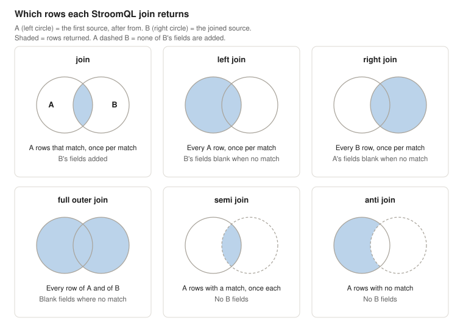
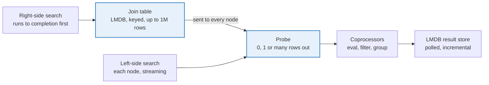

# StroomQL Joins Design

Snapshot of the design document, last updated 2026-11-16

## TL;DR

- **What:** add join lines to StroomQL, straight after `from`: `join` (or `inner join`), `left join`, `right join`, `full outer join`, `semi join` and `anti join`. `where exists`, `where not exists` and `where X in (from …)` are the SQL forms of semi and anti joins. Either side may be a source or a bracketed query, and `where` may name joined fields. Until the 2026-11-16 revision, semi and anti joins were called `keep join` and `drop join`, and there were no right or full joins.
- **How:** the bounded side (a Data Connection, a small or grouped query) runs first into an LMDB join table, up to 1 million rows. The other side streams through it into the existing result store, so results still arrive incrementally.
- **Windowed joins too:** event-to-event joins within a time window, such as a logon then an export within 10 minutes, are in this plan as its last stage.
- **Not DuckDB, for now:** it would add a second query language, end incremental results, and bring a 79 MB native jar that does not run on Stroom's Alpine image as shipped.
- **Status:** all sixteen decisions made on 2026-11-12; all seven build stages built and committed on 2026-11-12. Three differ from the decisions: the pushdown limit is 1,000 keys, `anti join` is pushed down only on ID and whole-number fields, and windowed joins give their rows once both searches finish.
- **Revision, 2026-11-16:** semi and anti joins take their standard names, replacing `keep join` and `drop join`. They gain their SQL forms, `where exists`, `where not exists` and `where X in (…)`, and right and full outer joins are added. This is stages 8 to 10, of which all done on 2026-11-16.

## How a StroomQL query runs today

Every query reads exactly one source into one result store, and the browser polls that store until it is complete. `SearchRequestFactory.addDataSource()` refuses a second source, and no `join` token exists.

1. `SearchRequestFactory` turns the StroomQL into a `SearchRequest`: one `Query` (data source, `where`, optional `nativeQuery` from the `sql` clause) and one `TableSettings` (eval, group, sort, select, having, limit).
2. `ResultStoreManager` picks the `SearchProvider` for the data source, adds the time range and query key, and asks the provider to create a `ResultStore`.
3. The provider produces rows as `Val[]` and pushes them into `CoprocessorsImpl.accept()`. Lucene fans the search out to every node; each node runs its own coprocessors and sends LMDB payloads back to the coordinator, which merges them. Data Connections run as one local task (`PreparedQuery.Run` feeding `SqlRowConsumer`).
4. The coprocessor's `LmdbDataStore` applies `filter` and eval, then groups by merging rows that share a key. Sorting happens at read time, capped by `maxSortedItems` (500,000).
5. The browser polls with the same query key. Each poll re-parses the StroomQL, reads the first page from the store, and gets `complete = false` until every node has finished.

Two existing features act like joins. `in dictionary` is a semi join against a fixed word list. `getState(map, key, time)` in `eval` looks a key up in Plan B per row.

Data Connections (#6010, on 7.14) add JDBC, Athena, CSV, Excel and LDAP sources. They are the main reason joins are now wanted: the reference data people want to join to now lives in a source StroomQL can read.

## What users need

Users want to relate rows from two sources in one query, and almost always one side is small or summarised. These five cases cover the requests we have seen. The syntax is the sketch from the Stroom 9 roadmap (55 · Views and joins); the proposed syntax section below refines it.

| # | Need | Left side | Right side | Kind | Right side size |
| --- | --- | --- | --- | --- | --- |
| 1 | Enrich events with owner, department or asset details | Events (index) | Data Connection (HR, CMDB) | left | Small: thousands of rows |
| 2 | Find events from users who should not exist, or are not leavers | Events | Data Connection or CSV | semi / anti | Small |
| 3 | Compare two summaries, for example logons per user against file exports per user | Grouped query | Grouped query | inner / left | Bounded by the group-by |
| 4 | A sequence: a logon followed by an export within 10 minutes | Events | Events | inner, within a window | Large unless windowed |
| 5 | Enrich with values as they were at event time | Events | Plan B or reference data | left, valid at | Looked up by key |

Case 1 written as a query:

```text
from "Windows events"
left join "HR Users" as hr on UserId = hr.Username
where EventTime > day() - 7d
select EventTime, UserId, hr.Department, hr.Manager
```

Case 3, joining two grouped queries:

```text
from "Windows events"
left join (
  from "File events"
  where Action = 'Export'
  group by UserId
  select UserId, count() as Exports
) as ex on UserId = ex.UserId
where EventType = 'Logon'
group by UserId
select UserId, count() as Logons, first(ex.Exports) as Exports
```

Case 5 already works today without a join, through Plan B and reference data lookups in `eval`. Joins should not replace those, only sit beside them.

## Why joins are hard here

A join needs one side complete before any joined row is final, but Stroom's stores fill a little at a time and are only complete when every node has finished. Five specifics follow from the code.

- **Results arrive incrementally.** A store reports `complete = false` while nodes are still sending payloads. A row on the left can only be joined, or dropped by a semi or anti join, once the right side is complete. Otherwise a later right row could change the answer.
- **Grouped rows are not final until the end.** A group's count keeps changing as payloads merge. A join on a grouped side must wait for that side to finish.
- **The store has no streaming read.** `LmdbDataStore.fetch()` reads pages under a single read transaction. Reading a whole side means `OffsetRange.UNBOUNDED`, which is still capped by `maxSortedItems` (500,000) and the group-depth sizes (`1000000,100,10,1`).
- **Rows are grouped on the worker nodes.** A Lucene search groups on each node and ships LMDB payloads, so a join that must happen before grouping has to run on every node, not just the coordinator.
- **Every poll re-parses the query.** A join's child searches must be found again from the query key on every poll, and destroyed with it.

The way through is to keep one side bounded and complete first, and stream the other side through it. That keeps the large side incremental, which is what users see today. It is also the rule the Stroom 9 roadmap agreed on 2026-11-03: one side bounded, kept or looked up.

## Options

A native join in StroomQL is the easiest option for users. DuckDB is a good engine but a second language, and it gives up incremental results. External tools such as DataGrip cannot reach Stroom's data today.

**A. Native join in StroomQL.** Add join lines to StroomQL. The bounded side runs first as an ordinary child search, and its rows are held in a hash table keyed on the join key. The other side then streams through the existing coprocessors, probing the table as rows arrive.

**B. Embedded DuckDB.** Register a Java table function, for example `stroom('<StroomQL>')`, with DuckDB's new Java API (`DuckDBFunctions.tableFunction()`, with `bind`, `init` and `apply` callbacks filling 2,048-row chunks; [DuckDB, 2026-08-25](https://duckdb.org/2026/08/25/table-functions-in-java)). Each call runs a Stroom search and streams its rows into DuckDB, and users write DuckDB SQL over them. This is how DataGrip 2026.3 joins across connections ([DuckDB, 2026-11-05](https://duckdb.org/2026/11/05/jetbrains-datagrip)).

**C. External SQL tools.** Analysts join Stroom data in DataGrip or another client. Neither article offers a way for an outside client to query a server's data: DataGrip's DuckDB runs inside the IDE, over DataGrip's own connections. Stroom would need its own JDBC driver or an Arrow Flight SQL endpoint first.

|  | A. Native join | B. Embedded DuckDB | C. External tools |
| --- | --- | --- | --- |
| Language users write | StroomQL, with completion, help and Stroom's functions | DuckDB SQL wrapping StroomQL strings; a second language | The tool's SQL |
| Results while running | Incremental on the streamed side, as today | None until DuckDB finishes: joins, sorts and groups block | None |
| Dashboards, tables, links to events, annotations | Unchanged: same result store | Rows must be copied back into a result store | Outside Stroom |
| Join kinds | inner, left, semi, anti; windows later | All of SQL, including large-to-large joins that spill to disk | All of SQL |
| Large-to-large joins | Refused with a reason (one side must be bounded) | Supported, with disk spill | Supported, on the analyst's machine |
| New dependency | None | `duckdb_jdbc` 2.0.0.0, a 79 MB jar of native code | A new Stroom server endpoint |
| Runs in Stroom's Docker image | Yes | Not as shipped: the image is Alpine (musl) and the jar holds only glibc Linux builds | n/a |
| Memory | LMDB join table beside the result stores, capped | Native memory outside the JVM's limits; needs `memory_limit` and `temp_directory` | Analyst's machine |
| Security | Each side searched as the current user | Same, but DuckDB's file and HTTP access must be locked off (`enable_external_access = false`) | Data leaves Stroom |
| Work | Parser, join operator, node shipping of the bounded side | Table function, type mapping, result copy-back, packaging | Driver or Flight SQL server |

**Recommendation: A**, with B kept as a later execution engine behind the same syntax if large-to-large joins become a real need. DuckDB earns its place when both sides are big, which is also when a Stroom search is slowest and incremental results matter most. That case is better met by the roadmap's live views than by a second engine.

## Proposed syntax

Join lines go straight after `from`, one per joined source, and the right side is either a whole source or a bracketed query. This follows the roadmap decision of 2026-11-04 and changes no existing clause.

```text
from <side>
<kind> <side> on <a> = <b> [and <c> = <d> ...]
...
where ...      // may name any field; first-source terms are pushed down to its index,
               // except with a right or full join
eval ...
filter ...     // runs on joined rows
group by ...
select ...

<kind> := join | inner join | left [outer] join | right [outer] join | full [outer] join
        | semi join | left semi join | anti join | left anti join

<side> := <source> [as <alias>] [sql """..."""]
        | ( from <source> [sql ...] [where ...] [eval ...] [group by ...] select ... ) [as <alias>]

// SQL forms of semi and anti joins, at the top level of where, joined by and
where exists (from <source> [as <alias>] where <k> = <first source alias>.<k> [and ...])
where not exists (from <source> [as <alias>] where <k> = <first source alias>.<k> [and ...])
where <field> in (from <source> [where ...] select <k>)
where <field> not in (from <source> [where ...] select <k>)

// windowed event-to-event join (stage 7)
join <source> as <alias> on <a> = <b> within <duration> [after | before] <time field>
```

| Join | Also written | Rows out | Joined fields |
| --- | --- | --- | --- |
| `join` | `inner join` | One row per match; first-source rows with no match are dropped | Added |
| `left join` | `left outer join` | One row per match; first-source rows with no match are kept | Added, blank when no match |
| `right join` | `right outer join` | One row per match; joined rows with no match are kept | Added; first-source fields blank when no match |
| `full outer join` | `full join` | One row per match; unmatched rows from both sides are kept | Added, blank where no match |
| `semi join` | `left semi join`, `where exists (from …)`, `where X in (from …)` | Each first-source row with at least one match, once | None |
| `anti join` | `left anti join`, `where not exists (from …)`, `where X not in (from …)` | Each first-source row with no match | None |



A `join` and a `semi join` return the same region; the semi join adds no fields and never repeats a row. Every join starts from the first source's rows except the right and full joins, which also give joined rows that matched nothing.

Rules:

- **Field names.** Joined fields are named `<alias>.<field>`, so `hr.Department`. The alias defaults to the source name. Fields of the first source stay unprefixed, so existing queries read the same.
- **`where`.** `where` may name any field. Stroom splits it: the top-level `and` terms that name only first-source fields are pushed down to Lucene, Elastic or the database, as today, except with a right or full join. For inner and semi joins, terms that name only one joined source's fields are pushed down to that source's search too; for left, anti, right and full joins they are not, because that would change which rows count as unmatched. Every other term, including an `or` that mixes both sides, runs on joined rows. The query info pane shows which part was pushed down. `filter` keeps its current meaning.
- **Bracketed sides.** Either side may be a bracketed query, for example a grouped summary. A bracketed left side must finish before any joined row appears, so its results are not incremental.
- **Keys.** One or more equal pairs, joined with `and`, and either side may be an expression (`lowerCase(UserId) = hr.Username`). Values compare as strings after the usual `Val` conversion, so a number key matches its text form.
- **Time range.** The query's time range applies to the first source. A joined source with a time field gets it too, unless its bracketed query sets its own range in `where`.
- **Several joins.** Each join line has its own bounded right side; they apply in order.

- **Key matching.** Keys compare exactly and case-sensitively. A blank or null key never matches, as in SQL.
- **First-source names.** When the first source has an alias, `UserId` and `logon.UserId` both work. A bare name means the first source when names clash.
- **Chained joins.** A join's keys may use the first source and any earlier join's fields, so user to department to cost centre is three lines. A key from an earlier join cannot be pushed down.
- **Fan-out.** One left row matching many right rows produces one row per match, within the existing result store limits. A warning is shown once a left row matches more than 1,000 right rows.
- **Event links.** The hidden StreamId, EventId and AnnotationId columns come from the first source only, so a joined row still opens and annotates its left event.
- **Bracketed left side.** The outer `where` runs after the join, like `filter`, because there is no index to push it to.
- **Where joins are allowed.** In the StroomQL editor, Embedded Query, scheduled queries and reports. Streaming analytic rules refuse a join with a clear error, because they run one event at a time inside the pipeline.

Case 2 from above, users with logons who are not in HR:

```text
from "Windows events"
anti join "HR Users" as hr on lowerCase(UserId) = hr.Username
where EventType = 'Logon'
group by UserId
select UserId, count() as Logons
```

Case 4, a logon followed by an export within 10 minutes:

```text
from "Windows events" as logon
join "File events" as export
  on logon.UserId = export.UserId
  within 10m after logon.EventTime
where logon.EventType = 'Logon' and export.Action = 'Export'
select logon.EventTime, logon.UserId, export.EventTime, export.FileName
```

Dashboards get joins through the Embedded Query component, which already runs StroomQL. The Query component's expression tree stays single-source.

## Proposed execution

The right side runs to completion as an ordinary child search and is written to an LMDB join table keyed on the join key. The table is sent to every node, and the left side's rows probe it on their way into the existing coprocessors. Everything after the probe (eval, filter, grouping, the result store, paging, polling) is unchanged.



The highlighted parts are new. The left search starts only once every join table is built; everything from the coprocessors on is today's code.

1. **Model.** `Query` gains `joins`: a list of `Join` (kind, alias, key pairs, optional window, and the right side). A bracketed side, left or right, is carried as its own `Query` and `TableSettings`. `SearchRequestFactory` builds it from the join lines, and resolves each source with `DataSourceResolver` as `from` does.
2. **Child searches.** `ResultStoreManager` puts a placeholder store under the search's key, so polls see an incomplete search straight away. A background task runs a child search for each right side, and for a bracketed left side. The children are held by the join search itself, not by the result store manager. Each child is searched as the current user, so a join never widens access. Once the tables are built, the first source's search takes the placeholder's place under the same key. Terminating or destroying the search terminates or destroys its children.
3. **Join table.** When a right child completes, its rows are read once with `OffsetRange.UNBOUNDED` into a `JoinTable`. This is its own LMDB environment, beside the result stores, made by the same environment factory. Its key is the join key and its duplicate-sorted values are the right side's rows, holding only the fields the query uses. It is capped at 1 million rows or 256 MB, changeable by administrators; over the cap, the query fails and suggests a filter or a grouped right side.
4. **Splitting `where`.** Top-level `and` terms that name only first-source fields stay in the left search's expression and are pushed down, except with a right or full join. For inner and semi joins, terms that name only one right source's fields move into that child search the same way. The remaining terms become a post-join predicate, built with `ExpressionPredicateFactory`, that runs straight after the probe.
5. **Pushdown of semi and anti joins.** A `join` or `semi join` whose table has at most 1,000 keys, with a plain field of the first source as its left key that the source can search with `in`, also adds an `in` term to the left search. An `anti join` adds `not in`, but only on ID and whole-number fields, where every data source matches exactly as the join does; on text fields a source that ignores case would drop rows the join keeps. The limit is 1,000 rather than the 10,000 first agreed, because Lucene, Solr and Elasticsearch refuse queries of more than 1,024 conditions by default. A key with spaces, commas, quotes or wildcards, or a number written unusually, turns the pushdown off for that join.
6. **Left search.** The left search starts only after every table is built, and runs through its normal provider. `CoprocessorsFactory` wraps `CoprocessorsImpl` in a `JoiningCoprocessors` that probes each `Val[]` and passes on zero, one or several joined rows. `FieldIndex` gains the `alias.field` positions, and providers are told not to extract them. A bracketed left side is read from its child store once complete and fed through the same probe.
7. **Other nodes.** Each node's search task carries the join's id. The node fetches a compacted, compressed copy of the LMDB table from the coordinator once, over the remote search resource. It opens the copy read-only and deletes it when the search ends.
8. **Progress.** While a child runs, polls return `complete = false` with a message such as "Reading HR Users: 12,400 rows". After that, left rows arrive incrementally as they do today.

The probe sits before grouping, so a joined field can be grouped by or summed, and each node groups its own joined rows exactly as it does now.

### Windowed event-to-event joins

In a windowed join the left side is the anchor and is bounded instead of the right, because both sides are events. For example, take logons followed by an export within 10 minutes.

1. The left search runs first and writes its rows to an LMDB join table, keyed on the join key, with each row's time. It has the same cap, so the left side must be selective: a filter, a short time range or a grouped query.
2. The right search is narrowed before it starts, to the anchors' windows: overlapping windows are merged, and at most 20 ranges are searched, merged across the smallest gaps if there are more. The right side's time is its data source's time field, so it must have one; Data Connections have none. When there are at most 980 keys, the search also gets an `in` term on its key, leaving room under the 1,024-condition limit for the ranges.
3. Each right row probes the table and is joined to every left row with the same key whose time puts the right row inside the window.
4. As built, rows do not stream: the right search runs to completion, capped at the join limit, and then every joined row is given at once, with unmatched anchors for `left join` and `anti join` and matched ones for `semi join`. Over the cap the query fails before any row is given. Streaming `join` and `semi join` rows as the right rows arrive is left for later, as it means probing inside the right search on every node.

A windowed join with no window is refused with a message suggesting one.

A query with a windowed join has only that one join line, and neither side may be a bracketed query yet.

## Revision: standard names and outer joins

Before release, joins move to standard SQL names and gain the outer joins SQL users expect. `keep join` and `drop join` become `semi join` and `anti join`. `where exists`, `where not exists` and `where X in (…)` are added as their SQL forms, and `right join` and `full outer join` are added. Joins have not been released, so the old words are removed, not deprecated.

### What we are correcting

Decision 2 chose `keep` / `drop`, with `semi` and `anti` as completion synonyms. Users don't recognise `keep` and `drop`, which no SQL dialect or query language uses, and the synonyms were never built.

| Was | Now | Why |
| --- | --- | --- |
| `keep join` | `semi join`, or Spark's `left semi join` | DuckDB's name for it |
| `drop join` | `anti join`, or Spark's `left anti join` | DuckDB's name for it |
| `join` | `join` or `inner join` | `inner join` is standard SQL |
| `left join` | `left join` or `left outer join` | `left outer join` is standard SQL |

Only the names change. A semi join gives each first-source row that has a match, once, with no joined fields. An anti join gives each first-source row with no match. Their `in` / `not in` pushdown stays as built.

### What we are adding

| Form | Rows out | Joined fields | Runs as |
| --- | --- | --- | --- |
| `where exists (from S where k = p.k)` | First-source rows with a match, once | None | Semi join |
| `where not exists (from S where k = p.k)` | First-source rows with no match | None | Anti join |
| `where X in (from S select k)` | First-source rows whose X is one of S's k values, once | None | Semi join on X = k |
| `where X not in (from S select k)` | First-source rows whose X is none of S's k values | None | Anti join on X = k |
| `right join` or `right outer join` | One row per match, plus each joined row with no match | Added; first-source fields blank on unmatched joined rows | New |
| `full join` or `full outer join` | One row per match, plus unmatched rows from both sides | Added, blank where there is no match | New |

Rules for the `exists` and `in` forms:

- **Rewritten, not run differently.** Each form becomes the semi or anti join a join line gives, before the search starts, with the same pushdown.
- **Top level only.** They may appear only at the top level of `where`, joined by `and`. Under `or`, or inside `not`, they are refused with a message saying so; `not exists` is its own form.
- **Correlation.** The bracketed query names the first source's fields by its alias or name (`p.team`). Only equality is allowed, joined by `and`, and each pair becomes a join key. The bracketed query's other terms are pushed into its own search.
- **Telling `in` forms apart.** `in (from …)` is told apart from `in (a, b)` and `in dictionary` by `from` straight after the bracket. Its bracketed query must select exactly one field.
- **Not in `filter` or `having`.** They run after the search, when no join can be added.
- **Blank keys.** As decision 12 says, blank and null keys never match. That is SQL's behaviour for `not exists`. It is not SQL's for `not in`, which gives no rows once the subquery holds a null, so `not in` follows the join's rule instead, and the help says so (decision 19).

Rules for right and full outer joins:

- **Matched flags.** The join table keeps a matched flag per row, set by the probe, as windowed joins already do for their anchors.
- **Several nodes.** When the first source finishes, each node sends back its matched flags. The node running the search merges them, then gives every joined row that no node matched, with first-source fields blank.
- **Late rows.** Those unmatched rows arrive when the search completes, not incrementally.
- **No pushdown.** First-source `where` terms are not pushed down, because SQL applies `where` after the join and pushing them down changes which rows count as unmatched. To narrow the first source before the join, use a bracketed first source. A right join's keys are still pushed down as `in`, as an inner join's are: it only gives the first source's rows that match, and which joined rows matched depends only on those. A full join's aren't. Joined-source terms stay out of its search, as for left joins.
- **First version limits.** A right or full join must be the last join line and can't be windowed. The joined side is still capped at the join limit, and hidden event link columns (decision 15) are blank on unmatched joined rows.

### Tests

Every join kind and every alias gets tests at three levels:

- **Unit tests.**
  - Tokenising and parsing each spelling.
  - The rewrite of each `exists` and `in` form into its join.
  - The refusals: a form under `or`, an `in` query with two fields, a correlation that isn't equality, a right or full join that isn't last, a windowed one.
  - Matched flags merged from several nodes, and late rows going through `eval`, `filter` and `group by`.
- **Equivalence tests.** Each alias gives the same rows as its join line, for example `where exists` and `semi join`.
- **Content pack.**
  - The five join examples use the new names.
  - New examples cover `where exists`, `where not exists`, `where X in`, `right join` and `full outer join`.
  - Teams gains a team nobody in People belongs to, so right and full joins have unmatched rows on both sides.
  - `TestDataConnectionExamplePack` checks every example's rows, run as the Query pane runs them.

## Decisions

All sixteen were decided on 2026-11-12. Twelve followed the recommendation; four changed it, and the sections above now reflect those changes. Decisions 10 to 16 settle the details needed to build. On 2026-11-16 decision 2 was changed and decisions 17 to 21 were added for the revision above.

| # | Question | Recommendation | Decision | Outcome |
| --- | --- | --- | --- | --- |
| 1 | Native join in StroomQL, or embedded DuckDB? | Native; DuckDB a possible later engine | Agreed | Native |
| 2 | Kind keywords: `keep` / `drop`, or `semi` / `anti`? | `keep` / `drop`, with `semi` and `anti` as completion synonyms | Changed | `keep` / `drop` on 2026-11-12. Changed on 2026-11-16 to `semi` / `anti`, the standard names; `keep` and `drop` are removed |
| 3 | Does `where` filter the first source only? | Yes; joined conditions go in `filter` | Changed | `where` may name joined fields. Top-level `and` terms on first-source fields are pushed down; the rest runs after the join |
| 4 | Join table in the JVM heap or in LMDB? | Heap, with the cap | Changed | LMDB, keyed on the join key |
| 5 | Join table limit | 1 million rows or 256 MB | Agreed | 1 million rows or 256 MB, set by administrators |
| 6 | Reuse a join table across runs of a refreshing dashboard? | No cache at first | Agreed | No cache |
| 7 | Push `keep` / `drop` down as `in` / `not in`? | Yes, below 10,000 keys, plain indexed fields | Agreed | Yes, below 10,000 keys |
| 8 | Bracketed (grouped) query on the left side too? | Not in the first release | Changed | Yes, in the first release; that side finishes before any joined row appears |
| 9 | Event-to-event joins within a time window | A later stage | Changed | In this plan, as stage 7 |
| 10 | Joins in analytic rules, scheduled queries and reports? | Refused in streaming rules; allowed in scheduled queries and reports | Agreed | As recommended |
| 11 | Naming the first source's fields when it has an alias | Both `UserId` and `logon.UserId`; a bare name means the first source on a clash | Agreed | As recommended |
| 12 | How keys compare | Exactly, case-sensitive; blank and null keys never match | Agreed | As recommended |
| 13 | Limit on matches per left row | Existing result store limits, plus a warning above 1,000 matches for one left row | Agreed | As recommended |
| 14 | May a join's keys use an earlier join's fields? | Yes; joins apply in order | Agreed | As recommended |
| 15 | Hidden event link columns (StreamId, EventId, AnnotationId) | First source only | Agreed | As recommended |
| 16 | Outer `where` with a bracketed left side | Applied after the join, like `filter` | Agreed | As recommended |
| 17 | SQL forms of semi and anti joins? | `where exists`, `where not exists` and `where X in (…)`, rewritten into semi and anti joins | Agreed | As recommended, 2026-11-16 |
| 18 | Also accept `inner join`, `left outer join`, `left semi join` and `left anti join`? | Yes, so SQL and Spark users' habits work | Agreed | As recommended, 2026-11-16 |
| 19 | Also accept `where X not in (from …)`? | Yes, as an anti join, with the help saying blank keys never match; SQL instead gives no rows once the subquery holds a null | Agreed | As recommended, 2026-11-16 |
| 20 | Right and full outer joins? | Add them; unmatched joined rows arrive when the search completes; last join line only at first | Agreed | As recommended, 2026-11-16: last join line, not windowed |
| 21 | What do the old `keep join` and `drop join` give after the rename? | An error naming the new word | Changed | A plain parse error, as for any unknown word; nothing released used them |

## Work plan

There are ten stages, all on a branch from 7.14. Each stage ends with its tests and an audit before the next starts. Stages 1 to 4 give single-node joins, which already cover Data Connections joined to each other and to Plan B. Stage 5 adds Lucene and Elastic across the cluster, stage 7 adds windowed event-to-event joins, and stages 8 to 10 bring the standard SQL names, the exists and in forms, and right and full outer joins.

1. **Language. Done 2026-11-12.** `JOIN` (its kind is part of the token, as in `left join`) and `ON` in `TokenType` and the clause-order tables; `on` is only a keyword inside a join line, and `from` straight after a bracket starts a bracketed query. `Query` gains `alias`, `sourceTableSettings` and `joins` (`QueryJoin`, `JoinKey`, `JoinWindow`, `JoinType`). `SearchRequestFactory` parses join lines, bracketed queries on either side and windows, and `JoinWhereSplitter` splits `where`. Completion offers data sources after `join`, `sql` only for a joined source that runs SQL, and `on` only after a join line. Streaming and table builder rules refuse joins. Queries with joins are refused at search time until stages 2 and 3. `Highlighting in mode-stroom_query.js colours join kinds, on and within, and joined data sources as after from (approved 2026-11-12)`.

   Audit, 2026-11-12: seven fixes. Conditions on joined rows now test hidden columns that hold the fields themselves, so a column or eval of the same name can't stand in for one. Keys and windows accept `${...}` fields, which an alias with a space needs. A query with only an alias also needs join support (`needsJoinSupport()`). Fields of keep and drop joins are refused outside their own keys and searches. `join` stays a field name outside join lines, and `from Left join ...` keeps `Left` as the data source. A bracketed `from` gets no event link columns. Scheduled query rules may have joins; only streaming and table builder rules refuse them. Join line parsing moved to `JoinLineParser`, `PendingJoin` and `ParsedQuery`. Open: streaming rules are only refused when they run, not when saved.
   - Tests: parsing of every kind, aliases, several joins, expression keys, bracketed sides, and `where` splits (including `or` across sides and left joins keeping right terms post-join). Errors: an unknown alias, a missing `on`.
2. **Join table and probe.** Add the LMDB `JoinTable` with its row and byte caps, `JoiningCoprocessors`, the post-join predicate, and `alias.field` positions in `FieldIndex`, all in `stroom-query-common`.

   Done and committed 2026-11-12 (dfa34c22dc). In `stroom.query.common.v2`: `JoinKeys` compiles one side's keys, with each value length-prefixed so different value lists never make the same key; a blank, null or error value means no key. `JoinTable` holds rows in LMDB under the key's 64-bit hash and a sequence number, with the real key in each value, because LMDB's duplicate keys limit values to 511 bytes. It has `JoinLimits` (1 million rows, 256 MiB by default) and throws `JoinTableFullException`. `JoinPlan` works out which joined fields each table holds: the key fields first, then the ones the query names. Left keys are compiled first so chained joins work. `JoinProbe` applies each kind and warns once when a row matches more than 1,000 rows. `JoiningCoprocessors` wraps the query's coprocessors: it copies `alias.field` values from the fields they name, then applies each join in order. It also wraps the coprocessor groups that Lucene extraction feeds directly. Windowed joins are refused until stage 7. Admin-set limits come with stage 3.
   - Tests: each kind against a brute-force join of the same rows, fan-out on duplicate keys, blank right fields in left joins, the cap, and the table removed when the search ends.
3. **Child searches.** Parent and child query keys in `ResultStoreManager`, a bracketed left side read from its child store, waiting for completion, progress messages, and terminate and destroy cascading to children.

   Done and committed 2026-11-12 (25855ef985). `JoinSearchRunner` runs searches that need join support. It starts with a placeholder store, whose progress reads, for example, "Searching 'hr' to join". It then runs each joined source as a child search, limited to one row more than the join limit, and builds its table from the child's rows. Child warnings are kept, named after their source; a child that fails, or a table that fills, fails the search. Once the tables are built, it registers them with `JoinTables` and starts the first source's search under the same key. `CoprocessorsFactory` sees the registered tables and wraps that search's `CoprocessorsImpl`, so no provider changed. A bracketed first source is read from its child and given to a store of its own. Destroying the store deletes the tables. `ResultStoreManager.getSearchStore()` waits through the placeholder for scheduled query rules and reports, which read the store themselves. Admins set the limits with `searchResultStore.joinMaxRows` and `joinMaxSize`. Until stage 5, payloads from a search on several nodes, such as an index, are refused when the coprocessors have joins, rather than shown unjoined. A bracketed join query that has joins of its own is refused for now.

   Review, 2026-11-12. The join hook moved into the `CoprocessorsFactory` method every provider ends up calling; most providers never used the one first wired. `JoinTables` now holds each search's query with its tables. A bracketed joined query keeps its own `limit`. A terminate that arrives while the first source's search is starting now reaches it. `getSearchStore()` throws when a join search failed, so scheduled rules and reports can't quietly find nothing. Refused payloads are reported once.
   - Tests: a poll before the right side finishes, terminating mid-way, and the right side's own permission check.
4. **Single-node providers.** Data Connections, Plan B (`StateSearchProvider`) and analytics joined end to end, first with CSV to CSV.

   Done and committed 2026-11-12 (f42fa2e6b7). `TestJoinSearchRunnerIntegration` (stroom-app) runs real CSV Data Connections: left, inner, keep and drop joins; chained joins with grouping after them; a bracketed grouped joined query; a bracketed first source; `where` across both sources; and join tables deleted with the search. `TestDataConnectionPermissions` joins a CSV to a JDBC source as a non-admin user, with and without Use on the joined document and its credential. The tests found three bugs, now fixed. A non-incremental search, as an API client runs it, answered from the empty placeholder. Ending a joined source's search as a non-admin user needed Manage Tasks, so child searches are now ended as the processing user, as the result store manager does. Data Connections warned about every joined field, which is now skipped as `JoinPlan.isAliasedField()`. Plan B and analytics data sets have no integration test: their test set-up has no search stack. They use the same coprocessor method and `accept` path as the tested fake provider, so they are covered by unit tests and code reading, not run end to end.
   - Tests: stroom-app integration tests on the example Data Connection pack.
5. **Cluster.** The join id in node search tasks, a remote resource that serves a compacted copy of the table, and its node-side lifecycle. Then the same for Elastic and Solr.

   Done and committed 2026-11-12 (08add2f807). Only Lucene's remote nodes needed work. Elastic and Solr run on the coordinator and give rows to its joined coprocessors, and Lucene's local node search uses those coprocessors too. `NodeSearchTask` gains `sourceNode`. A remote node whose query needs join support fetches the tables from that node (`JoinTableFetcher`) over `RemoteSearchResource.joinTables`, which serves them only to the search's owner or the processing user. The node rebuilds the tables from a stream (`JoinTableTransfer`) rather than copying LMDB files, within its own limits. Each node applies the joins to its own rows, so the coordinator merges joined payloads and the stage 3 refusal is gone. `JoinTables` counts the coprocessors using each search's tables and deletes them when the last is cleared. Testing found a JVM crash: a probe read a join table after its search was destroyed. `JoinTable` now has a read/write lock: closing waits for lookups under way, and later ones throw. `TestLuceneSearchProviderJoinIntegration` joins the test index to a CSV on one node. The two-node path is covered by unit tests with a mocked node call, not by a real second node.
   - Tests: a two-node search joined to a CSV, and a node that cannot fetch the table fails the query cleanly.
6. **Pushdown and documentation.** `in` and `not in` pushdown for `keep` and `drop` joins, StroomQL documentation, a CHANGELOG entry, and a joined query in the example pack.

   Done and committed 2026-11-12 (fb600a4889). `JoinPushdown` adds `in` for `join` and `keep join`, and `not in` for `drop join` on ID and whole-number fields only, when the table has at most 1,000 plain keys and the first source can search the field. The StroomQL help for `join` covers keys, `where`, limits and pushdown, and the CHANGELOG has entries for joins and for a fix found on the way: Stroom's own `in` filter split values on spaces only, so `in (a, b)` on a Data Connection matched only `b`. No joined query was added to the example pack.
7. **Windowed event-to-event joins.** `within <duration> after | before <time field>`, the left side as the table with row times, the right search narrowed by time range and keys, and late emission of unmatched rows for `left` and `drop`.

   Done and committed 2026-11-12 (35e722736c). `WindowedJoin` plans the join and probes with the window; `JoinSearchRunner` searches the first source into an anchor table, then the joined source over the merged windows, and gives the joined rows once both are searched (see Windowed event-to-event joins). Tests run fake logon and export sources and join the Lucene test index to itself within a day, checked against plain searches. Testing found that a query with only a `from` alias failed in the stage 6 pushdown; fixed.
   - Tests: results equal a brute-force windowed join over a test set, window edges (exactly 10 minutes), and refusal when the left side is over the cap.
8. **Standard names. Done 2026-11-16.** Rename `keep join` and `drop join` to `semi join` and `anti join` in the tokeniser, `JoinType`, the StroomQL help, the tests, the example pack and `JOINS_DESIGN.md`. Accept `inner join`, `left outer join`, `left semi join` and `left anti join` (decision 18). Tests: tokenising and parsing every spelling, and every pack example run under its new name.

   `JoinType` is now `INNER`, `LEFT`, `SEMI` and `ANTI`. The tokeniser makes one join token of `inner join`, `left join`, `left outer join`, `semi join`, `left semi join`, `anti join` and `left anti join`, and `JoinLineParser` reads the kind from it, so `left semi join` is a semi join and `left` alone a left join. `keep` and `drop` are now plain words, so `from People keep join Teams ...` fails to parse with no message of its own (decision 21). The StroomQL help lists each kind with its longer spelling, Ace highlights every spelling, the two pack examples use `semi join` and `anti join`, and the unreleased CHANGELOG entry for joins names the new words. Tests: every spelling as one token and as its kind, each longer spelling giving the same join as the short one, `keep` and `drop` refused, and the pack, CSV and Lucene integration tests under the new names.

   Review, 2026-11-16. `JoinType` now holds both spellings of each kind; the tokeniser builds its pattern from them and the parser looks the words up there, refusing any it doesn't know, so a kind added later can't run as an inner join by mistake. A data source or alias named like a kind keeps its name: in `from Left semi join ...` the data source is `Left`, and in `from events as Anti join ...` the alias is `Anti`. Not changed: Ace highlights a kind only when it is on the same line as `join`, as Ace reads one line at a time.
9. **SQL forms. Done 2026-11-16.** `where exists`, `where not exists`, `where X in (from …)` and `where X not in (from …)` (decisions 17 and 19). This means bracketed queries inside `where`, correlation to the first source's fields, a rewrite into a join line before planning, and refusals for the forms that can't be rewritten. Tests: each rewrite, each refusal, the same rows as the equivalent join line, and pack examples for each form.

   `SearchRequestFactory` takes the forms out of the top-level `and` terms of `where`, before `where` becomes an expression, and adds a semi or anti `PendingJoin` for each, after any join lines, as if it were one. `WhereSubqueries` reads them from the tokens: `exists (…)` and `exists(…)` (read as a function), `not exists`, `X in (from …)` and `X not in (from …)`. The bracketed query may only have `from` a data source, `sql`, `where` and, for `in`, `select` of one field. In its `where`, each `a.Field = p.Field` comparing it with the first source becomes a key, and the other terms, with its alias taken off, become its own search, ANDed with any `where` terms on its alias moved there later. So `not exists` with a condition gives the rows with no match among the joined rows that pass it, as in SQL. The first source's fields are named by its alias, or by its data source's name if it has none. Refused, each with its own message: a form beside `or` at the top level, in brackets, after `not` other than its own, in `filter` or `having`, or inside a bracketed query; an `in` query selecting anything but one field; a comparison with the first source that isn't `=` between two fields; an `exists` with no comparison; other clauses; and an alias already used.

   The tokeniser now reads `and`, `or` and `not` by the clause at their own bracket level, so `where X in (from Y select Z) and A = 1` keeps its `and`. Help for `where` covers the forms and the blank-key difference of `not in` (decision 19). Three pack examples: on-call teams with `exists`, no known team with `not exists`, and known teams with `in`. Tests: `TestWhereSubqueries` (24: each form gives the same search request as its join line, keys, own conditions, refusals), the tokeniser, CSV integration tests showing every form gives its join line's rows, and the pack. The from clause, join lines, these forms and the placing of `where` moved out of `SearchRequestFactory` (2,072 lines, over checkstyle's 2,000) into `JoinClauses`, which calls back through a small `Parser` interface; `SearchRequestFactory` is now 1,783 lines.

   Review, 2026-11-16. Refused now: `or` at the top level of a bracketed query's `where` when comparisons are taken out of it, as `and` comes before `or` and taking them out changed what the rest meant (in brackets it is one condition and goes into the search whole); anything but a field before `in`, which had silently matched nothing; and a clause given twice. The field before `in` may be named by the data source's name, as the comparisons may. The tokeniser pieces start with their bracket, so a word straight after `(`, as in `f(not)`, is no more a keyword than before. `ResultStoreManager.search` makes a response straight from a placeholder's replacement when the hand-over has already happened. One alias check and one prefix rule (`JoinWhereSplitter.withoutAlias`) serve join lines and the forms, and both build the joined search the same way. Ace's join highlighting starts at a word boundary.
10. **Right and full outer joins. Done 2026-11-16.** Matched flags in the join table, flags merged from remote nodes, late unmatched rows through `eval`, `filter` and `group by`, no first-source pushdown, and the last-join-line and no-window limits. Tests: the probe and flag merge as unit tests, a Lucene integration test over several nodes, CSV integration tests, and pack examples using Teams' new unmatched team.

    `JoinType` gains `RIGHT` (`right join`, `right outer join`) and `FULL` (`full join`, `full outer join`), which add the joined fields and give unmatched joined rows (`givesUnmatchedJoinedRows()`); the tokeniser and Ace highlighting take the new spellings. `JoinTable` keeps one bit per row number in an `AtomicLongArray`, set by `forEachMatchNotingMatched`, which the probe uses for right and full joins only; it holds rows with no key for them too, under an empty key that no lookup matches, and gives the rows never matched with `forEachUnmatchedRow`. `JoinTableTransfer` now sends each row's number, and a node's copy keeps it, so `getMatched` and `addMatched` agree between nodes. `CoprocessorsImpl` writes a node's matched bits after its payloads, and the coordinator ORs them in as it reads them, only when the query has a right or full join, so other payloads are unchanged. `ResultStore.signalComplete()` gives the unmatched rows once, before the coprocessors complete, unless the search was stopped; remote nodes complete their coprocessors directly, so only the coordinator gives them, after every node's last poll. They go through `eval`, `where`, `filter` and `group by` like any row. The parser refuses a right or full join that isn't the last join line, after any `exists` or `in` forms too, or that has a window, and keeps the first source's `where` terms on the joined rows (`JoinWhereSplitter.split` with `firstPushDownAllowed`). Help covers both kinds. Pack: Teams gains Research, which no one is in, and examples of a right join and a full outer join. Tests: `TestJoinTable` (noting matches, keyless rows, merging by number), `TestJoinTableTransfer` (numbers and keyless rows copied), `TestJoiningCoprocessors` (every kind against a join worked out by hand, unmatched rows last, matches from another node merged), parser refusals and `where` placement, CSV integration tests (right, full, `where` on unmatched rows, grouping, a bracketed first source) and a Lucene one (the test index right-joined to a CSV with a user who has no events). As before, there is no test with a real second node; the merge is tested with two copies of a table in one JVM.

    Review, 2026-11-16. The unmatched rows are now given when `CoprocessorsImpl` completes, not in `ResultStore.signalComplete()`, so a provider that completes its coprocessors directly, such as SQL statistics, gives them too. Only the coprocessors whose join tables were built on their own node give them: a node's copy is registered as one (`JoinTables.Registration.copy`). They are withheld, with a warning, when the search was stopped or failed, including a node that was down or a bracketed first source that failed, as their matches aren't all known. `JoinSearchRunner` checks the last-join-line and no-window rules too, for search requests not built by the parser. A node sends only the words of matched bits that changed since its last payload. A table only makes its matched bits when a right or full join first uses them. `JoinTable` no longer knows join kinds: the join search decides which rows with no key it holds. The parser's message for a right or full join with `where exists` or `in (from …)` says they can't be used together. Not changed: as SQL tests `where` after the join, a first-source condition that only the data source can test, such as a term on a field an index holds but doesn't store, runs on the joined rows' values and may not match. A data source doesn't say which fields it gives back, so this can't be refused up front; instead each node notes whether each first-source field that where tests after the join (those of the hidden \_\_join\_where\_ columns the value filter names) ever had a value, sends that with its matched bits, and the coordinator warns, once the first source gave rows, of any that never did, suggesting a bracketed first source (agreed 2026-11-16).

A DuckDB engine stays out of this plan; it can be revisited if large-to-large joins become a real need.

## Follow-ups

Not started. Each would build on the ten stages without changing the syntax.

- **Stream windowed join rows.** Give `join` and `semi join` rows as the joined source's rows arrive, rather than once both searches finish, and drop the cap on the joined source. This means probing inside the joined source's search on every node, with the anchor table shipped to each node as join tables are now.
- **Skip a search that can give nothing.** When a `join` or `semi join` side returns no rows, the main source is still searched in full and every row dropped. Stopping early needs a match-nothing condition that every data source reads the same way.
- **Joins inside bracketed queries.** A bracketed query on either side can't have join lines of its own yet.
- **A windowed join with other join lines.** A query with a time window can have only that one join line, and neither side can be a bracketed query.
- **Pushdown limit from configuration.** The 1,000-key pushdown limit is fixed below the default of 1,024 conditions; it could follow the administrator's `maxBooleanClauseCount` instead.
